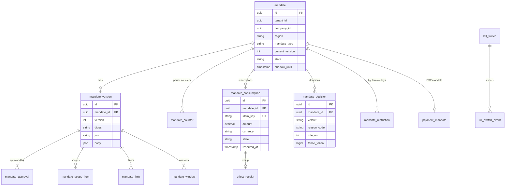
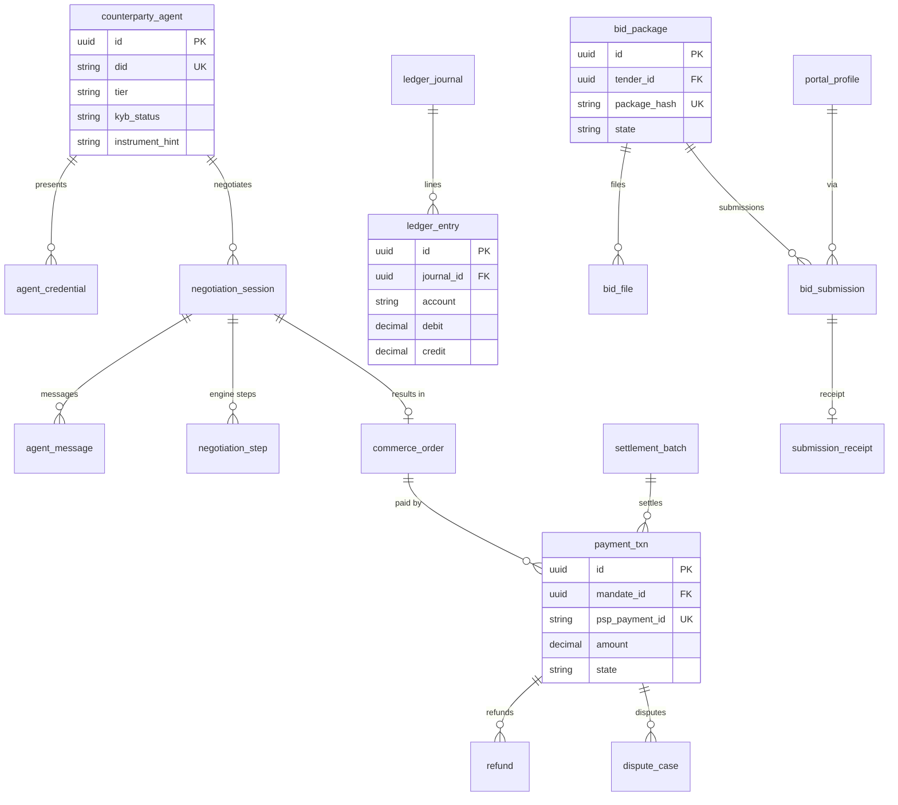

## 11.17.9 Screens, entities, APIs, events and audit trail

### 11.17.9.1 Screens

Group P has no screen range in the V12B allocation; A205–A259 belong to Groups N/O. This part claims **A260–A269** provisionally [ASSUMPTION-1040] (the strings `SM-SIT-A260…` in Part 3.5a are SIT test IDs, not screens). Patterns follow Part 2.5 (LP-LIST, LP-DETAIL, LP-QUEUE, LP-WIZARD, LP-MONITOR, LP-DASH); all screens meet WCAG 2.2 AA (Part 2.5 §2.46), including keyboard-only approval, visible focus, no time-limited approval without warning, status messages announced (`aria-live`), and money read with currency by screen readers.

| ID | Screen | Pattern | Key content | Actions | Roles | Gates and states |
|---|---|---|---|---|---|---|
| A260 | Mandate register | LP-LIST + LP-DETAIL | Mandates by type, state, owner, remaining headroom bars (per action, aggregate, count), expiry countdown, jurisdictions with pack state, shadow badge | Open, Revoke, Tighten, Export evidence | R01–R03, R05–R12, R15 (read) | Uniform 404 out of scope; Revoke = step-up |
| A261 | Mandate builder | LP-WIZARD | Steps: type → workflows/actions → scope (counterparties, offerings, channels, jurisdictions, data classes) → limits → windows → simulation → review; AG-200 panel; plain-language summary | Draft with assistant, Simulate, Submit | Requesters per type | Submit disabled until simulation run; errors inline with field IDs |
| A262 | Mandate approval | LP-QUEUE + LP-DETAIL | Full mandate in plain language; diff vs previous version; worst-case exposure; digest prefix; approver 1 decision (for approver 2); conflict-of-interest notice | Approve (step-up), Reject (reason code + text) | Eligible approvers | Requester cannot see Approve; notification deep-link only opens this screen (MC-23) |
| A263 | Mandate monitor and anomalies | LP-MONITOR + LP-DASH | Live decisions stream (verdict, reason code), ledger, reconciliation breaks, anomaly alerts with AG-201 explanation, KPI-P tiles | Disposition alert, Suspend, Request resume, Export evidence | Owners, R08/R09, R10, R01 | Resume requires two people |
| A264 | Kill switch console (extends Part 7.3 §7.6.11) | LP-DETAIL | Scopes incl. mandate, counterparty, portal, payment method, PSP account; propagation status per worker pool; last drill result | Engage (one person), Request release (two people) | R01, R10, R11 (own tenant), platform on-call | Engage confirmation states scope and blast radius |
| A265 | Counterparty agent registry | LP-LIST + LP-DETAIL | DID, tier T0–T3, VCs and status, KYB evidence, instrument (masked), screening result, re-verification due, message history | Onboard, Upgrade tier (human), Downgrade, Block | R03, R07, R08, R10 | Instrument change → AR-06 hold banner |
| A266 | Commerce negotiation desk (within A172) | LP-QUEUE + LP-DETAIL | Sessions, messages (signed, untrusted badge), engine steps with bounds (floor hidden from non-approvers), escalations, forbidden terms | Approve counter (L2), Decline, Take over | R03, R07, R10 | Numbers read-only; any human-entered price passes AU-089 |
| A267 | Payments, settlements, refunds and disputes | LP-LIST + LP-DETAIL | Payment mandates (scheme, ref, max, status), transactions, settlement batches, journals, refunds, dispute cases with deadlines | Initiate refund (L2), Respond to dispute, Mark reconciled (maker-checker) | R08, R09, R07 (read) | BRL-APR-07 maker ≠ checker |
| A268 | Bid submission console (extends A104) | LP-DETAIL | Package manifest and hash, file list with hashes, MT-BID mandate, mode (AUTO/ASSISTED/MANUAL) and why, deadline guard timeline, assisted-session launcher, receipt and verification, evidence | Seal, Request mandate, Start assisted session, Record manual evidence | R06, R02, R10 | Deadline countdown in UTC and portal local (FR-DM-02) |
| A269 | Portal capability registry | LP-LIST + LP-DETAIL | Portal profiles, capability value, counsel review record and expiry, adapter version, signing rule, CAPTCHA/automation notes | Propose change (Legal approves), Retire | R10, R11, R06 (read) | Capability change = two-person (R10 + R11) |

### 11.17.9.2 Entities

| Table | Key columns (beyond tenant_id, company_id, created_at, created_by) | RLS | Retention | Notes |
|---|---|---|---|---|
| `mandate` | id, region, mandate_type, effect_class, autonomy_level, current_version, state, shadow_until, owner_id | tenant + company (`app_rw`, DEC-778) | 8 y (money/bid), 3 y others | State changes only via service methods |
| `mandate_version` | mandate_id, version, body jsonb, digest char(64), jws text, policy_version, rule_pack_versions jsonb | same | same | Immutable (trigger blocks UPDATE) |
| `mandate_approval` | version_id, approver_id, role, decision, reason_code, mfa_at, signed_at | same | same | Unique (version_id, approver_id) |
| `mandate_scope_item` / `mandate_limit` / `mandate_window` | normalised projections of the body for indexing | same | same | Derived; body is source of truth |
| `mandate_restriction` | mandate_id, kind, value jsonb, effective_at, by | same | same | Tighten-only (check constraint by kind) |
| `mandate_counter` | mandate_id, period_key, committed_amount, reserved_amount, committed_count, reserved_count, version (optimistic) | same | 8 y | Row-locked at reserve |
| `mandate_consumption` | mandate_id, idem_key UNIQUE, amount, currency, state, reserved_at, committed_at, receipt_id, fence_token | same | 8 y | Append-only states via new rows for reversals |
| `mandate_decision` | mandate_id (nullable for L1/L2), run_id, step_id, level, verdict, reason_code, rule_no, inputs_hash, fence_token | same | 2 y hot / 8 y cold (R3) | Partitioned monthly |
| `kill_switch`, `kill_switch_event` | scope_type, scope_id, engaged, engaged_by, released_by[2], reason | tenant (platform scopes in ops schema) | 8 y | |
| `effect_receipt` | adapter, provider_ref, status, observed_at, payload_hash, s3_key | same | as mandate | |
| `counterparty_agent`, `agent_credential` | did, tier, kyb_status, registration_ids, instrument_hint (masked), screening_at; credential: issuer_did, type, status_list_ref, expires_at, vc_hash | same | 8 y after last transaction | No raw VC PII beyond needed fields |
| `agent_message` | session_id, envelope_id UNIQUE, direction, type, body_hash, s3_key, verified, injection_flag | same | 8 y | Body stored as evidence (encrypted) |
| `negotiation_session`, `negotiation_step` | counterparty_id, mandate_id, state, round, engine_inputs jsonb, engine_outputs jsonb | same | 8 y | |
| `commerce_order` | session_id, order_ref, lines jsonb, total, currency, state, signed_confirmation_hash | same | 8 y | Feeds OrganicSpec dual ledgers |
| `payment_mandate` | mandate_id, psp, scheme, psp_ref, max_amount, frequency, status | same | 8 y | References only (BRL-FIN-07) |
| `payment_txn`, `refund`, `dispute_case`, `settlement_batch` | psp_payment_id UNIQUE (dedup BRL-FIN-02), amount, fee, tax, state, deadlines | same | 8 y | |
| `ledger_journal`, `ledger_entry` | journal_id (= source idem key), account, debit, credit, mandate_id, reservation_id | same | 8 y | Deferred constraint Σdebit = Σcredit |
| `bid_package`, `bid_file` | tender_id, manifest jsonb, package_hash UNIQUE, file sha256, s3_key (object lock) | same | Tender record retention (≥ 8 y; verify GFR/portal rules) | |
| `bid_submission`, `submission_receipt` | package_id, mandate_id, portal_profile_id, mode, idem_key, state, portal_bid_ref, verified | same | same | |
| `portal_profile` | portal_family, jurisdiction, capability, review_by, review_expires_at, adapter_version, signing_rule | platform catalogue (read to tenants) + tenant account binding | — | Capability change two-person |
| `anomaly_alert`, `recon_run`, `recon_break` | rule_id, mandate_id, refs jsonb, disposition | same | 3 y / 8 y | |

### 11.17.9.3 APIs (Admin BFF, `/api/v2/…`, OpenAPI 3.1, DEC-778 role)

| Method | Path | Purpose | Roles | Idempotency | Errors (beyond 401/403/U404) |
|---|---|---|---|---|---|
| POST | `/mandates` | Create draft | requester roles | `Idempotency-Key` | 422 schema |
| PATCH | `/mandates/{id}` | Edit draft (new version if pending: approvals void) | requester | ETag | 409 state |
| POST | `/mandates/{id}/simulate` | Run simulation | requester | — | 422 |
| POST | `/mandates/{id}/submit` | Freeze digest; route approvals | requester | key | 409; 422 ineligible |
| POST | `/mandates/{id}/approvals` | Approve/reject `{digest, decision, reason}` | eligible approvers | key | 409 `DIGEST_MISMATCH`, 403 `SOD_VIOLATION`, 401 `STEP_UP_REQUIRED` |
| POST | `/mandates/{id}/restrictions` | Tighten overlay | owner, R10, R01 | key | 422 `NOT_TIGHTENING` |
| POST | `/mandates/{id}/suspend` / `/resume` | Suspend (one) / resume (two-person request) | owner, R10, R01 | key | 409 |
| POST | `/mandates/{id}/revoke` | Revoke with reason code | per §11.17.5.13 | key | 409 already terminal |
| GET | `/mandates`, `/mandates/{id}`, `/mandates/{id}/versions/{v}` | Read | scoped | — | — |
| GET | `/mandates/{id}/decisions`, `/ledger`, `/alerts` | Monitor | scoped | — | — |
| POST | `/mandates/{id}/evidence-packs` | Export (async) | owner, R10, R15 | key | — |
| POST | `/internal/mandates/decide` | PDP decision for an intent (service identity R19 only) | R19 | intent idem key | — (verdict in body) |
| POST | `/kill-switches` / `/kill-switches/{id}/release-requests` | Engage / request release | per §11.17.5.13 | key | — |
| GET/POST | `/commerce/counterparties`, `/commerce/counterparties/{id}/tier` | Registry, tier changes | R03, R07, R10 | key | 409 tier rule |
| POST | `/agent-gateway/{protocol}/inbound` | Counterparty message intake (public, mTLS optional, JWS mandatory) | external agents | envelope_id | 400 `ENVELOPE_INVALID`, 401 `SIGNATURE_INVALID`, 409 `REPLAY` |
| GET | `/.well-known/did.json`, `/.well-known/jwks.json`, `/agent/catalog` | DID document, keys, published catalog | public | — | — |
| GET/POST | `/commerce/sessions`, `/commerce/sessions/{id}/escalations/{eid}/decision` | Negotiation desk | R03, R07, R10 | key | — |
| GET/POST | `/payments/mandates`, `/payments/transactions`, `/payments/refunds`, `/payments/disputes/{id}/responses` | Payments | R07, R08, R09 | key | 409 maker-checker |
| POST | `/webhooks/psp/{psp}` | PSP webhooks | PSP | event ID dedup | 400 signature |
| POST | `/bids/{id}/packages` / `/packages/{pid}/seal` | Package and seal | R06 | key | 422 gate |
| POST | `/bids/{id}/submissions` | Request submission (mode decided server-side) | R06 (request); executor R19 | key | 409 `DEADLINE_GUARD`, 409 `HASH_MISMATCH` |
| POST | `/bids/{id}/submissions/{sid}/manual-evidence` | Record human submission evidence | R06 | key | 422 |
| GET/POST | `/portals`, `/portals/{id}/capability-changes` | Registry | R10, R11 | key | — |

### 11.17.9.4 Events (outbox, CloudEvents envelope)

| Event | Producer | Consumers | Payload keys |
|---|---|---|---|
| `mandate.drafted` / `.simulated` / `.submitted` | MND | A106, audit | mandate_id, version |
| `mandate.approved_1` / `.approved` / `.rejected` / `.approvals_voided` | AU-261 | A106, AU-262, audit | digest, approver |
| `mandate.activated` / `.suspended` / `.resumed` / `.exhausted` / `.expired` / `.revoked` / `.closed` | AU-262/266/267/268 | PDP cache, AU-266, A263 | reason_code |
| `mandate.decision` | AU-264 | AU-267, A263, audit | verdict, reason_code, rule_no, fence |
| `mandate.consumption.reserved` / `.committed` / `.released` / `.held` | AU-263 | AU-268, AU-277 | amount, idem_key |
| `mandate.anomaly.raised` / `.dispositioned` | AU-267 | AG-201, owners | rule_id |
| `killswitch.engaged` / `.release_requested` / `.released` | AU-265 | all workers, A264 | scope |
| `agent.message.received` / `.verified` / `.rejected` | Gateway, AU-269 | AG-202 | envelope_id, reason |
| `negotiation.step.computed` / `.escalated` / `.accepted` | AU-271 | AG-203, A266 | session, round |
| `commerce.order.confirmed` | MND/commerce | AU-277, AU-273 | order_ref |
| `payment.intent.created` / `.captured` / `.failed` / `.reconciling` / `.settled` / `refund.completed` / `dispute.opened` / `.closed` | AU-273/274/275/276 | AU-277, A267 | psp_payment_id |
| `bid.package.sealed` / `bid.submission.requested` / `.submitted` / `.reconciling` / `.failed` / `.manual_recorded` | AU-278/279 | A268, AU-034, audit | package_hash, portal_ref |
| `recon.break.opened` / `.resolved` | AU-268/274 | AG-209, Finance | break_id |

### 11.17.9.5 Audit trail

Every event above is written to the tenant audit log with actor (user, R19 service, or R20 agent run), correlation ID, mandate ID and version, decision ID and reason code; the log is hash-chained per tenant with a daily KMS-signed anchor (Part 4.1 §4.5.4). Security events (Part 4.1 §4.10.1) are added: `SEC-MND-01` digest/JWS mismatch; `SEC-MND-02` stale fence token at adapter; `SEC-MND-03` SoD violation attempt; `SEC-MND-04` approval from unrecognised device; `SEC-AGT-01` invalid counterparty signature; `SEC-AGT-02` replayed nonce; `SEC-PAY-01` webhook signature failure; `SEC-PAY-02` unknown PSP payment ID; `SEC-BID-01` uploaded file hash ≠ sealed hash. Auditor role R15 can read all mandate evidence and export packs.

## 11.17.10 Threat model (STRIDE) and abuse cases

Method: Part 4.1 §4.2.1 (impact × likelihood; mitigations mapped to controls and tests). New trust boundaries: **TB-P1** counterparty agent ↔ agent gateway; **TB-P2** mandate engine/PDP ↔ adapters (PSP, portal); **TB-P3** approver devices ↔ approval API; **TB-P4** PSP/portal ↔ webhook/receipt ingestion.

| ID | TB | STRIDE | Threat | Impact | Likelihood | Mitigation (controls) | Residual | Test |
|---|---|---|---|---|---|---|---|---|
| THR-V12-P-01 | P1 | S | Counterparty impersonates a trusted business agent | H | M | DID + VC from trusted issuer; KYB tiers; JWS; status list (AU-269/270; FC-01) | L | Model C VC; TC-V12-P-767 |
| THR-V12-P-02 | P1 | T | Message altered in transit | H | L | JWS over canonical body; TLS 1.2+ | L | TC-V12-P-767 |
| THR-V12-P-03 | P1 | R | Counterparty denies having accepted an order | M | M | Signed acceptance stored; signed confirmation returned; framework agreement attribution clause [GAP-1046] | L | TC-V12-P-773 |
| THR-V12-P-04 | P1 | I | Our floor/ceiling or mandate limits leak to counterparty | H | M | Selective-disclosure mandate VC; AG-203 floor-leak validator; engine numbers only | L | TC-AI-AG203-004 |
| THR-V12-P-05 | P1 | D | Message flood exhausts AI budget | M | M | Rate limit per DID; tier T1 cannot trigger Sonnet beyond quota; budget reservation (BRL-AI-08) | L | TC-V12-P-782 |
| THR-V12-P-06 | P1 | E | **Prompt injection** asks our agent to exceed the mandate or change bank details | H | H | Reader step without tools; numbers from AU-271; PDP caps; AR-06/AR-09; CTRL-AI-08 | L | TC-AI-AG202-004…006 |
| THR-V12-P-07 | P1 | S | Replay of an old acceptance | H | M | Nonce store, exp ≤ 5 min, envelope_id unique | L | TC-V12-P-767 |
| THR-V12-P-08 | P2 | T | Worker forges an ALLOW decision or skips the PDP | H | L | Adapter gateway requires a valid decision ID + fence token minted by AU-264; adapters callable only by the executor service identity | L | TC-V12-P-731 |
| THR-V12-P-09 | P2 | T | Race: dispatch after revocation | H | M | Fence tokens; gateway rejects stale; reservation check inside lock | L | Model K; TC-V12-P-730 |
| THR-V12-P-10 | P2 | T | Concurrent reservations overspend aggregate cap | H | M | Row lock on counter; serialisable section; concurrency test | L | TC-V12-P-726 |
| THR-V12-P-11 | P2 | R | Effect occurred but no record (lost response) | H | M | Unknown → Reconciling; query by idempotency key; RC-P-01/02 | L | Model C PSP=Timeout |
| THR-V12-P-12 | P2 | D | PSP or portal outage near a deadline | H | M | Planned submit T−48 h; assisted fallback; circuit breaker; escalation ladder | M | TC-V12-P-797 |
| THR-V12-P-13 | P2 | E | Browser-automation worker credentials reused for other actions | H | L | Isolated pool; per-company portal account; secrets fetched per submission; egress allowlist to portal host | L | TC-V12-P-810 |
| THR-V12-P-14 | P3 | S | Stolen approver session approves a mandate | H | M | Step-up MFA ≤ 5 min; WebAuthn; new-device notice; two distinct approvers | L | TC-V12-P-721 |
| THR-V12-P-15 | P3 | E | Requester approves own mandate via a second account | H | M | IdP subject uniqueness; HR identity link; SoD on person, not account; CoI rule | L | TC-V12-P-718 |
| THR-V12-P-16 | P3 | T | Approver sees one mandate, approves another (UI swap) | H | L | Approval API requires the digest displayed; server compares | L | TC-V12-P-723 |
| THR-V12-P-17 | P3 | R | Approver denies approving | M | L | Signed approval with MFA timestamp; hash chain | L | TC-V12-P-717 |
| THR-V12-P-18 | P4 | S | Forged PSP webhook marks a payment captured | H | M | Webhook signature; IP allowlist where offered; reconcile against PSP API before ledger commit for amounts ≥ threshold | L | TC-V12-P-777 |
| THR-V12-P-19 | P4 | T | Forged portal receipt | H | L | Receipt fetched by adapter from portal session, not from e-mail alone; fields verified vs package; status query | L | TC-V12-P-808 |
| THR-V12-P-20 | P2 | I | PSP tokens or mandate refs leak | M | L | Field encryption (Part 4.5.3); references only | L | SAST |
| THR-V12-P-21 | P2 | T | Mandate row tampered in DB by a privileged operator | H | L | Digest + JWS verification at dispatch; `service_role` break-glass only (DEC-778) | L | TC-V12-P-723 |
| THR-V12-P-22 | P1 | E | Counterparty swaps payee instrument (BEC) | H | M | AR-06 suspend; call-back; T3 re-verification | L | TC-V12-P-783 |
| THR-V12-P-23 | P2 | D | Anomaly engine down silently | M | L | Heartbeat; money mandates suspend after 15 min without heartbeat | L | TC-V12-P-750 |
| THR-V12-P-24 | P2 | E | L4 orchestrator creates new effect types | H | L | Plan graph allowlist; mandate action list; PDP rule 10 | L | TC-V12-P-755 |
| THR-V12-P-25 | P2 | T | Package changed after approval (file swapped in S3) | H | L | Object lock; sealed hash recomputed before submit; SEC-BID-01 | L | TC-V12-P-806 |
| THR-V12-P-26 | P2 | I | EU tenant mandate processed in IN region | H | L | Region router; PSP account per region; residency test | L | TC-V12-P-753 |
| THR-V12-P-27 | P2 | E | Jurisdiction pack in Draft treated as Approved | H | L | AU-128 only Approved; CJ-R19/R20 | L | Model M JUR |
| THR-V12-P-28 | P1 | I | Model output exfiltrates data via counterparty message | M | L | Output URL allowlist; no free-text from internal docs in replies (CTRL-AI-05) | L | TC-AI-AG203-005 |
| THR-V12-P-29 | P2 | T | Clock manipulation to pass deadline or window | H | L | NTP with skew alarm; server time only; skew > 1 s closes automated path | L | TC-V12-P-799 |
| THR-V12-P-30 | P2 | D | Chargeback storm | M | L | AR-08; T0 on chargeback; mandate suspend ≥ 2/30 d | L | TC-V12-P-779 |

**Abuse cases (misuse by authorized insiders or partners).**

| ID | Abuse case | Actor | Expected system behaviour | Test |
|---|---|---|---|---|
| ABU-P-01 | Splitting a large purchase into many just-under-cap payments | Requester colluding with supplier | AR-04 routes to L2; weekly owner review | TC-V12-P-746 |
| ABU-P-02 | Adding a friend's company as counterparty in a mandate amendment | Requester | New version needs two approvers; CoI flag; T2 KYB required | TC-V12-P-718 |
| ABU-P-03 | Approver rubber-stamps without reading | Approver | Worst-case exposure shown; minimum review time 30 s before Approve enabled; sampling audit by R15 | TC-V12-P-762 |
| ABU-P-04 | Engaging kill switch to sabotage a competitor bid of a sibling startup | Insider | Kill switch scoped by tenant/company; reason code; audit; release two-person | Model K |
| ABU-P-05 | Using MT-OUT mandate to send first-touch cold outreach at scale | Marketer | First touch stays L2 unless pack allows; caps; consent | TC-V12-P-752 |
| ABU-P-06 | Re-using an MT-BID for a different tender | Bid manager | Mandate binds tender and hash; DENY | TC-V12-P-793 |
| ABU-P-07 | Submitting a late revision outside the guard | Bid manager | Automated path closed; human manual only with evidence | TC-V12-P-796 |
| ABU-P-08 | Counterparty agent probing floor by many small RFQs | External | Rate limit; AR-10 price drift; tier downgrade | TC-V12-P-784 |
| ABU-P-09 | Refund to a different instrument | Insider | Original instrument only; L2 otherwise | TC-V12-P-778 |
| ABU-P-10 | Approver delegating to the requester | Approver | TPA-07 blocks | TC-V12-P-719 |
| ABU-P-11 | Operator edits mandate row directly | Platform staff | Integrity failure, SEV2 | TC-V12-P-723 |
| ABU-P-12 | Tenant admin loosens company ceiling alone | R12 | BRL-APR-11: two-person | TC-V12-P-732 |
| ABU-P-13 | Using a payment mandate after contract termination | Requester | RV-08 revoke; anomaly on dormant mandate reactivation | TC-V12-P-733 |
| ABU-P-14 | Social-engineering Finance to resume a suspended mandate | External | Two-person resume with cause evidence | TC-V12-P-734 |
| ABU-P-15 | Marking a reconciliation break resolved without evidence | Finance maker | Checker ≠ maker; evidence required | TC-V12-P-744 |
| ABU-P-16 | Disabling anomaly rules via configuration | R11 | Rules release-controlled; thresholds tighten-only per tenant | TC-V12-P-749 |
| ABU-P-17 | Using L4 plan to chain mandates beyond their purpose | R11 | Plan bound to explicit mandate IDs; purpose check | TC-V12-P-755 |
| ABU-P-18 | Counterparty claiming a mandate VC with higher limits than ours | External | Our limits from our DB, never from their message | TC-AI-AG202-004 |
| ABU-P-19 | Approving from a shared device in a public place | Approver | WebAuthn; new-device notice; session limits | TC-V12-P-721 |
| ABU-P-20 | Disputing legitimate charges repeatedly (friendly fraud) | Buyer | Evidence packs; T0 after chargeback; KPI-P-10 | TC-V12-P-779 |
