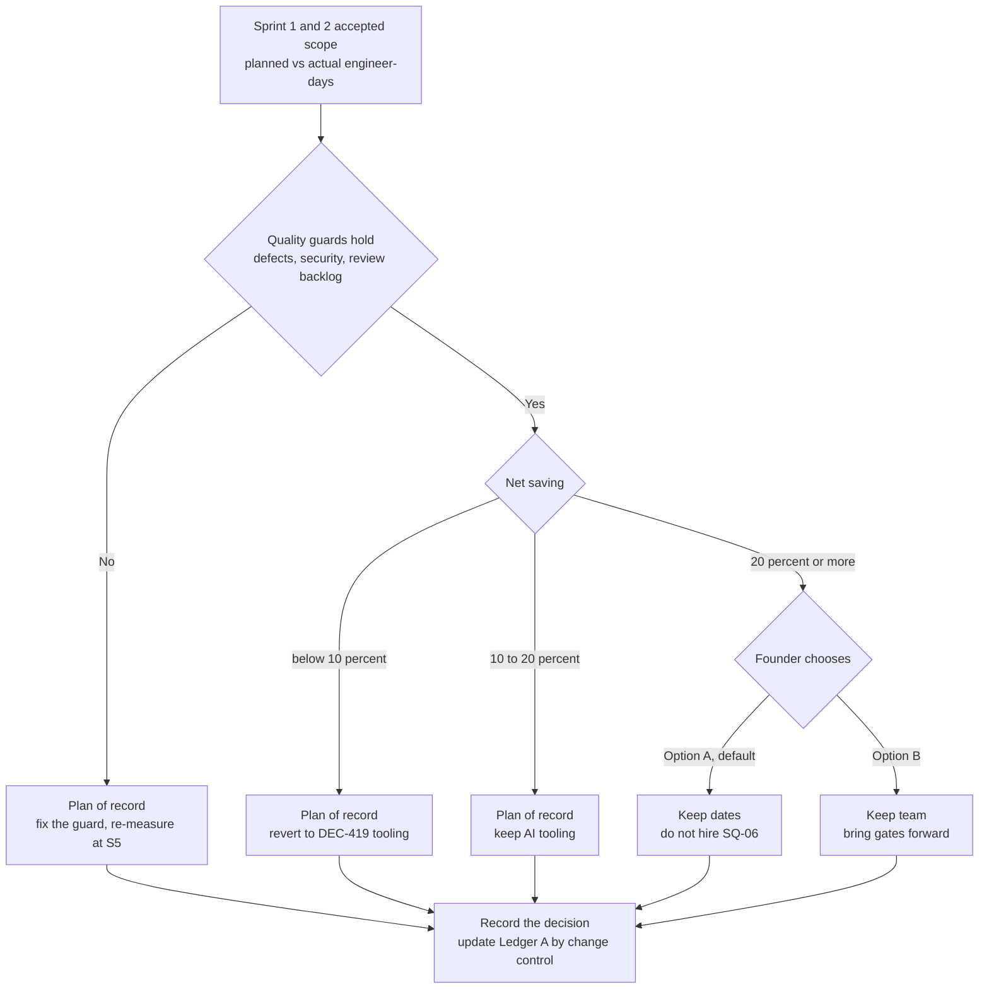
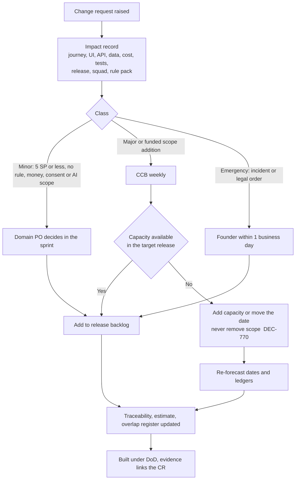

# AI Growth Engine: Employee Sales & Marketing Automation
## Application Blueprint: PART 11 (Batch 11.20b), Master Implementation Plan V12: Sprints, Team Scaling, Budgets, Risks, RAID, Governance and Change Control

| Field | Value |
|---|---|
| Document | Part 11, Batch 11.20b of 11.20a–11.20b (Group P5, letter S). Holds §11.20.7–§11.20.17: cadence and capacity, Sprints 0–2 in detail, the sprint-by-sprint plan S0–S45, team scaling and hiring, DEC-420 calibration, UAT and RACI, development and running budgets by release and by year, risk register, RAID log, governance cadence, change control, decisions, ADRs, persona review, tags and the quality gate |
| Version | 1.0 · 28 Nov 2026 |
| Baseline | Part 11.20a (roll-up, releases, gates, calendar); Part 8.1 §8.1.4–§8.1.7 and Part 8.2 §8.2.1, §8.2.2.4, §8.2.7 (templates); Part 8.4 (ledgers, rates); Part 9.5 §9.5.2.5–§9.5.2.9; Part 9.10 §9.10.10 (DEC-416…422); Part 11.14 (DEC-770…791) |
| Roles applied | Programme Director, SAFe Release Train Engineer, Principal Architect, FinOps and budgeting lead, Risk manager |
| Model | `assembly/v12b/s_master_plan.py` (scheduler and cost model) and `assembly/v12b/s_fragments.py` (tables); every computed table below is generated, not typed |

---

## 11.20.7 Sprint plans

### 11.20.7.1 Cadence, ceremonies and working agreements

The programme runs as one agile release train (ART) with up to eleven squads. Part 8.1 §8.1.4.1 ceremonies stay for each squad; the train adds the SAFe events below (DEC-905).

| Ceremony | When (IST) | Length | Participants | Output |
|---|---|---|---|---|
| Squad sprint planning | Monday of sprint week 1, 10:30 | 2 h | Squad, domain PO | Sprint goal, committed stories (DoR met), capacity sheet |
| Squad stand-up | Every working day, 10:00 | 15 min | Squad | Blockers; on-call handover Monday |
| Scrum of scrums | Tuesday and Thursday, 11:00 | 30 min | Squad tech leads, RTE, Principal Architect | Cross-squad dependencies, integration risks |
| PO sync | Wednesday, 15:00 | 45 min | Domain POs, Founder (chief PO), RTE | Backlog order across squads; scope-to-release mapping |
| Backlog refinement | Wednesday of week 1, 16:00 | 1.5 h per squad | PO, tech lead, QA, UX when needed | Next sprint meets DoR |
| System demo (train) | Friday of week 2, 14:00 | 1.5 h | All squads, POs, startup heads, Founder | Integrated increment on staging; PO acceptance |
| Squad retrospective | Friday of week 2, 16:00 | 45 min | Squad | Two improvement actions |
| PI planning | IP sprint, two days (dates §11.20.7.7) | 2 × 6 h | Whole train, Founder, business owners, counsel liaison | PI objectives per squad, programme board, risks ROAMed |
| Inspect and adapt | Last day of each PI | 3 h | Whole train | PI metrics, problem-solving workshop, backlog items |
| Change control board | Thursday, 16:00 weekly | 45 min | Founder/PO, RTE, Principal Architect, QA lead, Finance, DPO as needed | CR decisions (§11.20.13) |
| Release gate review | Gate day (Part 11.20a §11.20.5) | 1–2 h | Gate votes and advisers | Gate decision in A090 |

**Working agreements (unchanged from Part 8.1 plus DEC-420).** WIP ≤ 2 stories per engineer; DoR and dependencies met before a story enters a sprint; every change is a human-reviewed pull request; agents cannot merge or deploy; agent sandboxes hold synthetic data only; SAST, licence, secret scans and the provenance log gate every merge; auth, RLS, PDP, money, mandates, residency and AI guardrail code needs a second human reviewer from the owning squad and the security engineer; no story is Done without its evidence record.

### 11.20.7.2 Capacity method [ASSUMPTION-1101] [ASSUMPTION-1102]

```text
capacity_pd(squad, sprint) = Σ new-FTE ramp × FTE × 7.53 pd × (working days ÷ 10) × 0.95 leave
                             × coordination (1.00 ≤ 4 squads; 0.95 ≤ 7; 0.92 above)
                             × 0.5 in IP sprints × (1 − sustain reserve)
7.53 pd per FTE per sprint     = 33.9 pd ÷ 4.5 FTE (Part 9.5 §9.5.2.5, measured basis of the plan of record)
new-FTE ramp                   = 0.5 in its first sprint, 0.85 in its second, 1.0 after (Part 9.5: 15% onboarding loss)
team-of-record ramp            = 0.7 in S0 and S1 (Part 8.1, ASSUMPTION-157)
sustain reserve                = 10% of active capacity after the R1 gate; 15% after the R2-A gate (production support, defects)
capacity_SP                    = capacity_pd ÷ 0.7  (1 SP ≈ 0.7 pd, Part 8.1 §8.1.6.1)
commitment rule                = committed SP ≤ capacity_SP × 1.03; no stretch goals in S0–S2
calibration                    = the 7.53 value is re-baselined at the S2 review (DEC-420) and every PI on the 3-sprint rolling average
```

### 11.20.7.3 Sprint 0 (Mon 7 Dec – Fri 18 Dec 2026; Day 1–12)

**Sprint goal.** Every later story can rely on IaC environments, a recorded identity decision including per-tenant SAML/OIDC brokering (check 13), CI quality and security gates, RLS enforced through the least-privilege `app_rw` role with the Data API off (DEC-778), the outbox, an append-only audit log, default-OFF flags and a deny-by-default PDP.

**Capacity.** SQ-01 4.5 FTE × 7.53 × 1.0 × 0.95 × 0.7 ramp = **22.5 pd ≈ 32 SP**. **Committed: 32.0 SP** (100%).

| Story | Title | Epic | Type | Priority | Points | SP mid | Owner (role) | Dependencies |
|---|---|---|---|---|---|---|---|---|
| US-0101 | Identity compatibility spike, 12 checks + check 13 (tenant SAML/OIDC through the broker for Okta, Entra ID, Google) | EP-01 | Spike | Must | 3–6 | 4.5 | Founder/CTO + BE | DP-01, DP-15, DP-V12-S-06 |
| US-0102 | AWS, Supabase and Vercel IaC baseline for dev, test, staging and prod | EP-01 | Enabler | Must | 3–5 | 4.0 | DevOps | DP-02 |
| US-0103 | CI pipeline with quality, security and policy gates | EP-01 | Enabler | Must | 2–3 | 2.5 | DevOps + QA | US-0102 |
| US-0107 + US-01-ZR26 | RLS framework through the `app_rw` role with per-transaction `app.tenant_id` / `app.company_ids`; CI assertion that no runtime path uses `service_role` | EP-01 | Enabler (Security) | Must | 4–7 | 5.5 | BE | US-0102 |
| US-01-ZR27 (part) | Data API disabled for application schemas; break-glass path for migrations only | EP-01 | Security | Must | 1 | 1.0 | DevOps | US-0102 |
| US-0110 | Transactional outbox, idempotent consumers, retry policy | EP-01 | Enabler | Must | 3–5 | 4.0 | BE | US-0107 |
| US-0111 | Append-only audit log and job activity | EP-01 | Feature | Must | 2–3 | 2.5 | BE | US-0110 |
| US-0113 | Synthetic seed data sets (two tenants, 26 startups, sensitive fixtures; IN and EU residency fixtures) | EP-01 | Enabler (Data) | Must | 2–3 | 2.5 | QA + BE | US-0107 |
| US-0117 | Feature-flag framework with default-OFF governance | EP-01 | Enabler | Must | 1–2 | 1.5 | FS | US-0102 |
| US-0303 | PDP skeleton (plan-time and dispatch-time) | EP-03 | Enabler | Must | 3–5 | 4.0 | BE | US-0107, US-0110 |

**Non-story work in Sprint 0 (outside velocity).**

| Task | Owner | Due | Link |
|---|---|---|---|
| Sign two staff-augmentation framework agreements; open requisitions for waves 1–2 (SQ-02 completion, SQ-03, SQ-04) | Programme Director | Day 15 | DP-V12-S-01; RECOMMENDATION-1111 |
| Appoint counsel panel (India first); send the 11 marketing packs (Part 11.15) for review | Growth/compliance lead | Day 30 | DP-V12-S-02; RECOMMENDATION-1113 |
| Open procurement track of Part 8.1 (SES, Anthropic terms, WABA, OAuth) plus IdP developer tenants, CRM developer orgs, DLT registrations | DevOps; IAM lead | Day 10 | DP-V12-S-06, S-07 |
| Record planned engineer-days per accepted story for the DEC-420 calibration | RTE | Every story from Day 1 | DEC-420 |
| Programme Director and RTE hired or contracted | Founder | Day 15 / Day 43 | §11.20.8.5 |

**Demo script (Fri 18 Dec) and acceptance.** (1) IaC plan applies to four environments with no drift. (2) A query through `app_rw` without `app.tenant_id` returns zero rows; a cross-tenant read is denied (two-tenant fixture). (3) The Data API returns 404 for application schemas; CI fails a branch that references `service_role` in runtime code. (4) Outbox delivers once under replay. (5) PDP denies by default. **Acceptance:** PO accepts each story with its evidence record; check 13 result recorded with ADR-255 fallback decision if it fails.

### 11.20.7.4 Sprint 1 (Mon 21 Dec 2026 – Fri 1 Jan 2027; Day 15–26)

**Sprint goal.** W0-B control set: BFF sign-in, secret references only, consent and suppression, model gateway with hard cost cap, point-in-time recovery switched on with its recovery path, and the catalogue core.

**Capacity.** 4.5 FTE × 7.53 × 0.8 × 0.95 × 0.7 = **18.0 pd ≈ 26 SP**. **Committed: 25.5 SP** (98%).

| Story | Title | Epic | Type | Priority | Points | SP mid | Owner (role) | Dependencies |
|---|---|---|---|---|---|---|---|---|
| US-0104 | Admin sign-in through the BFF | EP-01 | Feature (Security) | Must | 3–5 | 4.0 | FS + FE | US-0101 checks 1–3, 7, 12 |
| US-0112 | Integration registry with secret references | EP-01 | Feature (Security) | Must | 3–5 | 4.0 | BE + DevOps | US-0102, US-0110 |
| US-0301 | Consent ledger and suppression with immediate cancellation | EP-03 | Feature (Compliance) | Must | 3–5 | 4.0 | BE + FE | US-0107 |
| US-0401 | Model gateway skeleton and internal run API | EP-04 | Enabler | Must | 3–5 | 4.0 | FS (AI lead) | US-0112 |
| US-0404 | Cost reservation, hard caps, 80/100% alerts, emergency pause | EP-04 | Feature | Must | 3–5 | 4.0 | BE | US-0401 |
| US-0201 | Offering and capability editor with readiness lifecycle | EP-02 | Feature | Must | 3–5 | 4.0 | FS + FE | US-0107, US-0111 |
| US-21-ZR18 (part) | PITR enabled; `recovery_path` recorded; WAL archive bucket | EP-21 | Enabler (DR) | Must | 1–2 | 1.5 | DevOps | US-0102 |

**Demo (Thu 31 Dec, moved for the holiday).** BFF cookies only; registry never returns a secret; opt-out cancels queued items within 60 s; gateway rejects invalid output; simulated spend hits 100% and stops; PITR restore point listed. **Gate:** W0-B control set Tue 5 Jan 2027 (Day 30), as in Part 8.1.

### 11.20.7.5 Sprint 2 (Mon 4 Jan – Fri 15 Jan 2027; Day 29–40) and the DEC-420 calibration gate

**Sprint goal.** Complete W0-B: MFA step-up, claims approval, readiness gate, tier routing through the registry, injection guard, source register; place the Command Centre shell; seed the model registry (DEC-788) and the per-zone Vercel projects; **measure the AI-built net saving for the calibration gate.**

**Capacity.** 4.0 FTE × 7.53 × 1.0 × 0.95 = **28.6 pd ≈ 41 SP**. **Committed: 40.5 SP** (99%).

| Story | Title | Epic | Type | Priority | Points | SP mid | Owner (role) | Dependencies |
|---|---|---|---|---|---|---|---|---|
| US-0402 | Evaluation harness and CI regression gate | EP-04 | Enabler | Must | 3–5 | 4.0 | FS (AI lead) + QA | US-0401, US-0103 |
| US-1701 | Command Centre shell, seven-view navigation, scope selector | EP-17 | Feature | Must | 3–5 | 4.0 | FE | US-0104 |
| US-0105 | MFA step-up and session revocation | EP-01 | Security | Must | 2–3 | 2.5 | FS | US-0104 |
| US-0115 | Correlation IDs, structured logs, tracing | EP-01 | Observability | Must | 1–2 | 1.5 | DevOps + BE | US-0110 |
| US-0202 | Claim and price-version approval (hash-bound) | EP-02 | Feature | Must | 3–5 | 4.0 | FS + FE | US-0201, US-0105 |
| US-0205 | Readiness gate | EP-02 | Compliance | Must | 2–3 | 2.5 | FS | US-0202 |
| US-0403 + US-04-ZR22 (part) | Rules-first tier routing through registry-approved rows only | EP-04 | Security | Must | 3–5 | 4.0 | FS (AI lead) | US-0402 |
| US-0406 | Prompt-injection isolation and output guardrails | EP-04 | Security | Must | 2–3 | 2.5 | FS (AI lead) | US-0402 |
| US-0501 | Source permissions registry | EP-05 | Compliance | Must | 3–5 | 4.0 | BE + FE | US-0202 |
| US-0511 | Discovery fetcher sandbox (egress allowlist, SSRF) | EP-05 | Security | Must | 2–3 | 2.5 | DevOps + BE | US-0501 |
| US-04-ZR20 (part) | Model registry DDL, Claude Sonnet primary row (REG-002) with two-person approval | EP-04 | Enabler | Must | 2–3 | 2.5 | FS | US-0402 |
| US-21-ZR16 (part) | Per-zone Vercel projects `web-in`, `admin-in`, `developers`; functions pinned to Mumbai | EP-21 | Enabler | Must | 2–3 | 2.5 | DevOps | US-0102 |
| US-0502 | Research planner with scoped queries and budget | EP-05 | Feature | Must | 3–5 | 4.0 | BE | US-0501, US-0404 |

**Calibration gate (S2 review Fri 15 Jan 2027; decision by Thu 21 Jan 2027, Day 46).** Measured on accepted Sprint 1–2 scope: net saving = 1 − actual ÷ planned engineer-days; defects escaping to SIT ≤ plan + 20%; no unresolved critical or high security finding; review backlog < 2 days. The result selects the hiring path of §11.20.8.6 and is recorded as a new decision (DEC-420 requirement; template DEC-904).

### 11.20.7.6 Sprint-by-sprint plan S0–S45 (central effort; generated)

Columns: *Gross capacity* includes the sustain reserve; *Feature capacity* is after the IP-sprint halving and the sustain reserve; *Committed* is the package effort the scheduler places (pd ÷ 0.7). Package codes: R1-core = baseline Release 1 + CR-ALN-01 Musts; R1-V12 = V12 core platform, AI governance, UX and operations; R1-PD = identity, developer platform, connectors and platform decisions; R2A-cat = catalogue; R2A-ent = enterprise operations; R2B-P = mandates, commerce, payments, bids; R2B-Q = voice. Story allocation inside each package follows the release placement of the source part (for example Part 11.19b §11.19.5.12 for R1-PD, Part 11.16e §11.16.5.16.3 for INV-R1) and is fixed at each PI planning.

{{F_SPRINTS}}

### 11.20.7.7 Programme increment calendar

| PI | Sprints | Dates | PI planning (in the preceding IP sprint) | Main PI objectives |
|---|---|---|---|---|
| PI-0 | S0–S2 | 7 Dec 2026 – 15 Jan 2027 | Sprint 0 planning Mon 7 Dec 2026 | R0 controls; calibration |
| PI-1 | S3–S8 | 18 Jan – 9 Apr 2027 | Thu–Fri 14–15 Jan 2027 | R0 gate; R1 identity, developer platform, connectors; V12 core; W1–W2 |
| PI-2 | S9–S14 | 12 Apr – 2 Jul 2027 | Thu–Fri 8–9 Apr 2027 | R1 build complete and gate; catalogue start; mandate and voice engines start |
| PI-3 | S15–S20 | 5 Jul – 24 Sep 2027 | Wed–Thu 30 Jun – 1 Jul 2027 | Catalogue at full flow; INV boundary; 24×7 set-up; EU stack |
| PI-4 | S21–S26 | 27 Sep – 17 Dec 2027 | Thu–Fri 23–24 Sep 2027 | R2-A gate; R3-a; R4-a; R2-B build; A1 start |
| PI-5 | S27–S32 | 20 Dec 2027 – 10 Mar 2028 | Wed–Thu 15–16 Dec 2027 | R2-B gate; INV-R1, INV-R2; A1 gate; A2 build |
| PI-6 | S33–S38 | 13 Mar – 2 Jun 2028 | Wed–Thu 8–9 Mar 2028 | A2 gate; R3 exit; A3 build |
| PI-7 | S39–S44 | 5 Jun – 25 Aug 2028 | Thu–Fri 1–2 Jun 2028 | A3, A4; ISO 27701/42001; R4 exit (S45) |

### 11.20.7.8 If capacity is short: the no-scope-cut ladder (DEC-770, DEC-912)

| Step | Trigger | Action | Approver |
|---|---|---|---|
| 1 | 3-sprint rolling capacity < 90% of plan for any squad | Rebalance queues across squads at the next PI planning; move non-gating stories within the release | RTE |
| 2 | Release forecast slips ≥ 1 sprint | Add contract FTE to the constrained squad (up to 7 per squad) | Founder via CCB |
| 3 | Slip ≥ 2 sprints or a new release package | Add a squad (≈ ₹8.5 L per month central, §11.20.9.1) | Founder via CCB; change request under DEC-790 |
| 4 | Capacity cannot be bought in time | Move the gate date; re-forecast budgets; inform stakeholders (§11.20.12) | Founder (DEC-770) |
| — | Never | Remove a Must, compliance, security, mandate, residency or rule-pack control from a release | — |

---

## 11.20.8 Team scaling plan

### 11.20.8.1 Delivery model (DEC-420 AI-built squads)

| Element | Rule in this plan |
|---|---|
| Squad | Five engineering FTE in velocity (tech lead, three engineers, one QA automation engineer), stream-aligned to one release package family; SRE and security as enabling teams (ADR-265) |
| AI-built practice | Every squad works with AI models and agents for drafting code, tests, fixtures and documentation under the DEC-420 operating model; humans own architecture, security, PDP, money, mandates, residency and AI guardrails |
| Quality guard | Second human reviewer from the owning squad for protected areas; provenance log per merge; agent sandboxes with synthetic data only |
| Ownership | One owner per capability (overlap register, ADR-268); shared components (PDP, MND, registry, entitlement ledger) have a single owning squad and published contracts |
| Staffing source | SQ-01 employed (team of record); all other squads from two staff-augmentation vendors at contract rates, with knowledge transfer to SQ-01 before release to sustain |
| Sustain | From the end of the build (S42), SQ-01 plus one contract squad (10 FTE) run maintenance and minor enhancements (running line B-S33) alongside the 24×7 rota |

### 11.20.8.2 Squads

{{F_SQUADS}}

### 11.20.8.3 Programme roles outside velocity

{{F_ROLES_PEAK}}

### 11.20.8.4 FTE per phase

{{F_FTE_PHASE}}

**Team peak: 80.25 FTE in Sprint 22 (11–22 Oct 2027)** = 55 engineering FTE in eleven squads + 25.25 programme roles, plus the contracted NOC/SOC first line, counsel and auditors outside the headcount.

### 11.20.8.5 Hiring sequence

Lead times assume staff augmentation (2–6 weeks per profile after the framework agreements) [ASSUMPTION-1109]; each wave is requested one PI ahead.

| Wave | Who | FTE | Start (sprint, date) | Requisition by | Gated by |
|---|---|---|---|---|---|
| 0 | Team of record SQ-01; growth/compliance lead | 4.5 + 0.5 | S0 Mon 7 Dec 2026 | In place | DEC-228/232 |
| 0 | Programme Director | 1.0 | S2 Mon 4 Jan 2027 | Day 1 | DEC-903 |
| 1 | SQ-02 first two contract engineers (DEC-228); RTE; principal architect; first scrum master | 2.0 + 3.0 | S3 Mon 18 Jan 2027 | Day 1 | DEC-228 |
| 2 | SQ-03 identity and developer platform | 5.0 | S4 Mon 1 Feb 2027 | Day 1 | DEC-784/785 (Release 1) |
| 2 | SQ-04 AI platform; domain POs; security engineer; DBRE; UX designer | 5.0 + 4.0 | S4–S5 | Day 15 | DEC-788 |
| **Gate** | **DEC-420 calibration** | — | Decision Thu 21 Jan 2027 | — | Confirms waves 3–6 (§11.20.8.6) |
| 3 | SQ-02 to 5 FTE; SQ-05 catalogue and billing; QA lead | 3.0 + 5.0 + 1.0 | S6–S7 | Day 40 | Calibration result |
| 3 | SQ-06 catalogue services II; second architect; second UX; SRE; technical writer | 5.0 + 4.0 | S9 Mon 12 Apr 2027 | Day 60 | Calibration result (not hired under option A) |
| 4 | SQ-07 autonomy and commerce; SQ-08 voice; compliance analyst; second security engineer; FinOps analyst | 10.0 + 2.5 | S11–S12 | Day 100 | DEC-779…782 |
| 5 | SQ-09 investment; SQ-10 regions and compliance; second compliance analyst; third security engineer; second SRE | 10.0 + 3.0 | S16–S18 | Day 170 | DEC-772…776, DEC-783 |
| 5 | NOC/SOC vendor contract | vendor | S18 | Day 170 | DEC-773 |
| 6 | SQ-11 advanced intelligence (A1 team, ASSUMPTION-700) | 5.0 | S21 Mon 27 Sep 2027 | Day 240 | DEC-417; R2-A gate − 2 sprints |
| Ramp-down | SQ-03, SQ-07, SQ-08, SQ-10 → sustain or release | −20.0 | after S25 (Fri 3 Dec 2027) | — | Queues complete |
| Ramp-down | SQ-02 after S29; SQ-06, SQ-09 after S30; SQ-01, SQ-05 after S40; SQ-04, SQ-11 after S41 | — | Jan–Jul 2028 | — | Queues complete; SQ-01 + one squad stay as sustain |

### 11.20.8.6 DEC-420 calibration gate in the scaling plan



| Outcome | Hiring effect | Dates (model) | People cost ₹ L (central rates) |
|---|---|---|---|
| < 20% or guards fail | Waves 3–6 as planned | Plan of record (R1 Day 208, R2-A Day 334, close Day 642) | 1,607.9 |
| ≥ 20%, option A | SQ-06 not hired; its queue moves to SQ-05 | R1 Day 194; R2-A Day 320; INV-R2 Day 474 (+2 weeks); close Day 628 | 1,424.4 |
| ≥ 20%, option B | All waves | R1 Fri 18 Jun 2027 (Day 194); R2-A Fri 22 Oct 2027 (Day 320); close Fri 25 Aug 2028 (Day 628) | 1,384.0 |

The calibration is repeated at each Inspect-and-Adapt; a later result can only release capacity in the next wave, never remove a control.

### 11.20.8.7 Business UAT participants per release [GAP-1117]

| Release | UAT window (central) | Packs | Participants (persona) | Participant-days high / low |
|---|---|---|---|---|
| R1 | S12–S13 | Part 8.1 W0–W3 packs; SSO/SCIM with two enterprise IT administrators; developer pilot with two integrators; CRM and SMS connector pilots | Part 8.1 §8.1.5.4 participants + R12 IT admins (2), developer partners (2) | 130 / 65 |
| R2-A | S21–S22 | UAT-PK-SC, UAT-PK-FIN, 39 SKU acceptance (Service Owner 0.5 day per SKU), billing and credits | Tenant admins (4), finance maker and checker (2), Service Owner, DPO | 60 / 30 |
| R2-B | S25–S26 | Mandates, payments, bids, voice packs per jurisdiction | Finance (2), bid manager, voice supervisors (2), DPO, counsel (advisory) | 35 / 18 |
| INV-R1 / INV-R2 | S28–S29; S30–S31 | Issuer admin, R21, R10C, counsel UAT per jurisdiction | Issuer admins (2), compliance (2), counsel | 30 / 15 |
| R3-a / R4-a | S24; S26 | EU tenant pilot; one market pilot per region | EU tenant admins (2), market leads (4) | 24 / 12 |
| A1–A4 | Each A build end | Agent evaluation packs | Startup heads, growth managers | 40 / 20 |
| **Total** | | | | **319 / 160** |

### 11.20.8.8 RACI across the train

R = responsible, A = accountable (one per row), C = consulted, I = informed.

| Activity | Founder/PO | Programme Director | RTE | Principal Architect | Domain POs | Squad tech leads | QA lead | Security lead | SRE lead | Legal/DPO and counsel | Finance/FinOps |
|---|---|---|---|---|---|---|---|---|---|---|---|
| Release scope and gate decision | A | R | C | C | R | C | R | R | R | R | C |
| PI planning and programme board | C | A | R | C | R | R | C | C | C | I | I |
| Architecture runway, ADRs, sequencing | A | C | C | R | C | R | C | C | C | I | I |
| Capacity, hiring waves, vendors | A | R | C | C | I | C | C | I | C | I | R |
| DEC-420 calibration and tooling | A | R | R | C | I | R | R | C | I | I | C |
| Counsel rule-pack sign-off and activation | C | I | I | I | C | I | C | C | I | A / R | I |
| Certification (SOC 2, ISO) | A | C | I | C | I | C | C | R | R | C | C |
| 24×7 operations and incidents | A | I | I | C | I | C | I | R | R | C | I |
| Budget re-forecast per sprint | A | R | C | I | I | I | I | I | C | I | R |
| Change control (CCB) | A | R | R | C | C | C | C | C | C | C | C |
| Risk register and RAID | A | R | R | C | C | C | C | R | C | C | C |

---

## 11.20.9 Budget

### 11.20.9.1 Rates and conventions

| Parameter | Value | Source |
|---|---|---|
| Employee engineer | ₹1.0 / 1.25 / 1.5 L per FTE-month (L / C / H) | BRD §6; Part 8.4 |
| Contract engineer | ₹1.2 / 1.5 / 1.8 L | ASSUMPTION-202 |
| Lead, architect, security, PO, programme roles | ₹2.0 / 2.5 / 3.0 L [ASSUMPTION-1107] | Market practice; verify quotes |
| Mid programme roles (scrum master, UX, writer, compliance analyst, FinOps) | ₹1.2 / 1.5 / 1.8 L | As contract |
| Contract squad (4 engineers + 1 lead) | ₹6.8 / 8.5 / 10.2 L per month | Formula |
| Sprint | 14 ÷ 30.4 = 0.46 month | Part 8.4 convention |
| Effort value | pd × ₹4,545 / 5,682 / 6,818 | Part 8.4 |
| Budget bands | **Rate band** on the plan-of-record schedule (low / central / high rates); **effort risk** shown separately (§11.20.9.9) | DEC-910 |
| Excluded | GST, Founder time, recruitment fees beyond the contract-rate premium, customer-funded tenant usage, PSP and marketplace pass-through fees | Part 8.4 |
| Prices | All provider, auditor, counsel and tool prices: **estimates; verify at time of implementation (as of 27 Nov 2026)** | — |

### 11.20.9.2 Development cost (one-time) by release

People cost is allocated to a release in proportion to the package effort each squad delivered in each sprint; capacity held for production support, gate windows and hypercare is shown as its own line, because it is real cash that belongs to no single release.

{{F_DEV_REL}}

**Why cash is ≈ 5× the effort value.** The effort value prices only story effort at the BRD day rate. Cash pays for calendar time of a 55–80 person train: programme roles outside velocity (≈ 35% of FTE-months), sustain and gate windows (≈ 15% of people cost), leave, IP sprints, coordination and onboarding, and contract and lead rates above the BRD rate. Part 8.4 showed the same effect at small scale (ratio ≈ 1.7); it grows with team size.

### 11.20.9.3 Development cost by programme year

{{F_DEV_YEAR}}

### 11.20.9.4 One-time external items

{{F_EXT}}

### 11.20.9.5 Reconciliation with approved budgets

| Approved item | Amount | Where it sits in this plan |
|---|---|---|
| Ledger A to the Release 2 build gate (DEC-230) | ₹52.7–84.1 L | SQ-01, SQ-02 (first two contract engineers), QA uplift, UX, independent reviewer, pen tests 1–2: inside R0, R1 and part of R2-A people cost |
| CR-ALN-01 (DEC-416) | ₹2.79–11.64 L | R1-core and R2-A baseline packages |
| A1 (DEC-417) | ≈ ₹28.0–55.4 L | A1 people cost (₹89.2 / 111.5 / 133.8 L in this plan: higher because the A1 team runs as a full squad with programme roles) |
| CR-V12-J-01 (DEC-770) | ₹9.4–37.3 L | R2-A catalogue package |
| **Total approved one-time** | **₹92.9–188.4 L** | |
| **Plan development total (rate band)** | **₹14.56 / 19.11 / 23.84 Cr** | §11.20.9.2 |
| **Increment funded under DEC-790** | **₹13.63 / 17.76 / 21.96 Cr** | Low − approved low; central − approved midpoint ₹1.35 Cr; high − approved high |
| Running approved (DEC-422) | ₹26,105–35,362 per month | Line B-S01 |
| Running plan at steady state (all releases live, incl. sustain team) | ₹20.0 / 31.5 / 46.6 L per month | §11.20.9.8 |
| Build tooling approved (DEC-419/420) | ≈ ₹1.20–1.37 L per month + build-agent API cap ₹1.35 L for the team of record | Scaled per active squad (§11.20.9.7) |

### 11.20.9.6 Subscription and running cost (recurring) lines

Monthly values are per the source part (central = stated base or midpoint). Year values are computed month by month from the line's start on the central calendar. Lines already inside the DEC-008 AI ceilings (for example Part 11.3 workflow AI per tenant, ₹1,247–12,467) are not added again.

{{F_RUN_LINES}}

### 11.20.9.7 Running cost by programme year

{{F_RUN_YEAR}}

Build-time tooling = ₹1.15 / 1.44 / 1.73 L per active squad-month (Claude Max seats for five engineers, CI sandboxes, agent observability, and the build-agent API at 25–50% of the DEC-420 cap per squad) [ASSUMPTION-1106]. It ends with the build.

### 11.20.9.8 Run-rate added by each release

{{F_RUN_RATE}}

### 11.20.9.9 Contingency, management reserve and effort risk

| Item | Size | Held by | Released when |
|---|---|---|---|
| Management reserve on development | 10% of the central development total = **₹1.91 Cr** (outside the totals) | Founder / Finance | CCB-approved draw (§11.20.13) |
| Effort risk (high effort at central rates) | People cost ₹23.80 Cr instead of ₹16.08 Cr (+₹7.72 Cr); programme close Fri 12 Jan 2029 | Founder | Re-forecast each PI; DEC-770 (dates and budget follow the work) |
| Effort risk (low effort at central rates) | People cost ₹12.56 Cr (−₹3.52 Cr) | Finance | Hiring waves reduced at PI boundaries |
| Running contingency | 15% (B11) inside the lines that include it; otherwise applied by the FinOps review | FinOps | Monthly |
| AI ceilings | DEC-008 caps and the hard-capped lines B02, B23, B24, B25 unchanged | FinOps | Degradation ladder |

### 11.20.9.10 Programme budget summary (estimates)

**Development (one-time).**

| Block | Low | Central | High | Notes |
|---|---|---|---|---|
| People (squads + programme roles), plan-of-record schedule | ₹12.86 Cr | ₹16.08 Cr | ₹19.29 Cr | §11.20.9.2 |
| External one-time (counsel, audits, certifications, pen tests, translation, DPIA) | ₹1.70 Cr | ₹3.03 Cr | ₹4.55 Cr | §11.20.9.4 |
| **Development total** | **₹14.56 Cr** | **₹19.11 Cr** | **₹23.84 Cr** | of which PY1 ₹8.81 / 11.14 / 13.47 Cr; PY2 ₹5.75 / 7.97 / 10.37 Cr |
| Management reserve (outside) | — | ₹1.91 Cr | — | 10% |
| Effort-risk view (high effort, central rates, + external central) | — | — | ₹26.83 Cr | §11.20.9.9 |

**Subscription and running (recurring).**

| Block | Low | Central | High | Notes |
|---|---|---|---|---|
| Operational running PY1 / PY2 / PY3 | ₹0.11 / 1.54 / 2.43 Cr | ₹0.19 / 2.61 / 3.84 Cr | ₹0.26 / 4.06 / 5.70 Cr | §11.20.9.7 |
| Build-time tooling PY1 / PY2 | ₹0.95 / 0.40 Cr | ₹1.19 / 0.50 Cr | ₹1.43 / 0.61 Cr | Ends with the build |
| **Steady-state run-rate (all releases, sustain team)** | **₹20.0 L / month** | **₹31.5 L / month** | **₹46.6 L / month** | §11.20.9.8; ₹17.8 L central without the sustain team |

---

## 11.20.10 Risk register

Method of Part 8.2 §8.2.1.1 (P and I on 1–5; score ≥ 15 red, reviewed weekly by the Founder; 9–14 amber; ≤ 8 green). RSK-001…092 and the part-level risks (RSK-V12-R-01…10, Part 11.16/11.17/11.18 risk tables) remain open in their parts; the programme-level risks are added here.

| ID | Risk | Source | P | I | Score | Mitigation | Contingency | Owner | Trigger | Status |
|---|---|---|---|---|---|---|---|---|---|---|
| RSK-V12-S-01 | Staff augmentation cannot supply ≈ 45 contract engineers on the wave dates | §11.20.8.5 | 4 | 4 | **16** | Two vendors, framework agreements by Day 15; requisitions one PI ahead; profile specs per squad | Later squad start; dates move (DEC-770); internal referral bonus | Programme Director | Any wave < 80% staffed two weeks before start | Open |
| RSK-V12-S-02 | Coordination overhead of 11 squads lowers velocity below the model | §11.20.7.2 | 3 | 4 | **12** | ART events, single-owner register, contracts between squads, coordination factor already 0.92 | Pause a wave; merge squads | RTE | Train velocity < 90% of plan for 2 sprints | Open |
| RSK-V12-S-03 | Counsel sign-offs late for payment, voice, securities packs | Parts 11.15–11.18 | 4 | 3 | **12** | Engagement 10 weeks ahead (RECOMMENDATION-1113); drafts already written; one reviewer per pack | Activation waits; release gates unaffected (DEC-906) | Growth/compliance lead | Pack not signed 4 weeks before its earliest date | Open |
| RSK-V12-S-04 | SOC 2 Type II window longer than 6 months or a qualified opinion | DEC-775 | 3 | 4 | **12** | Controls operating from R1; continuous evidence; readiness assessment | R3/R4 exits move; claims withheld | Security lead | Auditor requires > 6 months | Open |
| RSK-V12-S-05 | Effort underestimated (several parts sized by analogy; catalogue N-class) | §11.20.2 | 3 | 4 | **12** | Actual/estimate tracking from Sprint 0; re-estimate at each PI | Effort-risk band (close Jan 2029); management reserve | RTE + Finance | Actual/estimate > 1.25 for 2 sprints | Open |
| RSK-V12-S-06 | AI-built saving below 10% or quality guards fail | DEC-420 | 3 | 3 | 9 | Plan of record assumes no saving | Revert tooling; plan unchanged | RTE | Calibration result | Open |
| RSK-V12-S-07 | Founder as chief PO and approver becomes a bottleneck across 12 releases | RSK-012 | 4 | 4 | **16** | Domain POs; written delegations; 48 h decision SLA; Programme Director | Delegate gate votes per release | Founder | Decision backlog > 5 items or > 48 h | Open |
| RSK-V12-S-08 | Security incident in a consequential capability (mandate, payment, voice) | DEC-779…782 | 2 | 5 | 10 | Two-person mandates, kill switch, PDP recheck, pen tests, 3-way suites | Kill switch; incident process; regulator notification per pack | Security lead | Any SEV1 in R2-B scope | Open |
| RSK-V12-S-09 | Residency breach (EU data written to India or vice versa) | DEC-772 | 2 | 5 | 10 | CJ-TC-09 blocking both ways; region router; in-zone DR | Stop EU onboarding; notify; remediate | DPO | Any CJ-TC-09 failure | Open |
| RSK-V12-S-10 | Anthropic EU regional processing not available for EU tenants | DEC-772; RSK-V12-R-06 | 3 | 3 | 9 | Confirm by S12; registry rows per zone | EU AI routes HOLD / Tier 3 | Founder | No confirmation by S20 | Open |
| RSK-V12-S-11 | Running costs above estimates (counsel retainers, KYC, voice minutes) | §11.20.9.6 | 3 | 3 | 9 | Per-line alerts 70/90/100%; pass-through pricing for voice and KYC | Reduce pilot volumes; renegotiate retainers | FinOps | Line > high estimate for a month | Open |
| RSK-V12-S-12 | Scope keeps growing because every CR is funded (DEC-790) | DEC-790 | 4 | 3 | **12** | CR impact record and capacity rule (§11.20.13); release freezes | New CRs to the next release | Founder + RTE | Approved CR volume > 10% of PI capacity | Open |
| RSK-V12-S-13 | Business UAT participants unavailable for new products | GAP-1117 | 3 | 3 | 9 | Book blocks one PI ahead | Proxy users for non-vertical packs | Founder | < 75% of booked days delivered | Open |
| RSK-V12-S-14 | NOC/SOC vendor not live at the R2-A gate | DEC-773 | 2 | 4 | 8 | RFP at S12; contract S18 | Internal rota (option A, ₹2.5–4.0 L/month) | SRE lead | Contract not signed by S18 | Open |
| RSK-V12-S-15 | PSP or portal terms forbid automation in a market | Part 11.17 | 3 | 3 | 9 | Portal capability registry; ASSISTED/MANUAL modes | Manual path | Payments lead | Counsel finds a prohibition | Open |
| RSK-V12-S-16 | Knowledge loss when contract squads ramp down | §11.20.8.5 | 3 | 3 | 9 | Pairing with SQ-01; runbooks; two-sprint overlap; ADRs | Retain one engineer per squad for 1 month | Principal Architect | Defect rate up 25% after a release-to-sustain | Open |
| RSK-V12-S-17 | Certification scope creep (ISO 42001 AI system inventory larger than planned) | DEC-775 | 2 | 3 | 6 | AI registry as the inventory (DEC-788) | Extend ENT-04c | Security lead | Stage 1 findings | Open |
| RSK-V12-S-18 | Regional stack drift between IN, EU and later regions | ENT-05/07 | 3 | 3 | 9 | One IaC template; per-zone pipelines; drift job | Freeze region changes | SRE lead | Drift alert > 24 h | Open |
| RSK-V12-S-19 | Year-end freeze and holidays reduce capacity more than modelled | ASSUMPTION-1100 | 3 | 2 | 6 | Holiday list per sprint; freeze rule | Gate +1 sprint | RTE | Working days < plan by 10% | Open |
| RSK-V12-S-20 | FX moves raise USD-priced tools, audits and counsel | Part 8.4 | 3 | 2 | 6 | ₹90/USD planning rate; quarterly review | Re-forecast | Finance | ₹/USD > 95 | Open |
| RSK-V12-S-21 | Integration of the investor product exposes Sales & Marketing tenants to INV data | DEC-800 | 2 | 5 | 10 | Separate product boundary, schema `inv`, RLS, AU-200 | Disable INV entitlements | Security lead | Any cross-product read in tests | Open |
| RSK-V12-S-22 | Release 1 scope (≈ 1,226 pd) too large for one gate | §11.20.3 | 3 | 3 | 9 | Progressive activation from Feb 2027; R1 freeze at S12 | Split R1 activation by capability | Founder | R1 forecast > 2 sprints late at S9 | Open |
| RSK-V12-S-23 | Double counting or gaps remain after the overlap register | §11.20.2.3 | 2 | 3 | 6 | Single-owner register maintained in the backlog tool (ADR-268) | Re-run the roll-up at PI planning | RTE | Two stories with the same capability in different squads | Open |
| RSK-V12-S-24 | Supabase/Vercel EU plans or SLAs not available as assumed | DEC-772/774 | 2 | 3 | 6 | Verify at S16; alternatives in ADR-267 | AWS-native EU fallback | SRE lead | Provider quote lacks EU region or SLA | Open |

**Heat summary.** Red (≥ 15): RSK-V12-S-01, S-07. Amber (9–14): S-02, S-03, S-04, S-05, S-06, S-08, S-09, S-10, S-11, S-12, S-13, S-15, S-16, S-18, S-21, S-22. Green (≤ 8): S-14, S-17, S-19, S-20, S-23, S-24.

---

## 11.20.11 RAID log

### 11.20.11.1 Assumptions

| ID | Assumption | Tag | Validate by | Owner |
|---|---|---|---|---|
| A-01 | Holidays and year-end leave per §11.20.1.3 (Part 11.20a) | ASSUMPTION-1100 | Sprint 0 planning | RTE |
| A-02 | 7.53 pd per FTE-sprint, ramp 0.5/0.85, leave 0.95, coordination 1.00/0.95/0.92 | ASSUMPTION-1101 | DEC-420 gate; every PI | RTE |
| A-03 | Sustain reserve 10% after R1, 15% after R2-A | ASSUMPTION-1102 | PI-3 inspect and adapt | SRE lead |
| A-04 | Absorption 10 / 7.5 / 5% of V12 groups A–L at refinement | ASSUMPTION-1103 | PI-2 re-estimate | RTE |
| A-05 | Enterprise items and their external costs per §11.20.2.8 and §11.20.9.4 | ASSUMPTION-1104 | Quotes by S16 | Programme Director |
| A-06 | Hardening sprints per release; SOC 2 Type II window 6 months; ISO 27701/42001 ≈ 4 months after ISO 27001 | ASSUMPTION-1105 | Auditor contract | Security lead |
| A-07 | Running assumptions (managed Kubernetes, tax engine, surveillance audits, build tooling per squad, sustain team) | ASSUMPTION-1106 | Quotes | FinOps |
| A-08 | Lead and programme-role rates ₹2.0–3.0 L per month | ASSUMPTION-1107 | Contracts | Finance |
| A-09 | V11 A2/A3 remainder split 55 / 45% | ASSUMPTION-1108 | A1 actuals | AI lead |
| A-10 | Staff-augmentation lead time 2–6 weeks per profile | ASSUMPTION-1109 | Vendor SLAs | Programme Director |

### 11.20.11.2 Issues (open now)

| ID | Issue | Impact | Action | Owner | Due |
|---|---|---|---|---|---|
| I-01 | No counsel panel, auditors, NOC/SOC vendor or staff-augmentation vendors named [GAP-1115] | Waves and activations cannot be contracted | RFPs in Sprint 0 | Programme Director | Day 15 / Day 30 |
| I-02 | No quotes for managed Kubernetes, tax engine, per-market counsel and certification bodies [GAP-1116] | Running and external lines are estimates | Obtain quotes | FinOps | S16 |
| I-03 | Part 11.14 §11.14.2 (pending conflicts list) is not yet completed | Some V12 rows may still read "Pending" | Consolidation owner to close (DEC-791 adopts all) | Founder | S2 |
| I-04 | DEC-790 increment (₹13.6–22.0 Cr) needs a ledger entry and cash plan | Commitments beyond Ledger A | Approve DEC-910/911 | Founder + Finance | Day 15 |
| I-05 | Parts 11.16d/e use DEC-770-derived day rates (₹4,519/5,697/6,807) while other parts use Part 8.4 rates | ≤ 0.6% value difference | This plan revalues at Part 8.4 rates | FinOps | Done here |
| I-06 | Payment packs for UK and US and voice packs for some markets not drafted | Those activations cannot start | Draft at R4-a with counsel | Growth/compliance lead | S24 |

### 11.20.11.3 Dependencies

The external dependencies are DP-01…DP-15 (Part 8.1 §8.1.7.3) and DP-V12-S-01…22 (Part 11.20a §11.20.4.6). Internal dependencies between packages are the earliest-start rules of Part 11.20a §11.20.2.6 and the graphs of §11.20.4. **Decisions** are logged in §11.20.14 and in A090.

---

## 11.20.12 Governance cadence

| Forum | Cadence | Chair | Members | Inputs | Outputs |
|---|---|---|---|---|---|
| Founder decision forum | Weekly (Monday) | Founder | Programme Director, RTE, Finance | Decision backlog, red risks | Decisions in the log within 48 h |
| Programme steering | Fortnightly (sprint review Friday) | Founder | Programme Director, RTE, architects, domain POs, security, DPO, Finance | Burn-up per release, forecast dates, budget re-forecast, top risks | Gate readiness, re-forecast approval |
| ART sync (scrum of scrums + PO sync) | Twice weekly | RTE | Tech leads, POs | Programme board | Dependency resolution |
| PI planning / Inspect and adapt | Every six sprints | RTE | Whole train | Vision, PI objectives | Committed PI objectives |
| Change control board | Weekly | Founder/PO | §11.20.13 | CRs with impact records | Approved / deferred CRs |
| Risk and RAID review | Fortnightly (steering) + weekly for red | Programme Director | Risk owners | Register | Actions, escalations |
| FinOps review | Monthly + per-sprint burn | Finance | FinOps, SRE, AI lead | Ledger lines, alerts | Re-forecast, line approvals |
| Security and AI governance board | Monthly | Security lead | AI lead, DPO, Principal Architect | Findings, registry rows, evaluations | Approvals, waivers (expiring) |
| Counsel pack board | Fortnightly | Growth/compliance lead | Counsel panel, DPO, domain POs | Pack status, C-01…C-12 questions | Sign-offs, Q-REV schedule |
| Certification steering | Monthly from S12 | Security lead | Auditors (as needed), SRE, DPO | Control evidence | Readiness decisions |
| Vendor management | Monthly | Programme Director | Vendors | Staffing, SLAs | Corrective actions |
| Release gate | Per gate | Founder/PO | Part 11.20a §11.20.5.3 | Evidence pack | Go / no-go in A090 |
| Quarterly business review | Quarterly | Founder | Startup heads, Finance | KPIs, benefits | Priorities for next PIs |

**Reporting.** One-page status per sprint (burn-up per release, forecast gate dates low/central/high, budget actual versus plan per ledger line, top five risks, decisions needed); monthly FinOps pack; gate packs per Part 8.2 §8.2.4.

---

## 11.20.13 Change control (extends Part 8.2 §8.2.2.4; DEC-912)



| Element | Rule |
|---|---|
| Classes | Minor, Major, Emergency (Part 8.2) plus **Funded scope addition** (DEC-790): any new V12 or Founder scope; always Major |
| Impact record | Part 8.2 fields plus: target release and squad; overlap check against the single-owner register (ADR-268); rule packs and jurisdictions affected; residency zones affected; certification controls affected; running-cost lines |
| Capacity rule | **Replaces the Part 8.2 spill rule:** an approved CR adds capacity (FTE or squad) or moves the gate date; nothing is removed from a release (DEC-770) |
| Freeze points | R1 scope freeze start of S12 (Mon 24 May 2027); R2-A start of S20 (Mon 13 Sep 2027); R2-B start of S24 (Mon 8 Nov 2027); INV-R1 start of S27 (Mon 20 Dec 2027); A-releases two sprints before each build end. After a freeze only Must, compliance, security and defect CRs enter |
| Re-forecast | Every sprint review: dates (scheduler re-run with actual velocity), development and running ledgers; any forecast above the high band of a release goes to the Founder forum |
| Management reserve | Draws only through the CCB with an impact record; balance reported monthly |
| DEC changes | Only the Founder/PO through a CR that cites the DEC (Part 8.2 rule unchanged) |
| Metrics | CR count and SP per PI; approval lead time; share of CRs that are compliance-driven; RSK-V12-S-12 trigger |

---

## 11.20.14 Decisions and architecture decision records

### 11.20.14.1 Decisions

| DEC | Decision | Authority | Effect |
|---|---|---|---|
| DEC-900 | Adopt Part 11.20 as the master implementation plan of record for the entire revised scope (Parts 0–9, V11, V12 groups, Founder decisions, enterprise items) | Founder decisions DEC-770 and DEC-790 (28 Nov 2026); P5 planning panel | Supersedes the calendar parts of Part 8.1 §8.1.2 and Part 9.5 §9.5.2.7 as the plan of record; their scope remains |
| DEC-901 | Effort baseline of record **4,283 / 6,374 / 9,302 pd** (plan), from 7,908 pd central gross, with the single-owner overlap register OV-01…OV-20 and the 10 / 7.5 / 5% absorption on groups A–L | DEC-790; Part 11.10 RECOMMENDATION-924 | Replaces 532 / 722 / 921 pd (DEC-228) as the programme estimate |
| DEC-902 | Release structure R0, R1, R2-A, R2-B, R3 (R3-a), R4 (R4-a), INV-R1, INV-R2, A1–A4 with gate dates of record from the central schedule: R0 Fri 29 Jan 2027; **R1 Fri 2 Jul 2027**; **R2-A Fri 5 Nov 2027**; **R2-B Fri 14 Jan 2028**; INV-R1 Fri 11 Feb 2028; A1 Fri 25 Feb 2028; INV-R2 Fri 10 Mar 2028; R3-a Fri 19 Nov 2027; R3 exit Fri 19 May 2028; A2 Fri 19 May 2028; A3 Fri 28 Jul 2028; A4 Fri 25 Aug 2028; R4-a Fri 17 Dec 2027; **R4 exit and programme close Fri 8 Sep 2028** | DEC-770 (dates follow the work) | DEC-228 dates become indicative (CONFLICT-1118 resolved); low and high bands published with every re-forecast |
| DEC-903 | Team scaling to eleven squads (peak 55 engineering FTE + 25.25 programme roles = 80.25 FTE in S22) through two staff-augmentation vendors, in waves 0–6 | DEC-770 ("team extended by change request") | Extends DEC-228 staffing; hiring waves of §11.20.8.5 |
| DEC-904 | DEC-420 calibration in the plan: plan of record assumes no saving; at ≥ 20% option A (default) does not hire SQ-06; option B keeps the team and brings gates forward; the result is recorded as a new decision | DEC-420 | Calibration applied to waves 3–6 only |
| DEC-905 | SAFe cadence: PI-0 (S0–S2) then PIs of six sprints with an IP sprint at 50% feature capacity; PI calendar of §11.20.7.7; A-release builds may start when the previous A build completes, while activation gates G-A1…G-A3 stay | P5 RTE; amends the sequencing of DEC-411 | Removes idle capacity between A gates; CONFLICT-1119 resolved |
| DEC-906 | Build everywhere, activate per jurisdiction: release gates certify build and test; activation needs the jurisdiction's counsel-signed pack active in AU-128, region readiness and the flag approver; missing sign-off never delays a gate | DEC-779…783; DEC-761 | Activation matrix of Part 11.20a §11.20.5.2; flag names proposed in §11.20.3.6 |
| DEC-907 | Certification chain: SOC 2 Type I at the R2-A gate; Type II observation from R2-A; Type II report and ISO 27001 at the R3 exit; ISO 27701 and ISO 42001 at the R4 exit | DEC-775 | Fixes R3/R4 exits by calendar, not effort |
| DEC-908 | EU stack built in the R3 window and ready at R3-a (Fri 19 Nov 2027); provisioned in production at the first EU contract (DEC-772); global stamps ready at R4-a | DEC-772, DEC-776 | Region flags of §11.20.3.6 |
| DEC-909 | Year-end change freeze 24 Dec – 2 Jan: no gate in a sprint containing 24–31 December | P5 Programme Director | R2-B gate moved from S27 to S28 |
| DEC-910 | Development (one-time) budget of record ₹14.56 / 19.11 / 23.84 Cr (rate band, plan-of-record schedule), of which external ₹1.70 / 3.03 / 4.55 Cr; management reserve ₹1.91 Cr outside; DEC-790 increment over approved items ₹13.63 / 17.76 / 21.96 Cr | DEC-790 | Ledger A extended by change request; reported by release and year |
| DEC-911 | Running (recurring) budget of record by line and release (§11.20.9.6–9.8): PY1 ₹0.19 Cr, PY2 ₹2.61 Cr, PY3 ₹3.84 Cr operational (central), build tooling PY1 ₹1.19 Cr, PY2 ₹0.50 Cr; steady state ₹31.5 L per month central including the sustain team | DEC-790; extends DEC-422 | Ledger B lines opened as each release reaches them; alerts 70/90/100% per line |
| DEC-912 | Change control under DEC-770/790: no scope removal; capacity or date moves; freeze points; per-sprint re-forecast; management-reserve draws via CCB | DEC-770, DEC-790 | Replaces the Part 8.2 spill rule |
| DEC-913 | Governance cadence of §11.20.12, including the counsel pack board and certification steering | P5 Programme Director | Forums and reporting of record |
| DEC-914 | Sustain model after the build: SQ-01 plus one contract squad (10 FTE) and the 24×7 rota; contract squads release to sustain after a two-sprint knowledge-transfer overlap | P5 Programme Director | Running line B-S33 |
| DEC-915 | The plan is regenerated by `s_master_plan.py` at every PI planning with actual velocity, start dates and estimates; the published tables are its output | P5 RTE | Single source for dates and budgets |

### 11.20.14.2 Architecture decision records

| ADR | Title | Decision | Alternatives rejected | Consequences | Status |
|---|---|---|---|---|---|
| ADR-265 | Squad topology and ownership | Stream-aligned squads per package family (identity/developer, AI platform, catalogue ×2, commerce, voice, investment, regions, advanced); SRE and security as enabling teams; platform components (PDP, MND, registry, entitlement ledger, region router) each owned by one squad with published contracts | Component teams per layer (hand-offs on every story); one large pool (no ownership of controls) | + clear ownership of fail-closed controls; − inter-squad contracts must be maintained | Proposed (P5) |
| ADR-266 | Activation control plane | Activation = feature flag AND pack state (AU-128/AU-170) AND region readiness, evaluated at configuration time and again by the PDP at dispatch; flags never bypass a pack | Flags alone (lets a capability run without a signed pack); per-tenant code branches | + one fail-closed rule for every jurisdiction; − flag approvers need pack visibility in A090 | Proposed (P5) |
| ADR-267 | Region promotion path | One IaC template per zone stamp; IN first, EU second (R3-a), then UK, ME, APAC, US (R4-a); managed Kubernetes from R3 for regional stacks; per-zone pipelines with promotion IN → EU → others for the same artefact; in-zone DR only | Region-specific forks; multi-region active-active database (not needed for residency) | + residency by construction; − n× running cost per zone | Proposed (P5) |
| ADR-268 | Single-owner work-package register | The overlap register OV-01…20 becomes a backlog-tool field: each capability ID has one owning squad and package; CI fails a story that duplicates an owned capability ID | Ad hoc dedupe at refinement | + no double build; − register upkeep at each PI | Proposed (P5) |
| ADR-269 | Continuous certification evidence | Evidence for SOC 2, ISO 27001/27701/42001 collected by the existing pipeline (AU-079/151/154) from R1, mapped to control IDs; auditors read from the evidence store | Point-in-time evidence before each audit | + Type II window starts with operating evidence; − control mapping effort in ENT-04a | Proposed (P5) |

---

## 11.20.15 Expert persona review

| Persona | Question | Finding | Action taken |
|---|---|---|---|
| Programme Director | Is the 80-person peak achievable from a 6.5-FTE start in ten months? | Only with two vendors and requisitions one PI ahead; wave 2 at S4 is the tightest | RECOMMENDATION-1111; RSK-V12-S-01 red; dates move rather than scope (DEC-770) |
| SAFe RTE | Do squads idle while waiting for gates? | First schedule left ≈ ₹4 Cr of idle cash between A gates | DEC-905 build overlap; squads released when queues end; sustain shown as its own line |
| Principal Architect | Is sequencing technically sound? | Identity, `app_rw`, registry and connector framework precede every R1 and R2 consumer; catalogue waits for QA infrastructure and the common engine | Earliest-start rules §11.20.2.6; dependency graphs §11.20.4 |
| Principal Architect | Are fail-closed controls on the scaling path? | No: they stay with owning squads and human review (DEC-420) | Principle P5 |
| FinOps lead | Are development and running costs separated and complete? | Yes; build tooling, which DEC-420 keeps separate from Ledger B, is shown as its own recurring block; lines already inside AI ceilings are not double counted | §11.20.9 |
| FinOps lead | Why is cash ≈ 5× the effort value? | Programme roles, sustain, leave, IP sprints, rates above the BRD rate | Explained in §11.20.9.2; effort value kept as the comparison measure |
| Risk manager | Which risk can stop the programme? | None stops it (all funded); the date risks are hiring (S-01), the Founder bottleneck (S-07) and the Type II window (S-04) | Red risks reviewed weekly |
| Risk manager | Can a missing counsel sign-off delay a release? | No: DEC-906 separates build gates from activation | Activation matrix §11.20.5.2 |

---

## 11.20.16 Registers

### 11.20.16.1 Tags issued in Part 11.20 (range 1100–1119)

| Tag | Statement | Basis | Validate by / owner |
|---|---|---|---|
| [ASSUMPTION-1100] | Calendar: Day 1 Mon 7 Dec 2026; holiday and leave list of §11.20.1.3; programme years PY1–PY3 | Task instruction; Indian holidays (verify) | Sprint 0 / RTE |
| [ASSUMPTION-1101] | Capacity: 7.53 pd per FTE-sprint; new-FTE ramp 0.5 / 0.85; leave 0.95; coordination 1.00 / 0.95 / 0.92; IP sprints at 50% | Part 9.5 §9.5.2.5; SAFe practice | DEC-420 gate; each PI / RTE |
| [ASSUMPTION-1102] | Sustain reserve 10% of active capacity after R1 and 15% after R2-A | Part 8.3 maintenance practice | PI-3 / SRE lead |
| [ASSUMPTION-1103] | Absorption of 10 / 7.5 / 5% of V12 groups A–L at refinement | Part 9.5 ASSUMPTION-502 at half strength | PI-2 / RTE |
| [ASSUMPTION-1104] | Enterprise engineering ENT-01…10 (228 / 348 / 521 pd) and enterprise external costs (EU and per-market counsel, tax advisers, pen tests, translation) | DEC-771…776 | Quotes by S16 / Programme Director |
| [ASSUMPTION-1105] | Hardening sprints per release (0–2); SOC 2 Type II window 6 months + report (≈ 14 sprints after R2-A); ISO 27701/42001 ≈ 8 sprints after ISO 27001 | Common audit practice (verify with the auditor) | Auditor contract / Security lead |
| [ASSUMPTION-1106] | Running: managed Kubernetes ₹10–30k per region-month; tax engine ₹15–60k/month; ISO surveillance; build tooling ₹1.15–1.73 L per squad-month; sustain team 10 FTE ₹11–16.5 L/month | Provider list prices (verify, 27 Nov 2026) | Quotes / FinOps |
| [ASSUMPTION-1107] | Lead and programme-role rate ₹2.0–3.0 L per FTE-month | Market practice (verify) | Contracts / Finance |
| [ASSUMPTION-1108] | V11 A2/A3 remainder split 55 / 45% | Part 9.10 gives A1 only | A1 actuals / AI lead |
| [ASSUMPTION-1109] | Staff augmentation delivers a profile in 2–6 weeks after the framework agreement | Vendor practice (verify) | Vendor SLAs / Programme Director |
| [RECOMMENDATION-1110] | Adopt the twelve-release structure with build-everywhere, activate-per-jurisdiction gating | DEC-770…790 | Founder, Day 1 |
| [RECOMMENDATION-1111] | Sign two staff-augmentation framework agreements by Day 15 | RSK-V12-S-01 | Founder, Day 15 |
| [RECOMMENDATION-1112] | Year-end change freeze 24 Dec – 2 Jan | Operational practice | Founder, Day 1 |
| [RECOMMENDATION-1113] | Engage counsel for each pack 10 weeks before its earliest technical date | RSK-V12-S-03 | Growth/compliance lead, Day 30 |
| [RECOMMENDATION-1114] | At the calibration gate, choose option A (do not hire SQ-06) if net saving ≥ 20% | DEC-420; §11.20.6.4 | Founder, Day 46 |
| [GAP-1115] | No named counsel panel, auditors, NOC/SOC vendor or staff-augmentation vendors; UK/US payment packs not drafted | Parts 11.15–11.17 | Day 30 / Programme Director |
| [GAP-1116] | No quotes for managed Kubernetes, tax engine, per-market counsel, certification bodies | DEC-775/776 | S16 / FinOps |
| [GAP-1117] | Business UAT participants for the new products not named | §11.20.8.7 | S8 / Founder |
| [CONFLICT-1118] | DEC-228 dates (Release 1 Day 180, Release 2 Day 208) versus the capacity-derived plan (R1 Day 208, R2-A Day 334). **Resolution:** DEC-770 makes dates follow the work; DEC-902 records the new dates | DEC-228 vs DEC-770 | Resolved (DEC-902) |
| [CONFLICT-1119] | DEC-411/DEC-417 sequence A2 after gate G-A1 (A1 "Day ≈ 239–365") versus the plan (A1 Day 446; A2 build overlapping the G-A1 window). **Resolution:** builds overlap, activation gates unchanged (DEC-905) | DEC-411/417 vs this plan | Resolved (DEC-905) |

### 11.20.16.2 Inconsistencies found in earlier parts (reported, not changed)

| # | Location | Finding | Handling here |
|---|---|---|---|
| 1 | Parts 11.2, 11.3, 11.4 vs 11.10c | The same SKU and workflow builds are estimated in four parts | Single-count rule; OV-01…OV-04 |
| 2 | Part 11.4d D-4 vs Parts 11.17, 11.18 | D-4 conflict workflows and voice/media adapters duplicated by the Founder-decision parts; 11.18 supersedes only the voice share | OV-07 removes all of D-4 (media in J SVC-27) |
| 3 | Part 11.5b E-02 vs Part 11.19b R-WP01…03 vs Part 11.8b H2 | Enterprise identity engine estimated twice; H2 says the "identity owner group" counts it | OV-12; R is the owner (DEC-784) |
| 4 | Part 11.9c R3 (24×7 security monitoring ₹40k–1.5 L/month) vs DEC-773 | Same service | Counted once in DEC-773 line |
| 5 | Part 11.8b B25 SMS-DLT vs Part 11.19b running table | Line repeated | Counted once |
| 6 | Part 11.19b B-R06 voice CPaaS vs Part 11.18c telephony lines | Same numbers and minutes | Counted in 11.18 only |
| 7 | Parts 11.16d/e rates (₹4,519/5,697/6,807) vs Part 8.4 (₹4,545/5,682/6,818) | Different day rates | Revalued at Part 8.4 rates |
| 8 | Part 11.16d running includes a "workbook cross-check" line | Not additive | Excluded from totals |
| 9 | Part 9.10 DEC-417 "A1 runs W6, Day ≈ 239–365"; Part 11.13b A2 "Day ≈ 366–480" | Superseded by the capacity calendar | CONFLICT-1119 |
| 10 | Part 11.1b CONFLICT-761 and others still read "Pending Founder decision" | DEC-772/776/790/791 adopted them | Treated as adopted (I-03) |
| 11 | Part 11.11b 24×7 option table (A/B/C) vs DEC-773 (hybrid) | DEC-773 chose the hybrid | Running line uses ₹1.1–2.6 L |
| 12 | Part 11.5b RB-E1a PITR line vs DEC-771 PITR | Same add-on | One line (B-S02) |

---

## 11.20.17 Quality gate: Batch 11.20b

| # | Check | Result | Notes and fixes applied |
|---|---|---|---|
| 1 | Every requirement traced to a source | **Pass** | Budget lines cite their parts and DECs; risks cite sources; sprint goals cite story families |
| 2 | Assumptions, gaps and conflicts tagged and logged | **Pass** | Twenty tags 1100–1119 in §11.20.16.1 (10 assumptions, 5 recommendations, 3 gaps, 2 conflicts) |
| 3 | IDs unique and consistent with earlier parts | **Pass** | DEC-900…915, ADR-265…269, RSK-V12-S-01…24, DP-V12-S-01…22 within allocation; story IDs from Parts 5, 11.16–11.19 |
| 4 | No story lacks AC; no requirement lacks a test | **N/A** | Planning part; Sprint 0–2 stories carry AC in their source parts |
| 5 | Negative, edge, security and accessibility cases covered | **Pass** | Demo scripts include denial cases; gates require security, residency and kill-switch evidence |
| 6 | No agent lacks guardrail, fallback, KPI and cost estimate | **N/A** | Agents specified in their parts |
| 7 | Time-sensitive facts flagged "verify" with as-of date | **Pass** | Rates, quotes, lead times and certification windows flagged (27 Nov 2026) |
| 8 | No restricted data routed to free-tier models | **Pass** | Unchanged; Tier 2 stays off |
| 9 | Consistent with earlier parts | **Pass with findings** | Twelve inconsistencies in §11.20.16.2 |

**Self-review corrections.** (1) The first schedule kept every squad until all A-releases ended and showed ≈ ₹4.3 Cr of idle cost; queues were narrowed and squads released when their queues end (DEC-914). (2) A2 build originally waited for the G-A1 KPI window; overlapping builds removed three idle sprints (DEC-905). (3) The R2-B gate fell on Fri 31 Dec 2027; the year-end freeze moved it to Fri 14 Jan 2028 (DEC-909). (4) After the R2-A gate the second-line SRE rota was counted twice (programme role and DEC-773); it now sits only in the running line. (5) V12 subtotal rows in Part 11.20a §11.20.2.7 were recomputed from the group table.

**Status: Part 11 Batch 11.20b complete. Part 11.20 complete: plan 4,283 / 6,374 / 9,302 pd; twelve releases from R0 (Fri 29 Jan 2027) to programme close (Fri 8 Sep 2028); peak 80.25 FTE (S22); development ₹14.56 / 19.11 / 23.84 Cr one-time; running ₹31.5 L per month central at steady state.**
