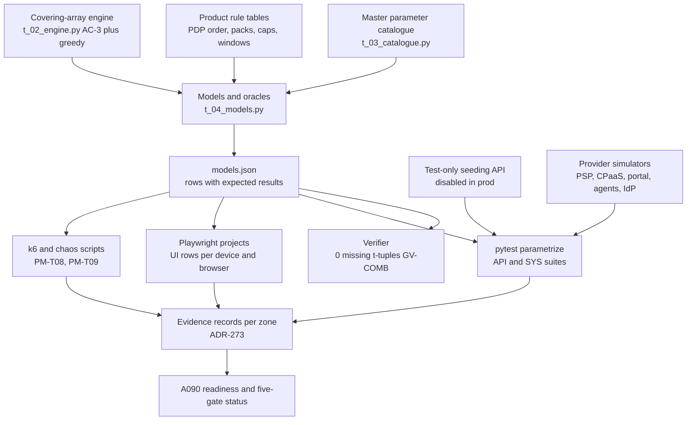
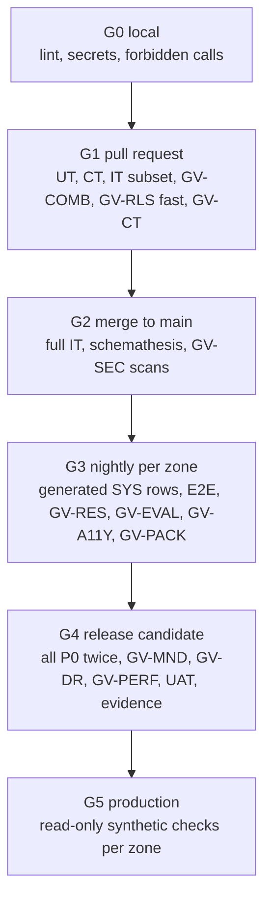

# AI Growth Engine: Employee Sales & Marketing Automation
## Application Blueprint: PART 11 (Batch 11.21a), Master Test Strategy and Combinatorial Test Design (V12): Organisation, Logistics and Capability Strategies

| Field | Value |
|---|---|
| Document | Part 11.21 (five files). **a (this file):** purpose, scope, principles, organisation and logistics (environments, test data and synthetic tenants, entry and exit criteria per release, defect management, automation architecture, CI gates, metrics) and the test strategy of every level and capability. **b:** master parameter catalogue, combinatorial method, model inventory and counts, test scenarios and the platform-wide pairwise cases. **c:** Investment Automation invocation cases, then 3-way, single-fault and exhaustive cases for money-, law- and safety-critical areas, residency, isolation and resilience. **d:** localization, accessibility, performance and AI-evaluation cases. **e:** cross-capability end-to-end suites, traceability rollup, release suites, regression strategy, conflicts, decisions, panel review, tags and quality gate |
| Version | 1.0 · 28 Nov 2026 |
| Baseline | Part 6.1 (test strategy template: levels, types T01–T21, techniques, conventions §6.1.12, CI gates G0–G5, LT-01…12, DR-1…8), Part 6.2a (test case template, precondition profiles PP-01…07), Part 6.4 (AI evaluation template), Parts 11.1–11.19 test sections (Group J reconciliation in Parts 11.10a–c), Part 11.14 (Founder decisions DEC-770…791, binding) |
| Precedence | Part 11.14 > this part > Part 6.1 for the V12 scope; Part 6.1 remains binding where this part is silent (DEC-920) |
| Roles applied | Head of Quality Engineering (primary), combinatorial test design expert, AI evaluation lead, performance and resilience test architect, security test lead, accessibility test lead; with QA Lead, Principal Engineer, DevOps/SRE Lead, Data Architect, Security/Compliance/AI Governance Lead, Product Owner |
| Tag ranges used | ASSUMPTION / GAP / CONFLICT / RECOMMENDATION-1120…1139 · DEC-920…939 · ADR-270…274 · TC-V12-T-### |
| Generators | `assembly/v12b/t_01_inventory.py` (blueprint test inventory), `t_02_engine.py` (covering-array engine and verifier), `t_03_catalogue.py` (master parameter catalogue), `t_04_models.py` (models and oracles), `t_05_build.py` (IDs, templates, rollup, assembly of Parts 11.21a–e) |

**Acronyms used in this part.** AC-3 arc-consistency algorithm 3 · AETG automatic efficient test generator (greedy covering-array family) · AT assistive technology · CA covering array · CJ-TC compliance and jurisdiction acceptance test (V12) · CT contract test · DSAR data-subject access request · E2E end-to-end · EVR evidence record · IPOG in-parameter-order generation · JIT just-in-time access · KMS key management service · LIA legitimate-interest assessment · MT- mandate type · NSE no side effect (Part 6.2a) · OAT operational acceptance test · PDP Policy Decision Point · PITR point-in-time recovery · PSP payment service provider · RLS row-level security · RPO / RTO recovery point / time objective · RTL right-to-left · SCIM System for Cross-domain Identity Management · SIT system integration test · SoD separation of duties · SUT system under test · t-way coverage every combination of values of any t parameters appears in at least one test · U404 uniform 404 (Part 6.2a) · UAT user acceptance test · VS variable strength · WAL write-ahead log.

**Time-sensitive facts.** Tool versions (pytest, Hypothesis, schemathesis, Playwright, axe-core, k6, Pact), assistive-technology versions, browser versions, provider sandboxes (PSP UPI AutoPay / e-NACH / SEPA, CPaaS, DLT aggregators, tender portals, IdPs, CRMs, KYC providers), cloud region codes (Supabase, AWS, Vercel), model identifiers and all prices are **unverified; verify at time of implementation (as of 28 Nov 2026)**. Every cost in this part is an estimate with its basis shown.

---

## 11.21.1 Purpose, scope, material reviewed and principles

### 11.21.1.1 What this part decides

| # | Decision area | Section | Consumed by |
|---|---|---|---|
| 1 | One master strategy for the whole revised scope (V12 adopted in full, DEC-770…791) at every level: unit, component, contract (OpenAPI), integration, SIT, system, E2E, UAT, OAT | §11.21.2.2, §11.21.3 | All teams; Part 11.20 (master implementation plan) |
| 2 | Environments per residency zone, test data and the synthetic tenant catalogue SYN-T01…T12 | §11.21.2.4–2.5 | DevOps/SRE; Data Architect |
| 3 | Entry and exit criteria per release R1–R4 and per level; blocking gates | §11.21.2.6 | Release go/no-go (A090; GNG-R-01…10) |
| 4 | Defect management extended with V12 severity examples | §11.21.2.7 | QA, SRE, Product |
| 5 | Automation architecture: model-driven generation, oracles as code, simulators, evidence | §11.21.2.8 | Principal Engineer; QA automation |
| 6 | CI gates G0–G5 extended with eleven V12 gates GV-* | §11.21.2.9 | CI/CD (Part 4.3, Part 11.5) |
| 7 | Capability strategies: AI evaluation (111 suites), security and RLS, performance, DR, accessibility, localization, residency, compliance rule packs, mandates, payments and commerce, bids, voice, investor/securities, identity and developer platform | §11.21.3 | Capability owners (Parts 11.15–11.19) |
| 8 | Master parameter catalogue P-01…P-26 | Part 11.21b §11.21.4 | Every combinatorial model in Parts 11.16–11.22 |
| 9 | Combinatorial method, 20 models, counts and verification; **{{GEN_TOTAL}} generated cases** | Part 11.21b §11.21.5–11.21.6; Parts 11.21c, 11.21d | Test automation |
| 10 | **{{E2E_COUNT}} cross-capability end-to-end cases** (18 journeys per zone) and UAT packs | Part 11.21e §11.21.7 | UAT owners |
| 11 | Traceability rollup (tests per part, all FR-V12 requirements, DEC-770…791), release suites and regression strategy | Part 11.21e §11.21.8 | QA Lead; release managers |

### 11.21.1.2 Material reviewed

Every Part 11 file was read for its test section; the test-case rows of every part file were also counted programmatically (`t_01_inventory.py`: an ID in the first cell of a table row is a definition; IDs are de-duplicated across files).

| Material | Test content found | Used in this part for |
|---|---|---|
| Part 6.1 Test Strategy | Levels, types T01–T21, risk matrix RA-01…30, environments, GSE-SYN, defect model, CI gates G0–G5, coverage targets, flaky policy, techniques (incl. pairwise §6.1.11.5 and the masking lesson), conventions §6.1.12, UAT plan, LT-01…12, DR-1…8 | Exact template of §11.21.1–11.21.3; extended, not replaced |
| Part 6.2a Test Cases EP-08…EP-11 | Full form and parameterized form, PP-01…07, NSE/U404 shorthand, adapter batteries B1–B7, journey register | Exact template of every TC-V12-T row |
| Part 6.4 AI Evaluation | Case template, datasets, thresholds, harness, fault model | Template of the AI-evaluation cases (Part 11.21d) |
| Parts 11.1, 11.2, 11.3, 11.4 | V12 BR/FR deltas; 39 SKUs; 156 workflows with scenario, step and AT tests (TC-V12-A/B/C/D) | SKU catalogue, effect classes, workflows per effect |
| Part 11.5, 11.8, 11.9 | Architecture, API/event contracts, DDL/RLS (TC-V12-E/H/I); `app_rw` RLS checks | Contract and RLS strategy; PM-T05 |
| Part 11.6 | 111 EVAL suites TC-V12-F-201…311 with gate families; registry | PM-T16; AI evaluation strategy |
| Part 11.7 | UI/UX, prototypes, locales and RTL (TC-V12-G) | PM-T06, PM-T07 |
| Parts 11.10a–c (Group J) | V12 test catalogue reconciliation: 1,342 workflow scenarios, 517 step tests, 195 acceptance tests, 233 register tests, classes TC-V12-J-001…019, R-1…R-10 execution rules, QC-V12-J-001…017; blueprint 4,156 → 6,472 | Rollup baseline; R-8 superseded (CONFLICT-1129) |
| Part 11.11 | SEV1–SEV4 communication matrix, SLA tiers and credit ladder, observability (TC-V12-K) | XT-13, XT-14 |
| Parts 11.12, 11.13 | V1 archive tests; AI improvement agents (TC-V12-L/M) | Rollup |
| Part 11.14 | DEC-770…791 | Binding scope |
| Part 11.15a–c | Rule-pack framework, 13 packs with test cases and YAML | Compliance strategy, XT-10, jurisdiction values |
| Parts 11.16a–e | Investment Automation: 25 + 9 combinatorial models (M-O1…16, PM-N-01…09), 2,391 TCs | PM-T02, J-T-08, rollup |
| Parts 11.17a–b | Mandate engine, commerce and payments, bids: models M, C, B, K; 716 generated cases; PDP order §11.17.5.12 | PM-T03 oracle order, XT-15 |
| Parts 11.18a–d | Voice: call model (3-way, 273 rows) and four smaller models; 465 generated cases | Voice strategy, J-T-06/07 |
| Parts 11.19a–c | Identity, developer platform, connectors, Vercel path, RPO, registry, benchmarks: 13 models, 1,072 generated + 86 full-form cases | Identity/DR/registry strategies, rollup |

### 11.21.1.3 Binding sources

| Source | What it fixes for testing |
|---|---|
| DEC-770, DEC-790 | Full Release 2 change request and every V12 change request funded; dates follow the work; scope is never cut to meet a date, so **no test is dropped to meet a date** |
| DEC-771, DEC-787 | Growth RTO ≤ 120 min (KPI-32, blocking) and RPO ≤ 15 min in every residency zone, with restore drills at each release gate |
| DEC-772, DEC-776, DEC-786 | India and EU residency; CJ-TC-09 blocking in both directions; residency chosen at onboarding; Vercel functions pinned per zone; global expansion by market only with Approved packs |
| DEC-773, DEC-774, DEC-775 | 24×7 on-call (paging tests monthly); SLA tiers 99.5 / 99.9 / 99.95% with credits; SOC 2 → ISO 27001 → ISO 27701/42001 evidence |
| DEC-777 | Promotional window 09:00–21:00 recipient local; stricter pack wins |
| DEC-778 | API uses least-privilege `app_rw` subject to RLS; Data API disabled; `service_role` only in CI migrations with break-glass — blocking checks |
| DEC-779…783 | Bounded mandates (L3/L4), agentic commerce and payments, automatic bids, AI voice and recordings, investor/fundraising — each built, activated per jurisdiction only with an Approved pack |
| DEC-784, DEC-785 | SSO/SCIM and developer platform with CRM/SMS/voice connectors in Release 1 |
| DEC-788 | Provider-neutral registry; Claude Sonnet approved primary; all 111 evaluation suites funded |
| DEC-789 | Cross-tenant benchmarks with cohorts ≥ 10, noise, opt-in |
| V12-B brief | Pairwise for every capability; 3-way for safety-, money- and law-critical capabilities; exhaustive where ≤ 64; generated programmatically; every combination a real test case |
| Part 6.1 §6.1.11.5 | Masking lesson: separate valid and invalid value sets; 3-wise for interacting P0 factors; exclusions listed |
| Part 11.10c R-1…R-10 | Canonical V12 test IDs, parameterized classes, evidence fields, "Not run" until executed on fictional fixtures; R-8 amended by DEC-921 |

### 11.21.1.4 Master test principles (MP-01…MP-16)

| ID | Principle | Consequence |
|---|---|---|
| MP-01 | **Fail closed is tested, not assumed.** Every control that can deny (entitlement, role, zone, pack, consent, mandate, cap, kill switch, data class, registry) has at least one denial row per capability with the NSE assertion | Single-fault layers PM-T01N, PM-T02N, PM-T03N |
| MP-02 | **Combinatorial by default.** Every cross-cutting behaviour is tested over the master parameter catalogue at the strength of its risk (DEC-924) | §11.21.5 |
| MP-03 | **Oracles are code and are shared.** The expected result of each generated row is computed by a rule-based oracle that implements the same decision order as the product (e.g. PDP order §11.17.5.12); the product and the test import the same rule tables, and disagreements are triaged as defects in either | ADR-270 |
| MP-04 | **Unmask deep paths.** For gate-heavy models a positive sub-space layer is generated so that allow paths are exercised with all other values valid | PM-T03P |
| MP-05 | **Zones are first-class test parameters.** Every SYS suite with personal data runs in the IN zone and in the EU zone (or the EU-configured test cell until the EU stack exists) | DEC-927 |
| MP-06 | **No test treats a synthetic pass as production certification** (BRD §13.2; Part 11.10c R-3). Packs used in test are synthetic approvals; activation in production needs counsel-signed packs | §11.21.3.11 |
| MP-07 | **Mandated autonomy is tested as a bounded privilege.** L3/L4 rows assert reserve → commit, caps, counterparties, windows, revocation and reconciliation; L1/L2 rows assert the human or hash binding (supersedes Part 11.10c R-8, DEC-921) | PM-T03, XT-15 |
| MP-08 | **Exactly-once effects.** Every effect path is exercised with duplicate, timeout-after-submit and crash faults (NFR-005, NFR-026) | PM-T01 provider values, PM-T09 |
| MP-09 | **Money is Decimal plus ISO 4217**; amounts in fixtures come from helpers, never typed by hand (Part 6.1 §6.1.12.4) | XT-14, J-T-01/03/04 |
| MP-10 | **Time is controlled.** Window, expiry, deadline, statutory clock and drift tests use the clock-control endpoint (Part 6.1 §6.1.6.5), never `sleep` | XT-12, J-T-05, J-T-08 |
| MP-11 | **AI quality gates are evidence, not opinion.** A workflow's AI step counts as tested only after its EVAL suite passes its gate families (Part 11.10c R-6) | PM-T16 |
| MP-12 | **Accessibility and localization are release criteria, not polish.** P1 screens fail the release on any critical/serious axe finding or untranslated string | PM-T06, PM-T07 |
| MP-13 | **Isolation is proven on every access path,** including search, embeddings, notifications, webhooks, exports, benchmarks and the Data API | PM-T05 |
| MP-14 | **Every execution writes an evidence record** (Part 6.1 §6.1.5.4; Part 11.10c R-4) stored in the zone of the tenant whose data it touched (DEC-939) | ADR-273 |
| MP-15 | **Regenerate, do not hand-edit.** When a parameter value is added (new locale, zone, SKU, pack, role), the models are regenerated; the diff of cases is reviewed like code | RECOMMENDATION-1139 |
| MP-16 | **Test-only capabilities never reach production.** Seeding API, clock control and simulators are compiled out or disabled by configuration in `prod`, verified by a start-up guard test | RECOMMENDATION-1138 |

### 11.21.1.5 Quality objectives per release

| Objective | R1 (W0–W3) | R2 (W4–W5, full V12 change request) | R3 (de-DE, fr-FR; SOC 2 Type II, ISO 27001) | R4 (ar-AE RTL; ISO 27701/42001) |
|---|---|---|---|---|
| P0 pass rate at the gate | 100% (2 consecutive green runs) | 100% | 100% | 100% |
| P1 pass rate | 100% | 100% | 100% | 100% |
| Required t-tuples covered by executed rows (P0 models) | 100% | 100% | 100% | 100% |
| Open S1/S2 defects | 0 / 0 | 0 / 0 | 0 / 0 | 0 / 0 |
| Residency probe (CJ-TC-09) findings | 0 | 0 | 0 | 0 |
| DR drill (KPI-32) | RPO ≤ 15 min, RTO ≤ 120 min per zone | same | same | same |
| EVAL suites for enabled AI workflows | 100% green for en (+ hi where enabled) | 100% for en, hi, ta, or | + de, fr | + ar |
| WCAG 2.2 AA (critical/serious) | 0 on P1 screens | 0 | 0 | 0 incl. RTL |
| Packs Approved for each activated jurisdiction | IN (outbound) | IN, EU for mandates, payments, bids, voice, investor | + UK, US as contracted | + AE/ME, SG/APAC as contracted |

---

## 11.21.2 Organisation and logistics

### 11.21.2.1 Test organisation and responsibilities

| Role | Accountable for | Main artefacts | Capacity basis |
|---|---|---|---|
| Head of Quality Engineering (QA Lead, DEC-228 QA 1.0) | Strategy, gates, release recommendation, defect triage chair | This part; A090 readiness report | Existing QA 1.0 from Sprint 3 |
| Test automation engineers (contract engineers per DEC-228 and DEC-790 extension) | Generators, oracles, fixtures, simulators, CI wiring | `t_*` models in the product test repo; pytest/Playwright suites | Effort in §11.21.2.11 |
| Combinatorial test design owner (QA Lead or delegate) | Parameter catalogue, models, constraints, strength policy, regeneration diffs | P-01…P-26; PM-T01…T16; XT-10…15 | Part of QA Lead time |
| AI evaluation lead (LLM platform lead, Part 11.19) | 111 suites, gold sets, judge calibration, registry gates | EVAL-SM-SVC-*; AU-154/155/156 | Per Part 11.6/11.19 estimates |
| Performance and resilience architect (SRE lead) | LT-01…12, LT-V12-T-01…12, DR-1…8, DR-V12-T-01…08, game days | k6 scripts, chaos scripts, drill evidence | SRE time |
| Security test lead | SAST/DAST/SCA, authorization and RLS matrices, pen tests, red team | ZAP baselines, RLS suites, pen-test reports | Security lead + external pen-test vendor (verify cost) |
| Accessibility test lead (Lead UX/UI designer) | WCAG 2.2 AA audits, AT passes, screen readers on desktop and mobile | Axe reports, AT scripts, VPAT/ACR | UX time + AT licences |
| Counsel (external, per Part 11.15) | Reviews oracles derived from packs (RECOMMENDATION-1137) | Signed review of oracle tables | Part 11.15 legal budget |
| Business UAT owners (P02 startup heads, R10, R08/R09, external pilot tenants) | UAT packs UAT-PK-V12-01…13 sign-off | UAT evidence | Business time |

### 11.21.2.2 Test levels for the V12 scope

| Level | Code | Scope in V12 | Owner | Tools (verify versions) | Environment | Entry | Exit |
|---|---|---|---|---|---|---|---|
| Unit | UT | Pure rules: PDP order, mandate guards, caps, window function, credit ladder, money/tax, pack evaluator, registry router, residency router, oracle functions themselves | Developer | pytest, Hypothesis, Vitest | `local`, `ci` | Story in progress | Layer coverage targets of Part 6.1 §6.1.9.6; mutation ≥ 85% for money, PDP, mandate and pack evaluator |
| Component | CMP | One React component or one Django app with its DB in a transaction: mandate console, consent widgets, RTL layout primitives, MoneyInput, voice console | Developer | Vitest + RTL + vitest-axe; pytest-django | `ci` | UT green | Every UI state rendered; axe 0 violations; keyboard path complete |
| Contract | CT | OpenAPI per surface (public, portal, admin, developer v1, internal), event schemas, webhooks, SDKs (TS/Python/Java), provider adapters (PSP, CPaaS, DLT, tender portal, counterparty agent, KYC, IdP, SCIM, CRM, model registry) | Principal Engineer | schemathesis, OpenAPI diff, Pact/JSON-Schema, SDK conformance suites | `ci`, `test` | Schema published | 0 breaking diffs without version bump; 100% operations fuzzed; adapter batteries B1–B7 green |
| Integration | IT | Real PostgreSQL with RLS and `app_rw`, Valkey, Celery, outbox, simulators | Developer + QA | pytest-django, testcontainers | `ci`, `dev` | UT/CT green | RLS suite and `service_role` guard green (DEC-778) |
| SIT | SIT | V12 workflow scenario classes TC-V12-J-001…010, step classes, approval-binding instances, cross-module flows per zone | QA | pytest API suites, simulators, clock control | `test-IN`, `test-EU` | IT green; fixtures loaded | All P0/P1 pass; generated rows of PM-T01…T05/T09 executed |
| System | SYS | Deployed build through BFF/API per zone: combinatorial models, DAST, performance, DR | QA + SRE | pytest, k6, ZAP, chaos scripts | `test-*`, `staging-*`, `perf-*` | SIT green | Thresholds met; evidence complete |
| End-to-end | E2E | Journeys J-T-01…18 per zone across Website, Portal, Admin, voice and partners | QA | Playwright (Chromium, Firefox, WebKit, Edge channel), axe | `staging-*` | SYS green | P0 journeys green on Chromium and WebKit |
| User acceptance | UAT | UAT-PK-V12-01…13 per capability and zone, by business owners and pilot tenants | Product Owner | Test management tool; A090 | `uat-*` | UAT readiness review | Sign-off by PO + owner + independent reviewer |
| Operational acceptance | OAT | Paging, runbooks, restore drills, key rotation, kill switch drills, evidence export for audits | SRE | Runbooks, paging tool | `staging-*`, `prod` (read-only checks) | OAT checklist | DR and paging drills green; SOC 2 evidence complete |

### 11.21.2.3 Test types used in V12 (Part 6.1 T01–T21 applied)

The Part 6.1 type codes are kept (no new codes, so Part 6 dashboards keep working). V12 concerns are expressed as tags on the type:

| V12 concern | Type code(s) | Tag | Example cases |
|---|---|---|---|
| Residency (IN/EU) | T19 + T15 | `RES` | PM-T04, J-T-12 |
| Rule-pack conformance | T19 | `PACK` | XT-10, PM-T03 pack rows |
| Mandate and money integrity | T19 + T20 + T16 | `MND` | PM-T03, XT-15, J-T-03 |
| Voice compliance | T19 | `VOICE` | J-T-06/07; Part 11.18 TC-V12-Q |
| Securities compliance | T19 | `SEC` | PM-T02, J-T-08 |
| Model registry and AI gates | T14 | `REG` | PM-T16, J-T-16 |
| Accessibility 2.2 | T08 | `A11Y` | PM-T07 |
| Localization and RTL | T13 | `L10N` | PM-T06 |
| Resilience | T12 | `DR` | PM-T09, J-T-11 |
| Operability and on-call | T21 | `OPS` | XT-13 |

### 11.21.2.4 Environments

| Environment | Zone | Purpose | Data | External providers | Promotion and isolation rules |
|---|---|---|---|---|---|
| `local` | — | Developer loop | Factories | Simulators only | — |
| `ci` | IN (runner) | G0–G2 | Factories, SYN-T small profile | Simulators; recorded fixtures | Ephemeral; destroyed per run |
| `dev` | IN | Integration of main | SYN-T profile `s` | Sandboxes allowed by the outbound allowlist guard (Part 6.1 §6.1.6.4) | Auto-deploy on merge |
| `test-IN` | IN (Mumbai) | Nightly SYS/E2E, combinatorial runs, residency probes | SYN-T profile `m` | Sandboxes + simulators | Nightly reset (seed version pinned) |
| `test-EU` | EU (Frankfurt) — **EU-configured test cell from R1** (DEC-927), full EU stack once the first EU tenant is contracted (DEC-772) | Same as `test-IN` for EU tenants; CJ-TC-09 reverse direction | SYN-T EU tenants generated **inside** the EU cell | EU sandboxes (SEPA, EU SES region) | No replication or backup to IN; probes compare both zones |
| `staging-IN`, `staging-EU` | per zone | G4 release candidate, E2E, DR drills, ZAP full, perf smoke | SYN-T profile `l` + edge packs | Sandboxes; live credentials forbidden (B6) | Release-candidate tags only |
| `perf-IN`, `perf-EU` | per zone | LT-01…12, LT-V12-T-01…12 | Profile `l` and noisy-neighbour pack | Simulators with recorded latency | Ephemeral, sized as production tier |
| `uat-IN`, `uat-EU` | per zone | UAT packs | `uat` profile; pilot tenants' synthetic data | Sandboxes | Access by UAT participants only (SSO) |
| `drill-*` | per zone | Isolated restore targets for DR drills (AU-297) | Restored copies | None | Destroyed after evidence capture |
| `prod-IN`, `prod-EU` | per zone | G5 read-only synthetic checks | Production | Live | No test writes with external effects |

**Simulators and sandboxes added for V12** (in addition to Part 6.1 §6.1.6.3): PSP simulator (UPI AutoPay, e-NACH, card MIT, SEPA SDD; webhooks, disputes, chargebacks, settlement files), counterparty-agent simulator (verifiable credentials valid / expired / revoked / untrusted issuer; offers within and beyond bounds), tender-portal simulator (GeM-type and EU eSubmission; anti-automation clause switch; receipts), CPaaS and carrier simulator (inbound/outbound, AMD, DTMF, recording, failover), DLT aggregator and registry scrub simulator (NCPR, DNC, TPS, Bloctel, UAE DNCR fixtures), KYC/AML provider simulator (clear / possible match / true match / error), IdP simulators (Okta, Entra ID, Google, generic SAML/OIDC; XSW corpus), SCIM client, CRM sandboxes (Salesforce, HubSpot, Zoho; verify availability), model registry fixture REG-FIX-3 with approved, candidate, suspended rows per zone, Vercel API mock for AU-296, KMS deny-policy injector.

**Clock control** (Part 6.1 §6.1.6.5) is extended with per-recipient time zones and holiday calendars (IN national and state holidays, DE, FR, UK, US, AE fixtures; verify dates), statutory clocks (allotment 60 days in IN, verify), bid deadlines and mandate validity windows.

### 11.21.2.5 Test data and synthetic tenants

All test data is synthetic or lawfully authorised fixture data (Part 6.1 §6.1.7; Part 11.10c R-3). No production personal data enters any non-production environment; EU synthetic data is generated inside the EU cell (DEC-930) [ASSUMPTION-1124: names, numbers and companies below are fictional fixtures].

| ID | Synthetic tenant | Type (P-01) | Zone | Locales | Plan | Purpose |
|---|---|---|---|---|---|---|
| SYN-T01 | Owner Portfolio (AppNAI, MedMaarg, EduVerse, OrganicSpec + 2 dormant startups) | T1-* | IN | en-IN, hi-IN, ta-IN, or-IN | FULL | Vertical rules, portfolio scope, ledgers, bids |
| SYN-T02 | Kestrel Analytics Pvt Ltd | EXT-SMB | IN | en-IN, hi-IN | BUNDLE (Outreach & Conversations) + SVC-17/21 | Self-service journey, UPI/e-NACH |
| SYN-T03 | Nordlicht GmbH | EXT-SMB → EXT-ENT (upgrade) | EU | de-DE, en-GB | SELECT then FULL | EU residency, SEPA, Entra ID OIDC |
| SYN-T04 | Atelier Lumière SAS | EXT-SMB | EU | fr-FR | BUNDLE (Commerce & Procurement) | Agentic commerce, Bloctel voice |
| SYN-T05 | Saffron Retail Ltd | EXT-ENT | IN | en-IN | FULL, Enterprise SLA | SSO SAML (Okta), SCIM, custom roles, connectors |
| SYN-T06 | Harbor Foods Pvt Ltd + operator Corvid Managed Services | EXT-MSP | IN | en-IN | BUNDLE | R21 delegation |
| SYN-T07 | Lumen Robotics Pvt Ltd | INV-T | IN | en-IN, hi-IN | INV plan | Investment Automation (RP-IN-SEC) |
| SYN-T08 | Lumen Robotics GmbH | INV-T | EU | de-DE, en-GB | INV plan | EU prospectus-exempt offers |
| SYN-T09 | Al Noor Trading FZ-LLC | EXT-SMB | EU (chosen) | ar-AE | TRIAL → SELECT | RTL, AE market gating |
| SYN-T10 / T11 | Isolation pair "Tenant X" (companies X1, X2) and "Tenant Y" | EXT-ENT / EXT-SMB | IN and EU copies | en-IN / en-GB | FULL | PM-T05, AP-10 |
| SYN-T12 | Noisy neighbour "Hydra Bulk Mailers" | EXT-SMB | IN and EU | en-IN | FULL | Fairness under load (PM-T08) |

| Fixture pack | Content | Version rule |
|---|---|---|
| FX-`<wf>`-v1 | V12 input of each of the 156 workflows (Part 11.10c) | Versioned with the workflow DTO |
| FX-MND | Mandates of every type MT-OUT…MT-ORCH in every lifecycle state; consumption ledgers at below / at / above cap | Seeded through the test-only seeding API (RECOMMENDATION-1138) |
| FX-PACK | Synthetic rule packs for IN, EU, UK, US, AE, SG in every lifecycle state; signed with a test key | Never loadable in `prod` (key not trusted there) |
| FX-PAY | PSP accounts, mandates (UPI AutoPay, e-NACH, SEPA), settlement files, disputes | Amounts from helpers (MP-09) |
| FX-VOICE | Synthetic caller audio (TTS-generated) in en, hi, ta, de, fr, ar; DTMF scripts; registry-listed numbers from reserved fictional ranges | No real voices or numbers |
| FX-INV | Investors with KYC states, eligibility, residency; offer documents; cap tables | Fictional persons and entities |
| FX-L10N | Pseudo-locale bundles, long German compounds, Indic scripts, Arabic with embedded Latin IDs | Regenerated per string change |
| FX-A11Y | AT scripts per screen group | Reviewed per wave |
| GSE-SYN | Part 6.1 synthetic dataset (profiles s, m, l, uat) | Unchanged; SYN-T adds tenants on top |

**Data rules.** (1) Personal-looking data uses reserved example domains and fictional number ranges. (2) Restricted fixtures (bank, KYC, recordings) are encrypted with the zone's test KMS key. (3) Seed and reset are deterministic: every run records the seed versions in the evidence record. (4) Masked production-derived data is allowed only for performance profiles in `perf-*` of the same zone, after DPO (R10) approval and the masking test of Part 6.1 §6.1.7.4.

### 11.21.2.6 Entry and exit criteria per release and per level

**Per level** — as Part 6.1 §6.1.5.1, plus: SIT entry requires the generated rows of the touched models regenerated with 0 missing tuples (GV-COMB); SYS exit requires the residency probe and the RLS suite green in each zone used.

| Release | Entry (to start the release test cycle) | Exit (go/no-go; all blocking) |
|---|---|---|
| **R1** (W0–W3; SSO/SCIM, developer platform, connectors, SKUs 01–16 and 25, IN zone; EU test cell) | Feature-complete build for R1 scope; SYN-T01…06, T10/T11 loaded; simulators for IdP, SCIM, CRM, DLT, SES, WhatsApp; registry fixtures | 100% P0/P1 of R1 rows (Part 11.21e §11.21.8.4 release counts); GV-RLS, GV-RES (IN, EU cell), GV-CT, GV-SEC, GV-A11Y, GV-COMB, GV-EVAL (enabled workflows), GV-DR (KPI-32 drill IN) green; 0 S1/S2; pen test of SSO/SCIM and developer API closed; UAT-PK-V12-02 signed |
| **R2** (W4–W5 and the full V12 change request: mandates, payments, commerce, bids, voice, investor, SKUs 17–24 and 26–39, EU zone for first EU tenant) | R1 exit met; packs for IN and EU in counsel review or Approved (synthetic in test); PSP, CPaaS, tender-portal, counterparty-agent and KYC simulators; FX-MND, FX-PAY, FX-VOICE, FX-INV | All R1 + R2 rows green; PM-T03 L1/L2/L3 100%; XT-10/15 100%; DR drills per zone with active mandate (J-T-11); 24×7 paging test (XT-13) green; EVAL suites for enabled R2 workflows; counsel sign-off for every jurisdiction to be activated (production); SOC 2 Type I evidence complete; UAT-PK-V12-01, 03–10, 12, 13 signed |
| **R3** (de-DE, fr-FR; UK/ME/APAC/US markets as contracted; SOC 2 Type II, ISO 27001) | R2 exit; de/fr bundles; packs for newly contracted markets | All R1–R3 rows; de/fr EVAL slices; linguistic review; zone tests for any new zone; certification evidence |
| **R4** (ar-AE RTL; ISO 27701/42001) | R3 exit; ar bundle; RTL components | All rows incl. RTL; AT passes in RTL; ar EVAL slices; UAT-PK-V12-11 signed |

**Suspension and resumption.** Testing of a release candidate is suspended when (a) a P0 row fails in two consecutive runs with a product cause, (b) the environment's residency probe finds a cross-zone object, or (c) the simulator contract drifts from the provider sandbox. It resumes after the fix is merged and the affected models are regenerated and re-run.

### 11.21.2.7 Defect management (Part 6.1 §6.1.8 extended)

| Severity | Part 6.1 definition (unchanged) | V12 examples added (DEC-929) | Fix SLA (pilot team, business days) | Release rule |
|---|---|---|---|---|
| **S1** | Confidentiality breach, unauthorized external action, financial inaccuracy, regulatory eligibility failure, data loss, rollback impossible | Personal data written in the other residency zone; an L3 effect beyond a mandate cap or after revocation; duplicate pay-out or collection; AI voice call without AI disclosure or recording without required consent; offer terms shown to an ineligible investor; bid submitted with bytes different from the approved hash; Tier 2 call with personal data; `service_role` reachable from the API; RPO > 15 min or RTO > 120 min in a drill | Fix starts immediately; 24×7 on-call (DEC-773) | Blocks every release; hotfix for production |
| **S2** | Major function broken without workaround | Mandate cannot be revoked within 1 min; reconciliation break not routed; EVAL gate not enforced for a locale; RTL layout unusable on a P1 screen | ≤ 3 | Blocks the release |
| **S3** | Function impaired with workaround | Non-P1 translation gap; non-critical axe finding; performance within 20% above target on non-P0 path | ≤ 10 | Waiver possible (RBR-3/RBR-4 of Part 6.1) |
| **S4** | Cosmetic | Text expansion clipping on non-primary label | Backlog | No block |

Lifecycle, fix priority, RCA and escaped-defect rules are those of Part 6.1 §6.1.8. Additional rule: every S1/S2 found by a generated row adds the row's parameter values to a **pinned regression set** that is executed in RT-1 even when impact analysis would not select it.

### 11.21.2.8 Automation architecture

| Component | Specification |
|---|---|
| Repository layout | `tests/model/` (catalogue, models, oracles imported from `app/rules/`), `tests/generated/` (JSON produced in CI, never hand-edited), `tests/api/`, `tests/e2e/`, `tests/perf/`, `tests/chaos/`, `tests/a11y/`, `tests/eval/` (EVAL suites), `tests/contract/` |
| Generation in CI | GV-COMB job regenerates the models from the catalogue on every change to `tests/model/` or to `app/rules/`; fails on any missing tuple or invalid row; publishes the diff of rows (added / removed / changed expected) as a PR comment |
| Oracle sharing | Product rule tables (PDP order, pack YAML, mandate eligibility, window, credit ladder) live in `app/rules/` and are imported by both the product and the oracles; oracle-only logic (expected text, priority) lives in `tests/model/`. Law-critical oracle tables are reviewed by counsel (RECOMMENDATION-1137) |
| Parametrization | One pytest function per model; `@pytest.mark.parametrize` over the JSON rows; test ID = TC-V12-T-###; fixtures resolved from the row values (tenant, zone, role → SYN-T user, etc.) |
| UI rows | Playwright projects per (browser, device) pair present in the rows; Edge via the Chromium `msedge` channel; Safari rows on WebKit plus a weekly real-device pass |
| Evidence | Each test writes an evidence record (Part 6.1 §6.1.5.4 fields + zone, model ID, row values, oracle version, seed versions) to the evidence store of the zone (ADR-273) |
| Test registry | Table `qa_test_case` (id, model, row JSON, expected, priority, release, status, last result) synchronised from the JSON; dashboards per release and model (RP-26 extension) |

### 11.21.2.9 CI gates (Part 6.1 §6.1.9.5 extended, DEC-926)

| Gate | Stage | Contents | Blocking rule | Time budget |
|---|---|---|---|---|
| **GV-COMB** | G1 (when models, catalogue or rules change), G3 | Regenerate models; verifier; diff report | Missing tuples > 0 or invalid rows > 0 blocks | ≤ 10 min |
| **GV-RLS** | G1 (fast subset), G2 (full), G3 | Part 11.9b RLS checks, `app_rw` guard, Data API disabled, `service_role` absent from runtime config, PM-T05 rows | Any failure blocks (DEC-778) | ≤ 15 min (G2) |
| **GV-CT** | G1, G2 | OpenAPI diff per surface, schemathesis, event schema registry, SDK conformance, adapter batteries | Breaking change without version bump blocks | ≤ 15 min |
| **GV-SEC** | G1 (SAST/SCA/secrets), G2 (image, IaC), G3 (ZAP baseline per role), G4 (ZAP full, authz matrix, pen-test findings) | Part 6.1 T07 + V12 surfaces (developer API, webhooks, agent endpoints, voice webhooks, investor portal) | High/critical findings block | per stage |
| **GV-RES** | G3, G4 | PM-T04 rows; CJ-TC-09 probes both directions; Vercel function region check; provider region metadata | Any cross-zone object blocks | ≤ 45 min |
| **GV-EVAL** | G1 (smoke when prompts/models/routes change), G3 (affected suites), G4 (all suites of enabled workflows per locale) | 111 EVAL suites; PM-T16 meta-tests | Gate family failure blocks the workflow/locale (AIX-19) | ≤ 3 h (G3) |
| **GV-PACK** | G3, G4, and on every pack change | Pack YAML schema; pack test cases of Part 11.15; XT-10; PM-T03 pack rows; re-run of every generated row whose jurisdiction value matches the changed pack | Failure blocks activation of the pack | ≤ 30 min |
| **GV-A11Y** | G1 (component axe), G3 (page axe on PM-T07 keyboard rows), G4 (manual AT passes) | PM-T07 | Critical/serious on P1 screens blocks | per stage |
| **GV-MND** | G3, G4 | PM-T03 L1–L3, XT-15, Part 11.17b generated catalogue, reconciliation replay | Any P0 failure blocks | ≤ 60 min |
| **GV-DR** | G4 and quarterly | KPI-32 drill per zone, DR-V12-T-01…08, PM-T09 rows tagged for the release | RPO > 15 min or RTO > 120 min blocks (DEC-771/787) | ≤ 1 day |
| **GV-PERF** | G3 (smoke 5 min), G4 (load set for the release) | LT-01…12, LT-V12-T-01…12, PM-T08 rows | Threshold breach on P0 workloads blocks | ≤ 1 day |

### 11.21.2.10 Metrics and reporting

| Metric | Definition | Target | Reported in |
|---|---|---|---|
| t-way coverage (executed) | Required t-tuples present in rows that **passed** in the run ÷ required t-tuples | 100% for P0 models at G4 (RECOMMENDATION-1136, DEC-938) | A090; RP-26 |
| Pass rate by priority | Passed ÷ executed per P0…P3 | P0/P1 100% | A090 |
| Escaped defects | Production defects not caught by a test, per release | ≤ 2 S3 per release; 0 S1/S2 | PIR |
| Defect detection by layer | Share of defects found per layer (L1/L2/L3 of PM-T03) | Monitored; L3 should find the most denial bugs | QA review |
| Flake rate | Part 6.1 §6.1.9.7 | ≤ 2% quarantine cap; P0 never quarantined | Dashboard |
| Evidence completeness | Executions with a complete evidence record ÷ executions | 100% | A090 |
| EVAL gate status | Suites green per workflow and locale | 100% of enabled | AU-154 view |
| Residency findings | Cross-zone objects found by probes | 0 | GV-RES |
| Mean time to regenerate | From catalogue change to green GV-COMB | ≤ 1 h | CI |

### 11.21.2.11 Effort and cost of this part's deliverables (estimate; DEC-936)

Rates: DEC-770 implied blended rates ₹4,519 / ₹5,697 / ₹6,807 per person-day (low / central / high), as used in Parts 11.16–11.19. Funded under DEC-790 as part of the approved V12 change requests; outside the DEC-230/231 ledgers. **Overlap:** Part 11.10c (QA infrastructure 77/126/206 pd) and the test estimates in Parts 11.16–11.19 already fund parts of the frameworks named below; Part 11.20 must de-duplicate before adding these figures to the plan [GAP-1127].

**Development (one-time).**

| Work package | pd low | pd central | pd high | Basis |
|---|---|---|---|---|
| Productise engine, catalogue and oracles into the test repo (pytest plugin, JSON store, diff report) | 10 | 15 | 22 | 5 modules; reuse of `t_02`/`t_04` |
| Shared rule tables and oracle parity tests | 12 | 18 | 26 | 20 models × 0.6–1.3 pd |
| Synthetic tenants SYN-T01…T12, fixture packs, seeding API with prod guard | 14 | 20 | 30 | 12 tenants + 8 packs |
| V12 simulators not already estimated (KYC, registry scrub, tender portal anti-automation switch, carrier failover) | 10 | 16 | 24 | 4 simulators × 2.5–6 pd |
| Automation of generated models (parameterized functions, fixtures per value) | 40 | 60 | 85 | 20 models × 2–4.25 pd |
| Automation of the 31 E2E cases | 37 | 56 | 81 | 31 × 1.2 / 1.8 / 2.6 pd |
| Manual AT passes (desktop + mobile screen readers) per release R1–R4 | 8 | 12 | 18 | 4 releases × 2–4.5 pd |
| Performance and DR suites LT-V12-T-01…12, DR-V12-T-01…08 | 18 | 26 | 38 | 20 scripts/drills |
| CI gates GV-* and dashboards | 8 | 12 | 18 | 11 gates |
| UAT facilitation for 13 packs | 10 | 15 | 22 | 13 × 0.8–1.7 pd |
| **Total** | **167** | **250** | **364** | |
| **Cost** | **₹7.55 L** | **₹14.24 L** | **₹24.78 L** | pd × rate |

**Running (recurring, monthly unless stated).**

| Item | Low | High | Basis (verify at implementation, as of 28 Nov 2026) |
|---|---|---|---|
| EU-configured test cell before the EU stack (small Supabase project, AWS dev-size services, Vercel preview) | ₹6,000 | ₹12,000 | Fraction of the DEC-772 EU lines at test size |
| `perf-*` environments on demand (2–4 runs per month per zone) | ₹5,000 | ₹20,000 | Ephemeral, production-sized for hours |
| Real-device and browser cloud (optional; Playwright first) | ₹0 | ₹25,000 | Open-source first; paid by exception |
| Screen-reader licences (JAWS; NVDA free; VoiceOver/TalkBack included in OS) | ₹2,000 | ₹4,000 | Annual licence ÷ 12 |
| AI evaluation runs (111 suites × 70 cases × 2–3 locale slices per full run; 2 full runs + nightly samples) | ₹15,000 | ₹45,000 | Token cost per registry rate card; budgeted under the AI ceilings |
| External penetration test (per release) | ₹2.5 L per test | ₹6 L per test | One-time per release; vendor quote required |

---

## 11.21.3 Test strategy by level and capability

### 11.21.3.1 Unit and component

| Focus | What is tested | Technique | Coverage target |
|---|---|---|---|
| PDP order (§11.17.5.12) | Every rule in order, with each earlier rule passing and the rule under test failing | DT, PBT (random rule vectors; invariant: the first failing rule is the reported code) | 100% rules, mutation ≥ 85% |
| Mandate guards and consumption ledger | reserve → commit / release; aggregate and count caps; velocity; concurrency (two dispatches racing for the last unit) | ST, BVA, PBT (`RuleBasedStateMachine`) | 100% transitions, 1-switch |
| Window function | DEC-777 half-open window, DST, holidays, stricter pack | BVA, DT (XT-12) | 100% boundaries |
| Credit ladder and SLA computation | XT-14 boundaries; rounding | BVA | 100% |
| Pack evaluator | YAML rules, precedence (strictest wins), expiry | DT, PBT (random pack sets: result never less strict than any single pack) | 100% rule types |
| Registry router | task × data class × zone × state (Part 11.19 M10) | DT | 100% |
| Residency router | tenant zone → endpoints, buckets, keys, queues | EP | 100% components |
| Oracles | Each oracle function checked against hand-computed examples and against the product rule tables (parity) | EP | 100% oracle branches |
| UI components | Mandate console, consent capture, cap gauges, RTL primitives, voice console, data-room viewer | Component tests + vitest-axe; keyboard | All UI states |

### 11.21.3.2 Contract testing (OpenAPI and events)

| Contract | Source of truth | Tests | Gate |
|---|---|---|---|
| Admin, portal, public and internal APIs | OpenAPI per surface (Part 11.8) | Route inventory vs allowlist (NFR-001); schemathesis stateful fuzzing; OpenAPI diff; problem-details schema; localization of `detail` | GV-CT |
| Developer API v1 (DEC-785) | Public OpenAPI with versioning policy | Breaking-change diff against the last published version; deprecation headers; rate-limit headers; scopes per key; zone host binding | GV-CT |
| SDKs (TypeScript, Python, Java) | Generated from OpenAPI | Conformance suite per SDK: auth, pagination, retries, idempotency key, webhook signature verification (Part 11.19 M06) | GV-CT |
| Webhooks and events | Event schema registry | Producer and consumer contracts; signature, timestamp, replay window; payload carries references only (FR-V12-R-046) | GV-CT |
| Provider adapters | Recorded sandbox fixtures | Battery B1–B7 (Part 6.2a §6.2.1.6) for PSP, CPaaS, DLT, tender portal, counterparty agent, KYC, CRM, IdP, SCIM, model registry rows | GV-CT; nightly drift |
| Agent-to-agent protocol (SVC-28) | Commerce message schemas and VC formats (Part 11.17a §11.17.6.2) | Valid, expired, revoked, untrusted-issuer credentials; signed offers; replay | GV-CT |

### 11.21.3.3 SIT, E2E and UAT

**SIT.** The V12 workflow classes TC-V12-J-001…010, step classes and acceptance classes (Part 11.10c) run per SKU and per zone. The platform pairwise model PM-T01 adds the cross-cutting combinations (tenant × plan × SKU × zone × locale × role × channel × identity × device × browser × data × consent × provider × autonomy × AI route × SLA) that the per-workflow classes do not vary. Approval-binding classes (TC-V12-J-009) now assert the mandate path for L3/L4 workflows (DEC-921).

**E2E.** Journeys J-T-01…18 (Part 11.21e §11.21.7) chain capabilities across Website, Portal, Admin, voice and partners, once per zone where the capability exists. Each page passes axe; each journey uses one correlation ID; each effect is reconciled.

**UAT packs (new).**

| Pack | Capability | Participants | Journeys | Zones | Release |
|---|---|---|---|---|---|
| UAT-PK-V12-01 | Self-service tenant lifecycle and mandated outreach-to-cash | Pilot SMB tenant admin, R03, R08/R09 | J-T-01 | IN, EU | R2 |
| UAT-PK-V12-02 | Enterprise identity and developer platform | Enterprise IT admin, developer | J-T-02 | IN, EU | R1 |
| UAT-PK-V12-03 | Agentic commerce, procurement and payments | P07, R08/R09, supplier/buyer pilot | J-T-03, J-T-04 | IN, EU | R2 |
| UAT-PK-V12-04 | Automatic bid submission | AppNAI R06, R02, R10 | J-T-05 | IN, EU | R2 |
| UAT-PK-V12-05 | AI voice inbound/outbound and coaching | MedMaarg desk, R03, R10, sales coach | J-T-06, J-T-07 | IN, EU | R2 |
| UAT-PK-V12-06 | Investor journey | Issuer founder, IR manager, R10, test investor | J-T-08 | IN, EU | R2 |
| UAT-PK-V12-07 | Managed service | Client admin, operator | J-T-09 | IN | R2 |
| UAT-PK-V12-08 | Kill switch, revocation and pack lifecycle | R10, R11, R01 | J-T-10, J-T-13 | IN, EU | R2 |
| UAT-PK-V12-09 | DR drill witnessed by business | R01, SRE | J-T-11 | IN, EU | R1 (IN) / R2 (EU) |
| UAT-PK-V12-10 | Privacy rights and offboarding | DPO, tenant admin | J-T-12, J-T-18 | IN, EU | R2 |
| UAT-PK-V12-11 | Arabic RTL experience | Arabic-speaking pilot users | J-T-14 | EU | R4 |
| UAT-PK-V12-12 | Vertical safety (EduVerse, MedMaarg) | Vertical owners | J-T-15 | IN | R1 |
| UAT-PK-V12-13 | AI registry changes and benchmarks | AI lead, R01 | J-T-16, J-T-17 | IN, EU | R2 |

### 11.21.3.4 AI evaluation (including the 111 V12 suites)

| Element | Strategy | Source |
|---|---|---|
| Suites | One `EVAL-<workflow>` suite per AI-inference workflow (111), ≥ 50 labelled + 20 adversarial cases, sliced by language (en, hi; de, fr at the EU gate; ar from R4), sector, channel and edge case | FSD 16.4; Part 11.6b |
| Gate families | C classification (macro-F1 ≥ 0.90, no class < 0.80), E extraction (exact ≥ 95%, schema 100%), G generation (claims 100%, citations ≥ 95%, rubric ≥ 4/5, toxicity 0, groundedness ≥ 95%), R ranking (NDCG@10 ≥ baseline), T translation (≥ 4/5), A adversarial (0 violations; ≥ 98% corpus; 0 tool misuse; 0 canary leak) | Part 11.6b |
| Gold sets | Two annotators, adjudication, κ ≥ 0.7; LLM judge gating only at κ ≥ 0.8 | AU-155/156 |
| Triggers | Model, prompt, retrieval/index, policy or rule-pack, tool change; nightly drift sample | AU-154, AU-057 |
| Zone | Suites run in the tenant's zone on the zone's registry rows; EU slices on EU rows | DEC-772, DEC-788 |
| Registry | A candidate model becomes routable only after its applicable suites pass and two people approve the registry row | DEC-788; Part 11.19 M10/M13 |
| Meta-tests | PM-T16: 111 cases (each suite once) varying trigger × zone × locale × model row × judge × injected result, pairwise; they test the **gate machinery** (blocking, locale isolation, registry, FinOps), not model quality | Part 11.21d |
| Agent cases | Part 6.4 TC-AI cases stay; V12 agents of Parts 11.6, 11.13, 11.16–11.18 keep their own TC-AI sets | Part 6.4 |
| Red team | Prompt injection through inbound email, chat, voice transcripts, counterparty agent messages, documents in the data room; tool misuse attempts (pay, submit, send); canary leakage | Part 4.1 §4.8.3; Part 11.17 fraud controls |
| Safety invariants in AI tests | AI never gives personalised investment advice; never sets prices outside approved revisions; acts only through registered tools and mandates; discloses itself as AI in voice | DEC-779…783 |

### 11.21.3.5 Security, RLS and multi-tenant isolation

| Area | Tests | Cadence | Gate |
|---|---|---|---|
| RLS and database roles | Part 11.9b checks; `app_rw` with `app.tenant_id`/`app.company_ids` per transaction; Data API disabled; `service_role` only in CI migrations with break-glass audit; Part 11.19 M12 | PR (fast), merge (full), nightly | GV-RLS |
| Isolation on every path | PM-T05 (caller × target × operation 3-way, path pairwise): BFF, developer API, search, export, RAG, webhooks, notifications, benchmarks, Data API | Nightly per zone | GV-RLS / G3 |
| Authorization matrix | Role × screen group × mutating action (Part 6.1 coverage target) + custom roles and SoD (Part 11.19 M03) + R21 delegation | Nightly | G3 |
| Identity | SSO SAML/OIDC (XSW corpus, audience, issuer, replay), SCIM conformance, MFA step-up, session revocation ≤ 60 s | Nightly; pen test per release | GV-SEC |
| Developer platform | API key scopes and zone binding, OAuth client credentials, rate limits, webhook signing, SDK verification | Nightly | GV-SEC |
| Agentic commerce security | Verifiable credentials, signature algorithms, replay, counterparty allowlist, negotiation-bound tampering | Nightly | GV-MND |
| Payments | PSP webhook signatures, idempotency keys, tokenization (no raw card or bank data stored; PCI scope reduction), reconciliation integrity | Nightly | GV-MND |
| Voice | Caller-ID spoofing defence, toll fraud limits, recording access control, transcript redaction | Nightly | G3 |
| Investor | Data-room watermarking, download controls, NDA gating, KYC evidence access | Nightly | G3 |
| AI | Prompt injection, tool misuse, data-class routing, Tier 2 refusal for personal data | Per change | GV-EVAL |
| DAST and pen test | ZAP baseline per role nightly; full scan and external penetration test per release on every new surface | Per release | GV-SEC |
| Supply chain | SAST, SCA, secrets, container and IaC scans (Part 6.1 G1/G2) | PR, merge | GV-SEC |

### 11.21.3.6 Performance, load and soak

Part 6.1 LT-01…12 stay. New load tests for V12 (DEC-934; thresholds are proposed targets pending NFR confirmation [ASSUMPTION-1125]):

| ID | Test | Profile | Duration | Environment | Pass criteria |
|---|---|---|---|---|---|
| LT-V12-T-01 | AI gateway and registry routing | 50 req/s mixed task classes, two zones | 60 min | `perf-IN`, `perf-EU` | Gateway overhead p95 ≤ 150 ms excl. model time; reservation before every call; Tier 3 under provider saturation; 0 Tier 2 calls with personal data |
| LT-V12-T-02 | Voice concurrency | 100 concurrent AI calls inbound + 50 outbound | 60 min | `perf-IN` | Answer ≤ 2 rings; AI turn latency p95 ≤ 1.5 s; 0 lost consented recordings |
| LT-V12-T-03 | Payments and reconciliation | 2,000 PSP instructions/h; 10,000-line settlement file | 2 h | `perf-*` | Instruction p95 ≤ 2 s excl. PSP; reconciliation ≤ 15 min; 0 duplicate pay-outs |
| LT-V12-T-04 | SSO and SCIM bursts | 500 SSO logins in 5 min; SCIM bulk 100 ops × 20 | 30 min | `perf-*` | SCIM 100 ops ≤ 5 s p95; SSO callback p95 ≤ 700 ms |
| LT-V12-T-05 | Mandate dispatch at L3 | 5,000 MT-OUT effects/h across 50 tenants; one aggregate cap reached mid-run | 2 h | `perf-*` | Cap never exceeded under concurrency; reserve → commit latency p95 ≤ 200 ms |
| LT-V12-T-06 | Agentic commerce negotiation | 200 concurrent negotiations, 5 rounds each | 60 min | `perf-*` | Round latency p95 ≤ 1 s excl. counterparty; 0 orders beyond bounds |
| LT-V12-T-07 | Bid deadline surge | 30 submissions in the last 10 min before a deadline | 30 min | `perf-IN` | All submitted before deadline or paged for manual fallback ≥ 10 min before it |
| LT-V12-T-08 | Investor data room | 300 concurrent viewers, watermarking on | 60 min | `perf-*` | Page render p95 ≤ 1.5 s; 0 unwatermarked downloads |
| LT-V12-T-09 | Developer API fairness | 20 tenants, one at 10× its rate limit | 30 min | `perf-*` | Noisy tenant receives 429; others' p95 within LT-01 targets |
| LT-V12-T-10 | Webhook fan-out | 100 subscriptions, 50 events/s, 10% failing endpoints | 30 min | `perf-*` | First attempt ≤ 5 s p95; retries per policy; no head-of-line blocking |
| LT-V12-T-11 | Multi-region soak | LT-06 mix in both zones simultaneously | 72 h | `perf-IN`, `perf-EU` | LT-06 criteria in each zone; 0 cross-zone calls |
| LT-V12-T-12 | Replication and WAL archive under load | LT-11 load with WAL archiving and standby | 60 min | `perf-*` | Replication lag < 60 s; WAL archive age < 5 min; RPO monitor quiet |

PM-T08 (Part 11.21d) is the pairwise matrix of profile × zone × tenant mix × workload × cache × SLA tier that schedules these tests.

### 11.21.3.7 DR and resilience (RPO ≤ 15 min, RTO ≤ 120 min)

Part 6.1 DR-1…8 stay, with the RTO target replaced by DEC-771 (≤ 120 min; CONFLICT-1130). Part 11.19b DR-R1…R8 and model M09 cover database recovery paths. New drills for V12 (DEC-934):

| ID | Drill | Method | Measured | Cadence | Owner |
|---|---|---|---|---|---|
| DR-V12-T-01 | Standby promotion per zone during MT-PAY batch | Make the Supabase primary unavailable; promote the in-zone standby; replay outbox | RPO, RTO, duplicate effects (must be 0) | Each release gate (KPI-32) | SRE + QA |
| DR-V12-T-02 | AZ loss with live voice calls | Kill one AZ's API/workers during LT-V12-T-02 | Dropped calls handled (apology + callback), recordings intact | Each release | SRE |
| DR-V12-T-03 | Vercel region outage | Block the zone's function region | Static page; API clients via direct host; no cross-zone fallback of personal data | Each release | SRE |
| DR-V12-T-04 | Model provider outage | Fail the primary registry row | Fallback to approved in-zone row or Tier 3; never Tier 2 for personal data | Quarterly | AI lead |
| DR-V12-T-05 | PSP outage mid-batch | PSP simulator timeouts after acceptance | Uncertain → reconcile; no second pay-out | Each release | QA |
| DR-V12-T-06 | KMS key unavailable | Deny policy on the zone key | Fail closed: no decrypt, no signing, no dispatch; SEV1 paging | Semi-annual | Security |
| DR-V12-T-07 | Bid deadline with platform outage | Outage 30 min before a deadline | R06/R02 paged with the approved package ≥ 10 min before deadline | Each release | QA |
| DR-V12-T-08 | Full zone rebuild from IaC and backups in the in-zone secondary region | Rebuild exercise | RTO ≤ 120 min for core; evidence | Annual | SRE |

PM-T09 (Part 11.21c) is the 3-way matrix zone × failure × in-flight work × load from which drill variants are drawn per release.

### 11.21.3.8 Accessibility (WCAG 2.2 AA)

| Layer | Method | Scope | Gate |
|---|---|---|---|
| Component | vitest-axe and keyboard tests for every shared component | All components incl. mandate console, consent widgets, cap gauges, voice console, RTL primitives | GV-A11Y (G1) |
| Page | @axe-core/playwright on every E2E step; PM-T07 keyboard rows | All screens touched by journeys | GV-A11Y (G3) |
| WCAG 2.2-specific | 2.4.11 focus not obscured, 2.5.7 dragging alternative, 2.5.8 target size ≥ 24×24, 3.2.6 consistent help, 3.3.7 redundant entry, 3.3.8 accessible authentication (SSO, MFA, WebAuthn) | P1 screens | GV-A11Y |
| Manual AT passes | NVDA + Chrome, JAWS + Edge, VoiceOver + Safari (macOS), VoiceOver (iOS), TalkBack (Android), voice control (DEC-937) | PM-T07 AT rows, top journeys per wave | G4 |
| Reflow and zoom | 320 CSS px, 200% and 400% zoom, text spacing | Website, portal, investor portal, Admin review/approval screens | G3 |
| RTL | Mirrored layout, reading order, bidi isolation | All screens at R4 | G4 (R4) |
| Media | Captions/transcripts for recordings shown in the UI; pause controls | Voice console, webinars | G3 |
| Reporting | Accessibility conformance report (ACR/VPAT) per release | Website and Admin | Release |

### 11.21.3.9 Localization and RTL

| Area | Method | Locales | Gate |
|---|---|---|---|
| Pseudo-localization | +35% and +100% expansion builds; accent and bidi pseudo-locales | All UI | G1 |
| ICU messages | Lint plural/gender categories per locale; missing-key check | All | G1 |
| Formats | CLDR dates, numbers (lakh/crore for en-IN etc.), currency, collation, names and addresses | All (PM-T06) | G3 |
| Templates | Localized approved versions for email, WhatsApp, SMS, voice scripts; no machine translation at send time | Per locale at its release | G3 |
| Voice | ASR/TTS registry rows per locale; fallback to hand-off | en, hi, ta, de, fr, ar | G3 |
| Linguistic review | Native reviewers per locale; glossary 100% (EVAL T family) | Per release of the locale | G4 |
| RTL | Mirroring, bidi isolation, icon direction, charts, PDF | ar-AE (R4) | G4 |

### 11.21.3.10 Data residency (India and EU)

| Check | How | Gate |
|---|---|---|
| CJ-TC-09 both directions | Probe scans DB, buckets, cache keys, indexes, logs, SIEM exports, backups and DR copies of the other zone for the tenant's identifiers | GV-RES |
| Component matrix | PM-T04 (3-way): zone × component × operation × actor × data class | GV-RES |
| Edge and functions | Vercel function region check per request; no body logging; header allowlist (DEC-786) | GV-RES |
| Providers | Provider account/region configuration and DPA processing location per zone (SES, CPaaS, PSP, model registry rows) | G4 checklist |
| DR copies | Secondary copies only within the zone (EU→EU, IN→IN) | GV-DR |
| Benchmarks | Only noised cohort aggregates leave tenant boundaries; per-zone cohorts (DEC-789) | G3 |
| Onboarding | Residency choice at onboarding; zones not provisioned fail closed (`RESIDENCY_ZONE_UNAVAILABLE`) | PM-T01N |

### 11.21.3.11 Compliance rule packs

| Check | How | Gate |
|---|---|---|
| Pack schema and YAML | Schema validation of each pack (Part 11.15 §11.15.3.1) and of synthetic test packs | GV-PACK |
| Pack test cases | Every test case listed in each Part 11.15 pack section runs against AU-128 | GV-PACK |
| Lifecycle | XT-10 (capability × pack state, exhaustive) | GV-PACK |
| Precedence | Strictest wins across packs; PBT with random pack combinations | G1 (UT) |
| Change regression | On a pack change, every generated row whose jurisdiction/pack value matches is re-run (RT-4) | GV-PACK |
| Production activation | Counsel sign-off record present for the exact pack version (MP-06) | Release checklist |
| Missing packs | Jurisdictions without an Approved pack are tested **only for fail-closed behaviour** (SG, AE, BR in this part) [GAP-1126] | PM-T01N, PM-T02N, PM-T03 |

### 11.21.3.12 Mandates, payments and agentic commerce

| Risk | Test focus | Models and suites |
|---|---|---|
| Effect outside the mandate | Scope, caps (per action, aggregate, count, velocity), counterparties, windows, jurisdictions, data classes; first failing rule reported | PM-T03 L1/L2/L3; Part 11.17b model M |
| Approval abuse | Two distinct eligible approvers, MFA freshness, digest binding | XT-15; Part 11.17b |
| Concurrency | Racing dispatches for the last unit of a cap; idempotency under retries | LT-V12-T-05; PBT state machine |
| Revocation and kill switch | Immediate effect (≤ 1 min), reservation release, in-flight hold | J-T-10; Part 11.17b model K (exhaustive 64) |
| Payment integrity | PSP idempotency, Uncertain handling, settlement reconciliation, disputes and chargebacks, refunds | J-T-03, J-T-04, DR-V12-T-05; Part 11.17b model C |
| Ledger integrity | Double-entry balance; receivable and payable separation; FX snapshot | UT PBT; J-T-01/03/04 |
| Agent identity | Verifiable credentials, issuer trust, revocation status | Part 11.17b; GV-CT |
| Monitoring | Anomaly rules AU-267, A263 visibility ≤ 1 min, weekly 100% review evidence | SYS |

### 11.21.3.13 Automatic bid submission

| Risk | Test focus | Suites |
|---|---|---|
| Wrong package submitted | Submitted bytes hash = approved hash; price and terms unchanged | PM-T03 E12 rows; Part 11.17b model B |
| Portal forbids automation | Pack/portal flag forces manual submission | Part 11.17b; RP-IN-PROC / RP-EU-PROC packs |
| Deadline risk | Pre-deadline paging and manual fallback | DR-V12-T-07, LT-V12-T-07 |
| Signature | DSC/eIDAS signer custody; human signatory rules per pack | Part 11.17b |
| Evidence | Receipt stored; mandate Exhausted after one use | J-T-05 |

### 11.21.3.14 AI voice and recordings

| Risk | Test focus | Suites |
|---|---|---|
| No AI disclosure | Disclosure in the first utterance in the caller's language | Part 11.18 TC-V12-Q-C3; J-T-06 |
| Calling without lawful basis | Consent, registry scrubbing, calling window, caller ID | Part 11.18 call model (3-way, 273 rows), NX, VM; J-T-07 |
| Recording without consent | Pack-specific consent (all-party where required) | Part 11.18 RX (exhaustive) |
| Coaching misuse | Purpose limitation for recordings | Part 11.18 CP |
| Hand-off | Human hand-off on request, low confidence, sensitive topics | Part 11.18 call model |
| Load and outage | LT-V12-T-02, DR-V12-T-02 | §11.21.3.6–3.7 |

### 11.21.3.15 Investor and securities

| Risk | Test focus | Suites |
|---|---|---|
| Unlawful solicitation or offer | Route, investor eligibility, pack state, channel | Part 11.16d M-O1, 11.16e PM-N-01; PM-T02/PM-T02N; PM-T03 E14/E15 |
| Personalised advice by AI | Neutral refusal; no recommendation stored or sent | Part 11.16d M-O7; PM-N-05; PM-T02N |
| Closing and allotment | Reconciled receipt, approvals, statutory clocks | Part 11.16d M-O2; J-T-08 |
| KYC/AML | Screening results, expiry, beneficial owners | Part 11.16d M-O5 |
| Data room | NDA, grants, watermarking | Part 11.16e PM-N-02; LT-V12-T-08 |

### 11.21.3.16 Identity, developer platform, connectors and platform decisions

Covered in depth by Part 11.19c (13 models, 1,072 generated cases and 86 full-form cases). This part adds the platform-wide pairwise model (identity method and channel as parameters of PM-T01), the isolation paths of PM-T05 (developer API key, webhooks, Data API) and journey J-T-02.

---

### Quality gate: Part 11.21a

| # | Check | Result | Notes |
|---|---|---|---|
| 1 | Every requirement traced to a source | Pass | DEC-770…791, Part 6.1, Parts 11.6–11.19 cited per row |
| 2 | Tags logged | Pass | Register in Part 11.21e §11.21.12 |
| 3 | IDs unique and consistent | Pass | New ID families LT-V12-T, DR-V12-T, UAT-PK-V12, SYN-T, GV-* checked against all parts (LT-13/16 and DR-9 already used elsewhere, so not reused) |
| 4 | No requirement without a test | Pass | Capability → models/suites tables §11.21.3 |
| 5 | Negative, edge, security, accessibility | Pass | MP-01, §11.21.3.5, §11.21.3.8 |
| 6 | Agents: guardrail, fallback, KPI, cost | N/A | No new agent |
| 7 | Time-sensitive facts flagged | Pass | Header and cost tables |
| 8 | No restricted data to free tiers | Pass | Tier 2 refusal tested (PM-T01N, LT-V12-T-01, DR-V12-T-04) |
| 9 | Consistent with earlier parts | Pass with conflicts raised | CONFLICT-1129…1132 (Part 11.21e) |

**Status: Part 11 Batch 11.21 file a complete. Strategy, organisation, logistics and capability strategies specified; generated cases in files b–d; journeys, rollup and decisions in file e.**
