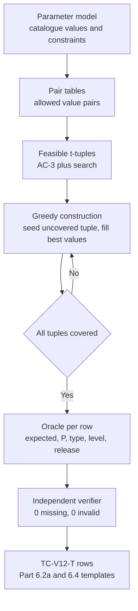

# AI Growth Engine: Employee Sales & Marketing Automation
## Application Blueprint: PART 11 (Batch 11.21b), Master Test Strategy and Combinatorial Test Design (V12): Master Parameter Catalogue, Combinatorial Method, Model Inventory and Platform-wide Cases

| Field | Value |
|---|---|
| Document | Part 11.21b: master parameter catalogue (P-01…P-26) and reference tables (39 SKUs, 24 INV SKUs, 22 roles); combinatorial method, strength policy, constraint handling, layers and verification; model inventory and counts for all 20 Part 11.21 models and the rollup of every combinatorial model in the blueprint; test scenarios TS-V12-T-01…18; generated cases of PM-T01 and PM-T01N in the Part 6.2a parameterized form (PM-T02/PM-T02N are in Part 11.21c) |
| Version | 1.0 · 28 Nov 2026 |
| Baseline | Part 11.21a; Part 6.1 §6.1.11.5 and §6.1.12; Part 6.2a §6.2.1; Parts 11.2, 11.10, 11.15–11.19 |
| Roles applied | Combinatorial test design expert (primary), Head of Quality Engineering, Business Systems Analyst, Principal Engineer |

---

## 11.21.4 Master parameter catalogue

### 11.21.4.1 Cross-cutting dimensions and values

Every Part 11.21 model draws its parameters from this catalogue (single source: `assembly/v12b/t_03_catalogue.py`). Values prefixed with `~` are **invalid values**: they are never combined with each other in the valid-set arrays and are exercised in single-fault layers (Part 6.1 §6.1.11.5 masking rule).

{{CATALOGUE}}

### 11.21.4.2 SKU reference (39 Sales & Marketing services)

Effect classes follow Part 11.17a §11.17.5.2 (R0 read/draft, R1 internal record, R2 external communication, R3 financial/legal/commitment); SKUs that FSD 12 does not classify explicitly are classified from the service definition [ASSUMPTION-1123]. Mandate types and the maximum level come from the eligibility register (Part 11.17a §11.17.5.14). The first release in which the SKU is testable end to end follows Part 11.10b's classification and DEC-770 [ASSUMPTION-1120]. "AI suites" counts the EVAL suites of the SKU's workflows (Part 11.6b).

{{SKU_TABLE}}

### 11.21.4.3 SKU reference (24 Investment Automation services)

{{INV_SKU_TABLE}}

### 11.21.4.4 Role reference (R01–R21 and custom roles)

Channel and identity coupling and the SKUs each role operates are derived from the RBAC matrix (Part 2.3 §2.26.3), the R21 rules (Part 2.6), the custom-role rules (Part 11.19) and the SKU definitions [ASSUMPTION-1122]. R20 operates only SKUs with an AI step (Part 11.6b).

{{ROLE_TABLE}}

### 11.21.4.5 Value-level rules used by the constraints

| Rule | Statement | Source |
|---|---|---|
| CR-01 | Owner Portfolio (T1-*) tenants are on the full suite, in the IN zone, with the Business SLA | DEC-002 as amended; DEC-421/772 |
| CR-02 | Enterprise and managed-service tenants have no trial plan | Part 11.2 subscription engine |
| CR-03 | Locale availability per zone: IN → en-IN, hi-IN, ta-IN, or-IN, ar-AE; EU → en-GB, de-DE, fr-FR, ar-AE | DEC-776; Part 11.7c |
| CR-04 | SLA: SMB ≤ Business; Enterprise ≥ Business | DEC-774 |
| CR-05 | R21 only in EXT-MSP; R17 only for external tenants | Part 2.6; Part 1 |
| CR-06 | Role → SKUs, channels and identity methods per §11.21.4.4; developer API ↔ API key or OAuth; events ↔ signed webhook; agent tool calls ↔ workload identity | Part 2.3; Part 11.19 |
| CR-07 | UI channels ↔ a real device and browser; API/event/agent channels ↔ headless; Admin web ↔ desktop, laptop or tablet; Admin mobile web ↔ tablet or mobile | Part 2.5; DEC-043 |
| CR-08 | SSO SAML only for EXT-ENT, EXT-MSP and T1 | DEC-784 |
| CR-09 | Consent "not applicable" ↔ Public, Internal or Confidential business data; a personal basis ↔ Personal, Confidential or Restricted | BRL-ELG; Part 3.3 |
| CR-10 | Tier 2 free fallback only for Public or Internal data; open-weight in-zone rows never receive Restricted data | DEC-007; DEC-788; Part 11.19b |
| CR-11 | MedMaarg has no Restricted (health) data; WhatsApp, SMS and voice need opt-in or contract, not legitimate interest | MedMaarg rule; RP-IN-WA, RP-IN-SMS |
| CR-12 | Anonymous visitors never carry Restricted or Confidential data | Part 2.4 |
| CR-13 | L3/L4 for R2/R3 SKUs only where the eligibility register has a mandate type; L4 only for "L3 (L4 with plan)" rows; R0/R1 SKUs may run internally at L3/L4 without a mandate | Part 11.17a §11.17.5.2, §11.17.5.14 |

---

## 11.21.5 Combinatorial test design

### 11.21.5.1 Strength policy (DEC-924)

| Area | Strength | Why | Models |
|---|---|---|---|
| Platform-wide behaviour across all SKUs | **Pairwise (2-way)** on the valid set + single-fault layer for every invalid value | Most cross-cutting defects are triggered by one or two interacting values; 16 parameters make higher strength infeasible at this size | PM-T01, PM-T01N, PM-T02, PM-T02N |
| Money-, law- and safety-critical effects (mandates, payments, commerce, bids, voice, investor, publication, spend) | **3-way among the controls** + 2-way capability × control (variable strength), a **3-way positive sub-space**, and a **single-fault × capability** layer | Denials mask deep paths; defects in gates often need three interacting values (e.g. L3 × aggregate cap × EU pack) | PM-T03, PM-T03P, PM-T03N |
| Residency | **3-way** | Zone × component × operation interactions decide where data lands | PM-T04 |
| Isolation and RLS | **3-way** caller × target × operation + 2-way path × each | Confidentiality P0; paths are numerous but behave uniformly per triple | PM-T05 |
| Resilience with in-flight work | **3-way** | Failure × in-flight effect × load interactions decide duplicate-effect risk | PM-T09 |
| Localization, accessibility, performance | **Pairwise** | Quality attributes; interactions above 2 are rare | PM-T06, PM-T07, PM-T08 |
| AI evaluation gate machinery | **Variable strength:** each of the 111 suites once + pairwise among trigger, zone, locale, model row, judge and injected result | Each suite must run; gate behaviour interacts pairwise | PM-T16 |
| Small spaces (≤ 64 valid combinations) | **Exhaustive** | V12-B rule | XT-10…XT-15 |

### 11.21.5.2 Generation method

| Step | Specification |
|---|---|
| 1. Parameter model | Parameters and values from the catalogue; constraints written as a predicate that relates two parameters at a time (binary constraint network) |
| 2. Constraint handling | `t_02_engine.Net` derives the allowed value pairs for every parameter pair once, then decides whether a partial assignment can be completed by **arc consistency (AC-3)** plus backtracking with the smallest remaining domain first. A t-tuple that no valid full row can contain is **excluded by constraint** (reported per model) |
| 3. Required coverage | A list of strength groups (parameter subset, t); the union of their feasible t-tuples must be covered. This expresses pairwise, 3-way, variable-strength and each-choice coverage in one mechanism |
| 4. Construction | Deterministic AETG-style greedy: each new row is seeded with an uncovered tuple and filled parameter by parameter with the value that covers the most still-uncovered tuples while keeping the domains arc-consistent; `ncand` candidate rows per step, the best is kept; fixed seeds (921…936) make re-runs reproduce the same rows |
| 5. Exhaustive spaces | Spaces ≤ 64 valid combinations are enumerated completely |
| 6. Layers | **L1** full-space array (precedence when several faults coincide); **L2** positive sub-space (deep allow paths unmasked); **L3** single fault (each invalid value with all other values valid, paired with every value of the partner parameters) |
| 7. Oracle | Each row's expected result, priority, type, level and release are computed by the model's oracle function from the binding rules (decision orders of Parts 11.15–11.19); the same rule tables are imported by the product (MP-03) |
| 8. Verification | `t_02_engine.verify` is independent of the generator: it checks every row against the original predicate, recomputes every required tuple and, for every tuple absent from the array, proves infeasibility with a separate depth-first search with forward checking on the raw predicate. **Result for every model: 0 missing tuples and 0 invalid rows** |
| 9. IDs and templates | `t_05_build.py` assigns TC-V12-T IDs in model order and renders the Part 6.2a parameterized form (`ID · Data · Expected · Links · P · Type · Tech · Auto · Lvl`) with a Common block per model; AI-evaluation cases use the Part 6.4 template |

### 11.21.5.3 Model counts and verification (Part 11.21)

{{COUNTS}}

**Reading the table.** "Raw product" is the full Cartesian product; "Valid" is the exact number of valid combinations where enumerable. "Required t-tuples" counts the feasible tuples of all strength groups; every one appears in at least one row ("Missing after verification" = 0). "Pairwise-only size" shows how many rows a plain pairwise array would need for the 3-way models, i.e. the price of the higher strength. Priority mix of all Part 11.21 cases including the journeys: {{PRIO}}.

### 11.21.5.4 Combinatorial models across the whole blueprint

| Part | Capability | Models | Strengths | Generated cases | Generator |
|---|---|---|---|---|---|
| Part 6.1 / 6.2a | Dispatch matrix (role × scope × channel × integration × mode) | Sets A and B; TC-08-Q | Pairwise (3-wise nightly) | 26 + 12 | Greedy all-pairs (Part 6.1) |
| Part 11.16d | Investment Automation II (INV-SVC-13…24, securities packs) | 25 (M-O1…M-O16 + 9 mini-models) | 3-way, 2-way, exhaustive | 686 | `o_03_combi.py` |
| Part 11.16e | Investment Automation I (investor engagement, data room, offers, receipts) | 9 (PM-N-01…09) | 3-way, 2-way, exhaustive + base-choice | 760 | `n_comb.py` |
| Part 11.17b | Mandated dispatch, commerce and payment, bids, kill switch | 4 (M, C, B, K) + story arrays | 3-way three layers, exhaustive | 716 | `p_combinatorial.py` |
| Part 11.18d | Voice calls, recording, voicemail, number series, coaching | 5 (C3, RX, VM, NX, CP) | 3-way, exhaustive, pairwise | 465 | `q_voice_combinatorial.py` |
| Part 11.19c | Identity, developer platform, connectors, Vercel path, recovery, registry, benchmarks, DB access | 13 (M01…M13) | 3-way, pairwise, exhaustive | 1,072 | `R_02_combinatorics.py` |
| **Part 11.21** | **Platform-wide and cross-capability** | **20** | **2-way, 3-way, variable strength, single fault, exhaustive** | **{{GEN_TOTAL}}** | `t_04_models.py` |
| **Total** | | **76 + Part 6 sets** | | **{{GEN_TOTAL}} + 3,737** | |

The capability models of Parts 11.16–11.19 stay the authority for their capabilities; Part 11.21 adds the dimensions none of them varies together (tenant type × plan × SKU × zone × locale × role × channel × identity × device × browser × data class × consent × provider × autonomy × AI route × SLA), the cross-capability effect gateway, residency, isolation, quality attributes and the AI gate machinery.

### 11.21.5.5 Test scenarios

{{TS_TABLE}}

---

## 11.21.6 Generated test cases (part 1: platform-wide)

### 11.21.6.1 PM-T01 Platform SKU invocation (valid set, pairwise)

Every valid pair of values of the 16 parameters below appears in at least one case; denial values are tested separately in PM-T01N.

{{HDR_PM-T01}}

#### Group TC-V12-T-M01: Pairwise combinatorial cases – platform SKU invocation (valid set)

{{TAB_PM-T01}}

### 11.21.6.2 PM-T01N Platform SKU invocation (invalid values, single fault)

Each invalid value is combined with every tenant type and with both zones, all other values valid, so that the denial is observable and not masked. The oracle per invalid value:

{{NEG01_TABLE}}

{{HDR_PM-T01N}}

#### Group TC-V12-T-M01N: Single-fault cases – platform SKU invocation (invalid values)

{{TAB_PM-T01N}}

---

### Quality gate: Part 11.21b

| # | Check | Result | Notes |
|---|---|---|---|
| 1 | Every requirement traced to a source | Pass | Catalogue rows cite sources; each case cites TS, SKU/epic, effect class, mandate type and release |
| 2 | Tags logged | Pass | ASSUMPTION-1120, 1122, 1123 used here; register in Part 11.21e |
| 3 | IDs unique and consistent | Pass | TC-V12-T IDs assigned once by `t_05_build.py`; no reuse |
| 4 | No requirement without a test | Pass | Every SKU appears with every role that operates it (pairwise) |
| 5 | Negative, edge, security, accessibility | Pass | 23 invalid values (PM-T01N), each with every tenant type and both zones |
| 6 | Agents | N/A | |
| 7 | Time-sensitive facts flagged | Pass | Region codes "verify" |
| 8 | No restricted data to free tiers | Pass | CR-10 constraint; Tier 2 rows only with Public/Internal data; PM-T01N fault row |
| 9 | Consistent with earlier parts | Pass | Mandate types and levels as Part 11.17a |

**Status: Part 11 Batch 11.21 file b complete. Catalogue, method, counts and the platform-wide generated cases are published.**
