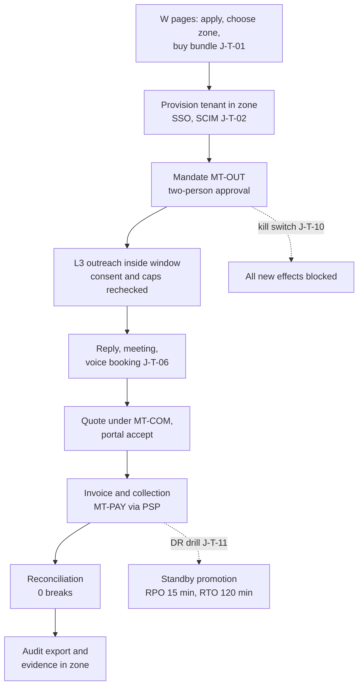

# AI Growth Engine: Employee Sales & Marketing Automation
## Application Blueprint: PART 11 (Batch 11.21e), Master Test Strategy and Combinatorial Test Design (V12): Cross-capability End-to-End Suites, Traceability Rollup, Release Suites, Regression Strategy and Decisions

| Field | Value |
|---|---|
| Document | Part 11.21e: cross-capability end-to-end journeys J-T-01…18 run per zone ({{E2E_COUNT}} full-form cases TC-V12-T-001…031), the traceability rollup of every test in the blueprint and of all {{FR_DEFINED}} FR-V12 requirements (with 9 gap-closure cases TC-V12-T-032…040), the suites run per release, the regression strategy, conflicts, decisions DEC-920…939, ADR-270…274, the expert panel review, the tags register and the quality gate of Part 11.21 |
| Version | 1.0 · 28 Nov 2026 |
| Baseline | Parts 11.21a–d; Part 6.1 §6.1.12.6 (traceability matrix specification), §6.1.13 (UAT); Parts 11.10a–c (V12 test catalogue); Parts 11.14–11.19 |
| Roles applied | Head of Quality Engineering (primary), AI evaluation lead, performance and resilience architect, security test lead, accessibility test lead, combinatorial test design expert, Product Owner |

---

## 11.21.7 Cross-capability end-to-end scenario suites

### 11.21.7.1 Journey register

Each journey chains several capabilities end to end and is executed once per zone in which the capability exists (IN; EU in the EU-configured test cell until the EU stack is provisioned, DEC-927). Every page passes axe; one correlation ID spans the journey; every effect is reconciled; every record is checked to be in the journey's zone.

{{E2E_REGISTER}}

*Figure: journey J-T-01 with the journeys that branch from it.*

### 11.21.7.2 End-to-end test cases (full form, Part 6.2a)

{{E2E_TABLE}}

---

## 11.21.8 Traceability rollup, release suites and regression strategy

### 11.21.8.1 Test totals across the blueprint

Counted by `assembly/v12b/t_01_inventory.py`: an ID in the first cell of a table row is a definition; IDs are de-duplicated across files; Part 11.21 is excluded from the scan and added below.

{{ROLL_PARTS}}

{{ROLL_TOTAL}}

**Result.** The blueprint holds **{{EXEC_BEFORE}} executable test cases before Part 11.21** and **{{EXEC_AFTER}} after it** ({{ALL_TOTAL}} new TC-V12-T cases: {{E2E_COUNT}} end-to-end, 9 FR gap-closure and {{GEN_TOTAL}} generated). The V12 brief's starting figure of 4,156 and Part 11.10's 6,472 (= 4,156 + 2,316) use the parts' own counts; this rollup recounts row definitions and expands Part 11.10's classes into their instances, which is the basis for release planning.

### 11.21.8.2 Functional-requirement traceability (FR-V12, Parts 11.1–11.19)

Every FR-V12 row defined in Parts 11.1–11.19 was checked programmatically (`t_05_build.py`, function `fr_trace`): first for a test named in the FR row itself (TC, TS, EVAL, workflow test, AT01 or combinatorial model), then for a TC row or a TC range anywhere in the blueprint that cites it. Nine FRs had a test description but no test ID; Part 11.21 closes them with TC-V12-T-032…040 (scenario TS-V12-T-18).

{{FR_TABLE}}

**Gap-closure cases (full form, Part 6.2a).**

{{GAP_TABLE}}

### 11.21.8.3 Decision-to-test traceability (Founder decisions DEC-770…791)

| DEC | Decision (short) | Blocking tests in this part | Capability tests elsewhere |
|---|---|---|---|
| DEC-770 | Full Release 2 change request; dates follow the work | Release entry/exit §11.21.2.6; release suites §11.21.8.4 | Part 11.10 classes |
| DEC-771 | RTO ≤ 120 min | PM-T09; DR-V12-T-01…08; J-T-11; GV-DR | Part 11.19 M09 |
| DEC-772 | IN and EU residency; CJ-TC-09 both directions | PM-T04; PM-T01 zone values; J-T-01…18 per zone; GV-RES | Part 11.19 M08 |
| DEC-773 | 24×7 on-call | XT-13; monthly paging test | Part 11.11 TC-V12-K |
| DEC-774 | SLA tiers with credits | XT-13, XT-14; PM-T01 SLA values; PM-T08 tiers | Part 11.11 |
| DEC-775 | Certification sequence | OAT evidence; evidence completeness metric | Part 11.11 |
| DEC-776 | Global expansion: zones, locales, tax | PM-T06; PM-T01N zone fault; J-T-14 | Part 11.7 |
| DEC-777 | 09:00–21:00 window | XT-12; PM-T03 E04 | Part 11.18 call model |
| DEC-778 | `app_rw`, no `service_role` | PM-T05 (Data API rows); GV-RLS | Part 11.9b; Part 11.19 M12 |
| DEC-779 | Bounded mandates L3/L4 | PM-T03 (all layers); XT-15; J-T-01/03/04/05/10 | Part 11.17b model M, K |
| DEC-780 | Agentic commerce and payments | PM-T03 E09–E11; J-T-03/04; LT-V12-T-03/06 | Part 11.17b model C |
| DEC-781 | Automatic bid submission | PM-T03 E12; J-T-05; DR-V12-T-07 | Part 11.17b model B |
| DEC-782 | AI voice and recordings | PM-T03 E04; J-T-06/07; LT-V12-T-02; DR-V12-T-02 | Part 11.18d (465 cases) |
| DEC-783 | Investor mode and Investment Automation | PM-T02, PM-T02N; PM-T03 E14/E15; J-T-08 | Parts 11.16d/e |
| DEC-784 | SSO/SCIM in Release 1 | PM-T01 identity values; J-T-02; LT-V12-T-04 | Part 11.19 M01–M03 |
| DEC-785 | Developer platform and connectors | PM-T05 developer-key and webhook paths; J-T-02 | Part 11.19 M04–M07 |
| DEC-786 | Personal data via Vercel | PM-T04 Vercel rows; DR-V12-T-03 | Part 11.19 M08 |
| DEC-787 | RPO ≤ 15 min | PM-T04 backup rows; PM-T09; LT-V12-T-12 | Part 11.19 M09 |
| DEC-788 | Model registry; Claude Sonnet primary; 111 suites | PM-T16; PM-T01 AI-route values; J-T-16; DR-V12-T-04 | Part 11.19 M10, M13; Part 11.6b |
| DEC-789 | Cross-tenant benchmarks | PM-T05 benchmark path; J-T-17 | Part 11.19 M11 |
| DEC-790 | All change requests funded | Effort §11.21.2.11 | Part 11.20 |
| DEC-791 | Every other pending item adopted (pricing experiments, generative media) | PM-T03 E13; PM-T01 SKU 27, 37 rows | Part 11.17 MT-PRICE |

### 11.21.8.4 Suites run per release

**Part 11.21 cases by first release** (a case runs from its first release onward; regression is cumulative):

{{REL_TABLE}}

**All suites by release** ("●" = runs at the release gate; "○" = runs where the scope exists or for regression only).

| Suite family | Source | R1 | R2 | R3 | R4 | Gate |
|---|---|---|---|---|---|---|
| TC-<epic> functional suites EP-01…EP-21 | Parts 6.2–6.5 | ● | ● | ● | ● | G3/G4 |
| TC-NFR, TC-FLT, TC-ENH-*, TC-ADV-*, TC-ALN-* | Parts 6.7–6.10, 2.6–9.10 | ● | ● | ● | ● | G3/G4 |
| TC-AI-AG### agent evaluation cases | Part 6.4 | ● | ● | ● | ● | GV-EVAL |
| V12 workflow classes TC-V12-J-001…019 (2,275 instances) | Part 11.10 | ● (SKUs 01–16, 25) | ● (all SKUs) | ● | ● | G3/G4 |
| TC-V12-A…I, K…M | Parts 11.1–11.9, 11.11–11.13 | ● | ● | ● | ● | G3 |
| Rule-pack cases | Part 11.15 | ● (IN outbound packs) | ● | ● (new markets) | ● | GV-PACK |
| Investment Automation (TC-V12-N, TC-V12-O) | Parts 11.16a–e | ○ | ● | ● | ● | G4 |
| Mandates, commerce, payments, bids (TC-V12-P) | Part 11.17b | ○ | ● | ● | ● | GV-MND |
| Voice (TC-V12-Q) | Part 11.18c/d | ○ | ● | ● | ● | G4 |
| Platform decisions (TC-V12-R) | Part 11.19c | ● | ● | ● | ● | G4 |
| PM-T01/T01N platform pairwise | Part 11.21b | ● (R1 rows) | ● | ● | ● | G3 |
| PM-T02/T02N investment | Part 11.21b | — | ● | ● | ● | G3 |
| PM-T03 (L1–L3) effect gateway | Part 11.21c | ● (L1/L2 rows of E01, E02, E05, E06) | ● | ● | ● | GV-MND |
| PM-T04 residency, PM-T05 isolation | Part 11.21c | ● | ● | ● | ● | GV-RES, GV-RLS |
| PM-T09 resilience, DR-V12-T-01…08 | Parts 11.21a/c | ● (idle and MT-OUT rows) | ● | ● | ● | GV-DR |
| XT-10…XT-15 exhaustive | Part 11.21c | ● (XT-11, 12) | ● | ● | ● | G3 |
| PM-T06 localization | Part 11.21d | ● (en-IN, en-GB) | ● (+ hi, ta, or) | ● (+ de, fr) | ● (+ ar RTL) | G3 |
| PM-T07 accessibility | Part 11.21d | ● (LTR) | ● | ● | ● (+ RTL) | GV-A11Y |
| PM-T08 performance, LT-01…12, LT-V12-T-01…12 | Parts 6.1, 11.21a/d | ● | ● | ● | ● | GV-PERF |
| EVAL-SM-SVC suites (111) and PM-T16 | Parts 11.6b, 11.21d | ● (enabled R1 workflows, en) | ● (+ hi) | ● (+ de, fr) | ● (+ ar) | GV-EVAL |
| E2E journeys J-T-01…18 | Part 11.21e | ● (J-T-02, 11, 15, 18) | ● (all except J-T-14) | ● | ● (+ J-T-14) | G4 |
| UAT-PK (Part 6.1) and UAT-PK-V12-01…13 | Parts 6.1, 11.21a | ● | ● | ● | ● | G4 |

### 11.21.8.5 Regression strategy (DEC-932)

| Tier | Trigger | Selection rule | Contents | Time budget | Blocking |
|---|---|---|---|---|---|
| **RT-0 smoke** | Every deploy (dev, test, staging, prod read-only) | Fixed | Health/ready, login per zone, one read per surface, residency probe sample | ≤ 5 min | Yes |
| **RT-1 impact** | Pull request | Trace graph: changed module → FRs → stories → TCs; plus every generated row whose parameter values touch the changed area (e.g. a change in `app/rules/pdp/` selects every PM-T03 row; a change in the WhatsApp adapter selects rows with SKU 07 or effect E02) (RECOMMENDATION-1134, ADR-274); plus the pinned S1/S2 regression set | Selected UT/IT/CT/SYS | ≤ 15 min p90 | Yes |
| **RT-2 nightly** | Nightly per zone | All generated SYS rows of the current release and earlier; E2E on three engines; EVAL suites affected by the day's changes | Full SYS + E2E | ≤ 3 h | Next release candidate blocked if red |
| **RT-3 release** | Release-candidate tag | Everything of RT-2 + all P0 twice + DR drills + load set + manual AT passes + UAT | Full regression | 1–5 days | Yes |
| **RT-4 pack change** | A rule pack version changes | Every row whose jurisdiction, pack or channel value is governed by the pack (PM-T01, PM-T02, PM-T03, XT-10, XT-12) + the pack's own cases (Part 11.15) | Targeted | ≤ 30 min | Blocks pack activation |
| **RT-5 model change** | Model, prompt, retrieval, policy or tool change | AU-154 selection of affected EVAL suites + PM-T16 rows of those suites + TC-AI cases of the agents | Targeted | ≤ 3 h | Blocks promotion |
| **RT-6 zone change** | New zone, region move or infrastructure change in one zone | PM-T04 and PM-T05 complete, PM-T09 for the zone, all E2E for the zone | Targeted | ≤ 1 day | Blocks zone go-live |

**Regression set maintenance.** (1) Every fixed defect adds a test (Part 6.1 T02). (2) Retired requirements retire their cases with status *Retired*; IDs are never reused. (3) Regenerating a model after a catalogue change produces a reviewed diff; cases whose row values no longer exist are retired, new rows get new IDs after the current maximum. (4) The permanent negative test of Part 6.1 §6.1.3.2 "no fundraising" is retired and replaced by securities permanent negatives (PM-T02N rows; DEC-923).

---

## 11.21.9 Conflicts and proposed resolutions

| ID | Conflict | Resolution | Status |
|---|---|---|---|
| [CONFLICT-1129] | Part 11.10c rule R-8 says consequential effects in any test keep autonomy L1 and "no test may assert an AI-executed signature, payment, bid submission or price"; DEC-779…781 allow mandated L3/L4 payments, commerce and bids | Amend R-8: a consequential effect in a test requires either a human approval bound to the payload hash (L1/L2) **or** an Active two-person mandate with all PDP rules passing (L3/L4); tests **must** assert system-executed effects under mandates; AI never signs or sets prices outside approved revisions (DEC-921) | Resolved by DEC-921 (consequence of DEC-779…781) |
| [CONFLICT-1130] | Part 6.1 T12 and DR-1…8 use RTO ≤ 4 h (DEC-018/158); DEC-771 sets RTO ≤ 120 min as blocking | All DR tests and drills use RTO ≤ 120 min and RPO ≤ 15 min (DEC-922) | Resolved by DEC-922 |
| [CONFLICT-1131] | Part 6 quiet-hour cases use 09:00–19:00 Monday–Saturday (BRL-ELG-08); DEC-777 sets 09:00–21:00 with stricter packs winning | XT-12 replaces the window oracle; affected Part 6.2a cases (e.g. TC-08-114…137) are re-baselined to the DEC-777 window at the next regeneration (DEC-931) | Resolved by DEC-931 |
| [CONFLICT-1132] | Part 6.1 G1 includes a permanent "no-fundraising check (DEC-002)"; DEC-783 adopts investor/fundraising | Retire the check; replace with securities permanent negatives: no offer to ineligible recipients, no general solicitation where prohibited, no personalised investment advice (DEC-923) | Resolved by DEC-923 |

## 11.21.10 Decisions

| DEC | Decision | Authority | Effect |
|---|---|---|---|
| DEC-920 | Part 11.21 is the master test strategy for the V12 scope; Part 6.1 stays binding where this part is silent | Customer revision V12 (28 Nov 2026); Founder instruction DEC-779…791 ("test strategies … all using permutations and combinations") | Single strategy across Parts 11.15–11.22 |
| DEC-921 | Part 11.10c R-8 amended (CONFLICT-1129) | Consequence of DEC-779…781 | Mandated effects are asserted in tests |
| DEC-922 | RTO ≤ 120 min and RPO ≤ 15 min are the blocking targets of every DR test and drill | Consequence of DEC-771, DEC-787 | Part 6.1 T12 target superseded |
| DEC-923 | "No fundraising" permanent negative retired; securities permanent negatives added | Consequence of DEC-783 | G1 content updated |
| DEC-924 | Strength policy: pairwise default; 3-way for money, law, safety, residency, isolation and resilience; exhaustive ≤ 64; single-fault layers for invalid values; positive sub-space layers for gate-heavy models | Customer revision V12 (V12-B brief) | §11.21.5.1 |
| DEC-925 | Covering arrays are generated by code and verified (0 missing tuples, 0 invalid rows) on every change | Customer revision V12 (V12-B brief) | GV-COMB |
| DEC-926 | Eleven V12 CI gates GV-COMB, GV-RLS, GV-CT, GV-SEC, GV-RES, GV-EVAL, GV-PACK, GV-A11Y, GV-MND, GV-DR, GV-PERF | Customer revision V12 (28 Nov 2026) | §11.21.2.9 |
| DEC-927 | EU-configured test cell from Release 1; all EU-zone suites run there until the EU stack exists | Consequence of DEC-772 | `test-EU` environment |
| DEC-928 | Entry and exit criteria per release R1–R4 as §11.21.2.6 | Customer revision V12 (28 Nov 2026) | A090 go/no-go |
| DEC-929 | Severity model extended with V12 S1 examples | Customer revision V12 (28 Nov 2026) | §11.21.2.7 |
| DEC-930 | Synthetic tenants SYN-T01…T12 and fixture packs are versioned test assets; no production personal data in non-production; EU synthetic data generated in the EU cell | Consequence of DEC-772 | §11.21.2.5 |
| DEC-931 | Messaging-window oracle: half-open [09:00, 21:00) recipient local; stricter pack wins; transactional exempt | Consequence of DEC-777 | XT-12; CONFLICT-1131 |
| DEC-932 | Regression tiers RT-0…RT-6 | Customer revision V12 (28 Nov 2026) | §11.21.8.5 |
| DEC-933 | Journey register J-T-01…18 and UAT packs UAT-PK-V12-01…13 | Customer revision V12 (28 Nov 2026) | §11.21.7, §11.21.3.3 |
| DEC-934 | Load tests LT-V12-T-01…12 and drills DR-V12-T-01…08 | Customer revision V12 (28 Nov 2026) | §11.21.3.6–3.7 |
| DEC-935 | EVAL suites gate promotion per workflow and locale; PM-T16 tests the gate machinery | Consequence of DEC-788 | GV-EVAL |
| DEC-936 | Effort 167 / 250 / 364 pd (≈ ₹7.55 / 14.24 / 24.78 L) and the running items of §11.21.2.11, funded under DEC-790, de-duplicated in Part 11.20 | Consequence of DEC-790 | Plan and budget |
| DEC-937 | Manual AT matrix includes JAWS, mobile screen readers and voice control | Customer revision V12 (28 Nov 2026) | PM-T07 |
| DEC-938 | Executed t-way coverage of P0 models = 100% is a release KPI | Customer revision V12 (V12-B brief) | §11.21.2.10 |
| DEC-939 | Test evidence is stored in the zone of the tenant whose data the test touched | Consequence of DEC-772 | ADR-273 |

**Architecture decision records.**

| ADR | Title | Decision | Alternatives rejected |
|---|---|---|---|
| ADR-270 | Model-driven combinatorial test generation | Parameter catalogue, models and oracles as code; JSON row store; pytest/Playwright parametrization; deterministic seeds; independent verifier | Commercial or external pairwise tools only (no shared oracle, no verification in CI); hand-written tables (drift) |
| ADR-271 | Per-zone test environments with an EU test cell from R1 | `test-*`, `staging-*`, `perf-*`, `uat-*`, `drill-*` per zone; no cross-zone replication | Single test environment simulating zones (cannot prove residency) |
| ADR-272 | Test-only seeding API and simulators | Seeding API and simulators behind a build flag and a start-up guard; never present in `prod` | Direct DB seeding (bypasses RLS and audit) |
| ADR-273 | Evidence store per zone | Evidence records with model ID, row values, oracle version and seed versions, stored in the zone | Central evidence store (residency breach risk) |
| ADR-274 | Impact-based regression selection | Trace graph + parameter-value addressing of generated rows | Full-suite-only (too slow for PRs); manual selection (misses) |

## 11.21.11 Expert panel review

| Panel member | Finding | Action taken |
|---|---|---|
| Head of Quality Engineering | The V12 scope multiplies suites; without one release table, gates drift | Release entry/exit (§11.21.2.6), release counts and suite matrix (§11.21.8.4) |
| Combinatorial test design expert | Plain arrays over gate-heavy models produce mostly denials (L1 of PM-T03: only a handful of ALLOW rows) | Three layers per critical model; constraint-excluded tuples reported; independent verifier |
| Combinatorial test design expert | A 16-parameter platform model is dominated by SKU × role (39 × 22) | Valid pairs derived from RBAC (CR-06) so only meaningful pairs are required; 648 rows instead of thousands |
| AI evaluation lead | Model quality and gate machinery are different concerns | Suites measure quality; PM-T16 tests the gates; registry approval tested separately (J-T-16) |
| Performance and resilience architect | DR tests must include in-flight consequential work, not only idle restores | PM-T09 in-flight parameter; DR-V12-T-01/05/07 |
| Security test lead | Isolation must cover non-obvious paths (embeddings, webhooks, notifications, benchmarks, Data API) | PM-T05 paths; GV-RLS blocking |
| Accessibility test lead | Mobile screen readers and voice control were missing from Part 6 | DEC-937; PM-T07 AT values |
| Counsel (advisory) | Oracles derived from packs encode legal interpretations | RECOMMENDATION-1137: counsel reviews oracle tables of law-critical models |

## 11.21.12 Tags register

### 11.21.12.1 Tags issued in Part 11.21 (range 1120–1139, all used)

| Tag | Statement | Where |
|---|---|---|
| [ASSUMPTION-1120] | First testable release per SKU: SM-SVC-01…16 and 25 in R1; 17…24 and 26…39 in R2 (Part 11.10b classes and epics; DEC-770) | §11.21.4.2 |
| [ASSUMPTION-1121] | Mandate and budget caps are inclusive: a value exactly at the cap is allowed | PM-T03 oracle |
| [ASSUMPTION-1122] | Role → SKU, channel and identity coupling derived from RBAC, R21 and custom-role rules and the SKU definitions | §11.21.4.4 |
| [ASSUMPTION-1123] | Effect class of SKUs not explicitly classified in FSD 12 derived from the service definition | §11.21.4.2 |
| [ASSUMPTION-1124] | Synthetic tenants, persons, numbers and amounts are fictional fixtures | §11.21.2.5 |
| [ASSUMPTION-1125] | Performance targets for AI gateway, voice, payments, SSO/SCIM, mandates, negotiation, data room and webhooks are proposed until NFRs confirm them | §11.21.3.6 |
| [GAP-1126] | No Approved-pack drafts yet for SG, AE (and UK/US for non-securities capabilities); those jurisdictions are tested only for fail-closed behaviour | §11.21.3.11 |
| [GAP-1127] | Parts 11.20 (plan) and 11.22 (stories) are produced in parallel; sprint placement of suites, de-duplication of effort and links to US-…-ZU stories to be completed there | §11.21.2.11 |
| [GAP-1128] | No contractual acknowledgement targets for SEV3/SEV4 by SLA tier; the Part 11.11b matrix is used | XT-13 |
| [CONFLICT-1129] | Part 11.10c R-8 vs DEC-779…781 | §11.21.9 |
| [CONFLICT-1130] | Part 6.1 RTO 4 h vs DEC-771 | §11.21.9 |
| [CONFLICT-1131] | Part 6 quiet-hour window vs DEC-777 | §11.21.9 |
| [CONFLICT-1132] | Part 6.1 no-fundraising permanent negative vs DEC-783 | §11.21.9 |
| [RECOMMENDATION-1133] | Generate tests from models as code with shared oracles (ADR-270) | §11.21.2.8 |
| [RECOMMENDATION-1134] | Select regression by parameter-value addressing of generated rows | §11.21.8.5 |
| [RECOMMENDATION-1135] | Run an EU-configured test cell from Release 1 (DEC-927) | §11.21.2.4 |
| [RECOMMENDATION-1136] | Report executed t-way coverage as a release KPI (DEC-938) | §11.21.2.10 |
| [RECOMMENDATION-1137] | Counsel reviews the oracle tables of law-critical models | §11.21.2.8 |
| [RECOMMENDATION-1138] | Test-only seeding API with a production start-up guard (ADR-272) | §11.21.1.4 MP-16 |
| [RECOMMENDATION-1139] | Regenerate models when catalogue values change and review the diff like code | §11.21.1.4 MP-15 |

### 11.21.12.2 Inconsistencies found in earlier parts (reported, not edited)

| # | Part | Inconsistency | Handling |
|---|---|---|---|
| 1 | Part 11.10c §11.10.5.1 R-8 | Still states the L1 cap for every consequential test after DEC-779…781 | CONFLICT-1129 / DEC-921 |
| 2 | Part 6.1 §6.1.3.1 T12, §6.1.14.4 | RTO 4 h | CONFLICT-1130 / DEC-922 |
| 3 | Part 6.1 §6.1.9.5 G1 | "no-fundraising check (DEC-002)" | CONFLICT-1132 / DEC-923 |
| 4 | Part 11.17a §11.17.5.3 vs §11.17.5.14 | The mandate-type table lists SM-SVC-38 (SMS) as a typical MT-OUT workflow, but the binding eligibility register does not; Part 11.21 follows the register (SMS has no mandate path) | Report to Group P2 owner |
| 5 | Load-test numbering | LT-13 and LT-16 are referenced in Part 3.4 as proposed numbers; Part 11.21 therefore uses LT-V12-T-01…12 to avoid a collision | Noted |
| 6 | Test totals | The V12 brief's 4,156 differs slightly from a row-definition scan of Parts 2.6–9.10 (§11.21.8.1) because worked examples and aliases are counted differently | Counting basis stated |

## 11.21.13 Quality gate: Part 11.21 (files a–e)

| # | Check | Result | Notes and fixes applied |
|---|---|---|---|
| 1 | Every requirement traced to a source | Pass | DEC-770…791 → tests (§11.21.8.3); all {{FR_DEFINED}} FR-V12 rows traced to ≥ 1 test (§11.21.8.2, 9 closed here); every case links TS, workflow/SKU and release |
| 2 | Assumptions, gaps, conflicts tagged and logged | Pass | 20 tags 1120…1139 (§11.21.12.1) |
| 3 | IDs unique and consistent with earlier parts | Pass | TC-V12-T-001…040 and 101…{{LAST_ID}}; DEC-920…939; ADR-270…274; LT/DR/UAT IDs checked for collisions |
| 4 | No story lacks AC and no requirement lacks a test | Pass (N/A for stories) | Stories are Part 11.22; every DEC and capability has tests |
| 5 | Negative, edge, security and accessibility cases covered | Pass | Single-fault layers; boundaries (XT-12, XT-14); isolation; WCAG 2.2 AA with AT |
| 6 | No agent lacks guardrail, fallback, KPI and cost | N/A | No new agents; AI gate machinery tested (PM-T16) |
| 7 | Time-sensitive facts flagged "verify" with an as-of date | Pass | Tools, regions, providers, AT versions, prices |
| 8 | No restricted data routed to free-tier models | Pass | Constraint CR-10; fault rows; LT-V12-T-01; DR-V12-T-04 |
| 9 | Consistent with earlier parts | Pass with conflicts raised | CONFLICT-1129…1132 resolved by DEC-921…923, 931 |
| 10 | Combinatorial coverage verified | Pass | All 20 models: 0 missing t-tuples, 0 invalid rows (independent verifier) |

**Status: Part 11 Batch 11.21 complete (files a–e). Master test strategy for the full V12 scope; master parameter catalogue of 26 dimensions; 20 combinatorial models generated programmatically and verified; {{ALL_TOTAL}} new test cases ({{E2E_COUNT}} end-to-end + 9 FR gap-closure + {{GEN_TOTAL}} generated); blueprint executable test total {{EXEC_BEFORE}} → {{EXEC_AFTER}}; DEC-920…939, ADR-270…274.**
