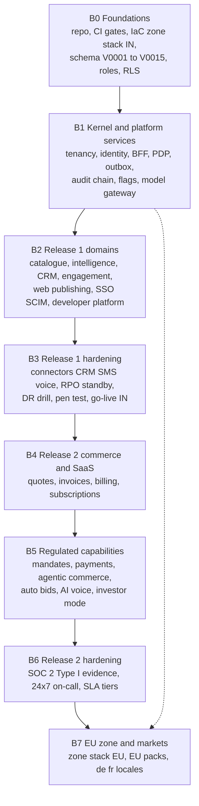

# AI Growth Engine: Employee Sales & Marketing Automation
## Application Blueprint: PART 11 (Batch 11.24a), Developer Build & Production Deployment Pack (single source of truth): Reading Guide, Repository Structure and the Consolidated API Contract

| Field | Value |
|---|---|
| Document | Part 11.24a: the single source of truth from which a development team builds the AI Growth Engine and deploys it to production in the India (IN) and EU residency zones. File a holds the reading guide and precedence (§11.24.1), the repository and code structure (§11.24.2) and the consolidated OpenAPI 3.1 contract (§11.24.3). File b holds the consolidated database DDL (§11.24.4), the configuration and secrets catalogue (§11.24.5) and the environments, infrastructure as code, networking and secrets management (§11.24.6). File c holds CI/CD (§11.24.7), the production deployment runbook (§11.24.8), the Definition of Ready and Done (§11.24.9), observability (§11.24.10), onboarding (§11.24.11) and the decisions, ADRs, tags and quality gate (§11.24.12–§11.24.16) |
| Version | 1.0 · 28 Nov 2026 |
| Baseline | Part 11.14 (DEC-770…791, binding); Parts 3.1–3.6, 4.1–4.4, 8.2; Parts 11.5a/b, 11.8a/b, 11.9a/b/c, 11.19a/b/c; data and API sections of Parts 11.16a–e, 11.17a/b, 11.18a–d; rule packs of Parts 11.15a–e and 11.16d; SHARED, V12 and V12-B briefs |
| Generated artefacts | `final/build/openapi.yaml` (1,122 operations), `final/build/api_index.csv`, `final/build/schema.sql` (470 tables), `final/build/migrations/V0001…V0015` (16 files), `final/build/migration_order.csv`, `final/build/table_index.csv`, `final/build/schema_deferred.sql` (empty), `final/build/db_test_report.txt` (42/42 PASS), `final/build/config/*` (catalogues and `.env.example` files), `final/build/ci/.github/workflows/*.yml` (5 workflows, 19 jobs), `final/build/terraform/**` (11 modules, 8 live roots) |
| Generator scripts | `assembly/v12b/w_common.py`, `w_sql.py`, `w_01_openapi.py`, `w_02a_parse_data_parts.py`, `w_02b_build_schema.py`, `w_03_dbtest.py`, `w_04_validate_openapi.py`, `w_05_config.py`, `w_06_ci_iac.py`, `w_07_fragments.py`, `w_08_assemble.py` |
| Precedence | V12-B brief > Part 11.14 > **Part 11.24 for build and deployment artefacts** > Parts 11.15–11.23 > Parts 11.1–11.13 > earlier parts (DEC-980). A functional or legal decision in a decision part always wins over this pack; the pack is then regenerated (DEC-997) |
| ID ranges used | DEC-980…999 · ADR-280…289 · ASSUMPTION/GAP/CONFLICT/RECOMMENDATION-1200…1219 · TC-W-DB-01…42 · TC-W-API-01…12 · DOR-01…18 · DOD-01…24 · GNG-01…40 · SMK-01…24 · CUT-01…34 · RB-W-01…12 · OB-01…26 · ONB-01…30 · API-V12-W-#### (operations without a source ID) |
| Roles applied | Principal Engineer / Tech Lead · Platform/DevOps lead (Vercel, Supabase, AWS, Terraform, GitHub Actions) · API governance lead (OpenAPI 3.1) · Database lead (PostgreSQL/Supabase, RLS, migrations) · Release manager |

---

## 11.24.1 Reading guide, precedence and build order

### 11.24.1.1 What this pack is and how to use it

This pack answers one question for the delivery team: **what exactly do we build, in which order, from which artefact, and how do we put it into production safely in both residency zones?** Every requirement-level statement points to the part that owns it. The generated artefacts in `final/build/` are produced by scripts from the tables of the blueprint, so a change in a source part is carried into the artefacts by re-running the scripts (DEC-997), not by editing the artefacts by hand.

| If you are… | Start with | Then read | Artefacts you own |
|---|---|---|---|
| Backend engineer (Django/DRF) | §11.24.2 repository, §11.24.3 API contract, §11.24.4 schema | Part 3.1 §3.1.4 components; Part 3.2 standards; Part 11.9b RLS; Part 11.17–11.19 designs | `backend/**`, `openapi/openapi.yaml`, `db/**` |
| Frontend engineer (React/TS) | §11.24.2.3 frontends, §11.24.3.6 client generation | Part 2.5, Part 11.7a–c screens; Part 3.2 §3.2.1 conventions | `apps/website`, `apps/admin`, `packages/*` |
| AI engineer | §11.24.2.4 AI assets, §11.24.5.3 flags, §11.24.7 PL-12 | Part 7.x, Part 11.6a/b, Part 11.19b C6 registry | `ai/**`, gateway module |
| Platform / DevOps | §11.24.6, §11.24.7, §11.24.8 | Part 4.3, Part 11.5b §11.5.5.8–10, Part 11.19a C4, Part 11.19b C5/C8 | `infra/**`, `.github/**`, `ops/**` |
| Database lead | §11.24.4 | Part 3.3, Part 3.6, Part 11.9a/b, Part 11.19b C8 | `db/**`, migration pipeline |
| QA lead | §11.24.4.8 DB tests, §11.24.7 gates, §11.24.9 DoD | Part 6.x, Part 11.10, Part 11.21 (where published) | test suites, evidence |
| Release manager | §11.24.8 runbook, §11.24.9 | Part 8.2 §8.2.4–8.2.5, Part 11.11 | A090 release records |
| Legal/compliance (R10) | §11.24.5.4 rule-pack gates and activation matrix | Parts 11.15a–e, 11.16d | Pack approvals, counsel sign-off |

### 11.24.1.2 Precedence: which part governs what

The rule is the one already used across Part 11 (DEC-415 extended): **later decision parts beat earlier parts; decisions beat descriptions; stricter law beats any default.** For build and deployment artefacts this pack is the reference; for behaviour, rules and legal conditions the owning part is the reference.

| Topic | Governing part (binding) | Superseded or narrowed text | This pack's role |
|---|---|---|---|
| Scope, safety caps, bounded mandates, regulated capabilities | Part 11.14 DEC-770…791; Parts 11.16–11.18 | DEC-002, DEC-053, DEC-064 (L1 cap), DEC-386/387/392 | Activation flags and DB gates (§11.24.5.4) |
| Hosting topology and regions | DEC-421 as amended by DEC-772, DEC-786; Part 11.5b §11.5.5.8; Part 11.19a C4 | Part 3.1 §3.1.6 (RDS, CloudFront for SPAs), Part 4.3 §4.34 accounts list (single region) | Zone stacks in IaC (§11.24.6) [CONFLICT-1213 → DEC-988] |
| Database access model and roles | DEC-778; Part 11.19b C8 (canonical `app_rw`) | Part 3.3 §3.3.5.10 `ge_app`/`ge_worker`; Part 11.9b `ge_*` names | Roles created canonical in V0001 (DEC-983) |
| Physical schema | Part 3.3 (typed entities), Part 3.6, Part 11.9a/b (DDL-V12-I), Part 11.19a/b (DDL-V12-R) | DEC-660 physical naming rule (amended) | `schema.sql` lineage (ADR-280, DEC-981) |
| API contract | Part 3.2 (standards and 555 operations), 3.5b, 9.7b, 11.5b, 11.8b, 11.13b, 11.16a/c, 11.17b, 11.18b, 11.19a/b | Per-namespace hand-written documents | `openapi.yaml` contract of record (DEC-986) |
| Recovery objectives | DEC-771 (growth RTO ≤ 120 min), DEC-787 (RPO ≤ 15 min); Part 11.19b C5 | DEC-158, Part 4.3 §4.47 cadence, Part 11.5b DR-01…05 (database) | DR drill and go/no-go (§11.24.8.8) |
| Release, rollback, go-live, hypercare | Part 4.3 §4.37–4.38, Part 8.2 §8.2.4–8.2.5, Part 11.5a §11.5.4.6 GO-01…08, Part 11.11 | Calendar dates of DEC-228 (now indicative, DEC-770) | Runbook (§11.24.8) |
| On-call, SLA | DEC-773, DEC-774; Part 11.11 | DEC-044/080 business hours; DEC-325 | Hypercare staffing (§11.24.8.7) |
| Rule packs and activation | Parts 11.15a–e, 11.16d; DEC-776 legal gate | Any statement of a "default on" external capability | Activation matrix (§11.24.5.4) |
| Model use | DEC-788 registry; Part 11.19b C6 | DEC-418 wording | `ai.*` flags, registry tables |

### 11.24.1.3 Build order (dependency-driven; dates follow the work, DEC-770)

The build order is a dependency graph, not a calendar. A stage starts when its entry gates are green. Stages B0–B3 are the Release 1 critical path; B4–B6 are Release 2; B7 is the EU zone and later markets (DEC-772, DEC-776).



| Stage | Build (repository paths) | Entry gate | Exit gate (all blocking) | Owning parts |
|---|---|---|---|---|
| B0 Foundations | `infra/modules/*`, `infra/live/dev/in`, `.github/workflows/pr.yml`, `db/migrations/V0001…V0015`, `backend/growth_engine/settings`, `packages/config` | Repo created; GitHub OIDC; Supabase org; Vercel team; AWS accounts | `db-verify` green (TC-W-DB-01…42); `pr.yml` 9 jobs green on an empty change; dev zone stack applied with an empty `tofu plan` | §11.24.2, §11.24.4, §11.24.6, §11.24.7; Part 4.3 §4.32–4.34 |
| B1 Kernel and platform | `backend/apps/core/*`, `bff/`, `policy/`, `workers/`, `ai/gateway`, `packages/api-client` | B0 exit | Two-tenant/26-company RLS suite green; PDP decision tables green; outbox exactly-once tests; audit chain verify; contract tests against `openapi.yaml` for IDN/TEN/OPS groups | Part 3.1 §3.1.4.1–4.2, 4.7; Part 11.9b; Part 11.19b C8 |
| B2 Release 1 domains | `backend/apps/{catalog,knowledge,governance,intelligence,crm,engagement,marketing,web,integrations}`, `apps/website`, `apps/admin` | B1 exit | Release 1 FR set has passing tests (BLK-10); SSO/SCIM (DEC-784), developer platform (DEC-785) suites; Vercel data-path conformance AU-296 green | Parts 2.x, 3.2, 11.5a, 11.8b, 11.19a |
| B3 Release 1 hardening | `adapters/{crm,sms,voice}`, `ops/runbooks`, `infra/modules/aws_dr_standby` | B2 exit | RPO-C1…C5 (Part 11.19b) passed; DR drill (§11.24.8.8) ≤ 15 min / ≤ 120 min; pen test 1 no Critical/High; go/no-go GNG-01…40 | Parts 8.2, 11.19b, 4.1 |
| B4 Release 2 commerce and SaaS | `backend/apps/{commerce,finance,saas,lifecycle,analytics}` | Release 1 live | BLK-2/BLK-6 financial integrity; billing sandbox (GO-05) | Parts 3.2 COM/FIN/SVC, 11.5b §11.5.5.6 |
| B5 Regulated capabilities | `backend/apps/{mandates,commerce_agentic,payments,bids,voice,investment}` | B4 contracts merged | Activation matrix cells remain OFF until packs approved; mandate/PDP/kill-switch suites; voice disclosure and recording suites; investor eligibility suites | Parts 11.16–11.18, 11.15 |
| B6 Release 2 hardening | `ops/**`, SOC 2 evidence pipeline | B5 exit | 24×7 paging test (DEC-773); SLA composition check (DEC-774); SOC 2 Type I readiness (DEC-775) | Part 11.11, 11.14 |
| B7 EU zone and markets | `infra/live/{staging,preprod,prod}/eu`, EU packs, locales | First EU tenant contracted (DEC-772) | CJ-TC-09 both directions (TC-W-DB-21, 25); EU drill (RPO-C6); EU DPIA; Anthropic EU processing confirmed (verify) | DEC-772, DEC-776; Part 11.19a/b |

### 11.24.1.4 How the generated artefacts were produced (reproducible)

| Step | Command (from `blueprint/assembly/v12b/`) | Reads | Writes |
|---|---|---|---|
| 1 | `python3 w_01_openapi.py` | Every API catalogue table (12 sources, §11.24.3.2) | `final/build/openapi.yaml`, `api_index.csv`, `w_frag/openapi_*.json` |
| 2 | `python3 w_04_validate_openapi.py` | `openapi.yaml` | `w_frag/openapi_validation.json` |
| 3 | `python3 w_02a_parse_data_parts.py` | Parts 3.3, 3.6b, 11.9a, 11.16a/c, 11.17b, 11.18b | `w_frag/data_model.json` |
| 4 | `python3 w_05_config.py` | Parts 4.4b, 11.5a, 4.3, 11.15a–e, 11.16d, 11.19b | `final/build/config/*`, `w_frag/config.json` |
| 5 | `python3 w_02b_build_schema.py` (needs PostgreSQL 16) | `data_model.json`, `config.json`, Appendix C/C2/C3 SQL (`assembly/v12/i_ddl/`), Part 11.19a/b SQL | `final/build/schema.sql`, `migrations/`, `migration_order.csv`, `table_index.csv`, `schema_deferred.sql` |
| 6 | `python3 w_03_dbtest.py` | `schema.sql` | `final/build/db_test_report.txt`, `w_frag/dbtest.json` |
| 7 | `python3 w_06_ci_iac.py` | — | `final/build/ci/**`, `final/build/terraform/**` |
| 8 | `python3 w_07_fragments.py && python3 w_08_assemble.py` | all of the above | the three Part 11.24 files |

---

## 11.24.2 Repository and code structure

### 11.24.2.1 Monorepo layout (ADR-060 retained; V12 additions marked ★)

One Git repository (trunk-based, Part 4.3 §4.32.2). The layout below extends Part 4.3 §4.32.1 with the V12 bounded contexts and the zone-aware infrastructure.

```text
growth-engine/
├── apps/
│   ├── website/                     # C01 commercial-website-react: public site W01–W34, portal, investor site W55–W99 ★, Vite/React 19/TS
│   └── admin/                       # C02 commercial-admin-react: A001–A113 + V12 Admin screens of Parts 11.7 and 11.16–11.19 ★ (seven views, Copilot, operator, portfolio)
├── packages/
│   ├── ui/                          # @growth/ui design system on Radix, Storybook, tokens (Part 2.5 §2.45), RTL support ★ (DEC-776)
│   ├── api-client/                  # generated from openapi/openapi.yaml (DEC-986) — never edited by hand
│   ├── i18n/                        # ICU catalogues: en, hi + Indic set, de, fr, ar (RTL) ★
│   ├── flags-client/                # evaluated-boolean reader from the BFF (no client-side evaluation)
│   └── config/                      # eslint, tsconfig, prettier, size-limit, Lighthouse budgets
├── backend/
│   ├── growth_engine/               # Django project: settings (typed, fail-closed, §11.24.5.1), urls_web / urls_admin / urls_hooks / urls_dev ★
│   ├── bff/                         # website and admin BFF (DEC-019): OIDC + PKCE, sessions, CSRF, step-up
│   ├── apps/                        # Django apps by bounded context (§11.24.2.2)
│   ├── policy/                      # PDP + rule-pack loader (AU-128), pack YAML from rulepacks/ ★
│   ├── workers/                     # Celery app, queue classes (Part 11.5b), beat, outbox relay, inbox processor
│   ├── adapters/                    # ports and adapters: email, whatsapp, sms_dlt ★, voice_cpaas ★, crm ★, psp ★, esign, calendar, search, ai
│   ├── gateway/                     # model gateway + registry eligibility (DEC-788) ★, cost ledger, degradation ladder
│   └── tests/                       # unit, integration, contract, rls (two-tenant/26-company fixture), residency ★
├── db/
│   ├── migrations/                  # V0001…V0015 baseline SQL (= final/build/migrations), then Django migrations with RunSQL for RLS/triggers
│   ├── schema.sql                   # generated baseline (= final/build/schema.sql)
│   └── tests/                       # TC-W-DB-01…42 (= w_03_dbtest.py) + Part 11.9b TC-V12-I suites
├── openapi/openapi.yaml             # contract of record (= final/build/openapi.yaml) + per-namespace derived documents
├── rulepacks/                       # machine-readable YAML of Parts 11.15a–e, 11.16d ★ (counsel-signed versions only in prod)
├── ai/{prompts,evals,datasets,registry}/   # prompts, 111 eval suites (DEC-788), synthetic datasets, registry rows ★
├── e2e/  load/                      # Playwright + axe; k6 LT-01…LT-12
├── infra/
│   ├── modules/                     # 11 modules (§11.24.6.3) = final/build/terraform/modules
│   ├── live/{dev,staging,preprod,prod}/{in,eu}/  # 8 roots ★ (DEC-772, DEC-987)
│   └── policies/                    # Checkov/OPA, SCPs per zone account
├── ops/{runbooks,alerts,dashboards,slo}/   # RB-###, DR-R1…R6, RB-W-01…12, AL-##, OB-##
├── tools/                           # trace_check.py, db/apply_and_verify.py, dr/*.py, release/*.py, flags/*.py
├── docs/{adr,api,security,rtm}/     # ADR-001…289, generated API docs, threat models, RTM extract
└── .github/workflows/               # pr.yml, main.yml, release.yml, nightly.yml, dr-drill.yml (= final/build/ci)
```

### 11.24.2.2 Django apps by bounded context (layered; enforced by import-linter, Part 3.1 §3.1.4.10)

| Layer | Django app (package) | Bounded context and modules | Main tables (schema `ge`) | API groups (OpenAPI tags) | Owning parts |
|---|---|---|---|---|---|
| L1 Kernel | `core.tenancy` | Tenants, companies (startups), divisions, brands, markets, memberships, portfolio grants | `tenant`, `organization`, `company`, `division`, `brand`, `market`, `ten_*`, `portfolio_grant` | Tenancy, configuration and business templates | 3.3 §3.3.4.1; 11.5a §11.5.5.1; 11.9b |
| L1 Kernel | `core.identity` | Users, roles, custom roles, SoD, SSO, SCIM, sessions, break-glass | `app_user`, `custom_role`, `role_permission`, `user_role_assignment`, `idp_connection`, `scim_*`, `user_session` | Identity, session and BFF; Platform decisions 11.19a | 11.19a C1; DEC-784 |
| L1 Kernel | `core.events` | Outbox, inbox, domain events, idempotency | `outbox`, `inbox`, `ops_domain_event`, `ops_idempotency_key` | Events, audit, jobs | 3.2 §3.2.3; ADR-003 |
| L1 Kernel | `core.audit` | Hash-chained audit, anchors, audit sinks | `audit_event`, `ops_audit_anchor`, `audit_sink` | Events, audit, jobs | 11.9b C3-07 |
| L1 Kernel | `ops` | Jobs, incidents, releases, test runs, status | `ops_*`, `incident`, `incident_notification`, `security_finding` | Events, audit, jobs, health and release | 4.3; 11.11 |
| L2 Platform | `governance` (PDP), `governance.eligibility`, `.privacy`, `.compliance`, `.rulepacks` ★ | Consent, suppression, jurisdiction packs, DSAR, breach clocks, activation gates | `consent_record`, `suppression`, `gov_*`, `jurisdiction_pack`, `jurisdiction_rule`, `rulepack_requirement`, `tenant_activation`, `dsar_request` | Governance | 2.3; 11.15; DEC-776 |
| L2 Platform | `ai`, `ai.gateway`, `ai.registry` ★, `ai.cost`, `ai.quality` | Model registry, prompts, evals, usage, budgets | `ai_model*`, `prompt_version`, `eval_*`, `ai_usage_event`, `ai_budget`, `ai_*` | AI gateway, cost, quality; 11.19b | 7.x; 11.6; 11.19b C6 |
| L2 Platform | `integrations`, `integrations.connectors` ★, `integrations.developer` ★ | Connector framework, OAuth clients, API keys, webhooks, sandboxes, CRM sync, DLT | `connector_installation`, `crm_*` (sync), `dlt_*`, `api_key`, `oauth_client`, `webhook_*`, `sandbox_environment` | Integrations; V12 developer platform | 11.8b; 11.19a C2–C3 |
| L2 Platform | `knowledge`, `catalog` | Documents, chunks, embeddings, offerings, prices, claims, tax profiles | `cat_*`, `offering`, `tax_rule` | Catalogue and knowledge | 3.3 §3.3.4.2 |
| L3 Domains | `intelligence.*` | Sources, research, evidence, organizations, signals, matching, contacts | `intel_*` | Intelligence | 3.3 §3.3.4.5–6 |
| L3 Domains | `crm`, `crm.leads` | Leads, deals, stages, activities | `crm_*` | CRM, leads and Customer 360 | 3.3 §3.3.4.7 |
| L3 Domains | `engagement.*` | Drafting, messages, threads, sequences, meetings, chat | `eng_*`, `channel_account` | Engagement | 3.3 §3.3.4.8 |
| L3 Domains | `marketing.*` | Content, social, SEO, landing pages, campaigns, ads, events, referrals | `mkt_*` | Marketing | 3.3 §3.3.4.9–10 |
| L3 Domains | `commerce.*`, `commerce.finance` | Proposals, quotes, contracts, orders, invoices, payments, ledgers | `com_*` | Commerce; Finance; Vertical desks | 3.3 §3.3.4.11–12 |
| L3 Domains | `lifecycle` | Onboarding, renewals, partners, pilots, feedback | `lcy_*` | Lifecycle | 3.3 §3.3.4.13 |
| L3 Domains | `web` | Website publishing, snapshots, domains | `mkt_publication*`, `ten_domain`, `edge_project` | Website publishing | 3.1 §3.1.4.8 |
| L3 Domains | `analytics` | Metrics, projections, forecasts, benchmarks ★ | `ana_*`, `metric_*`, `benchmark_*` | Command Centre; 11.19b | 3.3 §3.3.4.17; 11.19b C7 |
| L3 Domains ★ | `voice` | AI calls, numbers, scripts, sessions, recordings, transcripts, coaching | `voice_*`, `coaching_*` | AI voice and recordings | 11.18a–d; DEC-782 |
| L3 Domains ★ | `investment` | Investor mode, INV-SVC-01…24, offers, closings, cap table, KYC hand-off | `inv_*` | Investment Automation I/II | 11.16a–e; DEC-783 |
| L4 Orchestration | `automation` | Workflows, revisions, runs, steps, effects, plans, conflicts | `workflow_run`, `workflow_step_run`, `effect`, `aut_*` | Automation | 3.1 §3.1.4.6; 11.3–11.4 |
| L4 Orchestration ★ | `mandates` | Bounded mandates, PDP dispatch recheck, consumption ledger, kill switches | `mandate*`, `kill_switch*` | Bounded mandates, commerce, payments, bids | 11.17a; DEC-779 |
| L4 Orchestration ★ | `commerce_agentic`, `payments`, `bids` | A2A negotiation, PSP payments, auto bid submission | `commerce_*`, `payment_*`, `bid_*`, `agent_*` | same | 11.17a/b; DEC-780/781 |
| L4 Orchestration | `saas` | Catalogue, subscriptions, entitlements, billing, metering | `saas_*`, `invoice`, `usage_reservation` | SaaS service lifecycle | 11.5a/b |
| L5 Interfaces | `bff`, view modules, `commandcentre` | BFFs and Command Centre aggregation | — | BFF, Command Centre | 3.1; DEC-019 |

### 11.24.2.3 Frontends and shared packages

| Item | `apps/website` (C01) | `apps/admin` (C02) |
|---|---|---|
| Hosting | Vercel projects `website-in`, `website-eu` (functions bom1 / fra1, DEC-786) | Vercel projects `admin-in`, `admin-eu` |
| Origin | Startup domains, platform domain per zone | `admin.in.<domain>`, `admin.eu.<domain>` |
| Calls | `api.{zone}.<domain>` via Vercel rewrite (one pattern per environment, recorded in A090); never Supabase (DEC-421, SA-01) | same |
| Auth | BFF-web session cookie (R16, R17, R21) | BFF-admin session cookie (R01–R15), step-up for privileged actions |
| Client | `@growth/api-client` generated from `openapi.yaml`, namespace filter `public`, `portal`, `investor` | namespace filter `admin`, `tenant-api` |
| Budgets | ≤ 150 KB gzip JS per public route (NFR-043) | ≤ 350 KB main (NFR-044) |
| Env | FE-01…FE-06 (§11.24.5.2); no secrets | same |

### 11.24.2.4 Infrastructure, AI and test assets

| Path | Content | Gate |
|---|---|---|
| `infra/modules`, `infra/live` | 11 HCL modules; 8 live roots (4 environments × 2 zones) | `tofu fmt/validate`, Checkov, nightly drift |
| `ai/prompts`, `ai/evals`, `ai/registry` | Prompt versions, 111 eval suites, registry rows (REG-###) | PL-12 eval gate; AU-298 recertification |
| `rulepacks/` | 32 packs (draft until counsel sign-off) | AU-128 loader schema; activation gate (V0008a) |
| `backend/tests/rls`, `db/tests` | Two-tenant/26-company fixture; TC-W-DB-01…42 | `db-verify` job (blocking) |
| `e2e/`, `load/` | Synthetic journeys, axe, k6 | PL-15, PL-16 |

### 11.24.2.5 Code conventions that the generated artefacts assume

| Convention | Rule | Why it matters to this pack |
|---|---|---|
| Model ↔ table | Every Django model sets `db_table` to the physical name in `table_index.csv` and `managed = True`; constraints in `Meta.constraints` mirror V0009 | Django `makemigrations --check` must be empty against the baseline (ADR-282) |
| Scope context | Every request/job transaction starts with `SELECT ge.set_ctx(tenant, companies, write_company, actor, actor_kind, zone)` (SA-04) | All 1,610 policies depend on it; missing context fails closed (TC-W-DB-10) |
| Company column | Typed tables use `startup_id`; V12 spine tables use `company_id`; DTOs and APIs say `company_id` (DEC-982) | Serializers map the alias; RLS templates use the column that exists |
| Concurrency | `UPDATE … SET revision = revision + 1 WHERE id = $1 AND revision = $2`; `If-Match: "r<rev>"` | `fn_touch_revision` rejects other updates (TC-W-DB-28) |
| Archive, never delete | No DELETE grant for `app_rw`/`app_worker` | Retention deletes only via `app_retention` with `app.retention_run_id` |
| Effects | Through outbox + PDP dispatch recheck; never from a request thread | Side-effect class X operations carry `x-pdp` |
| Money | Decimal strings at the API; `numeric` or integer minor units in DB (DEC-664) | `components/schemas/Money` |

---

## 11.24.3 Consolidated API contract (OpenAPI 3.1)

### 11.24.3.1 What was generated

`final/build/openapi.yaml` is **one** OpenAPI 3.1.0 document generated by `w_01_openapi.py` from every API catalogue table in the blueprint. Reconciliation and mapping tables (Part 2.7a, 3.5a, 11.8a) are not sources of new operations; they map V12 source routes onto the catalogue and are therefore represented by the catalogue operations they point to.

| Metric | Value |
|---|---|
| Source operation rows harvested (after expanding multi-route cells such as `GET/POST /x`, `…/approve`) | **1,152** |
| Unique operations in the contract (method + templated path) | **1,122** |
| Paths | **1,002** |
| Baseline operations (Part 3.2 API-001…555 + Part 3.5b API-ENH-D-001…024) | **579** (all present, IDs unchanged) |
| Operations added after the baseline (9.7b, 11.5b, 11.8b, 11.13b, 11.16a/c, 11.17b, 11.18b, 11.19a/b) | **543** |
| Duplicates merged (same method and templated path defined twice; second ID kept in `x-also-defined-as`) | 30 |
| Operations without a source ID that received `API-V12-W-####` | 132 rows (Parts 11.5b, 11.16c, 11.17b) |
| OpenAPI tags | 30 |
| WebSocket streams kept out of the HTTP contract (`x-websockets`) | 1 (API-V12-Q voice media stream) |
| Validation | **openapi-spec-validator 0.9.0: 0 errors** (OpenAPI 3.1 schema and semantic checks); blueprint lint in §11.24.3.5 |

### 11.24.3.2 Sources and counts

<!--FRAG:api_by_part-->

**ID families in the contract.**

<!--FRAG:api_families-->

### 11.24.3.3 Index by domain group (OpenAPI tag)

The full per-operation index is `final/build/api_index.csv` (operationId, method, path, namespace, tag, source part, side-effect class, PDP, rate-limit class, baseline flag, aliases, summary). The table below is the tag-level index.

<!--FRAG:api_by_tag-->

**Operations by ingress namespace (`x-namespace`).** `tenant-api` marks the developer-platform and V12 enterprise routes that accept either the BFF session or an API key / OAuth client credential (DEC-785); `investor` marks the Investment Automation routes (DEC-783).

<!--FRAG:api_by_ns-->

### 11.24.3.4 How each operation is described

| OpenAPI element | Generated from | Rule |
|---|---|---|
| `operationId` | Source ID (API-###, API-ENH-D-###, API-ADV-X1-##, API-V12-H/M/N/Q/R-###); `API-V12-W-####` when the source table has none; suffix `.2`, `.3` when one source row expands into several operations | Stable once published; deleted operations leave gaps (Part 3.2 §3.2.2.4) |
| `summary`, `description` | Purpose column; Part 3.5b and 11.8b detail tables (request, rules, errors, event) | Business rules quote their rule IDs |
| `tags` | Domain group heading (Part 3.2) or the source part | 30 tags (§11.24.3.3) |
| Path | `~/` = `/api/v1/commercial/`; Part 11.18b admin = `/api/v2/admin/voice`; Part 11.17b = `/api/v2`; Part 11.16c = `/api/v1/investor` | Query strings removed from paths; parameters declared |
| `parameters` | Path parameters (uuid unless `ref`, `token`, `provider`, `zone`…), `X-Request-Id`, `Idempotency-Key` (POST with key), `If-Match` (PUT/PATCH/DELETE, If-Match rows), `X-Scope-Token` (admin), `limit`/`cursor` (list reads) | Part 3.2 §3.2.1.4–3.2.1.8 |
| `responses` | 200/201/202 by side-effect class (Q → 202 `RunAccepted`); errors 400/401/403/404/409/422/429 as `application/problem+json` | RFC 9457 with `code` and `rule_id` (Part 3.2 §3.2.1.9) |
| `security` | `bffAdminSession`, `bffWebSession`, `apiKey`, `oauth2ClientCredentials`, `scimBearer`, `webhookSignature`, `workloadIdentity`; `[{}]` only for public/BFF/health | Part 3.2 §3.2.1.1; DEC-784/785 |
| Extensions | `x-source-part`, `x-namespace`, `x-roles`, `x-fr`, `x-idempotency`, `x-side-effect-class`, `x-pdp`, `x-rate-limit-class`, `x-baseline`, `x-frd-named`, `x-also-defined-as`, `x-v12-source`, `x-v12-phase` | Used by the route-permission linter, rate limiter config and traceability checker |
| Servers | `https://api.in.{domain}`, `https://api.eu.{domain}` | Zone routing (DEC-772) |

**Request and response bodies.** The catalogue tables define fields only for Part 3.5b and Part 11.8b operations (detail tables); the contract therefore uses the shared `Command`/`Resource`/`Page` schemas with the documented fields in the description. The **field-level schemas are generated from the DRF serializers by drf-spectacular** and must diff clean against `openapi.yaml` with no breaking change (oasdiff, PL-06); the merged contract is then regenerated with the serializer schemas embedded [GAP-1206, RECOMMENDATION-1216].

### 11.24.3.5 Validation results

<!--FRAG:api_validation-->

**API contract tests (blocking in PL-06).**

| Test | Check | Tool |
|---|---|---|
| TC-W-API-01 | `openapi.yaml` validates as OpenAPI 3.1 (0 errors) | openapi-spec-validator |
| TC-W-API-02 | No duplicate `operationId`; no equivalent templated paths | `w_04_validate_openapi.py` |
| TC-W-API-03 | Every POST that changes state requires `Idempotency-Key` or documents its alternative | lint |
| TC-W-API-04 | Every PUT/PATCH/DELETE requires `If-Match` | lint |
| TC-W-API-05 | Every operation declares security; anonymous only on public/BFF/health | lint |
| TC-W-API-06 | Every side-effect class X operation has `x-pdp` P, D or P+D | lint |
| TC-W-API-07 | drf-spectacular output has no breaking difference against `openapi.yaml` | oasdiff |
| TC-W-API-08 | Generated `@growth/api-client` committed (no diff) | pnpm generate + git diff |
| TC-W-API-09 | Schemathesis property tests (all checks) against the ephemeral API | Schemathesis |
| TC-W-API-10 | Route-permission linter: every route has a permission class matching `x-roles` | `tools/route_permission_lint.py` |
| TC-W-API-11 | Website URLconf contains only `public`, `portal`, `bff/web`, `investor` routes (BRD §9 default deny) | URLconf test |
| TC-W-API-12 | Every operation ID is referenced by at least one test in the RTM (traceability checker) | `tools/trace_check.py` |

### 11.24.3.6 Using the contract in the build

1. **Backend first, contract-checked.** Implement serializers and views per operation; `manage.py spectacular` output is diffed against `openapi.yaml` (TC-W-API-07). A new operation is added to its owning part's catalogue table first, then the pack is regenerated (DEC-997).
2. **Clients are generated.** `@growth/api-client` is generated per namespace; frontends never write fetch code for catalogue routes.
3. **Per-namespace documents** (`public.yaml`, `portal.yaml`, `admin.yaml`, `internal.yaml`, `hooks.yaml`, `tenant-api.yaml`, `investor.yaml`) are produced by filtering `x-namespace`; the developer portal publishes only `tenant-api.yaml` and `hooks` event schemas (DEC-785).
4. **Breaking changes** create `/api/v2/…` for the affected namespace (Part 3.2 §3.2.1.3); the voice and mandate routes already live under `/api/v2` (Parts 11.17b, 11.18b).

*Continued in Part 11.24b (§11.24.4 onwards).*
