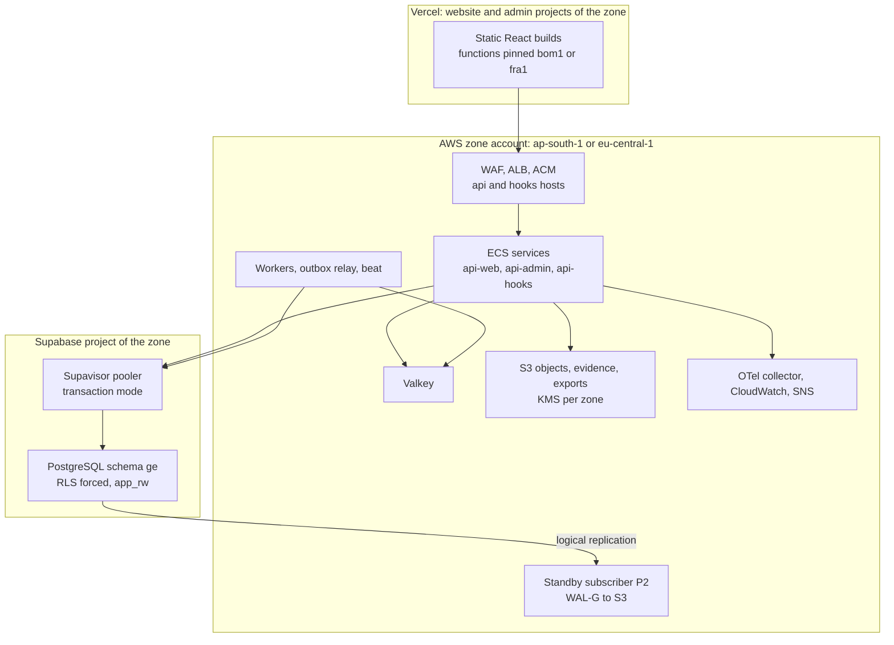

# AI Growth Engine: Employee Sales & Marketing Automation
## Application Blueprint: PART 11 (Batch 11.24b), Developer Build & Production Deployment Pack (single source of truth): Consolidated Database DDL, Configuration and Secrets Catalogue, Environments and Infrastructure as Code

| Field | Value |
|---|---|
| Document | Part 11.24b: consolidated PostgreSQL schema and ordered migration set (§11.24.4), configuration, secrets, feature flags, rule-pack gates and the per-jurisdiction activation matrix (§11.24.5), and environments, Terraform/OpenTofu modules, networking and secrets management for the IN and EU zones (§11.24.6) |
| Version | 1.0 · 28 Nov 2026 |
| Baseline | As Part 11.24a |
| Precedence | As Part 11.24a (DEC-980) |

---

## 11.24.4 Consolidated database DDL

### 11.24.4.1 Result in one table

`final/build/schema.sql` is a single ordered migration set (16 files in `final/build/migrations/`) generated by `w_02b_build_schema.py`. Each statement was applied to a scratch PostgreSQL 16.15 database during generation; the final file was then applied **from empty, in one transaction with `ON_ERROR_STOP`, to an IN-zone and an EU-zone database**, and 42 blocking database tests were run (§11.24.4.8). All 42 pass.

<!--FRAG:schema_counts-->

### 11.24.4.2 Physical schema lineage (ADR-280, DEC-981)

Two executable lineages exist in the blueprint: the **typed blueprint model** (Part 3.3 199 entities, Part 3.6 four additions, column dictionaries, prefixed names such as `crm_deal`) and the **V12 executable spine** (FSD V12 Appendix C/C2 as corrected by Part 11.9b DDL-V12-I "Appendix C3", then extended by Part 11.19a/b DDL-V12-R), which uses V12 names such as `tenant`, `company`, `workflow_run`, `api_key`. DEC-660 asked for prefixed physical names everywhere, but DDL-V12-R (written later) targets the V12 names directly [CONFLICT-1209]. The consolidated schema therefore uses one rule per lineage, so that **every verified statement of both lineages runs unchanged**:

| Entity group | Physical table | Created in | How the other name resolves | Rule |
|---|---|---|---|---|
| 48 V12 core and enterprise tables (Appendix C 29 + C2 19) | V12 name (`tenant`, `company`, `workflow_run`, `outbox`, `audit_event`, `api_key`, …) | V0003 | Part 3.3 name is a `security_invoker` view (e.g. `ten_tenant`, `aut_run`, `ops_outbox`); Part 3.3 columns that the V12 table lacks are added in V0008 | DDL-V12-I/R statements and verified tests stay valid |
| 18 C3 tables and 37 DDL-V12-R tables | V12 / Part 11.19 name | V0004, V0006 | — | As written in Parts 11.9b and 11.19a/b |
| 89 generic V12 domain tables (`growth_*`, `sales_*`) | **Not created**; the typed Part 3.3 table is physical (DEC-661) with `schema_ref`, `evidence_refs`, `payload` and the registry trigger | V0007/V0008 | V12 name is a `security_invoker` view with the V12 generic shape (`company_id`, `version`, `status`, `payload`) | V12 DTO reads keep working; RLS of the typed table applies (TC-W-DB-20) |
| Remaining Part 3.3 / 3.6 entities | Prefixed blueprint name | V0007 | — | Part 3.3 conventions (STD sets, scope classes, immutability) |
| New tables of Parts 11.16a/c, 11.17b, 11.18b | Name given in the part (`inv_*`, `mandate*`, `voice_*`, …) | V0007 | — | STD-S + STD-W + `region` with residency guard |

<!--FRAG:tables_by_domain-->

**Tables by origin (first CREATE statement).**

<!--FRAG:tables_by_origin-->

The per-table index is `final/build/table_index.csv` (table, migration, source, ENT, scope, immutability profile, column count, forced RLS, policy count, Part 3.3 alias view).

### 11.24.4.3 Migration order

<!--FRAG:migration_order-->

**Ordering rationale** (Part 3.3 §3.3.5.11 extended): extensions and roles → context functions → V12 spine (FK parents of everything) → verified C3 controls → reconciliation patch → DDL-V12-R → typed tables (no FKs inline) → columns and deltas → activation gates → constraints and all foreign keys in one pass (cycles need no special order because all tables exist; back-pointers listed in Part 3.3 §3.3.5.11 are `DEFERRABLE INITIALLY DEFERRED`) → triggers → RLS and grants → indexes → views → seed → assertions. On a populated database, V0012 indexes must be built with `CREATE INDEX CONCURRENTLY` outside a transaction and every DDL statement runs with `lock_timeout = 5s` (Part 4.3 §4.37; MG-02).

### 11.24.4.4 Roles and the canonical application role `app_rw` (DEC-778, DEC-983)

| Role | LOGIN | BYPASSRLS | Used by | Privileges in the generated schema |
|---|---|---|---|---|
| `app_owner` | no | no | Owns schema `ge` (V0001) | DDL via `SET ROLE` from `app_migrator`; RLS is FORCEd so the owner path is filtered too |
| `app_migrator` | yes (CI runner IPs only) | no | CI migration job | Member of `app_owner`; never in runtime secrets |
| **`app_rw`** | yes | **no** | Django API (one canonical name; formerly `ge_app` = V12 `app_user`) | SELECT/INSERT/UPDATE on mutable tenant tables; SELECT/INSERT on append-only tables; SELECT on platform tables; no DELETE/TRUNCATE (TC-W-DB-09) |
| `app_worker` | yes | no | Celery workers, outbox relay, beat | As `app_rw` + INSERT on worker-only platform tables |
| `app_readonly` | yes | no | Reporting, JIT support | SELECT; RLS applies |
| `app_retention` | yes | no | Retention purge | SELECT + DELETE under `app.retention_run_id` (policy `rls_<t>__retention_delete`) |
| `app_audit_writer` | no | no | `fn_append_audit()` owner | INSERT on `audit_event` via SECURITY DEFINER only |
| `app_platform_sec` | yes | no | Security findings, incidents, packs | Write on PLATSEC tables |
| `app_bench` | yes | no | AU-299 | `benchmark_*` only; `bench_contribute()` |
| `app_registry` | yes | no | Model registry service | Registry tables |
| `service_role`, `postgres` (Supabase) | key / yes | yes | **Break-glass only** (two-person, ≤ 2 h) | No grant on `ge` (TC-W-DB-06) |
| `anon`, `authenticated` (Supabase) | Data API | no | **Nobody** | `REVOKE ALL` (TC-W-DB-35) |

### 11.24.4.5 Row-level security

Every table with a `tenant_id` column has `ENABLE` and `FORCE ROW LEVEL SECURITY` and command-split policies (no `FOR ALL` policy on PUBLIC). Policies wrap the context helpers in scalar sub-selects so PostgreSQL evaluates them once per statement.

| Template | SELECT `USING` | INSERT / UPDATE `WITH CHECK` | Applied when |
|---|---|---|---|
| P-CO | `tenant_id = (SELECT ge.app_tenant()) AND <company col> = ANY ((SELECT ge.app_company_ids()))` | tenant AND `<company col> = (SELECT ge.app_write_company())` | Company column NOT NULL |
| P-CO-NULLABLE | as P-CO, or company column NULL (tenant-wide row) | write company, or NULL by `internal`/`service` actor | Company column nullable (scope T) |
| P-TEN | `tenant_id = (SELECT ge.app_tenant())` | same | No company column |
| P-X | `tenant_id IS NULL OR tenant_id = (SELECT ge.app_tenant())` | `tenant_id = (SELECT ge.app_tenant())` (platform defaults written by `app_owner` only) | Platform defaults + tenant overrides |
| Portal object grant (additional SELECT) | tenant AND `actor_kind = 'portal'` AND an unexpired, unrevoked `ten_portal_grant` for the object and the user | — | `com_proposal`, `com_quote`, `com_contract`, `com_invoice`, `com_order`, `lcy_onboarding`, `lcy_renewal`, `saas_service_request` |
| Retention delete | tenant AND `app.retention_run_id` set | — (DELETE, role `app_retention`) | Every tenant table |
| Part 11.9b C3 (kept verbatim) | P-TEN-SELF, P-PORTFOLIO, P-JOURNEY, service insert, platform split | per Part 11.9b | 49 V12 tables |
| Benchmark | `state = 'published'` for `app_rw`; all for `app_bench` | `app_bench` only | `benchmark_cell` |

<!--FRAG:rls_templates-->

### 11.24.4.6 Integrity controls (triggers and checks)

| Control | Implementation | Tables | Test |
|---|---|---|---|
| Optimistic concurrency | `ge.fn_touch_revision()` BEFORE UPDATE: requires `revision = OLD.revision + 1`, freezes `id`/`created_at`, sets `updated_at` | Typed M/F/V tables | TC-W-DB-28/29 |
| Append-only | `fn_forbid_mutation()` (C3) BEFORE UPDATE OR DELETE; purge only by `app_retention` with a run ID | Part 3.3 Imm. A tables, V12 ledgers, `audit_event`, `consent_record`, `ai_usage_event`, `eval_run` | TC-W-DB-27 |
| Versioned freeze | `ge.fn_freeze_versioned()`: approved/published/active/superseded rows change only to superseded/expired/retired | Part 3.3 Imm. V tables with `status` | TC-W-DB-36 |
| Audit hash chain | `fn_append_audit()` SECURITY DEFINER, per-tenant advisory lock, SHA-256 chain; `fn_verify_audit_chain()` | `audit_event` | TC-W-DB-30/31 |
| Domain registry (DEC-661) | `ge.fn_validate_typed_domain_row()`: payload requires an approved `schema_ref`; status, required keys and size validated | 82 typed domain tables | TC-W-DB-32 |
| Separation of duties | `enforce_sod()`, `enforce_sod_assignment()` (C3); DDL-V12-R conflict pairs (DEC-898) | `role_permission`, `user_role_assignment` | Part 11.9b TC-V12-I-005…007 |
| Effects forward-only | `fn_effect_transition()` (C3) | `effect` | Part 11.9b |
| Breach clocks | `fn_incident_deadline()`: CERT-In ≤ 6 h, GDPR/DPDP ≤ 72 h (verify) | `incident_notification` | Part 11.9b |
| Crypto-shredding | `fn_tenant_key_revoked()` destroys wrapped DEKs | `tenant_key_config`, `tenant_data_key` | Part 11.9b |
| SSO enforcement guard | `enforce_sso_guard()` (DDL-V12-R-01) | `idp_connection` | TC-W-DB-33 |
| Connector market gate | `connector_pack_guard()` (DDL-V12-R-09) | `connector_installation` | Part 11.19c [CONFLICT-1215] |
| Activation gate | `ge.fn_activation_gate()` + two-person CHECK (V0008a) | `tenant_activation` | TC-W-DB-39…42 |

<!--FRAG:triggers_by_kind-->

### 11.24.4.7 EU/IN residency guards (DEC-772, CJ-TC-09)

Each residency zone has its **own** Supabase project, AWS account set and Vercel projects; no table is replicated between zones. Inside the database the guards are layered:

| # | Guard | Mechanism | Rejects | Test |
|---|---|---|---|---|
| RG-1 | Database zone pin | `ALTER DATABASE … SET app.deployment_region = 'IN'|'EU'` at provisioning (IaC), read by `ge.app_zone()` which fails closed when unset | Any context or row check in an unconfigured database | — |
| RG-2 | Tenant region at onboarding | C3-05 `fn_tenant_region_guard()`: `tenant.data_region` must equal the database zone; immutable after insert | EU tenant in IN database and vice versa; later region change | TC-W-DB-21, 22, 25, 26 |
| RG-3 | Request zone | `ge.set_ctx(…, p_zone)` raises `RESIDENCY_ZONE_MISMATCH` when the API's `ZONE` differs from the database zone | Misrouted request or misconfigured task | TC-W-DB-23 |
| RG-4 | Row zone | `ge.fn_row_region_guard()` on 179 tables with `region`/`zone` columns (V12-B tables default `region = ge.app_zone()`) | A row labelled for the other zone | TC-W-DB-24 |
| RG-5 | Scope FKs | Every company-scoped row references `company (tenant_id, company_id)` → `tenant` of this database | Rows for tenants that do not live in this zone | FK |
| RG-6 | Backups and DR | Restore targets only in the same zone (DR-R5: never restore outside the zone); WAL-G CRR to the in-zone secondary region | Cross-zone restore | DR drill (§11.24.8.8) |
| RG-7 | Edge and model calls | Vercel functions pinned bom1/fra1 (AU-296); model registry rows per zone (`ai_model_region`) | Personal data processed outside zone | AU-296, AU-298 |

### 11.24.4.8 Database verification (executed 28 Nov 2026 on PostgreSQL 16.15)

<!--FRAG:db_apply-->

<!--FRAG:db_tests-->

**Supabase-specific verification at Sprint 0** [ASSUMPTION-1219]: the reference run used community PostgreSQL 16.15 without pgvector, Supavisor or Supabase-managed schemas. On the first Supabase project per zone the same `db-verify` job runs against the pooler URL (transaction mode) as `app_rw`, adds the pgvector `halfvec` column (V0008 conditional block), and confirms `ge` is absent from the Data API exposed schemas (SA-01).

### 11.24.4.9 Statements intentionally not applied (soft references and dictionary gaps)

No statement failed. 27 source statements or references were **not** turned into DDL, each for a stated reason; they are tracked as GAP-1205 and closed in sprint design (DoR-07):

<!--FRAG:skipped-->

### 11.24.4.10 Data migration and seeding

| Step | What | How | Evidence |
|---|---|---|---|
| DM-01 | Baseline schema | `schema.sql` = Django migration `db_baseline 0001` (RunSQL of V0001…V0015); later changes are Django migrations + RunSQL for RLS/triggers, expand/contract (ADR-282) | `migration_order.csv`, `showmigrations` |
| DM-02 | Reference data | V0014 seed + `data/seeds/` (countries, units, HSN/SAC, rule-pack metadata, recovery paths, edge projects) | Seed report |
| DM-03 | Tenant onboarding | Provisioning saga PS-01…PS-08 (Part 11.5a) creates tenant (region fixed), organization, companies, roles | Saga log |
| DM-04 | Legacy/import data | Part 3.3 §3.3.12 import templates; dry run → approval → execution; `import_unverified` contacts ineligible until lawful basis (GL-D02) | Dry-run and reconciliation reports |
| DM-05 | Capability mapping | 100 legacy capability IDs → SKU grants (`cat_legacy_capability_map`, Part 11.5b) | Mapping report |
| DM-06 | Backfill | Batches ≤ 5,000 rows, idempotent, quarantine ambiguous rows (MG-03) | `migration_quarantine` |
| DM-07 | Never copy production down | Lower environments use synthetic seeds only (THR-065) | Seed versions |

---

## 11.24.5 Configuration and secrets catalogue

### 11.24.5.1 Backend environment variables (typed settings, fail closed; ADR-288)

All settings are read once by a typed settings object at process start; any missing required value, an `APP_ENV`/account mismatch, a dispatch or paid flag true outside production, or a secret reference to another environment or zone **stops the process** (Part 4.4b FR-ENH-I-041). Secrets are never values in the environment: `*_REF` variables hold AWS Secrets Manager ARNs resolved at start. File: `final/build/config/env_catalogue.csv`; example: `final/build/config/backend.env.example`.

<!--FRAG:env_catalogue-->

### 11.24.5.2 Frontend (public) build variables

Vercel projects hold **public configuration only**; any variable that is not on this list fails the AU-296 conformance check.

<!--FRAG:fe_catalogue-->

### 11.24.5.3 Feature-flag registry (Part 4.3 §4.36 classes)

Flags are evaluated server-side; frontends receive booleans from the BFF. A flag can only further restrict or enable a path that is still PDP-checked. File: `final/build/config/feature_flags.csv`.

<!--FRAG:flags-->

### 11.24.5.4 Rule-pack gates and the per-jurisdiction activation matrix (DEC-776, DEC-779…783)

"Where lawful" means **built, but activated per jurisdiction only when that jurisdiction's rule packs are approved by counsel**. The gate is enforced twice: by the PDP at plan and dispatch time, and by the database (`ge.tenant_activation` + `ge.fn_activation_gate()`, V0008a), which refuses `enabled = true` unless every pack in `ge.rulepack_requirement` for the capability and jurisdiction is `Approved`, carries `counsel_signoff_ref`, is inside its effective window, and two different approvers (R01 and R10), neither the requester, have signed (TC-W-DB-39…42). A jurisdiction without any pack cannot be activated at all (TC-W-DB-40).

**Rule packs known to the build (harvested from Parts 11.15a–e and 11.16d; seeded as `Draft`).**

<!--FRAG:rulepacks-->

**Activation matrix** (`activation.<capability>.<jurisdiction>`; required packs; "—" = no pack exists, hard OFF). File: `final/build/config/activation_matrix.csv`.

<!--FRAG:activation_matrix-->

Today every cell is OFF: all 32 packs are `v0.1-draft` awaiting counsel sign-off, and 35 of 70 cells have no pack at all [GAP-1208]. The UK column has only the financial-promotion pack (investor mode); UK outreach, SMS and voice stay blocked until UK packs are drafted (DEC-776 region roadmap).

### 11.24.5.5 Secrets inventory and rotation

| Secret | Store (per zone) | Consumer | Rotation | Break-glass |
|---|---|---|---|---|
| `app_rw` / `app_worker` passwords (dual logins `_a`/`_b`, SA-07) | Secrets Manager `/growth/{env}/{zone}/db/*` | API, workers | 90 days, overlap | DBRE + Security |
| `app_migrator` password | Secrets Manager (CI role only) | Migration job | 90 days | — |
| Supabase `service_role` key, `postgres` password | Secrets Manager, separate path, no runtime role access | Nobody at runtime | 90 days and after each use | Two-person, ≤ 2 h, audited |
| Valkey ACL users | Secrets Manager | API, workers | 90 days | — |
| Model provider keys (registry rows) | Secrets Manager per provider per zone | Gateway | 90 days or provider policy | — |
| PSP, CPaaS, DLT, CRM, e-sign, WhatsApp BSP credentials | Secrets Manager per tenant connector (PROVIDER_SECRET_REF) | Adapters | Provider policy; on staff change | — |
| OAuth token signing keys, webhook signing secrets | KMS asymmetric keys / Secrets Manager | Token endpoint, AU-294 | 180 days; overlap window | — |
| SCIM tokens, API keys | Hash only in DB; plaintext shown once | Tenants | ≤ 397 days (DB check) | Leak → revoke ≤ 60 s (AU-293) |
| Benchmark pepper | Secrets Manager per zone | AU-299 | Yearly, re-key | — |
| Vercel, GitHub tokens | GitHub environment secrets (OIDC preferred) | CI | 90 days | — |

---

## 11.24.6 Environments, infrastructure as code, networking and secrets management

### 11.24.6.1 Environment matrix (DEC-987)

| Environment | Zones | Purpose | Data | Providers | Supabase | AWS | Vercel | Mapping to Part 11.5a |
|---|---|---|---|---|---|---|---|---|
| local | — | Development | `seed-small` synthetic | Mocks; MinIO, Valkey, PostgreSQL 16 + pgvector in Docker Compose; Supabase CLI stack optional | — | — | `vite dev` | dev (local) |
| dev | IN (EU optional) | Integration on merge, previews | Synthetic | Sandboxes | `growth-dev-in` | `growth-nonprod` account, zone VPC | Preview deployments | dev / sit |
| staging | IN, EU | Release verification, E2E, DAST, load, UAT | `seed-y1`, `seed-y2` synthetic | Sandboxes only (ABAC-12) | `growth-staging-in`, `growth-staging-eu` | `growth-nonprod` | `*-staging` domains | uat |
| preprod ★ | IN, EU | Production-shaped rehearsal: cut-over, migration on a masked/synthetic copy of prod volume, DR drill target, canary dry run | Synthetic at production volume; never production copies | Sandbox + production-equivalent configuration | `growth-preprod-in`, `-eu` (PITR on) | `growth-preprod` account | `*-preprod` | new [ASSUMPTION-1203] |
| prod | IN; EU when the first EU tenant is contracted | Live | Real, zone-resident | Live (after activation) | `growth-prod-in`, `growth-prod-eu` (Team/Enterprise plan for SLA tiers, verify) | `growth-prod-in`, `growth-prod-eu` accounts | `website-in/eu`, `admin-in/eu` production | prod-in / prod-eu |
| recovery | per zone | Isolated restore drills | Restored backups (same controls as prod), destroyed after drill | None (dispatch hard off) | New project or WAL-G instance | `growth-backup-{zone}` | — | DR |

### 11.24.6.2 Zone topology (cell per residency zone)

The IN and EU cells are identical modules with different variables; no network path, replication slot or IAM trust exists between them. Global services (DNS, GitHub, the developer portal static site) carry no personal data.

### 11.24.6.3 Terraform / OpenTofu module outline

HCL is written to the common subset of Terraform ≥ 1.9 and OpenTofu ≥ 1.9; the pipeline runs OpenTofu (ADR-012, DEC-989) [ASSUMPTION-1201]. Provider versions are pinned in `zone_stack` (aws ~> 5.80, supabase ~> 1.5, vercel ~> 2.0; verify at implementation, as of 27 Nov 2026). The outline in `final/build/terraform/` has 11 modules and 8 live roots; all 30 `.tf` files parse with python-hcl2.

| Module | Resources (main) | Key inputs | Outputs | Controls |
|---|---|---|---|---|
| `zone_stack` | Composition of all modules below | `env`, `zone` (IN/EU validated) | API host, project refs | Tags `data_residency = zone` |
| `aws_network` | VPC, private subnets in 2–3 AZs, NAT with static EIPs, VPC endpoints (S3, Secrets Manager, KMS, ECR, Logs, STS) | CIDR per zone/env | NAT EIPs (→ Supabase allowlist) | No public subnets for compute |
| `aws_security_baseline` | SCP attachment (deny regions outside the zone and its DR region), CloudTrail, GuardDuty, Config, Security Hub, GitHub OIDC roles | Org IDs | Role ARNs | Deny snapshot sharing, public S3 |
| `aws_data` | ElastiCache Valkey (TLS, ACL), S3 buckets (objects, evidence, exports, logs) SSE-KMS + versioning + public-access block, KMS keys per purpose, SES identity and configuration set | Zone | Bucket names, key ARNs | Object Lock on anchors |
| `aws_compute` | ECS cluster, 9 services (api-web, api-admin, api-hooks, outbox-relay, worker-tx, worker-batch, beat, renderer, extractor), task roles, autoscaling, circuit breaker | Image digest | Service ARNs | Signed digest only (cosign verify) |
| `aws_edge_api` | ALB, ACM, WAF managed + rate rules, Route 53 for `api.{zone}`, `hooks.{zone}` | Domain | DNS names | TLS 1.2+, HSTS |
| `aws_dr_standby` | PostgreSQL 16 subscriber (logical replication from Supabase), WAL-G archive/base-backup buckets with Object Lock, CRR to in-zone secondary region (IN: ap-south-2; EU: second EU region, verify), restore-drill role | Retention 35 d | Subscriber endpoint (private) | Two-person restore credentials |
| `aws_observability` | OTel collector, log groups (IN 180 days CERT-In; EU per DPA), metric filters, alarms AL-##, dashboards, SNS topics per severity | Thresholds | Topic ARNs | Logs stay in zone |
| `supabase_project` | Project in zone region, PITR add-on, network restrictions (NAT EIPs + CI), SSL enforcement, Data API settings (`ge` not exposed), log drain | Plan tier | Project ref, pooler host | `prevent_destroy` |
| `vercel_projects` | `website-{zone}`, `admin-{zone}`: function region, rewrites to `api.{zone}`, headers (CSP, HSTS), firewall rules, public env only, log drain without bodies | Domains | Project IDs | AU-296 conformance |
| `github_oidc` | OIDC provider and per-environment deploy roles mirroring GitHub environment protections | Repo | Role ARNs | No static keys |

### 11.24.6.4 Networking

| Flow | From → to | Path and protocol | Control |
|---|---|---|---|
| N-01 | Browser → website/admin | HTTPS to Vercel CDN | Firewall rules, CSP, HSTS; no tenant data cached |
| N-02 | Browser → API | HTTPS via Vercel rewrite or direct to `api.{zone}` (one pattern per environment) | WAF, rate classes (ADR-035), BFF cookies, CSRF |
| N-03 | API/workers → Supabase | TLS `verify-full` to Supavisor (transaction mode) from NAT EIPs | Supabase network restriction allowlist (SA-06); `app_rw`/`app_worker` |
| N-04 | CI → Supabase (migrations) | Direct connection from CI runner IPs | `app_migrator` only; break-glass for `service_role` |
| N-05 | Providers → hooks | HTTPS `hooks.{zone}` | Signature + timestamp/nonce (5 min), inbox dedup |
| N-06 | API/workers → providers | NAT egress, allowlisted domains (egress proxy or security-group + DNS firewall) | Adapter registry, circuit breakers |
| N-07 | Supabase → standby | Logical replication over TLS to private subscriber (via SSH/private link where available, verify) | Replication user secret; no public IP on subscriber |
| N-08 | Workers → model providers | HTTPS to zone endpoints of approved registry rows | DEC-788 eligibility; no personal data to unapproved rows |
| N-09 | Zone ↔ zone | **None** | SCPs, no peering, separate accounts and projects |

### 11.24.6.5 Secrets management

| Rule | Implementation |
|---|---|
| One store per zone | AWS Secrets Manager + KMS in the zone account; paths `/growth/{env}/{zone}/…` |
| No secrets in Vercel or Git | Vercel holds public config only (AU-296); gitleaks in PL-01/PL-09 |
| Workload identity | ECS task roles read only their paths; GitHub OIDC roles per environment; no static AWS keys |
| `service_role` isolation | Separate path, no runtime role access; CI policy check fails on any reference (SA-02); AU-292 detects sessions |
| Rotation | Secrets Manager rotation lambdas (DB dual logins, Valkey ACL); provider credentials by runbook; expiry reminders AU-293 |
| Customer-managed keys | `tenant_key_config` (aws-kms, azure-key-vault, gcp-kms) with crypto-shredding on revocation (DEC-776, C3-09) |
| Audit | Every secret read in CloudTrail; break-glass emits `db.break_glass.used` |

*Continued in Part 11.24c (§11.24.7 onwards).*
