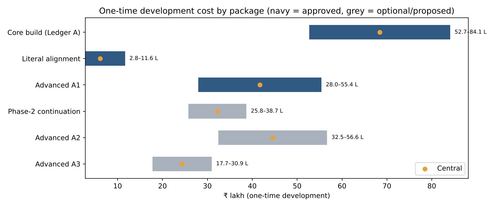
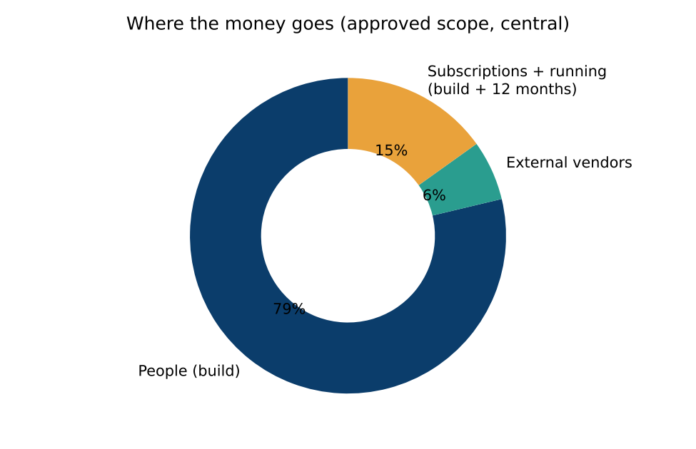
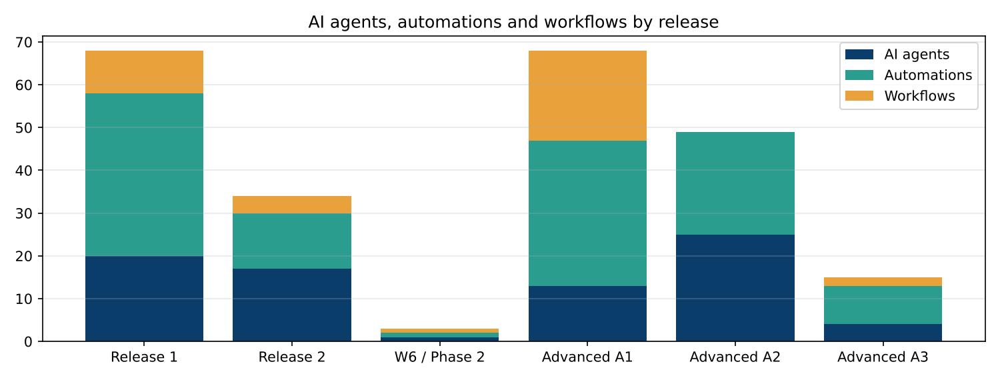
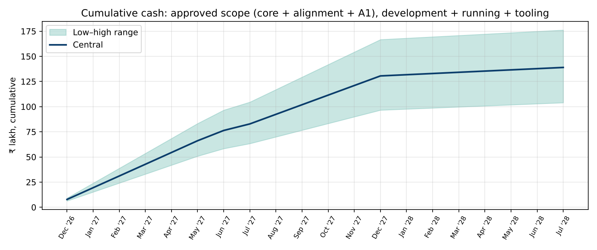

# AI Growth Engine: End-to-End Cost Estimate
## Development, subscriptions, AI agents, automations, workflows and lifecycle costs, in INR and USD

| Field | Value |
|---|---|
| Document | Cost Estimate v1.0 for the AI Growth Engine (Employee Sales & Marketing Automation) |
| Date | 28 Nov 2026 |
| Basis | Application Blueprint v1.1 (Parts 0–9.10, 345 decisions), approved budgets DEC-230/231, Founder decisions DEC-416…421 |
| Revision | Rev. A (28 Nov 2026): running costs re-based for the Vercel + Supabase + AWS Mumbai hosting stack (DEC-421) |
| Currency | INR and USD at **₹90 = $1** (blueprint rate, Part 8.4; verify at time of payment). Sensitivity at ₹85 and ₹95 in §13 |
| Prepared by | FinOps Lead with Product Owner, Delivery Lead, Solutions Architect, QA Lead and AI Governance Lead (blueprint team) |
| Classification | Confidential: Founder and authorized delivery partners |
| Companion files | `AI_Growth_Engine_Cost_Estimate_v1.0.xlsx` (14 sheets with live formulas: change FX, rates or scope and every total recalculates), `AI_Growth_Engine_Cost_Estimate_v1.0.docx` (editable) |

**How to read this document.** Every figure is an **estimate** with a low, central and high value. Prices of third-party services are list prices as known on the date above and are marked **verify at time of purchase**. Amounts **exclude GST** unless a "with GST" column says otherwise. One-time development cost and recurring subscription/running cost are **always shown separately**.

# 1. Executive summary

## 1.1 Headline numbers

| One-time development package | Status | When | Low (INR) | Central (INR) | High (INR) | Low (USD) | Central (USD) | High (USD) |
|---|---|---|---|---|---|---|---|---|
| Core build to the Release 2 gate (Ledger A) | Approved (DEC-230) | Dec 2026 – 2 Jul 2027 (Day 1–208) | ₹52.68 L | ₹68.38 L | ₹84.08 L | $58,533 | $75,978 | $93,422 |
| Literal alignment to the 38-document pack (CR-ALN-01) | Approved (DEC-416) | Within Releases 1–2 | ₹2.78 L | ₹6.09 L | ₹11.64 L | $3,093 | $6,768 | $12,939 |
| Advanced release A1 (AI, revenue, platform) | Approved (DEC-417) | Aug – Dec 2027 | ₹28.00 L | ₹41.70 L | ₹55.40 L | $31,111 | $46,333 | $61,556 |
| Phase-2 core continuation (W6 Should/Could, hypercare, expansion pilots) | Optional, not yet approved | Aug – Dec 2027 | ₹25.80 L | ₹32.25 L | ₹38.70 L | $28,667 | $35,833 | $43,000 |
| Advanced release A2 | Proposed; decided at gate G-A1 | Dec 2027 – Mar 2028 | ₹32.46 L | ₹44.56 L | ₹56.65 L | $36,067 | $49,511 | $62,944 |
| Advanced release A3 (after the scale gate) | Proposed; decided at gate G-A2 | Apr – Jul 2028 | ₹17.74 L | ₹24.34 L | ₹30.95 L | $19,711 | $27,044 | $34,389 |
| **Approved one-time development (core + alignment + A1)** | Approved | Dec 2026 – Dec 2027 | **₹83.46 L** | **₹116.17 L** | **₹151.12 L** | **$92,738** | **$129,079** | **$167,917** |
| **Full programme, if every option is approved** | Approved + optional | Dec 2026 – Jul 2028 | **₹159.46 L** | **₹217.32 L** | **₹277.43 L** | **$177,182** | **$241,468** | **$308,250** |

**Recurring subscriptions and running cost (separate from development).**

| Recurring item | Per month (INR) | Per month (USD) | Per year (INR) | Per year (USD) |
|---|---|---|---|---|
| Running cost paid **during the build** (Day 1–208, ramping up), approved Ledger B | ₹1.65 L – ₹2.14 L for the whole build | $1,832 – $2,373 total | — | — |
| Approved **build-time tooling** (DEC-419: Claude for all engineers, GitHub, Figma, Workspace, Bitwarden, BrowserStack), in addition to Ledger B | ₹73,890 – ₹77,094 | $821 – $857 | ₹8.87 L – ₹9.25 L | $9,852 – $10,279 |
| Pilot running cost **after launch** (approved Ledger B base + 15% contingency + 2 Claude seats) | ₹26,105 – ₹35,362 | $290 – $393 | ₹3.13 L – ₹4.24 L | $3,481 – $4,715 |
| Plus literal-alignment running additions (CR-ALN-02, upper bound) | ₹1,495 – ₹10,120 | $17 – $112 | ₹0.18 L – ₹1.21 L | $199 – $1,349 |
| Plus advanced capabilities at full rollout (X1 + X2 + X3, after A3) | ₹11,051 – ₹36,098 | $123 – $401 | ₹1.33 L – ₹4.33 L | $1,473 – $4,813 |
| **All-in pilot running after the full advanced roadmap** | **₹38,651 – ₹81,580** | **$429 – $906** | **₹4.64 L – ₹9.79 L** | **$5,153 – $10,877** |
| At the growth gate (Year-1 design point) | ₹59,000 – ₹79,000 + advanced lines | $656 – $878 + advanced | — | — |
| At scale (Year-2 design point) | ₹1,39,000 – ₹1,79,000 + advanced lines | $1,544 – $1,989 + advanced | — | — |

**Three-year total cost of ownership (build + 3 years of operation, maintenance and future-proofing):** approved path **₹194.82 L – ₹358.22 L** ($216,461 – $398,019); full roadmap **₹298.59 L – ₹548.34 L** ($331,767 – $609,263). See §12.

## 1.2 What drives the cost

- **People dominate.** About **79%** of the approved-scope money (central) is the build team. External vendors (penetration tests, training content) are about **6%**. Subscriptions and running costs for the build plus 12 months of operation are about **15%**.
- **AI usage is small and capped.** All 80 AI agents together cost an estimated **₹4,391 per month** at pilot volume (base; ₹1,974–₹11,002), inside the hard AI caps. Claude Sonnet stays the primary model (DEC-418).
- **Subscriptions for building** are mainly developer seats, above all Claude for the engineers. The approved baseline has 2 Claude seats. The Founder approved Claude Code for all 6 engineers on 28 Nov 2026 (DEC-419). The extra cost is repaid if it saves about 1 engineer-day per engineer per month (§13.5).
- **Lifecycle costs** after launch are maintenance (15–20% of development per year), future-proofing (model migrations, framework upgrades, security tests, DR drills) and running costs that step up only when the business passes the scale gates.

## 1.3 Decisions already taken and still open

| Item | Status | Reference |
|---|---|---|
| Core build budget (Ledger A) ₹52.68–84.08 L | Approved | DEC-230 |
| Pilot running budget (Ledger B) ₹19,895–26,335/month (AWS-only design) | Approved; re-based for DEC-421 in §8 | DEC-231 |
| Literal-alignment work CR-ALN-01 | Approved (funded) | DEC-416 |
| Advanced release A1 ≈ ₹28.0–55.4 L | Approved | DEC-417 |
| Claude Sonnet as primary model | Approved | DEC-418 |
| AI-built delivery with a Sprint 2 calibration gate | Approved | DEC-420; Cost Estimate v1.1 |
| Hosting on Vercel + Supabase + AWS Mumbai | Approved; running cost re-based in §8 | DEC-421 |
| Phase-2 core continuation (W6) ₹25.8–38.7 L | Open: decide at the Release 2 go/no-go | Part 8.4 |
| Advanced A2 and A3 | Open: decide at gates G-A1 and G-A2 | DEC-411 |
| Build-time tooling (Claude for all engineers, GitHub, Figma, Workspace, Bitwarden, BrowserStack, domains) | Approved 28 Nov 2026 | DEC-419; §7 |
| Items often missed (legal counsel, insurance, GST, etc.) | Open: see §11 | §11 |

# 2. Estimation basis, method and assumptions

## 2.1 Method

| Technique | Used for |
|---|---|
| **Top-down from approved budgets** | Core build (Ledger A), alignment, A1: the figures the Founder approved (DEC-230, DEC-416, DEC-417) |
| **Bottom-up by resource and calendar** | Resource plan: FTE × months × loaded rate (§3, §4) |
| **Effort-based (person-days)** | Effort by activity, alignment and advanced packages, vendor scenarios (§5, §13) |
| **Parametric** | Build effort per AI agent, automation and workflow by complexity class (§6); drafting effort per user story and test case (§5.3) |
| **Three-point (low / central / high)** | Every line. Central = midpoint unless a blueprint central value exists |
| **Unit pricing** | Subscriptions and cloud: unit price × seats or volume, plus 15% contingency where the blueprint applies it |
| **Scenario analysis (permutations)** | Scope × team model × estimate point × FX × AI usage (§13) |

## 2.2 Key parameters

| Parameter | Value | Source |
|---|---|---|
| FX rate | ₹90 per USD (sensitivity ₹85 / ₹95) | Part 8.4 (verify) |
| Loaded cost per person-month (India delivery) | ₹1,00,000 – ₹1,50,000 ($1,111 – $1,667) | BRD §6 |
| Working days per month / hours per day | 22 days / 8 hours = 176 hours per month | BRD §6 |
| Loaded cost per person-day | ₹4,545 – ₹6,818 ($50.51 – $75.76) | Derived |
| Loaded cost per hour | ₹568 – ₹852 ($6.31 – $9.47) | Derived |
| Contingency on running costs | 15% (line B11) | BRD §6; DEC-004 |
| Management reserve (one-time) | ₹3.94 L – ₹8.29 L, held outside the totals, released only by change control | Part 8.4 |
| GST | 18%, excluded from all totals (see the with-GST view in §11) | Assumption |
| Rate escalation from Year 2 | 8% per year | Assumption |
| Plan of record | Release 1 go/no-go Fri 4 Jun 2027 (Day 180); Release 2 build Fri 2 Jul 2027 (Day 208); W5 exit Fri 23 Jul 2027 (Day 229) | DEC-228 |

## 2.3 What "loaded cost" includes

Salary or contract fee, statutory benefits, paid leave, equipment allowance and management overhead for India-based delivery. It does not include recruitment fees, GST or travel (see §11).

# 3. Resource rate card (per hour, per day, per month)

| Role | Skill set | Technology | Per hour (INR) | Per hour (USD) | Per day (INR) | Per month (INR, USD) | Used in |
|---|---|---|---|---|---|---|---|
| Engineering lead / solutions architect (hands-on) | Architecture, Django/DRF, PostgreSQL RLS, security design, code review | Python, Django, PostgreSQL (Supabase), Vercel, AWS, Terraform | ₹710 – ₹852 | $7.89 – $9.47 | ₹5,682 – ₹6,818 | ₹1.25 L – ₹1.50 L ($1,389 – $1,667) | Core team (1 of 4) |
| Senior full-stack engineer | Django/DRF APIs, React/TypeScript, testing | Python, Django, React, TypeScript, Playwright | ₹568 – ₹852 | $6.31 – $9.47 | ₹4,545 – ₹6,818 | ₹1.00 L – ₹1.50 L ($1,111 – $1,667) | Core team (1 of 4), contract engineer |
| AI/LLM engineer | Prompt contracts, RAG, model gateway, evals, guardrails | Claude API, pgvector, Pydantic, eval harness | ₹625 – ₹852 | $6.94 – $9.47 | ₹5,000 – ₹6,818 | ₹1.10 L – ₹1.50 L ($1,222 – $1,667) | Core team (1 of 4), advanced A1–A3 |
| Backend / DevOps engineer | Celery, Valkey, outbox, CI/CD, IaC, observability | Celery, Valkey, Vercel, Supabase, AWS EC2/S3/SES, GitHub Actions, Terraform, Prometheus/Grafana | ₹568 – ₹852 | $6.31 – $9.47 | ₹4,545 – ₹6,818 | ₹1.00 L – ₹1.50 L ($1,111 – $1,667) | Core team (1 of 4), contract engineer |
| Frontend engineer | React/TypeScript, design system, WCAG 2.2 AA | React, TypeScript, Vite, axe-core | ₹568 – ₹795 | $6.31 – $8.84 | ₹4,545 – ₹6,364 | ₹1.00 L – ₹1.40 L ($1,111 – $1,556) | Contract engineer |
| QA lead / test engineer | Test strategy, SIT/UAT, automation, AI evaluation | Playwright, pytest, k6, OWASP ZAP, promptfoo-style evals | ₹511 – ₹767 | $5.68 – $8.52 | ₹4,091 – ₹6,136 | ₹0.90 L – ₹1.35 L ($1,000 – $1,500) | QA 1.0 FTE from Sprint 3 |
| UX/UI designer (contract) | IA, interaction design, accessibility | Figma | ₹511 – ₹767 | $5.68 – $8.52 | ₹4,091 – ₹6,136 | ₹0.90 L – ₹1.35 L ($1,000 – $1,500) | UX contractor |
| Growth / compliance lead (0.5–0.75 FTE) | DPDP consent, outreach rules, playbooks, UAT | Admin Command Centre, policy rules | ₹568 – ₹852 | $6.31 – $9.47 | ₹4,545 – ₹6,818 | ₹1.00 L – ₹1.50 L ($1,111 – $1,667) | Growth/compliance |
| Independent reviewer (architecture/security) | Design and security review at gates | Threat modelling, code review | ₹568 – ₹852 | $6.31 – $9.47 | ₹4,545 – ₹6,818 | ₹1.00 L – ₹1.50 L ($1,111 – $1,667) | Gate reviews |
| Data engineer / data scientist (advanced) | Semantic layer, feature store, scoring models | PostgreSQL, dbt-style models, Python ML | ₹625 – ₹852 | $6.94 – $9.47 | ₹5,000 – ₹6,818 | ₹1.10 L – ₹1.50 L ($1,222 – $1,667) | Advanced A1–A3 |
| SRE / security engineer (advanced) | SLOs, DR drills, zero trust, secrets rotation | AWS, Prometheus, Vault-style secrets, WebAuthn | ₹625 – ₹852 | $6.94 – $9.47 | ₹5,000 – ₹6,818 | ₹1.10 L – ₹1.50 L ($1,222 – $1,667) | Advanced A1–A3 |
| Product Owner (Founder) | Backlog, approvals, acceptance | — | Not costed | — | — | — | Internal, not costed |

Role rates sit inside the BRD §6 loaded band of ₹1.0–1.5 lakh per person-month. The approved budgets use the band itself, so the totals do not depend on the role split. For other ways of sourcing the team (an Indian IT vendor, a hybrid model, or onshore contractors at $45–90 per hour), see §13.2.

# 4. Resource plan and development cost (one-time)

## 4.1 Core build to the Release 2 gate (Ledger A, approved, DEC-230)

| # | Item | Resource | FTE | Months | Person-months | Hours | Rate per hour (INR) | Cost (INR) | Cost (USD) | Source |
|---|---|---|---|---|---|---|---|---|---|---|
| A1 | Core engineering team, Day 1–180 | 4 engineers (lead/architect, full-stack, AI/LLM, backend/DevOps) | 4.0 | 6.00 | 24.00 | 4,224 | ₹568 – ₹852 | ₹24.00 L – ₹36.00 L | $26,667 – $40,000 | Part 8.4 §8.4.2.1; DEC-005 |
| A2 | Core team extension, Day 181–208 | 4 engineers + QA + growth/compliance | 5.0 | 0.92 | 4.60 | 810 | ₹568 – ₹852 | ₹4.60 L – ₹6.90 L | $5,111 – $7,667 | Part 8.4; Part 9.5 |
| A3a | QA uplift to 1.0 FTE from Sprint 3 | QA lead / test engineer | — | — | 2.75 | 484 | ₹568 – ₹852 | ₹2.75 L – ₹4.12 L | $3,056 – $4,583 | Part 8.1 §8.1.6.5; DEC-232 |
| A3b | DevOps front-load (Sprint 0–2) | Backend / DevOps engineer | — | — | 0.60 | 106 | ₹568 – ₹852 | ₹0.60 L – ₹0.90 L | $667 – $1,000 | Part 8.1 §8.1.6.5 |
| A3c | UX contractor | UX/UI designer (contract) | — | — | 0.87 | 153 | ₹568 – ₹852 | ₹0.87 L – ₹1.30 L | $967 – $1,450 | Part 8.1 §8.1.6.5 |
| A3d | Independent reviewer | Independent reviewer | — | — | 0.55 | 97 | ₹568 – ₹852 | ₹0.55 L – ₹0.82 L | $611 – $917 | Part 8.1 §8.1.6.5 |
| A4 | Growth / compliance lead, Day 1–180 | Growth / compliance lead | 0.5 | 6.00 | 3.00 | 528 | ₹568 – ₹852 | ₹3.00 L – ₹4.50 L | $3,333 – $5,000 | Part 8.2 §8.2.7.6 |
| A5 | Two contract engineers (Option 2b), Day 43–208 | Senior full-stack / frontend engineers | 2.0 | 5.46 | 10.92 | 1,922 | ₹568 – ₹852 | ₹10.92 L – ₹16.38 L | $12,133 – $18,200 | DEC-228 |
| A6a | QA extension (source pack) | QA lead / test engineer | — | — | 0.46 | 81 | ₹568 – ₹852 | ₹0.46 L – ₹0.69 L | $511 – $767 | Part 9.5 §9.5.2.6 |
| A6b | UX extension (source pack) | UX/UI designer (contract) | — | — | 0.22 | 39 | ₹568 – ₹852 | ₹0.22 L – ₹0.33 L | $244 – $367 | Part 9.5 §9.5.2.6 |
| A6c | Training content: 147 task cards | Vendor / technical writer (fixed price) | — | — | — | Fixed price | — | ₹0.66 L – ₹1.91 L | $733 – $2,122 | Part 9.5 §9.5.2.6 |
| A6d | Penetration-test scope uplift | Security vendor (fixed price) | — | — | — | Fixed price | — | ₹1.00 L – ₹2.00 L | $1,111 – $2,222 | Part 9.5 §9.5.2.6 |
| A6e | Load-test staging windows | Cloud usage | — | — | — | Fixed price | — | ₹0.05 L – ₹0.21 L | $56 – $233 | Part 9.5 §9.5.2.6 |
| A7 | External penetration tests (before Release 1 and Release 2) | Security vendor (2 engagements) | — | — | — | Fixed price | — | ₹3.00 L – ₹8.00 L | $3,333 – $8,889 | Part 8.2 §8.2.7.4; DEC-126 |
|  | **Total Ledger A** |  |  |  | **47.97** | **8,443** |  | **₹52.68 L – ₹84.08 L** | **$58,533 – $93,417** |  |
| R | Management reserve (outside the total) | Change-control board |  |  |  |  |  | ₹3.94 L – ₹8.29 L | $4,378 – $9,211 | Part 8.4 |

**Team composition (Option 2b, DEC-228/232).** 4 core engineers for Day 1–208, plus 2 contract engineers for Day 43–208, plus QA at 1.0 FTE from Sprint 3. A growth/compliance lead works 0.5 FTE, rising to 0.75 in W4–W5. A UX contractor, a DevOps front-load and an independent reviewer are also included. The Founder acts as Product Owner and is not costed. Peak team: about 8.5 FTE.

## 4.2 Development cost by phase (core build)

| Phase | Days | Dates | Low (INR) | High (INR) | Low (USD) | High (USD) |
|---|---|---|---|---|---|---|
| Sprint 0 and foundation (W0-A, W0-B) | 1–30 | Dec 2026 | ₹5.40 L | ₹8.20 L | $6,000 | $9,111 |
| Release 1 build (W1–W3 + Must enhancements) | 31–180 | Jan – 4 Jun 2027 | ₹37.30 L | ₹59.00 L | $41,444 | $65,556 |
| Release 2 build to gate (W4–W5) | 181–208 | Jun – 2 Jul 2027 | ₹10.00 L | ₹16.90 L | $11,111 | $18,778 |
| **Total** | 1–208 |  | **₹52.68 L** | **₹84.08 L** | **$58,533** | **$93,417** |

## 4.3 Further one-time packages

| Package | Status | When | Effort pd (low / central / high) | Hours (central) | Cost (INR) | Cost (USD) | Source |
|---|---|---|---|---|---|---|---|
| Literal alignment to the 38-document pack (CR-ALN-01) | Approved (DEC-416) | Within Releases 1–2 | 61 / 107 / 171 | 858 | ₹2.78 L – ₹11.64 L | $3,093 – $12,939 | Part 9.10 §9.10.10 |
| Advanced release A1 (AI, revenue, platform) | Approved (DEC-417) | Aug – Dec 2027 | 376 / 553 / 790 | 4,424 | ₹28.00 L – ₹55.40 L | $31,111 – $61,556 | Part 9.10 §9.10.7 |
| Phase-2 core continuation (W6 Should/Could, hypercare, expansion pilots) | Optional, not yet approved | Aug – Dec 2027 | — / 100 / — | 800 | ₹25.80 L – ₹38.70 L | $28,667 – $43,000 | Part 8.4 §8.4.2.4 |
| Advanced release A2 | Proposed; decided at gate G-A1 | Dec 2027 – Mar 2028 | 353 / 518 / 733 | 4,144 | ₹32.46 L – ₹56.65 L | $36,067 – $62,944 | Part 9.10 (A2+A3 split pro rata to effort) |
| Advanced release A3 (after the scale gate) | Proposed; decided at gate G-A2 | Apr – Jul 2028 | 197 / 283 / 402 | 2,264 | ₹17.74 L – ₹30.95 L | $19,711 – $34,389 | Part 9.10 (A2+A3 split pro rata to effort) |

**Advanced team (A1–A3).** The expert panels plan for about 6 FTE in A1:

- 2 contract AI/LLM engineers;
- 1 data/ML engineer;
- 1 SRE/security engineer;
- 2 full-stack engineers for revenue features;
- QA and UX drawn from the core team.

The team shrinks to about 3–4 FTE in A2 and 1–2 FTE in A3 (Parts 9.7b, 9.8b, 9.9b). Approved in principle for A1 (DEC-417); procurement starts at the Release 2 gate.

# 5. Effort by activity, including user stories, test strategy and test cases

## 5.1 Effort and cost by activity

Programme effort is **532 / 722 / 921 person-days** for the core build (low/central/high) and **1,619 / 2,283 / 3,117** for the full programme. The table allocates the central effort by activity. It is an allocation of the same total, not an addition.

| Activity | Share | Core build pd (central) | Full programme pd (central) | Hours | Effort value (INR) | Effort value (USD) | Roles |
|---|---|---|---|---|---|---|---|
| Requirements analysis, backlog and user-story drafting | 7% | 51 | 160 | 1,279 | ₹7.26 L – ₹10.90 L | $8,072 – $12,108 | Product Owner, BA (engineering lead), growth/compliance lead |
| UX/UI design and accessibility | 6% | 43 | 137 | 1,096 | ₹6.23 L – ₹9.34 L | $6,919 – $10,378 | UX designer, frontend engineer |
| Architecture, security and data design | 6% | 43 | 137 | 1,096 | ₹6.23 L – ₹9.34 L | $6,919 – $10,378 | Engineering lead, independent reviewer |
| Backend development (APIs, rules, workflows, data) | 27% | 195 | 616 | 4,932 | ₹28.02 L – ₹42.03 L | $31,135 – $46,702 | Backend and full-stack engineers |
| Frontend development (Website and Admin) | 15% | 108 | 342 | 2,740 | ₹15.57 L – ₹23.35 L | $17,297 – $25,945 | Frontend and full-stack engineers |
| AI engineering (agents, gateway, RAG, evaluations) | 10% | 72 | 228 | 1,827 | ₹10.38 L – ₹15.57 L | $11,531 – $17,297 | AI/LLM engineer |
| Test strategy and test-case drafting | 4% | 29 | 91 | 731 | ₹4.15 L – ₹6.23 L | $4,613 – $6,919 | QA lead |
| Test automation and execution (unit, SIT, UAT, performance, security) | 11% | 79 | 251 | 2,009 | ₹11.42 L – ₹17.12 L | $12,684 – $19,027 | QA, engineers |
| DevOps, infrastructure, observability and release | 6% | 43 | 137 | 1,096 | ₹6.23 L – ₹9.34 L | $6,919 – $10,378 | Backend/DevOps engineer |
| Project management, ceremonies and reporting | 5% | 36 | 114 | 913 | ₹5.19 L – ₹7.78 L | $5,766 – $8,648 | Engineering lead, PO |
| Documentation, training content and handover | 3% | 22 | 68 | 548 | ₹3.11 L – ₹4.67 L | $3,459 – $5,189 | All roles |
| **Total** | 100% | **722** | **2,283** | **18,266** | **₹103.78 L – ₹155.67 L** | **$115,313 – $172,970** |  |

*Effort value* is effort × loaded day rate. Cash for an in-house team follows the calendar (§4), which also pays for meetings, onboarding and focus-factor losses.

## 5.2 Volume of artefacts to produce

| Artefact | Count | Where |
|---|---|---|
| User stories with Gherkin acceptance criteria | 461 (230 core + 135 source-pack + 96 advanced) | Parts 5, 2.6–8.3, 9.7–9.9 |
| Test cases and verification items (functional, NFR, AI evaluation, enhancement, alignment) | 4,156 | Parts 6, 6.8–6.10, 9.6–9.10 |
| Source-pack tests mapped (unit 75, SIT 422, UAT 302) | 799 | Part 6.8 |
| Functional requirements | 601 (181 + 180 enhancement + 240 advanced) | Parts 2.1, enhancement parts, 9.7–9.9 |
| Screens | 218 (147 + 71 advanced) | Parts 2.5, 2.7, 9.7–9.9 |
| API operations | 579 | Parts 3.2, 3.5 |
| AI agents / automations / workflows | 80 / 119 / 38 | Part 9.4 |

## 5.3 Drafting effort: user stories, test cases and test strategies

Three ways of working are compared:

- **(a) from scratch, manually;**
- **(b) AI-assisted drafting** with Claude, with a human writing and reviewing;
- **(c) refining the drafts already in this blueprint.** All stories, acceptance criteria and test cases exist in draft and need review, refinement and estimation with the team.

Option (c) is the plan of record. It is already inside the programme effort (§5.1, activities "Requirements…" and "Test strategy…").

| Artefact | Count | (a) Manual pd | (b) AI-assisted pd | (c) Refine blueprint drafts pd (plan) | Cost of (c), INR | Who |
|---|---|---|---|---|---|---|
| User stories with Gherkin acceptance criteria | 461 | 115 – 202 | 58 – 101 | 29 – 52 | ₹1.31 L – ₹3.54 L | BA / PO + engineer review |
| Test cases (functional, NFR, AI evaluation, alignment) | 4,156 | 171 – 260 | 78 – 130 | 42 – 78 | ₹1.89 L – ₹5.31 L | QA lead |
| Mapping of source-pack tests (unit 75, SIT 422, UAT 302) | 799 | 10 – 20 | 5 – 10 | 3 – 6 | ₹0.14 L – ₹0.41 L | QA lead |
| Test strategies and plans (§5.4) | 20 documents | 29 – 56 | 17 – 34 | 10 – 20 | ₹0.46 L – ₹1.34 L | QA lead |
| **Total** |  | **326 – 537** | **158 – 274** | **84 – 155** | **₹3.80 L – ₹10.59 L** |  |

Unit assumptions (hours per item, manual / AI-assisted / refine): user story 2.0–3.5 / 1.0–1.75 / 0.5–0.9; test case 0.33–0.5 / 0.15–0.25 / 0.08–0.15; source-test mapping 0.10–0.20 / 0.05–0.10 / 0.03–0.06. **Saving of (c) against (a): about 242–382 person-days (₹11.01 L – ₹26.05 L).**

## 5.4 Test strategy documents to produce

| Document | Count | pd each (manual) | Notes |
|---|---|---|---|
| Master test strategy | 1 | 5–8 | Drafts exist in Part 6.1 and Parts 6.8–6.10; refine per release |
| Level strategies: unit, SIT, UAT, performance, security, AI evaluation, accessibility, DR | 8 | 1.5–3 | Drafts exist in Part 6.1 and Parts 6.8–6.10; refine per release |
| Release test plans: R1, R2, W6, A1, A2, A3 | 6 | 1–2 | Drafts exist in Part 6.1 and Parts 6.8–6.10; refine per release |
| Test data and environment strategy | 1 | 2–4 | Drafts exist in Part 6.1 and Parts 6.8–6.10; refine per release |
| UAT scripts and sign-off packs per startup (AppNAI, MedMaarg, EduVerse, OrganicSpec) | 4 | 1–2 | Drafts exist in Part 6.1 and Parts 6.8–6.10; refine per release |

# 6. AI agents, automations and workflows: what they do, how automated, build and run cost, timeline

The blueprint defines **80 AI agents, 119 automations and 38 business workflows**, 237 items in total (Part 9.4).

- **AI agents** use Claude through the model gateway. They draft, classify, extract, match and summarize; they never sign, pay, submit bids or set prices.
- **Automations** are deterministic rules with no AI model.
- **Workflows** orchestrate agents, automations and people, with human approval at consequential steps.

## 6.1 Summary

| Type | Count | v1.0 baseline | v1.1 advanced | Build effort pd | Build cost (INR) | Build cost (USD) | Run cost per month (INR, pilot) |
|---|---|---|---|---|---|---|---|
| AI agents | 80 | 38 | 42 | 307 – 452 | ₹13.95 L – ₹30.82 L | $15,505 – $34,242 | ₹4,391 (₹1,974 – ₹11,002) |
| Automations | 119 | 52 | 67 | 78 – 154 | ₹3.52 L – ₹10.50 L | $3,914 – $11,667 | Inside hosting (B01) |
| Workflows | 38 | 14 | 24 | 176 – 283 | ₹8.00 L – ₹19.30 L | $8,889 – $21,439 | Inside hosting (B01) |
| **Total** | 237 |  |  | **560 – 889** | **₹25.48 L – ₹60.61 L** | **$28,308 – $67,348** | **₹4,391/month AI (base)** |

Build effort per item is a **parametric allocation inside the programme effort** (§5), not an extra cost. Complexity classes and person-days:

| Type | Simple | Medium | Complex |
|---|---|---|---|
| AI agent | 2–3 pd | 4–6 pd | 7–10 pd |
| Automation | 0.5–1 pd | 1–2 pd | 2.5–4 pd |
| Workflow | 3–5 pd | 5–8 pd | 8–12 pd |

Each estimate covers the prompt or rule contract, code, guardrails, evaluation or test set, and review UI hook. Screens shared with the module are excluded. AI run cost is the agent's own token formula at pilot volumes (Parts 7.2, 7.4b, 9.7b–9.9b), before a 25% overhead allowance.

## 6.2 Fully or partially automated

| Automation level | AI agents | Automations | Workflows | Meaning |
|---|---|---|---|---|
| Fully automated (deterministic rules within policy guardrails) | 0 | 109 | 0 | Runs without a person, inside the Policy Decision Point; audited |
| Fully automated within guardrails (post-hoc review) | 9 | 0 | 0 | AI acts on low-risk internal items; a person reviews afterwards (L3) |
| Mostly automated (acts; human reviews after) | 7 | 0 | 0 | AI acts; a person can reverse (L2) |
| Partially automated (AI drafts; human approves before use) | 37 | 0 | 0 | AI prepares; a person approves before anything leaves the system (L1) |
| Partially automated (rule engine prepares; human confirms) | 0 | 10 | 0 | Rules prepare an action; a person confirms |
| Assistive only (suggests; human acts) | 27 | 0 | 0 | Suggestions only (L0) |
| Partially automated (orchestrated end to end; human approval at consequential steps) | 0 | 0 | 38 | End-to-end orchestration; consequential steps (quotes, contracts, bids, payments) always need a person (DEC-064) |

## 6.3 Timeline by release

| Release | Days | Dates | Agents | Automations | Workflows | Build pd | Build cost (INR) |
|---|---|---|---|---|---|---|---|
| Release 1 | Day 1–180 | Dec 2026 – 4 Jun 2027 | 20 | 38 | 10 | 124 – 200 | ₹5.61 L – ₹13.64 L |
| Release 2 | Day 181–208 (W5 exit Day 229) | Jun – 23 Jul 2027 | 17 | 13 | 4 | 84 – 131 | ₹3.84 L – ₹8.93 L |
| W6 / Phase 2 | Day 237–365 | Aug – Dec 2027 | 1 | 1 | 1 | 10 – 15 | ₹0.43 L – ₹1.02 L |
| Advanced A1 | Day ≈ 239–365 | Aug – Dec 2027 | 13 | 34 | 21 | 182 – 294 | ₹8.27 L – ₹20.05 L |
| Advanced A2 | Day ≈ 366–480 | Dec 2027 – Mar 2028 | 25 | 24 | 0 | 128 – 196 | ₹5.82 L – ₹13.36 L |
| Advanced A3 (after scale gate) | Day ≈ 481–600 | Apr – Jul 2028 | 4 | 9 | 2 | 33 – 53 | ₹1.50 L – ₹3.61 L |

## 6.4 Skills and technology used

| Type | Skill set | Technology |
|---|---|---|
| AI agents | AI/LLM engineer (prompt contracts, RAG, evals); Python/Django backend engineer; QA (AI evaluation); UX for review screens | Claude via model gateway (Tier 0 cache → Haiku-class → Sonnet-class primary; DEC-418); Pydantic schemas; pgvector RAG; prompt registry; eval harness (promptfoo/deepeval-style, OSS); Celery workers |
| Automations | Python/Django backend engineer; data/DBA for rules and indexes; QA (unit and SIT) | Django REST Framework; Celery + Celery Beat on Valkey; PostgreSQL with RLS; transactional outbox; Policy Decision Point; no AI model |
| Workflows | Backend engineer (execution engine, outbox, PDP); React/TypeScript frontend engineer; QA (SIT/UAT); UX designer; product owner for approval gates | Universal execution engine; transactional outbox; PDP dispatch recheck; React/TypeScript Admin and Website screens; audit and live monitor |

## 6.5 Full list: AI agents (80)

| ID | Name | What it does | Automation | Autonomy | Model tier | Complexity | Build pd | Build cost INR | Build cost USD | Run INR/month | Release and timeline |
|-----|-----------|----------------------------------|--------|---------|--------|------|----|---------|-------|--------|---------|
| AG-001 | Knowledge & Claim Ingestion Assistant | Turns approved uploaded decks, brochures and FAQs into chunk summaries and claim candidates with page citations, so R10/R05 approve claims in minutes instead of reading whole documents. | Partially automated | L1 | 1a Haiku 5.5 | Simple | 2–3 | ₹9,091 – ₹20,455 | $101–$227 | ₹5 (₹2–₹15) | Release 1 (Dec 2026 – 4 Jun 2027) |
| AG-002 | AI Quality Judge & Eval Runner | Scores generative outputs against rubrics (groundedness, claim compliance, tone, refusal correctness) for the CI regression gate and for a 5% sample of production outputs. | Mostly automated | L2 (scores recorded automatically; a human reviews failures… | 1b Sonnet 5.5 via Batch API | Complex | 7–10 | ₹31,818 – ₹68,182 | $354–$758 | ₹139 (₹66–₹337) | Release 1 (Dec 2026 – 4 Jun 2027) |
| AG-003 | Research Query Planner | Expands approved capability codes, geography and organization types into scoped search queries within the plan's source and cost bounds. | Fully automated within guardrails | L3 within guardrails (queries only reach permitted search a… | Tier 0 templates first | Medium | 4–6 | ₹18,182 – ₹40,909 | $202–$455 | ₹1 (₹0–₹2) | Release 1 (Dec 2026 – 4 Jun 2027) |
| AG-004 | Evidence Extractor | Extracts organization-level business facts (projects, tenders, expansions, hiring for relevant functions, budgets, dates) with quotes and provenance from permitted pages and permitted social posts. | Fully automated within guardrails | L3 within guardrails (writes evidence records only; no exte… | 1a Haiku 5.5 via Batch API | Simple | 2–3 | ₹9,091 – ₹20,455 | $101–$227 | ₹19 (₹7–₹56) | Release 1 (Dec 2026 – 4 Jun 2027) |
| AG-005 | Buying Signal Classifier | Classifies each evidence item into the approved signal taxonomy with confidence; below-threshold items go to review. | Mostly automated | L2 (classification stored; items below threshold or in the … | 1a Haiku 5.5 via Batch API | Simple | 2–3 | ₹9,091 – ₹20,455 | $101–$227 | ₹6 (₹2–₹19) | Release 1 (Dec 2026 – 4 Jun 2027) |
| AG-006 | Need Discovery Agent | Derives business needs from signals and evidence and labels each as explicit (stated in a source) or inferred. | Mostly automated | L1 for inferred needs (reviewer verifies in A020); L2 for e… | 1a Haiku 5.5 via Batch | Simple | 2–3 | ₹9,091 – ₹20,455 | $101–$227 | ₹6 (₹2–₹21) | Release 1 (Dec 2026 – 4 Jun 2027) |
| AG-007 | Solution Match Explainer | Explains why each deterministically ranked offering (AU-016) fits a need and why others were excluded (readiness, geography, capability). | Assistive only | L0 (suggestion only; ranking is deterministic) | 1a Haiku 5.5 via Batch | Simple | 2–3 | ₹9,091 – ₹20,455 | $101–$227 | ₹2 (₹1–₹4) | Release 1 (Dec 2026 – 4 Jun 2027) |
| AG-008 | Decision-Maker Role Extractor | Extracts role hypotheses (function, seniority) and published professional channels from official organization pages for qualified accounts. | Partially automated | L1 (contact records created as unverified; AU-018 verifies;… | 1a Haiku 5.5 via Batch | Simple | 2–3 | ₹9,091 – ₹20,455 | $101–$227 | ₹1 (₹1–₹3) | Release 1 (Dec 2026 – 4 Jun 2027) |
| AG-009 | Qualification Brief Assistant | Prepares a one-screen cited brief per opportunity (need, fit, evidence freshness, score components, open questions) for the reviewer; at L2 (after the 90% gate) proposes accept/reject. | Partially automated | L1 until benchmark precision ≥ 90% on ≥ 200 labelled items … | 1a Haiku 5.5 pre-generated in Batch | Simple | 2–3 | ₹9,091 – ₹20,455 | $101–$227 | ₹11 (₹3–₹35) | Release 1 (Dec 2026 – 4 Jun 2027) |
| AG-010 | Import Mapping Assistant | Maps unmatched CSV/JSON column headers and value formats to versioned import templates after deterministic header matching. | Partially automated | L1 (user confirms mapping before import) | Tier 0 header dictionary first | Simple | 2–3 | ₹9,091 – ₹20,455 | $101–$227 | ₹0 (₹0–₹1) | Release 1 (Dec 2026 – 4 Jun 2027) |
| AG-011 | Outreach & Follow-up Message Drafter | Drafts evidence-cited first-touch emails, WhatsApp template variants, follow-up steps, event invitations and renewal reminders using approved claims only. | Mostly automated | L1 for personalised drafts (human approves exact hash); L2/… | 1b Sonnet 5.5 | Complex | 7–10 | ₹31,818 – ₹68,182 | $354–$758 | ₹165 (₹78–₹404) | Release 1 (Dec 2026 – 4 Jun 2027) |
| AG-012 | Claims & Policy Guard | Second-line check of every customer-facing draft (messages, content, proposals, chat answers sampled) for unsupported claims, prohibited content, tone and brand. | Fully automated within guardrails | L3 within guardrails for block/fix decisions (it can only m… | Tier 0 deterministic rules first | Simple | 2–3 | ₹9,091 – ₹20,455 | $101–$227 | ₹20 (₹6–₹64) | Release 1 (Dec 2026 – 4 Jun 2027) |
| AG-013 | Inbound Intent Classifier & Router | Classifies every inbound email, WhatsApp and web reply (positive, question, objection, out-of-office, complaint, urgent/clinical, wrong person, other), extracts proposed times and a one-line summary, and routes it. | Fully automated within guardrails | L3 for routing and sequence stop (classification only; any … | Tier 0: STOP keywords, auto-responder headers, bounce formats | Medium | 4–6 | ₹18,182 – ₹40,909 | $202–$455 | ₹9 (₹3–₹28) | Release 1 (Dec 2026 – 4 Jun 2027) |
| AG-014 | Reply Assistant | Drafts answers to inbound questions from approved FAQ and knowledge with citations; at L3, sends only approved FAQ answers verbatim with variables. | Fully automated within guardrails | L1 by default; L3 only when the answer is an exact approved… | Tier 0 semantic cache of approved FAQ answers | Simple | 2–3 | ₹9,091 – ₹20,455 | $101–$227 | ₹27 (₹8–₹86) | Release 1 (Dec 2026 – 4 Jun 2027) |
| AG-015 | Admin Copilot | Side-panel assistant that answers staff questions over records the user can already see and approved knowledge, with citations; briefs on accounts and meetings; proposes saved-view filters and drafts (message, task, note). | Assistive only | L0 answers; L1 drafts (DEC-035) | 1a Haiku 5.5 for lookups | Simple | 2–3 | ₹9,091 – ₹20,455 | $101–$227 | ₹222 (₹106–₹520) | Release 2 (Jun – 23 Jul 2027) |
| AG-016 | Autonomous Commercial Planner | Proposes commercial plans (objective, eligible segment, channel mix, sequence, budget, schedule) and workflow drafts from approved node types; narrates simulation results. | Partially automated | L1 for the plan (approval of the exact plan hash by R01 for… | 1b Sonnet 5.5 | Complex | 7–10 | ₹31,818 – ₹68,182 | $354–$758 | ₹26 (₹13–₹61) | Release 2 (Jun – 23 Jul 2027) |
| AG-017 | Website Assistant | Public chat on each verified startup site that answers from approved public knowledge with citations, captures a consented lead and hands over clinical, legal, pricing-negotiation and complaint topics. | Fully automated within guardrails | L3 for answers grounded in approved public knowledge; lead … | Tier 0 FAQ cache | Simple | 2–3 | ₹9,091 – ₹20,455 | $101–$227 | ₹13 (₹4–₹38) | Release 1 (Dec 2026 – 4 Jun 2027) |
| AG-018 | Content & Campaign Studio Drafter | Drafts articles, social variants, landing-page copy, ad copy, SEO titles/meta and translation drafts (hi-IN, ta-IN, or-IN) from a brief using approved claims. | Partially automated | L1 (content approver ≠ author; claims approval; DEC-038) | 1b Sonnet 5.5 | Medium | 4–6 | ₹18,182 – ₹40,909 | $202–$455 | ₹98 (₹48–₹238) | Release 1 (Dec 2026 – 4 Jun 2027) |
| AG-019 | Bid / RFP Analyzer | Parses RFPs, tenders and submitted project requirements into eligibility criteria, deadlines, mandatory documents, evaluation criteria and a compliance matrix, plus an L0 bid/no-bid brief. | Assistive only | L1 for checklist items; L0 for bid/no-bid | 1b Sonnet 5.5 | Medium | 4–6 | ₹18,182 – ₹40,909 | $202–$455 | ₹141 (₹56–₹423) | Release 2 (Jun – 23 Jul 2027) |
| AG-020 | Proposal & Bid Response Drafter | Drafts proposals and bid response sections from approved templates, meeting notes entered by staff, approved claims and the deterministic price snapshot (prices inserted by AU-035, never by the model). | Partially automated | L1 (DEC-064: proposals/quotes ≤ L1) | 1b Sonnet 5.5 | Medium | 4–6 | ₹18,182 – ₹40,909 | $202–$455 | ₹63 (₹31–₹154) | Release 2 (Jun – 23 Jul 2027) |
| AG-021 | Objection & Negotiation Assistant | Classifies objections into the approved taxonomy, drafts approved responses, and prepares exception summaries for A070 when a request exceeds concession limits. | Partially automated | L1 (price/terms ≤ L1, DEC-064) | 1b Sonnet 5.5 | Medium | 4–6 | ₹18,182 – ₹40,909 | $202–$455 | ₹22 (₹11–₹55) | Release 2 (Jun – 23 Jul 2027) |
| AG-022 | Contract Clause Reviewer | Compares counterparty redlines or third-party paper against the approved template and clause library; flags non-standard, missing or risky clauses for Legal with references. | Assistive only | L0 (suggest only) | 1b Sonnet 5.5 | Medium | 4–6 | ₹18,182 – ₹40,909 | $202–$455 | ₹18 (₹9–₹41) | Release 2 (Jun – 23 Jul 2027) |
| AG-023 | Order Document Extractor | Extracts RFQ/PO lines (SKU, description, unit, quantity, requested price, delivery date/region) from uploaded documents and emails into a draft order or RFQ for OrganicSpec and other order-desk startups. | Partially automated | L1 (draft order; coordinator confirms) | 1a Haiku 5.5 | Simple | 2–3 | ₹9,091 – ₹20,455 | $101–$227 | ₹5 (₹2–₹14) | Release 2 (Jun – 23 Jul 2027) |
| AG-024 | Payment Evidence Extractor | Pre-fills payment verification fields (UTR/reference, amount, currency, date, payer name, bank) from uploaded bank/UPI evidence for the Finance Maker. | Assistive only | L0 (pre-fill; maker confirms every field) | 1a Haiku 5.5 | Simple | 2–3 | ₹9,091 – ₹20,455 | $101–$227 | ₹1 (₹0–₹4) | Release 2 (Jun – 23 Jul 2027) |
| AG-025 | Onboarding Handoff Summarizer | Produces the commercial-to-delivery handoff summary (scope, commitments, contacts' roles, open risks, approved terms references) when a deal closes. | Partially automated | L1 | 1a Haiku 5.5 via Batch | Simple | 2–3 | ₹9,091 – ₹20,455 | $101–$227 | ₹0 (₹0–₹1) | Release 2 (Jun – 23 Jul 2027) |
| AG-026 | Loss & Feedback Analyzer | Classifies free-text loss reasons and customer feedback into the loss taxonomy and produces a monthly theme report. | Mostly automated | L2 (labels stored; owner can correct) | 1a Haiku 5.5 via Batch | Simple | 2–3 | ₹9,091 – ₹20,455 | $101–$227 | ₹0 (₹0–₹0) | Release 2 (Jun – 23 Jul 2027) |
| AG-027 | Market & Competitor Watch Summarizer | Summarizes permitted public competitor and market events into internal alerts with sources. | Fully automated within guardrails | L3 for internal alerts only (no external use) | 1a Haiku 5.5 via Batch | Simple | 2–3 | ₹9,091 – ₹20,455 | $101–$227 | ₹1 (₹0–₹2) | Release 2 (Jun – 23 Jul 2027) |
| AG-028 | Ops & Incident Triage Agent | Clusters failed runs, DLQ items, provider errors and alerts; summarizes probable cause and links the runbook (RB-) for on-call staff. | Assistive only | L0 (suggestions only); remediation by humans (CI-128 exclud… | 1a Haiku 5.5 | Simple | 2–3 | ₹9,091 – ₹20,455 | $101–$227 | ₹7 (₹2–₹22) | Release 2 (Jun – 23 Jul 2027) |
| AG-029 | Insight Narrative Agent | Writes weekly 'what changed and why' narratives on deterministic KPI snapshots for startup heads and a portfolio digest for the founder. | Fully automated within guardrails | L3 for internal digest delivery | 1a Haiku 5.5 via Batch | Simple | 2–3 | ₹9,091 – ₹20,455 | $101–$227 | ₹1 (₹0–₹4) | Release 2 (Jun – 23 Jul 2027) |
| AG-030 | SaaS Onboarding Configuration Assistant | During W33, proposes business profile, industry taxonomy, offering structure, objective templates and workflow bindings from the applicant's description. | Partially automated | L1 (applicant edits; platform approval before provisioning) | 1b Sonnet 5.5 | Medium | 4–6 | ₹18,182 – ₹40,909 | $202–$455 | ₹35 (₹17–₹86) | Release 2 (Jun – 23 Jul 2027) |
| AG-031 | Support Desk Assistant | Triages portal support tickets (W28, W34) by category and severity, drafts replies from the help centre, answers authenticated customers' questions about their own records, and drafts KB articles from resolved tickets. | Mostly automated | L1 for replies; L2 for category/severity | 1a Haiku 5.5 | Medium | 4–6 | ₹18,182 – ₹40,909 | $202–$455 | ₹14 (₹4–₹47) | Release 2 (Jun – 23 Jul 2027) |
| AG-032 | Partner Due-Diligence Brief | Compiles public evidence on prospective partners, insurers and licensees into a due-diligence checklist with sources. | Assistive only | L0 | 1b Sonnet 5.5 via Batch | Medium | 4–6 | ₹18,182 – ₹40,909 | $202–$455 | ₹10 (₹5–₹23) | W6 / Phase 2 (Aug – Dec 2027) |
| AG-033 | Requirements & Story Assistant | Drafts user stories, Gherkin AC, ADR and DPIA skeletons from FR/BRL/DEC text, and runs change-impact analysis over the traceability matrix. | Partially automated | L1 (PR review by PO) | Claude Code developer seats | Simple | 2–3 | ₹9,091 – ₹20,455 | $101–$227 | ₹505 (₹245–₹1,154) | Release 1 (Dec 2026 – 4 Jun 2027) |
| AG-034 | Coding Assistant | Claude Code for implementation, refactoring, IaC, UI microcopy and accessibility fixes, with repository rules (RLS scoping, outbox, no secrets). | Partially automated | L1 (all changes through PR review + CI gates) | Claude Code developer seats | Simple | 2–3 | ₹9,091 – ₹20,455 | $101–$227 | ₹505 (₹245–₹1,154) | Release 1 (Dec 2026 – 4 Jun 2027) |
| AG-035 | PR, Security & Release Review Agent | Reviews each pull request for tenancy/RLS scoping, outbox use, secret exposure, OWASP issues, missing tests; triages CI failures and SAST/dependency findings; drafts release notes and go/no-go summaries; drafts threat-model updates. | Assistive only | L0 (comments only; cannot approve or merge) | 1b Sonnet 5.5 via CI API key | Medium | 4–6 | ₹18,182 – ₹40,909 | $202–$455 | ₹505 (₹245–₹1,154) | Release 1 (Dec 2026 – 4 Jun 2027) |
| AG-036 | Test & Synthetic Data Generator | Generates test cases from Gherkin AC (EP/BVA/decision-table techniques), synthetic two-tenant fixtures (RECOMMENDATION-017), injection corpora and eval cases from reviewed feedback. | Partially automated | L1 (QA review) | Claude Code seats + 1a Haiku 5.5 via Batch for bulk fixtures | Simple | 2–3 | ₹9,091 – ₹20,455 | $101–$227 | ₹6 (₹3–₹14) | Release 1 (Dec 2026 – 4 Jun 2027) |
| AG-037 | Meeting Notes & Action Summarizer | Turns staff-written meeting notes (and, only after GAP-143 is resolved with consent, authorized transcripts) into a structured summary, decisions and action items that distinguish confirmed from unconfirmed commitments, so follow-ups start the same day and nothing the customer did not agree to is presented as agreed (doc 15 PC-10). | Partially automated | L1. Organizer approves the summary; action items become tas… | 1a Haiku 5.5; 15% escalation to 1b for long or multi-party notes | Complex | 7–10 | ₹31,818 – ₹68,182 | $354–$758 | ₹7 (₹2–₹22) | Release 2 (Jun – 23 Jul 2027) |
| AG-038 | Retention Next-Best-Action Advisor | For accounts entering the renewal window (AU-039), reads delivery milestones, feedback, support history and contract dates and proposes one next best action (check-in, success review, upsell discussion within approved offerings, risk escalation) with evidence, so account owners act before renewal dates instead of after churn (doc 15 PC-18) | Assistive only | L0 (suggest only). Owner accepts, edits or dismisses; accep… | 1a Haiku 5.5 via Batch; 10% escalation to 1b | Medium | 4–6 | ₹18,182 – ₹40,909 | $202–$455 | ₹5 (₹1–₹14) | Release 2 (Jun – 23 Jul 2027) |
| AG-039 | Agent Supervisor and Planner | Turns a staff objective ("pursue account X for offering Y", "prepare RFP response", "prepare launch brief") into a typed, budgeted, approvable plan over registered agents and automations, so multi-step work starts in minutes with every baseline control intact; it never executes, calls agents or dispatches (ADR-110) | Partially automated | L1. A plan containing any W1 step (draft, task, finding) ne… | 1b Sonnet 5.5 (effort medium; verify, as of 27 Nov 2026); no Tier 1a because planning errors are costly | Complex | 7–10 | ₹31,818 – ₹68,182 | $354–$758 | ₹120 (₹58–₹286) | Advanced A1 (Aug – Dec 2027) |
| AG-040 | Account Research Agent | Builds one cited, versioned account brief per organization from owned records (CRM, evidence, interactions) and permitted public sources only (AU-007), so every account-centric agent and person works from the same facts; no personal profiling, no private scraping (BR-M18, OPT-11-01) | Assistive only | L0. Brief is informational; memory proposals go through AU-… | 1a Haiku 5.5 via Batch; 15% escalation to 1b for large accounts (> 40 evidence items) | Complex | 7–10 | ₹31,818 – ₹68,182 | $354–$758 | ₹20 (₹6–₹63) | Advanced A1 (Aug – Dec 2027) |
| AG-041 | Signal and Intent Fusion Analyst | Explains the account-level intent band computed by AU-055 from classified signals (AG-005), first-party consented web engagement, inbound intents (AG-013) and event attendance (AU-051) as a dated timeline with reasons, so owners engage when intent rises | Assistive only | L0 | 1a Haiku 5.5 via Batch; 5% escalation | Simple | 2–3 | ₹9,091 – ₹20,455 | $101–$227 | ₹8 (₹3–₹22) | Advanced A2 (Dec 2027 – Mar 2028) |
| AG-042 | Predictive Score Explainer | Turns stored SHAP contributions from the advisory propensity model (AU-056) into a short plain-language "why" with caveats, so owners trust and correctly use the estimate alongside, not instead of, the DEC-011 score | Assistive only | L0 (display only; never changes stage, score, band or eligi… | 1a Haiku 5.5 via Batch; 5% escalation | Medium | 4–6 | ₹18,182 – ₹40,909 | $202–$455 | ₹7 (₹2–₹20) | Advanced A2 (Dec 2027 – Mar 2028) |
| AG-043 | Next-Best-Action and Offer Advisor | For each open opportunity, proposes one next best action from the registered action catalogue (call, send approved asset, book meeting, multi-thread to another role, involve specialist, pause, close-lost review) and, where eligible, one next best offer among approved, available offerings, with evidence, so P03 time goes to the highest-value step | Assistive only | L0. Owner accepts, edits or dismisses; accepted action beco… | 1a Haiku 5.5 via Batch; 15% escalation | Medium | 4–6 | ₹18,182 – ₹40,909 | $202–$455 | ₹30 (₹9–₹94) | Advanced A2 (Dec 2027 – Mar 2028) |
| AG-044 | Deal-Risk Early-Warning Analyst | Explains deal-risk flags raised by AU-058 (stalled beyond stage p75 duration, close date slipped twice, single-threaded, negative intent, competitor mention in notes, unanswered proposal) and drafts one suggested task, so managers intervene weeks before the forecast meeting | Assistive only | L0. Owner task; manager digest | 1a Haiku 5.5 via Batch; 10% escalation | Simple | 2–3 | ₹9,091 – ₹20,455 | $101–$227 | ₹10 (₹3–₹30) | Advanced A2 (Dec 2027 – Mar 2028) |
| AG-045 | Conversation Intelligence Analyst | Aggregates themes, objections, competitor mentions and commitment patterns across staff-written meeting notes and in-product written threads (email, WhatsApp, portal messages already processed lawfully under BR-M27), producing team-level insights that improve the objection library (KPI-28), coaching and loss learning. Audio recordings and call transcripts are out of scope (DEC-218, DEC-386) | Assistive only | L0. R02 reviews insights; any library change goes through A… | 1a Haiku 5.5 via Batch; 10% escalation | Medium | 4–6 | ₹18,182 – ₹40,909 | $202–$455 | ₹38 (₹13–₹114) | Advanced A3 (after scale gate) (Apr – Jul 2028) |
| AG-046 | Objection-Handling Coach | Lets staff practise objection handling against synthetic buyer personas built from the approved objection taxonomy (AG-021) and approved responses, and gives private feedback on coverage of approved facts, so new staff ramp faster and live replies stay within approved claims | Assistive only | L0. Practice only; never used on live threads; scores visib… | 1b Sonnet 5.5 (role-play quality) | Complex | 7–10 | ₹31,818 – ₹68,182 | $354–$758 | ₹151 (₹72–₹365) | Advanced A2 (Dec 2027 – Mar 2028) |
| AG-047 | RFP Response Co-pilot | For each requirement extracted by AG-019, retrieves matching approved, unexpired answers from the answer library (AU-063), drafts the response with per-answer citations and confidence, lists gaps with owners, and fills the compliance-matrix draft, so the bid team answers faster and only with approved content; submission stays human (DEC-053) | Partially automated | L1. Bid owner approves each answer (author ≠ approver for f… | 1b Sonnet 5.5; RFP prefix cached with 1-hour TTL | Complex | 7–10 | ₹31,818 – ₹68,182 | $354–$758 | ₹401 (₹198–₹904) | Advanced A1 (Aug – Dec 2027) |
| AG-048 | Price-Book Guidance Assistant (merged into AG-066, DEC-410) | Answers staff questions such as "which approved price version, bundle or tier applies to this order, and who must approve a 12% discount request?" by citing approved price-book entries and the DEC-038 approval route, so quotes are built right first time; it never proposes, computes or changes a price or discount (CI-071, DEC-064, DEC-388) | Assistive only | L0 | 1a Haiku 5.5; 5% escalation | Simple | 2–3 | ₹9,091 – ₹20,455 | $101–$227 | ₹5 (₹2–₹16) | Advanced A2 (Dec 2027 – Mar 2028) |
| AG-049 | Personalization-at-Scale Variant Generator | For a campaign brief and a set of deterministic segments (M38: sector, organization type, region, role, offering), generates 2–4 message or asset variants per segment from approved claims, so personalization scales without one-off drafts; variants become templates that need approval before any use (DEC-064) and can be tested by AU-065 | Partially automated | L1 for each template (author ≠ approver; claims approval R1… | 1b Sonnet 5.5 via Batch | Medium | 4–6 | ₹18,182 – ₹40,909 | $202–$455 | ₹65 (₹32–₹155) | Advanced A2 (Dec 2027 – Mar 2028) |
| AG-050 | Indic Localization Agent | Localizes approved content and templates into hi-IN, ta-IN, or-IN (DEC-026) and, when enabled per startup, bn-IN, te-IN, mr-IN, kn-IN, ml-IN, gu-IN [ASSUMPTION-603], using translation memory and a glossary, with back-translation and placeholder checks, so regional reach grows without changing approved meaning | Partially automated | L1. Linguist or content approver approves each locale versi… | 1b Sonnet 5.5 via Batch (verify Indic quality per locale in eval; Tier 2 multilingual candidates evaluated for Public content) | Complex | 7–10 | ₹31,818 – ₹68,182 | $354–$758 | ₹111 (₹54–₹270) | Advanced A2 (Dec 2027 – Mar 2028) |
| AG-051 | Campaign Planner and Pacing Advisor | Drafts a campaign plan (channel mix, schedule, budget split within the approved total cap) and weekly pacing proposals from AU-064 pacing indices, so spend tracks plan; it never moves budget (CI-062), never selects audiences (CI-063) | Partially automated | L1. R05L / R02 approve; ad spend within approved cap only; … | 1b Sonnet 5.5 | Complex | 7–10 | ₹31,818 – ₹68,182 | $354–$758 | ₹60 (₹29–₹141) | Advanced A2 (Dec 2027 – Mar 2028) |
| AG-052 | Experiment Designer and Analyst | Writes pre-registered experiment designs (hypothesis, primary and guardrail metrics, unit, duration) using sample sizes and MDE computed by AU-065, and writes plain-language readouts from AU-065 results, so every AI or marketing change is judged by measured lift | Assistive only | L1 for design (R11 + R05L approve; AU-067 pre-check); L0 fo… | 1a Haiku 5.5; 20% escalation | Simple | 2–3 | ₹9,091 – ₹20,455 | $101–$227 | ₹7 (₹2–₹24) | Advanced A2 (Dec 2027 – Mar 2028) |
| AG-053 | Attribution and Marketing-Mix Analyst | Explains AU-040 multi-model attribution and AU-066 marketing-mix results with uncertainty, so the founder and marketing lead make channel-budget decisions on evidence, with the BR-M52 caveat that attribution is an estimate | Assistive only | L0 | 1a Haiku 5.5 via Batch; 20% escalation | Medium | 4–6 | ₹18,182 – ₹40,909 | $202–$455 | ₹2 (₹1–₹5) | Advanced A3 (after scale gate) (Apr – Jul 2028) |
| AG-054 | Forecast Variance and Pipeline Hygiene Analyst | Decomposes week-over-week changes in the AU-041 forecast into drivers (new, slipped, won, lost, stage moves, probability changes) and lists hygiene findings (close date in the past, no next step, stage age outliers), so forecast reviews take minutes and KPI-29 error falls | Assistive only | L0 | 1a Haiku 5.5 via Batch; 10% escalation | Simple | 2–3 | ₹9,091 – ₹20,455 | $101–$227 | ₹3 (₹1–₹10) | Advanced A2 (Dec 2027 – Mar 2028) |
| AG-055 | Knowledge Curator and RAG Freshness Agent | Reviews AU-069 findings (stale chunks, conflicting facts across documents, near-duplicates, coverage gaps from clustered abstentions and retrieval misses) and drafts concrete edits or new FAQ entries for knowledge owners, so groundedness and answer coverage improve continuously (OKPI-14) | Partially automated | L1. Owner approves; approved edits re-enter the M03 ingesti… | 1a Haiku 5.5 via Batch; 10% escalation | Medium | 4–6 | ₹18,182 – ₹40,909 | $202–$455 | ₹14 (₹5–₹43) | Advanced A1 (Aug – Dec 2027) |
| AG-056 | Agent Red-Team and Drift Analyst | Generates mutations of the seed injection, jailbreak, cross-audience and data-exfiltration corpora (paraphrase, language switch to hi/ta/or, encoding, indirect via document/email/WhatsApp formats) for scheduled runs (AU-070), and clusters failing cases and drift signals (AU-057) into readable findings, so red-teaming is continuous rather than quarterly (§7.6.3) | Mostly automated | L0 for findings; L2 for writing candidates to the review qu… | 1b Sonnet 5.5 via Batch (line B23, delivery) | Complex | 7–10 | ₹31,818 – ₹68,182 | $354–$758 | ₹84 (₹41–₹206) | Advanced A1 (Aug – Dec 2027) |
| AG-057 | Admin Command Bar Interpreter | Lets staff type "show my overdue approvals for MedMaarg", "open the AppNAI tender due Friday", "draft a follow-up task for Acme" in the Admin shell (A003); maps the request to a registered command with parameters, resolved through AU-072 against the user's RBAC/ABAC, so navigation and routine drafts take seconds | Assistive only | L0 for navigation and filters; L1 for drafts (user submits … | Tier 0 grammar and fuzzy match first (≈ 50% resolved); then 1a Haiku 5.5; 5% escalation | Medium | 4–6 | ₹18,182 – ₹40,909 | $202–$455 | ₹19 (₹7–₹58) | Advanced A2 (Dec 2027 – Mar 2028) |
| AG-058 | WhatsApp Concierge with Human Handoff | Handles customer-initiated WhatsApp conversations (opted-in, BR-M31) within the service window: answers from approved public or granted portal knowledge with citations, offers meeting slots through AU-023, collects bounded enquiry fields, and hands off to a human on request or on any sensitive topic, so customers get answers in seconds without unsafe automation | Fully automated within guardrails | L3 only for exact approved FAQ answers (faq_id, DEC-064, as… | Tier 0 FAQ cache first; then 1a Haiku 5.5; 15% escalation | Medium | 4–6 | ₹18,182 – ₹40,909 | $202–$455 | ₹58 (₹18–₹188) | Advanced A2 (Dec 2027 – Mar 2028) |
| AG-059 | Meeting-Prep Brief Agent | Generates a one-page brief T−24 h before a meeting with a qualified account: purpose, attendee roles, AG-040 summary, open opportunities and objections, last commitments (confirmed vs unconfirmed from AG-037), approved assets to share, suggested agenda | Assistive only | L0 | 1a Haiku 5.5 via Batch; 10% escalation | Simple | 2–3 | ₹9,091 – ₹20,455 | $101–$227 | ₹3 (₹1–₹9) | Advanced A2 (Dec 2027 – Mar 2028) |
| AG-060 | Data-Quality and Dedupe Steward | Reviews candidate duplicate pairs from AU-074 blocking (similar names, domains, addresses, aliases) and inconsistent fields, and proposes merge / keep-separate with field-level resolutions and evidence, so duplicates fall and propensity features are clean; never merges by name alone (OPT-11-03) and never merges across startups or tenants | Partially automated | L1. R04 approves each merge in A018 merge preview (referent… | 1a Haiku 5.5 via Batch; 10% escalation | Simple | 2–3 | ₹9,091 – ₹20,455 | $101–$227 | ₹9 (₹3–₹29) | Advanced A1 (Aug – Dec 2027) |
| AG-061 | Account Plan and Buying-Committee Mapper | For a target account, drafts the account plan (objectives, whitespace among approved offerings, plays, risks) and proposes buying-committee slots and role hypotheses from permitted evidence, so tier-1 accounts get a reviewed plan within one day instead of a week, and deals become multi-threaded (KPI-ADV-X2-02) | Partially automated | L1. Owner edits and saves; tier-1 plans need R02 approval o… | 1a with 30% escalation to 1b for tier-1 accounts with > 20 evidence items | Complex | 7–10 | ₹31,818 – ₹68,182 | $354–$758 | ₹41 (₹12–₹123) | Advanced A2 (Dec 2027 – Mar 2028) |
| AG-062 | Signal Fusion "Why-Now" Brief Writer | Writes a three-sentence "why now" brief for each surging account and for each newly routed hot lead, citing the deterministic intent components (AU-084) and evidence, so sellers act on timing within the SLA (KPI-ADV-X2-03) | Assistive only | L0. Advisory text shown on A132 and on the routed lead; no … | 1a; 10% escalation to 1b when components conflict | Medium | 4–6 | ₹18,182 – ₹40,909 | $202–$455 | ₹35 (₹10–₹104) | Advanced A1 (Aug – Dec 2027) |
| AG-063 | Multichannel Cadence Composer | Proposes cadence structures from approved step templates for an objective and segment, and drafts per-recipient variants of approved templates (email, WhatsApp template variables) plus human-task briefs (LinkedIn research note, call opener from approved talk tracks), so sellers run coordinated, compliant, personalized cadences without writing each step (KPI-ADV-X2-06) | Partially automated | L1. Cadence structures need R03L or R05L approval of the re… | 1a; 15% escalation to 1b for multi-language or committee-wide drafts | Complex | 7–10 | ₹31,818 – ₹68,182 | $354–$758 | ₹45 (₹13–₹134) | Advanced A3 (after scale gate) (Apr – Jul 2028) |
| AG-064 | Pipeline Inspection and Forecast Risk Analyst | For each open deal, turns deterministic facts and AU-088 flags into a short risk note with cited facts and three inspection questions; for the forecast roll-up, explains week-over-week changes. Managers inspect more deals in less time and commit categories carry evidence (KPI-ADV-X2-07, KPI-ADV-X2-08) | Assistive only | L0. Advisory only; cannot change category, stage, amount or… | 1a; 20% escalation to 1b for deals with > 30 history events | Medium | 4–6 | ₹18,182 – ₹40,909 | $202–$455 | ₹48 (₹14–₹145) | Advanced A1 (Aug – Dec 2027) |
| AG-065 | Deal Room and Mutual Action Plan Assistant | Drafts MAP milestones from the proposal scope, RFP checklist (AG-019 output), approved meeting summaries (AG-037) and the vertical MAP template; drafts deal-room welcome text and weekly room updates from approved items, so buyers see one clear path to a decision (KPI-ADV-X2-09) | Partially automated | L1. Owner approves each milestone and each update; nothing … | 1a; 30% escalation to 1b for multi-workstream bids | Complex | 7–10 | ₹31,818 – ₹68,182 | $354–$758 | ₹23 (₹7–₹68) | Advanced A2 (Dec 2027 – Mar 2028) |
| AG-066 | CPQ Bundle Advisor and Guardrail Explainer | Given the stated need and the active price book, suggests up to three approved bundles or line sets with reasons, and explains guardrail results (AU-089) in plain language with the next allowed action, so time-to-quote falls and fewer quotes hit red (KPI-ADV-X2-10). It never sets, changes or negotiates a price | Assistive only | L0. Seller chooses; AU-089 and AU-035 compute prices and to… | 1a; 10% escalation to 1b | Medium | 4–6 | ₹18,182 – ₹40,909 | $202–$455 | ₹15 (₹5–₹46) | Advanced A1 (Aug – Dec 2027) |
| AG-067 | Customer Health and QBR Narrative Analyst | Explains deterministic health-score drivers (AU-093) in plain words, drafts the QBR narrative over the AU-094 metric snapshot, and proposes expansion hypotheses limited to approved offerings, so CSMs prepare reviews in an hour instead of a day and catch churn risk early (KPI-ADV-X2-12, KPI-ADV-X2-13) | Partially automated | L1. CSM edits; R02 approves the exact pack hash before shar… | 1a; 30% escalation to 1b for QBR narratives | Medium | 4–6 | ₹18,182 – ₹40,909 | $202–$455 | ₹28 (₹8–₹83) | Advanced A2 (Dec 2027 – Mar 2028) |
| AG-068 | Win/Loss and Voice-of-Customer Insight Synthesizer | Classifies redacted survey verbatims and win/loss review notes into the theme taxonomy, extracts competitor mentions present in the text, and produces a monthly theme synthesis with counts and example quotes, so product, marketing and sales act on evidence (KPI-ADV-X2-15). Builds on AG-026 loss-reason classification rather than replacing it | Assistive only | L0 for labels (reviewable, previous label kept); synthesis … | 1a; 10% escalation to 1b for the monthly synthesis | Medium | 4–6 | ₹18,182 – ₹40,909 | $202–$455 | ₹11 (₹3–₹33) | Advanced A2 (Dec 2027 – Mar 2028) |
| AG-069 | Partner Match and Co-sell Brief Assistant | Explains the deterministic partner-to-opportunity ranking (capability tags, region, tier, past verified outcomes), and drafts the co-sell brief that an owner may share with an approved partner, containing only fields allowed by BRL-ADV-X2-25. Grows partner-sourced revenue without data leakage (KPI-ADV-X2-11) | Partially automated | L1. Owner and R03P approve the brief hash before a co-sell … | 1a; 20% escalation to 1b | Medium | 4–6 | ₹18,182 – ₹40,909 | $202–$455 | ₹16 (₹5–₹47) | Advanced A2 (Dec 2027 – Mar 2028) |
| AG-070 | Enablement and Playbook Coach | In context (account plan, deal room, task workbench, editorial calendar), recommends approved enablement assets, the next play step from the vertical playbook, and short coaching tips derived from approved talk tracks and won-deal patterns, so sellers use approved material consistently (KPI-ADV-X2-18) | Assistive only | L0. Recommendations only; sharing an asset is a user action… | 1a; 10% escalation to 1b | Complex | 7–10 | ₹31,818 – ₹68,182 | $354–$758 | ₹52 (₹15–₹155) | Advanced A2 (Dec 2027 – Mar 2028) |
| AG-071 | Analytics NL Query Agent | Lets startup heads, growth managers and analysts ask questions in English and get governed numbers from the semantic layer without engineering tickets, so ≥ 70% of ad-hoc questions are self-served and no number is invented (every metric comes from CAP-X3-04) | Partially automated | L1-read. The user sees the plan in plain words and runs it;… | 1a Haiku 5.5; 25% escalation to 1b for multi-metric or ambiguous questions (verify model availability, 27 Nov 2026) | Complex | 7–10 | ₹31,818 – ₹68,182 | $354–$758 | ₹66 (₹26–₹198) | Advanced A2 (Dec 2027 – Mar 2028) |
| AG-072 | Workflow Draft Composer | Helps tenant administrators turn a described goal ("when a website form arrives for OrganicSpec, check eligibility, draft a reply and ask the order coordinator to approve") into a draft workflow that passes validation and simulation, so ≥ 50% of tenant automations are authored by tenant admins (CAP-X3-25) | Partially automated | L1. Draft only; human edits, simulates and submits; activat… | 1b Sonnet 5.5 (graph reasoning); no Tier 1a | Medium | 4–6 | ₹18,182 – ₹40,909 | $202–$455 | ₹61 (₹25–₹184) | Advanced A3 (after scale gate) (Apr – Jul 2028) |
| AG-073 | SRE Remediation Advisor | Cuts time from page to a safe, approved action by explaining the likely cause and ranking catalogued runbooks with evidence, and drafts postmortem timelines; target Sev2 MTTR ↓ ≥ 30% (NFR-ADV-X3-07) | Partially automated | L1 for execution (on-call approves plan hash). The agent ne… | 1a Haiku 5.5; 20% escalation to 1b for multi-signal incidents | Complex | 7–10 | ₹31,818 – ₹68,182 | $354–$758 | ₹9 (₹4–₹26) | Advanced A2 (Dec 2027 – Mar 2028) |
| AG-074 | AI Observability Drift Analyst | Turns trace aggregates, eval scores and feedback into a weekly per-agent health note with regressions linked to prompt or model revisions, so AI quality regressions are found ≤ 24 h after the alert and fixed before users notice (doc 31 "Quality regressions alert owner") | Partially automated | L1. Report reviewed by AI lead; actions become tickets afte… | 1a Haiku 5.5; 10% escalation | Medium | 4–6 | ₹18,182 – ₹40,909 | $202–$455 | ₹4 (₹2–₹12) | Advanced A1 (Aug – Dec 2027) |
| AG-075 | Compliance Evidence Assessor | Keeps SOC 2-aligned and ISO 27001-mapped control narratives current and lists missing or stale evidence, so an audit-ready pack exists on demand and preparation effort falls by ≥ 50% | Partially automated | L1. R10 approves narratives and status; the agent never mar… | 1a Haiku 5.5; 20% escalation to 1b for narrative drafting | Medium | 4–6 | ₹18,182 – ₹40,909 | $202–$455 | ₹33 (₹13–₹99) | Advanced A2 (Dec 2027 – Mar 2028) |
| AG-076 | Accessibility Co-pilot | Helps authors fix accessibility issues before publication and drafts alt text, so pre-publication violations fall ≥ 70% and alt-text coverage reaches 100% on public pages (NFR-088, BRL-PUB-06 unchanged) | Partially automated | L1. Author accepts or edits; publication gate remains deter… | 1a Haiku 5.5 (vision input, verify support and pricing); 10% escalation | Medium | 4–6 | ₹18,182 – ₹40,909 | $202–$455 | ₹19 (₹8–₹57) | Advanced A2 (Dec 2027 – Mar 2028) |
| AG-077 | Supply-Chain Risk Analyst | Shortens triage of new CVEs in deployed components by drafting exploitability notes and VEX candidates with evidence, so Critical findings are triaged ≤ 24 h and remediated within §4.16.3 SLAs | Partially automated | L1. A reviewer ≠ author accepts VEX (BRL-X3-19-3); upgrades… | 1a Haiku 5.5; 15% escalation | Simple | 2–3 | ₹9,091 – ₹20,455 | $101–$227 | ₹10 (₹4–₹30) | Advanced A1 (Aug – Dec 2027) |
| AG-078 | Secrets Rotation Coordinator | For providers without a rotation API, drafts the exact console steps, overlap window and verification call, so guided rotations finish on time with no downtime (NFR-ADV-X3-14) | Partially automated | L1. Human performs provider console steps and enters the ne… | 1a Haiku 5.5; no escalation | Medium | 4–6 | ₹18,182 – ₹40,909 | $202–$455 | ₹1 (₹0–₹2) | Advanced A1 (Aug – Dec 2027) |
| AG-079 | Anomaly & Fraud Triage Agent | Gives reviewers a concise, evidence-linked brief of why a case was raised and what to check, so precision at review reaches ≥ 0.9 and review time per case falls ≥ 40% | Partially automated | L1. Reviewer decides. No automatic payment, refund, account… | 1a Haiku 5.5; 15% escalation | Simple | 2–3 | ₹9,091 – ₹20,455 | $101–$227 | ₹19 (₹8–₹57) | Advanced A2 (Dec 2027 – Mar 2028) |
| AG-080 | FinOps Optimization Agent | Turns measured utilization and cost ledgers into a ranked list of savings with formulas and SLO risk, so ≥ 10% of infrastructure spend is identified as addressable per quarter without SLO violation (doc 36 OPT-03-04) and KPI-21/22/23 trends are explained | Partially automated | L1. Recommendations read-only until approved (doc 36 §5); n… | 1a Haiku 5.5; 20% escalation | Simple | 2–3 | ₹9,091 – ₹20,455 | $101–$227 | ₹9 (₹4–₹27) | Advanced A1 (Aug – Dec 2027) |

## 6.6 Full list: Automations (119)

| ID | Name | What it does | Automation | Autonomy | Model tier | Complexity | Build pd | Build cost INR | Build cost USD | Run INR/month | Release and timeline |
|-----|-----------|----------------------------------|--------|---------|--------|------|----|---------|-------|--------|---------|
| AU-001 | Model gateway router, Tier 0 cache & template responder | Routing decision table (§7.3.4); exact-match cache key = hash(agent, prompt version, model, normalized input, scope); semantic cache (pgvector cosine ≥ 0.92, same tenant/startup namespace, Public/Internal only); approved template responses | Fully automated | L3 (deterministic, within policy) | — | Medium | 1–2 | ₹4,545 – ₹13,636 | $51–$152 | In B01 | Release 1 (Dec 2026 – 4 Jun 2027) |
| AU-002 | Budget reservation, alerts & hard stop | Reserve estimated ₹ (max_tokens × output price + input estimate) against agent, startup, tenant and global budgets; reconcile actual usage; 80% alert, 100% hard stop; founder top-up audited | Fully automated | L3 (deterministic, within policy) | — | Medium | 1–2 | ₹4,545 – ₹13,636 | $51–$152 | In B01 | Release 1 (Dec 2026 – 4 Jun 2027) |
| AU-003 | Output schema validation & repair controller | Validate JSON against versioned schema; up to 2 repair retries with the validation error; then route per §7.3.4 (Tier 2 only if data class allows) else Tier 3 | Fully automated | L3 (deterministic, within policy) | — | Simple | 0.5–1 | ₹2,273 – ₹6,818 | $25–$76 | In B01 | Release 1 (Dec 2026 – 4 Jun 2027) |
| AU-004 | Data classification & PII redaction | Field-level classification from the data dictionary + Presidio analyzers (email, phone, Aadhaar/PAN patterns, names, health terms) with Indian recognizers; mask/pseudonymize; block Tier 2 if Restricted/Confidential remains | Fully automated | L3 (deterministic, within policy) | — | Medium | 1–2 | ₹4,545 – ₹13,636 | $51–$152 | In B01 | Release 1 (Dec 2026 – 4 Jun 2027) |
| AU-005 | Untrusted-content sanitizer & injection pre-filter | HTML-to-text cleaning, hidden-text removal, length caps, delimiter wrapping with provenance, injection heuristics (instruction verbs aimed at the model, tool-call syntax, canary probes) flagging injection_suspected | Fully automated | L3 (deterministic, within policy) | — | Medium | 1–2 | ₹4,545 – ₹13,636 | $51–$152 | In B01 | Release 1 (Dec 2026 – 4 Jun 2027) |
| AU-006 | Eval regression CI gate | Run promptfoo/DeepEval suites per agent (deterministic graders + AG-002 judge); compare to thresholds in §7.6.9; block merge on failure | Fully automated | L3 (deterministic, within policy) | — | Simple | 0.5–1 | ₹2,273 – ₹6,818 | $25–$76 | In B01 | Release 1 (Dec 2026 – 4 Jun 2027) |
| AU-007 | Source permission & expiry enforcer | Check purpose, licence, robots/terms flag, quotas and expiry per source; stop collection on expiry (M07 trigger) | Fully automated | L3 (deterministic, within policy) | — | Simple | 0.5–1 | ₹2,273 – ₹6,818 | $25–$76 | In B01 | Release 1 (Dec 2026 – 4 Jun 2027) |
| AU-008 | STOP / opt-out handler & queued-send cancellation | Multilingual STOP lexicon, List-Unsubscribe, WhatsApp opt-out; suppression write; cancel queued sends in scope atomically | Fully automated | L3 (deterministic, within policy) | — | Simple | 0.5–1 | ₹2,273 – ₹6,818 | $25–$76 | In B01 | Release 1 (Dec 2026 – 4 Jun 2027) |
| AU-009 | Policy Decision Point dispatch guard | Recheck scope, role, consent, jurisdiction, quiet hours, caps, entitlement, budget reservation and approved hash at dispatch | Fully automated | L3 (deterministic, within policy) | — | Simple | 0.5–1 | ₹2,273 – ₹6,818 | $25–$76 | In B01 | Release 1 (Dec 2026 – 4 Jun 2027) |
| AU-010 | Provider health checks & circuit breakers | Synthetic health probe; error-rate/latency windows; open circuit after 5 consecutive failures or 50% errors in 60 s; half-open probe after 30 s | Fully automated | L3 (deterministic, within policy) | — | Simple | 0.5–1 | ₹2,273 – ₹6,818 | $25–$76 | In B01 | Release 1 (Dec 2026 – 4 Jun 2027) |
| AU-011 | Privacy request locator & retention purge | Identifier search across tables incl. AI run logs and caches; purge AI payloads after 90 days; keep digests; legal hold respected | Fully automated | L3 (deterministic, within policy) | — | Simple | 0.5–1 | ₹2,273 – ₹6,818 | $25–$76 | In B01 | Release 1 (Dec 2026 – 4 Jun 2027) |
| AU-012 | FinOps cost attribution & anomaly alerts | Cost per task/agent/startup/tenant/provider; z-score and >150% of 7-day baseline alerts; KPI anomaly thresholds | Fully automated | L3 (deterministic, within policy) | — | Simple | 0.5–1 | ₹2,273 – ₹6,818 | $25–$76 | In B01 | Release 1 (Dec 2026 – 4 Jun 2027) |
| AU-013 | Release pipeline gates | Secret scan, SAST, dependency update bot (Renovate-style), licence check, ID/trace lint, restore drill schedule, smoke test | Fully automated | L3 (deterministic, within policy) | — | Simple | 0.5–1 | ₹2,273 – ₹6,818 | $25–$76 | In B01 | Release 1 (Dec 2026 – 4 Jun 2027) |
| AU-014 | URL normalization, blocked-host & duplicate-content filter | Canonicalize URLs, strip tracking, reject blocked hosts, content-hash dedupe (saves AG-004 calls) | Fully automated | L3 (deterministic, within policy) | — | Simple | 0.5–1 | ₹2,273 – ₹6,818 | $25–$76 | In B01 | Release 1 (Dec 2026 – 4 Jun 2027) |
| AU-015 | Organization canonical upsert & safe merge | Match by domain + location + alias; conflicting attributes → merge task | Fully automated | L3 (deterministic, within policy) | — | Simple | 0.5–1 | ₹2,273 – ₹6,818 | $25–$76 | In B01 | Release 1 (Dec 2026 – 4 Jun 2027) |
| AU-016 | Readiness-gated solution match ranking | pgvector similarity between need and approved capability chunks + rule filters (readiness Approved and Available, geography, capability profile) | Fully automated | L3 (deterministic, within policy) | — | Simple | 0.5–1 | ₹2,273 – ₹6,818 | $25–$76 | In B01 | Release 1 (Dec 2026 – 4 Jun 2027) |
| AU-017 | Opportunity scoring | score = round(100 × Σ wᵢcᵢ / Σ w_known); Unknown if known weight < 0.60; bands | Fully automated | L3 (deterministic, within policy) | — | Simple | 0.5–1 | ₹2,273 – ₹6,818 | $25–$76 | In B01 | Release 1 (Dec 2026 – 4 Jun 2027) |
| AU-018 | Contact verification & freshness expiry | Provenance check (published on official page), channel syntax/MX check, freshness expiry and recheck | Fully automated | L3 (deterministic, within policy) | — | Simple | 0.5–1 | ₹2,273 – ₹6,818 | $25–$76 | In B01 | Release 1 (Dec 2026 – 4 Jun 2027) |
| AU-019 | Research review assignment & alerts | Round-robin/owner rules; SLA timers | Fully automated | L3 (deterministic, within policy) | — | Simple | 0.5–1 | ₹2,273 – ₹6,818 | $25–$76 | In B01 | Release 1 (Dec 2026 – 4 Jun 2027) |
| AU-020 | Lead dedupe, consent capture & form routing | Idempotency key; dedupe; consent with policy revision; route by typed fields; age band < 18 → guardian/institution path with no minor data beyond grade band | Fully automated | L3 (deterministic, within policy) | — | Simple | 0.5–1 | ₹2,273 – ₹6,818 | $25–$76 | In B01 | Release 1 (Dec 2026 – 4 Jun 2027) |
| AU-021 | Customer 360 projection | Event-sourced projection | Fully automated | L3 (deterministic, within policy) | — | Simple | 0.5–1 | ₹2,273 – ₹6,818 | $25–$76 | In B01 | Release 1 (Dec 2026 – 4 Jun 2027) |
| AU-022 | Sequence scheduler with stop-on-reply | Eligibility recheck, quiet hours, caps; stop on any substantive reply (AG-013) or STOP (AU-008) | Fully automated | L3 (deterministic, within policy) | — | Simple | 0.5–1 | ₹2,273 – ₹6,818 | $25–$76 | In B01 | Release 1 (Dec 2026 – 4 Jun 2027) |
| AU-023 | Meeting slot offer & booking conflict check | Free/busy query, buffers, time-zone conversion, hold-and-confirm | Fully automated | L3 (deterministic, within policy) | — | Simple | 0.5–1 | ₹2,273 – ₹6,818 | $25–$76 | In B01 | Release 1 (Dec 2026 – 4 Jun 2027) |
| AU-024 | Bounce/complaint suppression | Hard bounce/complaint → suppression; soft bounce counters | Fully automated | L3 (deterministic, within policy) | — | Simple | 0.5–1 | ₹2,273 – ₹6,818 | $25–$76 | In B01 | Release 1 (Dec 2026 – 4 Jun 2027) |
| AU-025 | Emergency stop & runaway guard | Kill switch at platform/tenant/startup/workflow/agent/tier/channel scope; caps on steps, retries, concurrency, actions per relationship, LLM calls and tokens per run | Fully automated | L3 (deterministic, within policy) | — | Simple | 0.5–1 | ₹2,273 – ₹6,818 | $25–$76 | In B01 | Release 1 (Dec 2026 – 4 Jun 2027) |
| AU-026 | Uncertain-outcome reconciliation | Query provider by reference; mark reconciled_confirmed/failed; block retry until reconciled | Fully automated | L3 (deterministic, within policy) | — | Simple | 0.5–1 | ₹2,273 – ₹6,818 | $25–$76 | In B01 | Release 1 (Dec 2026 – 4 Jun 2027) |
| AU-027 | Notification digest & approval SLA escalation | Severity routing, digests, escalation ladders | Fully automated | L3 (deterministic, within policy) | — | Simple | 0.5–1 | ₹2,273 – ₹6,818 | $25–$76 | In B01 | Release 1 (Dec 2026 – 4 Jun 2027) |
| AU-028 | Missed-schedule recovery | Recover once; further misses alert | Fully automated | L3 (deterministic, within policy) | — | Simple | 0.5–1 | ₹2,273 – ₹6,818 | $25–$76 | In B01 | Release 1 (Dec 2026 – 4 Jun 2027) |
| AU-029 | Publication pipeline & expiry monitor | Approved-hash check, atomic pointer swap, tenant-keyed cache invalidation; claim/knowledge expiry notifications | Fully automated | L3 (deterministic, within policy) | — | Simple | 0.5–1 | ₹2,273 – ₹6,818 | $25–$76 | In B01 | Release 1 (Dec 2026 – 4 Jun 2027) |
| AU-030 | Automation conflict resolution by priority rules | Hold both; priority compliance > transactional > sales > marketing; merge or escalate | Fully automated | L3 (deterministic, within policy) | — | Simple | 0.5–1 | ₹2,273 – ₹6,818 | $25–$76 | In B01 | Release 1 (Dec 2026 – 4 Jun 2027) |
| AU-031 | Compliance auto-pause on complaint threshold | Threshold per channel/campaign → pause + incident | Fully automated | L3 (deterministic, within policy) | — | Simple | 0.5–1 | ₹2,273 – ₹6,818 | $25–$76 | In B01 | Release 1 (Dec 2026 – 4 Jun 2027) |
| AU-032 | Ad spend cap & anomaly pause | Cap check and >150% anomaly → pause via provider API | Fully automated | L3 (deterministic, within policy) | — | Simple | 0.5–1 | ₹2,273 – ₹6,818 | $25–$76 | In B01 | Release 1 (Dec 2026 – 4 Jun 2027) |
| AU-033 | SEO technical audit | Crawl checks (status, canonical, sitemap, metadata length), Search Console metrics from authorized source | Fully automated | L3 (deterministic, within policy) | — | Simple | 0.5–1 | ₹2,273 – ₹6,818 | $25–$76 | In B01 | Release 1 (Dec 2026 – 4 Jun 2027) |
| AU-034 | Bid deadline & mandatory-checklist tracker | Deadline countdown (UTC, FR-DM-02), checklist completeness gate before human submission | Fully automated | L3 (deterministic, within policy) | — | Simple | 0.5–1 | ₹2,273 – ₹6,818 | $25–$76 | In B01 | Release 2 (Jun – 23 Jul 2027) |
| AU-035 | Quote calculator, invoice generation & approval routing | Decimal lines, ROUND_HALF_UP, tax profile; threshold routing to approvers | Fully automated | L3 (deterministic, within policy) | — | Simple | 0.5–1 | ₹2,273 – ₹6,818 | $25–$76 | In B01 | Release 2 (Jun – 23 Jul 2027) |
| AU-036 | Document assembly, hashing & diff | Assemble from approved templates and onboarding checklists; SHA-256 hash; deterministic diff between revisions for approvers | Fully automated | L3 (deterministic, within policy) | — | Simple | 0.5–1 | ₹2,273 – ₹6,818 | $25–$76 | In B01 | Release 2 (Jun – 23 Jul 2027) |
| AU-037 | Payment matching proposal & maker-checker routing | Match on amount, reference, date window, payer; propose to maker; checker ≠ maker | Fully automated | L3 (deterministic, within policy) | — | Simple | 0.5–1 | ₹2,273 – ₹6,818 | $25–$76 | In B01 | Release 2 (Jun – 23 Jul 2027) |
| AU-038 | Fulfilment ledger & over-delivery guard | Idempotent event keys; over-delivery rejection; reservation/release | Fully automated | L3 (deterministic, within policy) | — | Simple | 0.5–1 | ₹2,273 – ₹6,818 | $25–$76 | In B01 | Release 2 (Jun – 23 Jul 2027) |
| AU-039 | Renewal calendar & rule-based account health score | Rules on usage, tickets, payments, engagement (no medical data) | Fully automated | L3 (deterministic, within policy) | — | Simple | 0.5–1 | ₹2,273 – ₹6,818 | $25–$76 | In B01 | Release 2 (Jun – 23 Jul 2027) |
| AU-040 | Revenue attribution & reconciliation | Last non-direct touch default + alternative models with caveat | Fully automated | L3 (deterministic, within policy) | — | Simple | 0.5–1 | ₹2,273 – ₹6,818 | $25–$76 | In B01 | Release 2 (Jun – 23 Jul 2027) |
| AU-041 | Stage-weighted forecast & backtest | Stage probabilities from history; MAPE backtest (KPI-29); labelled estimate | Fully automated | L3 (deterministic, within policy) | — | Simple | 0.5–1 | ₹2,273 – ₹6,818 | $25–$76 | In B01 | Release 2 (Jun – 23 Jul 2027) |
| AU-042 | Usage metering & entitlement enforcement | Meter AI tasks per tenant (definition §7.5.4), messages, fetches, storage; 80/100% alerts; deny beyond entitlement | Fully automated | L3 (deterministic, within policy) | — | Simple | 0.5–1 | ₹2,273 – ₹6,818 | $25–$76 | In B01 | Release 2 (Jun – 23 Jul 2027) |
| AU-043 | Expansion readiness gates | Checklist completion and approvals before promotion or rollout | Fully automated | L3 (deterministic, within policy) | — | Simple | 0.5–1 | ₹2,273 – ₹6,818 | $25–$76 | In B01 | W6 / Phase 2 (Aug – Dec 2027) |
| AU-044 | Integration procurement gate & entitlement expiry monitor | Evaluates PG-01…PG-10 evidence; blocks Active without all; daily expiry scan (30/7/1-day notices); 60-day unused detection; monthly re-evaluation task | Fully automated | L3 rules | — | Simple | 0.5–1 | ₹2,273 – ₹6,818 | $25–$76 | In B01 | Release 1 (Dec 2026 – 4 Jun 2027) |
| AU-045 | Matched-sample provider benchmark harness | Validates dataset (non-empty, unique opaque sample and expected-result IDs, no negative/nonfinite costs or latencies, same currency); runs baseline and candidate on identical sources; computes micro P/R, nearest-rank p95, failure rate, total and per-verified-outcome cost | Fully automated | L3 rules (verdict reviewed by QA) | — | Medium | 1–2 | ₹4,545 – ₹13,636 | $51–$152 | In B01 | Release 1 (Dec 2026 – 4 Jun 2027) |
| AU-046 | Knowledge revocation & derivative purge | Sets revoked_at; deletes embeddings; purges exact/semantic caches by knowledge revision; invalidates Copilot summaries; legal hold respected | Fully automated | L3 rules | — | Simple | 0.5–1 | ₹2,273 – ₹6,818 | $25–$76 | In B01 | Release 1 (Dec 2026 – 4 Jun 2027) |
| AU-047 | Dependency & model-weight licence gate | SBOM → licence register match; fail on unknown, AGPL-linked, weights without commercial use, stale review | Fully automated | L3 rules | — | Simple | 0.5–1 | ₹2,273 – ₹6,818 | $25–$76 | In B01 | Release 1 (Dec 2026 – 4 Jun 2027) |
| AU-048 | Provider invoice ↔ usage reconciliation | Matches invoice lines to metered usage by provider, account, period, unit; tolerance 2% or ₹100; dedupes usage events by provider event ID | Fully automated | L3 rules | — | Simple | 0.5–1 | ₹2,273 – ₹6,818 | $25–$76 | In B01 | Release 2 (Jun – 23 Jul 2027) |
| AU-049 | Tenant contribution-margin calculator | Margin = recognized service revenue − (direct provider cost + AI cost + allocated infra + allocated support), per tenant and cohort; allocation basis versioned | Fully automated | L3 rules | — | Simple | 0.5–1 | ₹2,273 – ₹6,818 | $25–$76 | In B01 | Release 2 (Jun – 23 Jul 2027) |
| AU-050 | Adapter retirement & credential revocation | Disable new calls; drain and reconcile pending events and invoices; export/delete provider-held data per policy; revoke credentials and webhooks; test replacement; mark Retired | Fully automated | L3 rules (owner signs off) | — | Simple | 0.5–1 | ₹2,273 – ₹6,818 | $25–$76 | In B01 | Release 2 (Jun – 23 Jul 2027) |
| AU-051 | Event registration capacity, dedupe & reminders | Capacity check with row lock; dedupe by normalized email + event; waitlist; consented reminders through outbox; attendance import | Fully automated | L3 rules | — | Simple | 0.5–1 | ₹2,273 – ₹6,818 | $25–$76 | In B01 | Release 1 (Dec 2026 – 4 Jun 2027) |
| AU-052 | Tender amendment detector & evidence refresh | Compares portal document hashes and deadline fields; on change creates amendment record, re-runs AG-019 checklist diff, updates AU-034 deadlines, notifies bid owner | Fully automated | L3 rules | — | Simple | 0.5–1 | ₹2,273 – ₹6,818 | $25–$76 | In B01 | Release 2 (Jun – 23 Jul 2027) |
| AU-053 | Supervisor plan validator and step guard | Rules PV-01…PV-10 (§9.7.4.2): registry enabled and pinned, DAG acyclic, ≤ 12 agent steps, Σ step cost ≤ reservation and ≤ ₹25 default, monotonic data class, guard + checkpoint after customer-facing drafts, minors/clinical exclusion, no W1 tool for untrusted readers, autonomy ≤ approved mode, re-plan ≤ 2; issues per-step capability tokens (ADR-114) | Fully automated | L3 (deterministic, within policy) | — | Medium | 1–2 | ₹4,545 – ₹13,636 | $51–$152 | In B01 | Advanced A1 (Aug – Dec 2027) |
| AU-054 | Agent version canary controller and auto-rollback | Hash (tenant_id, object_id) into buckets; route 5% → 25% → 100% with minimum dwell 48 h / 72 h; compare SLOs (AU-071) of canary vs control; rollback if any SLO burn rate > 2× over 1 h, any mandatory check fails once, or cost per task > 1.5× control | Fully automated | L3 (deterministic, within policy) | — | Medium | 1–2 | ₹4,545 – ₹13,636 | $51–$152 | In B01 | Advanced A1 (Aug – Dec 2027) |
| AU-055 | Intent fusion score | intent = Σ wₖ × sₖ × e^(−Δt/τₖ) over component types k (signal, inbound, web, event) with versioned weights and half-lives (default τ: signal 30 d, inbound 14 d, web 7 d, event 21 d); band High/Medium/Low/Unknown; Unknown if < 2 component types present; consented web aggregates only | Fully automated | L3 (deterministic, within policy) | — | Medium | 1–2 | ₹4,545 – ₹13,636 | $51–$152 | In B01 | Advanced A2 (Dec 2027 – Mar 2028) |
| AU-056 | Propensity model training, scoring and calibration (advisory) | Point-in-time features from ml_feature_snapshot (stage age, activity counts, AU-017 components, intent band, offering, sector, region, source type); LightGBM or regularized logistic regression; isotonic calibration; SHAP contributions stored; gates: AUC-PR > base rate × 1.5, ECE ≤ 0.08, lift@top-decile ≥ 2×, no fairness slice > 10 pp below overall; modes candidate → shadow → visible (R01 + AI lead approval) | Fully automated | L2 (scores stored; humans decide) | — | Complex | 2.5–4 | ₹11,364 – ₹27,273 | $126–$303 | In B01 | Advanced A2 (Dec 2027 – Mar 2028) |
| AU-057 | Model and agent drift monitor | PSI per ML feature and score distribution (alert > 0.2); KS test on agent confidence distributions; 7-day trends in abstention, schema-repair, escalation share, accept/edit/reject; fairness slices per §7.6.6 | Fully automated | L3 (deterministic, within policy) | — | Medium | 1–2 | ₹4,545 – ₹13,636 | $51–$152 | In B01 | Advanced A1 (Aug – Dec 2027) |
| AU-058 | Deal-risk rule pack | Rules DR-01 stage age > p75 of won deals for that stage and startup; DR-02 close date moved ≥ 2 times; DR-03 single contact role engaged for > 30 days in proposal stage; DR-04 negative or objection intent unanswered > 5 days; DR-05 proposal sent, no reply 10 days; DR-06 propensity drop ≥ 20 pp (if visible); band = count-weighted | Fully automated | L3 (deterministic, within policy) | — | Medium | 1–2 | ₹4,545 – ₹13,636 | $51–$152 | In B01 | Advanced A2 (Dec 2027 – Mar 2028) |
| AU-059 | Churn-risk model | Survival or logistic model on usage, ticket categories and severity, payment timeliness, engagement, milestone delays — no medical data (BR-M50), institution-level for EduVerse; calibrated; SHAP stored; feeds AG-038 and AU-039 health band as an extra advisory field | Fully automated | L2 (scores stored; humans decide) | — | Medium | 1–2 | ₹4,545 – ₹13,636 | $51–$152 | In B01 | Advanced A3 (after scale gate) (Apr – Jul 2028) |
| AU-060 | Action catalogue eligibility filter | Candidate actions from the registered catalogue filtered by stage, open tasks, caps, quiet hours, PDP dry-run eligibility (TL-10), relationship state, loss policy (no auto-recontact, CI-086), offering readiness Approved and Available, startup scope | Fully automated | L3 (deterministic, within policy) | — | Medium | 1–2 | ₹4,545 – ₹13,636 | $51–$152 | In B01 | Advanced A2 (Dec 2027 – Mar 2028) |
| AU-061 | Memory consent, retention and purge controller | Enforce ai_memory_policy (enabled, fact types, TTL); expire items past expires_at; purge on privacy request via AU-011 locator incl. memory_refs[] in envelopes; purge on tenant offboarding (WF-14); write purge certificate | Fully automated | L3 (deterministic, within policy) | — | Medium | 1–2 | ₹4,545 – ₹13,636 | $51–$152 | In B01 | Advanced A1 (Aug – Dec 2027) |
| AU-062 | Memory write gate | Rules §9.7.4.4: allowlisted fact types, evidence required, special-category lexicon + Presidio + regex block, ≤ 280 chars, natural persons as contact_id + role only, minors/clinical block, dedupe by value hash, contradiction → review finding | Fully automated | L3 (deterministic, within policy) | — | Medium | 1–2 | ₹4,545 – ₹13,636 | $51–$152 | In B01 | Advanced A1 (Aug – Dec 2027) |
| AU-063 | RFP answer library freshness and expiry | Each answer has owner, evidence, claim IDs, review_by (default 180 days); expire on claim expiry or review_by; notify owner at 30/7/1 days; block retrieval of expired answers; usage counter per bid | Fully automated | L3 (deterministic, within policy) | — | Medium | 1–2 | ₹4,545 – ₹13,636 | $51–$152 | In B01 | Advanced A1 (Aug – Dec 2027) |
| AU-064 | Budget pacing calculator | pacing index = actual spend ÷ planned spend to date; projected end-of-flight spend = actual + daily run-rate × days left; alert at index < 0.8 or > 1.2; never changes bids or budgets | Fully automated | L3 (deterministic, within policy) | — | Medium | 1–2 | ₹4,545 – ₹13,636 | $51–$152 | In B01 | Advanced A2 (Dec 2027 – Mar 2028) |
| AU-065 | Experiment allocator and statistics engine | Deterministic assignment hash(experiment_id, unit_id); sample size for two-proportion test (α 0.05, power 0.8, MDE set by owner); SRM χ² check (p < 0.001 → invalid); fixed-horizon analysis with 95% CI; optional Thompson sampling over pre-approved variants with 10% floor per arm; guardrail metrics (complaint rate, unsubscribe rate, KPI-18) stop the arm at threshold | Fully automated | L3 (deterministic, within policy) | — | Medium | 1–2 | ₹4,545 – ₹13,636 | $51–$152 | In B01 | Advanced A2 (Dec 2027 – Mar 2028) |
| AU-066 | Marketing-mix model run | Bayesian regression of weekly outcomes on channel spend with adstock and saturation, seasonality and controls; priors versioned; posterior predictive checks; results as credible intervals | Fully automated | L3 (deterministic, within policy) | — | Medium | 1–2 | ₹4,545 – ₹13,636 | $51–$152 | In B01 | Advanced A3 (after scale gate) (Apr – Jul 2028) |
| AU-067 | Compliance pre-check for plans and campaigns | Checks: purpose and privacy-notice revision cover the processing; consent basis per recipient class and channel; jurisdiction rule pack (DEC-029) for target countries; minors and clinical exclusions; claims cited are approved and unexpired; quiet hours and caps feasible; sender identity verified | Fully automated | L3 (deterministic, within policy) | — | Medium | 1–2 | ₹4,545 – ₹13,636 | $51–$152 | In B01 | Advanced A1 (Aug – Dec 2027) |
| AU-068 | Gateway cost optimizer | From the cost ledger and eval results: cache-miss hot spots (same prefix, low hit rate), prompts > p95 size for their agent, sync calls eligible for Batch, Sonnet-routed tasks where the Haiku eval meets thresholds, Tier 0 candidates (repeated identical answers); estimate ₹ saving with formula | Fully automated | L3 (deterministic, within policy) | — | Medium | 1–2 | ₹4,545 – ₹13,636 | $51–$152 | In B01 | Advanced A1 (Aug – Dec 2027) |
| AU-069 | RAG freshness and coverage monitor | Stale: chunk age > source freshness SLA or referencing superseded price/offering versions; conflict: same entity attribute with different values across approved chunks; duplicate: cosine ≥ 0.97 within namespace; gap: abstention/retrieval-miss clusters (HDBSCAN on redacted query embeddings) with ≥ 5 members; embedding-version skew | Fully automated | L3 (deterministic, within policy) | — | Medium | 1–2 | ₹4,545 – ₹13,636 | $51–$152 | In B01 | Advanced A1 (Aug – Dec 2027) |
| AU-070 | Golden-set and red-team scheduler | Schedules AU-006 suites, AG-056 mutation runs and Tier 2 model resistance runs in the eval sandbox; compares with baseline (dataset hash pinned) | Fully automated | L3 (deterministic, within policy) | — | Simple | 0.5–1 | ₹2,273 – ₹6,818 | $25–$76 | In B01 | Advanced A1 (Aug – Dec 2027) |
| AU-071 | Agent observability and AI SLO tracker | Per agent version SLOs (schema-valid ≥ 99.5%, groundedness ≥ 95% on sample, p95 latency, cost per task); 28-day error budget; multi-window burn-rate alerts (1 h and 6 h) | Fully automated | L3 (deterministic, within policy) | — | Simple | 0.5–1 | ₹2,273 – ₹6,818 | $25–$76 | In B01 | Advanced A1 (Aug – Dec 2027) |
| AU-072 | Command registry and RBAC resolver | Command ID → required permission set, scope rule (single startup for mutations), object-level check via existing permission classes; deny returns reason | Fully automated | L3 (deterministic, within policy) | — | Simple | 0.5–1 | ₹2,273 – ₹6,818 | $25–$76 | In B01 | Advanced A2 (Dec 2027 – Mar 2028) |
| AU-073 | WhatsApp service-window and handoff router | Service-window timer from last customer message (24 h, verify Meta policy); outside window only approved templates; handoff triggers (keywords, AG-013 labels urgent/clinical/complaint/legal/minor, user request, 2 consecutive low-confidence turns) → human queue with SLA; holding message template | Fully automated | L3 (deterministic, within policy) | — | Medium | 1–2 | ₹4,545 – ₹13,636 | $51–$152 | In B01 | Advanced A2 (Dec 2027 – Mar 2028) |
| AU-074 | Data-quality rules and dedupe blocking | Normalize names (legal suffixes, case, punctuation), domains, phone/address formats; blocking keys (domain root, normalized name trigram, city); Jaro-Winkler and token-set similarity; candidate pair if score ≥ 0.85 and same tenant and startup; mandatory-field completeness score | Fully automated | L3 (deterministic, within policy) | — | Medium | 1–2 | ₹4,545 – ₹13,636 | $51–$152 | In B01 | Advanced A1 (Aug – Dec 2027) |
| AU-075 | Meeting-prep scheduler | Select meetings 24–36 h ahead linked to an in-scope account with opportunity band ≥ 50 or an open bid; skip if brief exists and evidence unchanged; respect B24 ladder | Fully automated | L3 (deterministic, within policy) | — | Simple | 0.5–1 | ₹2,273 – ₹6,818 | $25–$76 | In B01 | Advanced A2 (Dec 2027 – Mar 2028) |
| AU-076 | Translation memory and glossary enforcer | Exact TM match → Tier 0 reuse; glossary term enforcement (source term → required target term); placeholder count and order equality; length limits per channel; script check (Devanagari, Tamil, Odia, etc.); back-translation similarity threshold | Fully automated | L3 (deterministic, within policy) | — | Medium | 1–2 | ₹4,545 – ₹13,636 | $51–$152 | In B01 | Advanced A2 (Dec 2027 – Mar 2028) |
| AU-077 | Send-time window optimizer (statistical) | Per segment and channel, empirical reply-time histogram with Bayesian smoothing toward the startup mean; choose the best 2-hour window inside quiet-hour policy; validated by AU-065 holdout | Fully automated | L3 (deterministic, within policy) | — | Medium | 1–2 | ₹4,545 – ₹13,636 | $51–$152 | In B01 | Advanced A3 (after scale gate) (Apr – Jul 2028) |
| AU-078 | Human feedback capture and label queue | Store diff and reason; sample stratified items into a labelling queue (A128) with redaction; reviewer labels → candidate eval items; promotion to an eval set only with R10 + AI lead approval and new dataset hash | Fully automated | L3 (deterministic, within policy) | — | Medium | 1–2 | ₹4,545 – ₹13,636 | $51–$152 | In B01 | Advanced A1 (Aug – Dec 2027) |
| AU-079 | AI system inventory and model-card sync | Maintain one inventory row per agent/automation-with-model and version: intended purpose, risk class (§9.7.12.1), data classes, autonomy cap, model tier, eval run IDs, fairness results, known limitations, oversight design, owner, kill-switch scope; block enablement if the model card is incomplete | Fully automated | L3 (deterministic, within policy) | — | Medium | 1–2 | ₹4,545 – ₹13,636 | $51–$152 | In B01 | Advanced A1 (Aug – Dec 2027) |
| AU-080 | Lead-to-account matcher | Normalize email domain (public-suffix list), strip free-mail; organization name similarity (token-set ratio, RapidFuzz-class library), registered ID exact match, address match (libpostal-class normalizer), existing contact link; weighted confidence = Σ wᵢ·mᵢ; thresholds 0.95 / 0.75 (CFG-ADV-X2-04) | Fully automated | L3 (deterministic, within policy) | — | Medium | 1–2 | ₹4,545 – ₹13,636 | $51–$152 | In B01 | Advanced A1 (Aug – Dec 2027) |
| AU-081 | Owner routing and speed-to-lead SLA clock | Routing order existing owner → account owner → territory → capacity-weighted round robin; skip ineligible; SLA due = start + class SLA on owner's business calendar; 75/100/200% escalation ladder | Fully automated | L3 (deterministic, within policy) | — | Medium | 1–2 | ₹4,545 – ₹13,636 | $51–$152 | In B01 | Advanced A1 (Aug – Dec 2027) |
| AU-082 | Territory and capacity simulator | Apply rules to all accounts; compute moved accounts and deals, capacity load per owner, balance index (1 − Gini of potential); compare before/after | Partially automated | L0 (simulation only) | — | Simple | 0.5–1 | ₹2,273 – ₹6,818 | $25–$76 | In B01 | Advanced A2 (Dec 2027 – Mar 2028) |
| AU-083 | Enablement usage and freshness tracker | Count usage per asset × stage × outcome (won/lost via relationship ID); flag assets whose claims expire in ≤ 14 days; unlist expired | Fully automated | L3 (deterministic, within policy) | — | Simple | 0.5–1 | ₹2,273 – ₹6,818 | $25–$76 | In B01 | Advanced A2 (Dec 2027 – Mar 2028) |
| AU-084 | Signal fusion and intent decay scorer | Intent = min(100, Σ type_weight × topic_fit × 0.5^(age/half-life)); components stored; expired evidence removed; surge = +15 points in 7 days | Fully automated | L3 (deterministic, within policy) | — | Simple | 0.5–1 | ₹2,273 – ₹6,818 | $25–$76 | In B01 | Advanced A1 (Aug – Dec 2027) |
| AU-085 | Buying-committee coverage calculator | Coverage = filled and engaged required slots ÷ required slots; single-threaded = 1 engaged member on a deal above threshold | Fully automated | L3 (deterministic, within policy) | — | Simple | 0.5–1 | ₹2,273 – ₹6,818 | $25–$76 | In B01 | Advanced A1 (Aug – Dec 2027) |
| AU-086 | Multichannel cadence orchestrator | For each due step: PDP dry-run; automated channels → outbox with dispatch recheck (AU-009); human steps → task (A137); global stop on any stop event for the person across all cadences; committee pause; cumulative cap across channels | Fully automated | L3 for scheduling (deterministic); dispatch of approved ite… | — | Medium | 1–2 | ₹4,545 – ₹13,636 | $51–$152 | In B01 | Advanced A1 (Aug – Dec 2027) |
| AU-087 | Forecast roll-up and weekly snapshot | Sum by category and owner chain; manager adjustments with reason; immutable snapshot (payload hash); attainment = Closed-Verified ÷ prior Commit; slippage = deals leaving Commit | Fully automated | L3 (deterministic, within policy) | — | Simple | 0.5–1 | ₹2,273 – ₹6,818 | $25–$76 | In B01 | Advanced A1 (Aug – Dec 2027) |
| AU-088 | Pipeline hygiene and inspection flags | Rules: no next step; close date past; stage age > p75 of won deals; single-threaded; no MAP above threshold; amount change > 20% in a week; owner lacks grant | Fully automated | L3 (deterministic, within policy) | — | Simple | 0.5–1 | ₹2,273 – ₹6,818 | $25–$76 | In B01 | Advanced A1 (Aug – Dec 2027) |
| AU-089 | CPQ guardrail evaluator | Validate lines against active price-book revision; required/excluded options; quantity bounds and breaks; validity ≤ max; margin ≥ floor (Decimal); discount band → approver per DEC-038 | Fully automated | L3 (deterministic, within policy) | — | Medium | 1–2 | ₹4,545 – ₹13,636 | $51–$152 | In B01 | Advanced A1 (Aug – Dec 2027) |
| AU-090 | Deal-room access and MAP tracker | Grant scoped object access to verified contact; expiry and revocation; milestone due/overdue states; slipped flag to AU-088 | Fully automated | L3 (deterministic, within policy) | — | Simple | 0.5–1 | ₹2,273 – ₹6,818 | $25–$76 | In B01 | Advanced A2 (Dec 2027 – Mar 2028) |
| AU-091 | Partner registration and channel-conflict checker | Duplicate check (AU-080 matcher), internal open opportunity check, existing registration check; first-valid-wins window; conflict case to R02 | Partially automated | L3 for checks; decision L1 (human R03P/R02) | — | Simple | 0.5–1 | ₹2,273 – ₹6,818 | $25–$76 | In B01 | Advanced A2 (Dec 2027 – Mar 2028) |
| AU-092 | Partner tier and commission record calculator | Commission record = verified revenue × approved rate (Decimal, ROUND_HALF_UP); tier = thresholds on trailing 12-month verified partner-sourced revenue and certifications | Fully automated | L3 (deterministic, within policy) | — | Simple | 0.5–1 | ₹2,273 – ₹6,818 | $25–$76 | In B01 | Advanced A2 (Dec 2027 – Mar 2028) |
| AU-093 | Customer health score v2 | Score = round(100 × Σ wᵢcᵢ ÷ Σ w_known); Unknown if known weight < 0.60; bands by template; trend over 30/90 days; quarterly back-test vs renewal outcome | Fully automated | L3 (deterministic, within policy) | — | Simple | 0.5–1 | ₹2,273 – ₹6,818 | $25–$76 | In B01 | Advanced A1 (Aug – Dec 2027) |
| AU-094 | QBR pack assembler | Snapshot verified metrics for the period (milestones, deliveries, usage, support, invoices and payment status, NPS); freeze snapshot hash | Fully automated | L3 (deterministic, within policy) | — | Simple | 0.5–1 | ₹2,273 – ₹6,818 | $25–$76 | In B01 | Advanced A2 (Dec 2027 – Mar 2028) |
| AU-095 | Survey scheduler with fatigue and eligibility rules | Eligibility via PDP (adult business contact, consent basis, jurisdiction); frequency caps 90/30 days; signed single-use token (expiry 14 days); detractor → task | Fully automated | L3 for scheduling; invitation dispatch L2 of approved templ… | — | Simple | 0.5–1 | ₹2,273 – ₹6,818 | $25–$76 | In B01 | Advanced A2 (Dec 2027 – Mar 2028) |
| AU-096 | Multi-model attribution calculator | For touches in window: first, last, last non-direct, linear, position-based 40/20/40, time-decay (half-life 30 days); credits sum to verified amount (Decimal ROUND_HALF_UP to 2 places; rounding residual assigned to the latest touch); Unknown bucket when no consented touch | Fully automated | L3 (deterministic, within policy) | — | Medium | 1–2 | ₹4,545 – ₹13,636 | $51–$152 | In B01 | Advanced A2 (Dec 2027 – Mar 2028) |
| AU-097 | Campaign ROI and cost allocation calculator | Join campaign costs (ads actuals, provider, AI from AU-012, manual lines with evidence) to attributed verified gross margin; ROI or "not assessed" | Fully automated | L3 (deterministic, within policy) | — | Simple | 0.5–1 | ₹2,273 – ₹6,818 | $25–$76 | In B01 | Advanced A2 (Dec 2027 – Mar 2028) |
| AU-098 | Experiment assignment and stop monitor | Arm = hash(visitor_key, experiment_id) mod 100 vs allocation; holdout respected; stop triggers (complaint/opt-out, bounce, claims, cap) pause arm | Fully automated | L3 (deterministic, within policy) | — | Simple | 0.5–1 | ₹2,273 – ₹6,818 | $25–$76 | In B01 | Advanced A3 (after scale gate) (Apr – Jul 2028) |
| AU-099 | Recognition points ledger and team board | Evaluate approved rules on verified outcome snapshots; append award; team aggregates; individual names only if opted in | Fully automated | L3 (deterministic, within policy) | — | Simple | 0.5–1 | ₹2,273 – ₹6,818 | $25–$76 | In B01 | Advanced A3 (after scale gate) (Apr – Jul 2028) |
| AU-100 | Identity resolution matcher & merge proposal | Exact blind-index match → link; similarity score (Jaro-Winkler name + org + domain) ≥ 0.8 → proposal; recompute consent/suppression, most restrictive wins | Partially automated | L2 for exact links (internal, reversible); L1 for merges | — | Simple | 0.5–1 | ₹2,273 – ₹6,818 | $25–$76 | In B01 | Advanced A3 (after scale gate) (Apr – Jul 2028) |
| AU-101 | Event log exporter | Read committed events since watermark; project allowlisted fields; drop/tokenize Restricted; write Parquet + manifest; advance watermark atomically | Fully automated | L2 (internal) | — | Simple | 0.5–1 | ₹2,273 – ₹6,818 | $25–$76 | In B01 | Advanced A2 (Dec 2027 – Mar 2028) |
| AU-102 | Semantic metric compiler & parity check | Compile YAML → SQL templates; run parity fixture vs legacy RP outputs; mark parity status | Fully automated | L2 (internal) | — | Simple | 0.5–1 | ₹2,273 – ₹6,818 | $25–$76 | In B01 | Advanced A1 (Aug – Dec 2027) |
| AU-103 | Feature materialization | Compute registered functions; write offline (lake) and online values with as-of | Fully automated | L2 (internal) | — | Simple | 0.5–1 | ₹2,273 – ₹6,818 | $25–$76 | In B01 | Advanced A3 (after scale gate) (Apr – Jul 2028) |
| AU-104 | Tenant export & webhook delivery engine | Permission recheck; dataset build; encrypt; manifest SHA-256; deliver; for webhooks sign HMAC with timestamp, exponential backoff 24 h | Partially automated | L1 to enable (approved hash); L2 per run of an approved sch… | — | Simple | 0.5–1 | ₹2,273 – ₹6,818 | $25–$76 | In B01 | Advanced A3 (after scale gate) (Apr – Jul 2028) |
| AU-105 | AI trace redaction & telemetry shipper | Apply AU-004 DLP; replace Restricted by type tokens; hash Confidential bodies unless sampling allowed; emit OTel GenAI spans; aggregate daily | Fully automated | L2 (internal) | — | Simple | 0.5–1 | ₹2,273 – ₹6,818 | $25–$76 | In B01 | Advanced A1 (Aug – Dec 2027) |
| AU-106 | SLO burn → runbook router | Map alert signature → candidate runbooks; execute protective steps of approved runbook classes at L2; open plan for L1 approval otherwise | Partially automated | L2 protective only; L1 others | — | Simple | 0.5–1 | ₹2,273 – ₹6,818 | $25–$76 | In B01 | Advanced A2 (Dec 2027 – Mar 2028) |
| AU-107 | Chaos scheduler & abort guard | Check environment = staging; start FIS template; watch stop conditions; abort ≤ 60 s; record result | Fully automated | L2 (staging only) | — | Simple | 0.5–1 | ₹2,273 – ₹6,818 | $25–$76 | In B01 | Advanced A1 (Aug – Dec 2027) |
| AU-108 | DR drill orchestrator | Restore snapshot/PITR in backup sandbox with dispatch off; run integrity suite; time RPO/RTO; file evidence; destroy | Fully automated | L2 (isolated account) | — | Simple | 0.5–1 | ₹2,273 – ₹6,818 | $25–$76 | In B01 | Advanced A1 (Aug – Dec 2027) |
| AU-109 | Status page publisher | Compute component state from external probes; publish approved notices; email subscribers | Partially automated | L2 for component state; L1 for incident text | — | Simple | 0.5–1 | ₹2,273 – ₹6,818 | $25–$76 | In B01 | Advanced A1 (Aug – Dec 2027) |
| AU-110 | JIT privileged access broker | Grant bundle permissions with TTL; revoke on expiry/withdrawal; propagate session revocation ≤ 60 s | Partially automated | L1 (approval by another person) | — | Simple | 0.5–1 | ₹2,273 – ₹6,818 | $25–$76 | In B01 | Advanced A1 (Aug – Dec 2027) |
| AU-111 | Device posture & session risk evaluator | Check device cert validity and binding, browser in matrix, passkey amr; compute posture level | Fully automated | L2 (protective: read-only downgrade) | — | Simple | 0.5–1 | ₹2,273 – ₹6,818 | $25–$76 | In B01 | Advanced A1 (Aug – Dec 2027) |
| AU-112 | Rights request orchestrator | Start clocks; call AU-011 locators per store; build step proposals; apply approved steps; tombstones to lake; generate evidence pack | Partially automated | L1 per execution step | — | Simple | 0.5–1 | ₹2,273 – ₹6,818 | $25–$76 | In B01 | Advanced A1 (Aug – Dec 2027) |
| AU-113 | Continuous control test runner | Run Config/Security Hub/Prowler/CI queries; record result; hash and store evidence; open finding on fail | Fully automated | L2 (read-only checks) | — | Simple | 0.5–1 | ₹2,273 – ₹6,818 | $25–$76 | In B01 | Advanced A2 (Dec 2027 – Mar 2028) |
| AU-114 | Secrets rotation executor | Managed: create new version, test, promote, revoke old after overlap. Guided: open task with AG-078 steps, one-time value form, verify, revoke | Partially automated | L1 for guided and emergency; L2 for managed rotations of ap… | — | Simple | 0.5–1 | ₹2,273 – ₹6,818 | $25–$76 | In B01 | Advanced A1 (Aug – Dec 2027) |
| AU-115 | Supply-chain verification gate | Generate SBOM + provenance; verify cosign signature and builder identity at deploy; upload SBOM; nightly CVE match on deployed set; scan marketplace partner artefacts | Fully automated | L2 (block-only, protective) | — | Simple | 0.5–1 | ₹2,273 – ₹6,818 | $25–$76 | In B01 | Advanced A1 (Aug – Dec 2027) |
| AU-116 | Anomaly & fraud rule engine | Velocity, novelty, duplicate-hash and mismatch rules with scores; thresholds per tenant; protective responses | Fully automated | L2 protective (challenge, step-up, temporary limit, session… | — | Simple | 0.5–1 | ₹2,273 – ₹6,818 | $25–$76 | In B01 | Advanced A2 (Dec 2027 – Mar 2028) |
| AU-117 | Cost showback calculator | Direct costs from ledger; allocate shared by drivers; reconcile; publish | Fully automated | L2 (internal); publication to W48 after reconciliation pass | — | Simple | 0.5–1 | ₹2,273 – ₹6,818 | $25–$76 | In B01 | Advanced A2 (Dec 2027 – Mar 2028) |
| AU-118 | Rightsizing & idle-resource detector | p95 utilization vs allocation; idle EIPs/volumes; S3 lifecycle gaps; log outliers; AI cache misses | Partially automated | L1 (read-only recommendations) | — | Simple | 0.5–1 | ₹2,273 – ₹6,818 | $25–$76 | In B01 | Advanced A1 (Aug – Dec 2027) |
| AU-119 | PWA offline sync & conflict check | Submit drafts in order with idempotency keys; revision check; conflicts to review list; wipe synced items | Fully automated | L2 (drafts only) | — | Simple | 0.5–1 | ₹2,273 – ₹6,818 | $25–$76 | In B01 | Advanced A3 (after scale gate) (Apr – Jul 2028) |

## 6.7 Full list: Workflows (38)

| ID | Name | What it does | Automation | Autonomy | Model tier | Complexity | Build pd | Build cost INR | Build cost USD | Run INR/month | Release and timeline |
|-----|-----------|----------------------------------|--------|---------|--------|------|----|---------|-------|--------|---------|
| WF-01 | Startup catalogue (product truth) | approve offering, price, claims, segment, customer roles, pipeline and workflow; no unapproved offerings or unscoped access (BRD §5). | Partially automated | L1 gates | — | Simple | 3–5 | ₹13,636 – ₹34,091 | $152–$379 | In B01 | Release 1 (Dec 2026 – 4 Jun 2027) |
| WF-02 | Market discovery | plan source query → evidence → signals/need → solution match → qualify, with allowed sources, review, freshness and confidence (BRD §5). | Partially automated | L1 gates | — | Simple | 3–5 | ₹13,636 – ₹34,091 | $152–$379 | In B01 | Release 1 (Dec 2026 – 4 Jun 2027) |
| WF-03 | Professional contacts | find organization decision-makers, verify channel/source, deduplicate, eligibility; no private scraping; contact score ≠ permission (BRD §5). | Partially automated | L1 gates | — | Medium | 5–8 | ₹22,727 – ₹54,545 | $253–$606 | In B01 | Release 1 (Dec 2026 – 4 Jun 2027) |
| WF-04 | Inbound acquisition | landing page, chat, email, WhatsApp, social, event or referral → lead and attribution, with scope, consent and dedupe; no medical records or minor targeting (BRD §5). | Partially automated | L1 gates | — | Medium | 5–8 | ₹22,727 – ₹54,545 | $253–$606 | In B01 | Release 1 (Dec 2026 – 4 Jun 2027) |
| WF-05 | Content and campaign | generate approved content, SEO, social, ad/landing plan, audience and budget, with claim and channel approval, cost caps and actual publication (BRD §5). | Partially automated | L1 gates | — | Medium | 5–8 | ₹22,727 – ₹54,545 | $253–$606 | In B01 | Release 1 (Dec 2026 – 4 Jun 2027) |
| WF-06 | Outreach and replies | preview eligible contacts → approved messages → callback → classify intent; opt-out/complaint stop; a response halts the generic sequence (BRD §5). | Partially automated | L1 gates | — | Medium | 5–8 | ₹22,727 – ₹54,545 | $253–$606 | In B01 | Release 1 (Dec 2026 – 4 Jun 2027) |
| WF-07 | Follow-up and meetings | schedule tasks by intent, preference and local time; verify calendar; caps, rejection and suppression stop (BRD §5). | Partially automated | L1 gates | — | Simple | 3–5 | ₹13,636 – ₹34,091 | $152–$379 | In B01 | Release 1 (Dec 2026 – 4 Jun 2027) |
| WF-08 | Project bid (AppNAI route, BRD §4 and BR-S001) | AppNAI qualify RFP/requirements, eligibility checklist, deadline guard, bid/no-bid, proposal and quote, human submission with recorded evidence, award proof, contract, delivery, verified payment (BRD §4–§5; DEC-053) | Partially automated | L1 gates | — | Medium | 5–8 | ₹22,727 – ₹54,545 | $253–$606 | In B01 | Release 1 (Dec 2026 – 4 Jun 2027) |
| WF-09 | Proposal, quote and negotiation | Proposal and quote from approved templates and price versions; Decimal totals and tax; discount and legal approval thresholds; recipient review in portal; objections answered from approved facts or escalated (BRD §5; DEC-038) | Partially automated | L1 gates | — | Medium | 5–8 | ₹22,727 – ₹54,545 | $253–$606 | In B01 | Release 1 (Dec 2026 – 4 Jun 2027) |
| WF-10 | Order and fulfilment (OrganicSpec route, BR-S004) | Buy/sell/service/training orders with SKU, unit and quantity lines; stock reservation; idempotent fulfilment events; over-delivery rejection; acceptance; separate receivable and payable ledgers (BRD §5; FR-DM-03) | Partially automated | L1 gates | — | Medium | 5–8 | ₹22,727 – ₹54,545 | $253–$606 | In B01 | Release 1 (Dec 2026 – 4 Jun 2027) |
| WF-11 | Commercial closure (all routes) | Close only on route-specific verified evidence (signed contract or verified payment); finance maker-checker; partial payments; no duplicate revenue or false Won state (BRD §5; DEC-054) | Partially automated | L1 gates | — | Medium | 5–8 | ₹22,727 – ₹54,545 | $253–$606 | In B01 | Release 2 (Jun – 23 Jul 2027) |
| WF-12 | Retention and renewal | Offering-specific onboarding and handoff (no patient data), milestones, feedback, renewal calendar and eligible reminders, lost-deal learning (BRD §5) | Partially automated | L1 gates | — | Medium | 5–8 | ₹22,727 – ₹54,545 | $253–$606 | In B01 | Release 2 (Jun – 23 Jul 2027) |
| WF-13 | Autonomous plan | Objective-driven plan from approved templates; simulation of recipients, cost, deadlines and conflicts; approval of the exact plan hash; execution with dispatch-time recheck; live monitoring, budget hard stops and emergency stop (BRD §5) | Partially automated | L1 gates | — | Medium | 5–8 | ₹22,727 – ₹54,545 | $253–$606 | In B01 | Release 2 (Jun – 23 Jul 2027) |
| WF-14 | Suspend and offboard (tenant or startup) | Suspend or offboard a tenant/startup: stop schedules and queued actions, revoke senders and access, reconcile uncertain outcomes, export allowed records, apply retention (BRD §5) | Partially automated | L1 gates | — | Medium | 5–8 | ₹22,727 – ₹54,545 | $253–$606 | In B01 | Release 2 (Jun – 23 Jul 2027) |
| WF-15 | Supervised multi-agent account pursuit | Pursue a qualified account through research, brief, next action and first-touch draft as one supervised plan, with every approval of the baseline preserved (ADR-110; BR-AUTO; DEC-064). | Partially automated | L1 gates | — | Medium | 5–8 | ₹22,727 – ₹54,545 | $253–$606 | In B01 | Advanced A1 (Aug – Dec 2027) |
| WF-16 | Predictive model lifecycle | Train, validate, shadow, approve, serve, monitor and retire advisory ML models (AU-056, AU-059, AU-066) without ever changing DEC-011 scoring or any eligibility decision (ADR-113; DEC-383). | Partially automated | L1 gates | — | Medium | 5–8 | ₹22,727 – ₹54,545 | $253–$606 | In B01 | Advanced A1 (Aug – Dec 2027) |
| WF-17 | Deal-risk and churn early warning | Nightly detect at-risk open deals (AU-058, AG-044) and, from A3, at-risk customers (AU-059 feeding AG-038), and turn each into an owner task with reasons, so intervention happens before the forecast or renewal date (BR-M21, BR-M50, BR-M60). | Partially automated | L1 gates | — | Medium | 5–8 | ₹22,727 – ₹54,545 | $253–$606 | In B01 | Advanced A1 (Aug – Dec 2027) |
| WF-18 | RFP response co-pilot (AppNAI) | Answer RFP requirements from the approved answer library with citations and gaps, inside WF-08, keeping bid/no-bid, pricing and submission human (BR-S001, DEC-053, DEC-064). | Partially automated | L1 gates | — | Medium | 5–8 | ₹22,727 – ₹54,545 | $253–$606 | In B01 | Advanced A1 (Aug – Dec 2027) |
| WF-19 | Localized personalization at scale | From a campaign brief and deterministic segments, generate guarded variants, localize them with TM and glossary, approve them as templates and test them, so personalized multilingual outreach scales under DEC-064 (BR-M25, BR-M34, BR-M38; DEC-026). | Partially automated | L1 gates | — | Medium | 5–8 | ₹22,727 – ₹54,545 | $253–$606 | In B01 | Advanced A1 (Aug – Dec 2027) |
| WF-20 | Experiment lifecycle | Pre-register, approve, run, monitor and read out experiments on messages, sequences, content, agent versions and NBA policies, so lift claims rest on valid statistics (ADR-118; BR-S090). | Partially automated | L1 gates | — | Medium | 5–8 | ₹22,727 – ₹54,545 | $253–$606 | In B01 | Advanced A1 (Aug – Dec 2027) |
| WF-21 | Agent release, canary and red-team | Release any new agent, prompt, model or ML version through offline evals, red-team, shadow and staged canary with automatic rollback, and keep it under continuous adversarial and drift monitoring (ADR-111, ADR-117; BR-M54; OKPI-16). | Partially automated | L1 gates | — | Medium | 5–8 | ₹22,727 – ₹54,545 | $253–$606 | In B01 | Advanced A1 (Aug – Dec 2027) |
| WF-22 | Knowledge freshness and memory governance | Keep RAG knowledge current, consistent and complete (AU-069, AG-055) and keep long-term memory lawful (AU-061, AU-062), with all edits through the M03 approval pipeline and all memory under purpose, TTL and erasure (BR-M03, BR-M56; DEC-385). | Partially automated | L1 gates | — | Medium | 5–8 | ₹22,727 – ₹54,545 | $253–$606 | In B01 | Advanced A1 (Aug – Dec 2027) |
| WF-23 | WhatsApp concierge with human handoff | Answer customer-initiated WhatsApp conversations within the service window from approved knowledge, offer meeting slots, and hand off to a human for sensitive topics or on request (BR-M31, BR-M41; DEC-030, DEC-064). | Partially automated | L1 gates | — | Medium | 5–8 | ₹22,727 – ₹54,545 | $253–$606 | In B01 | Advanced A1 (Aug – Dec 2027) |
| WF-25 | Account-based engagement | Select and tier target accounts, map the buying committee, approve an account plan and run coordinated plays across sales, marketing, success and partners, without any automatic outreach beyond approved, eligible steps (F01–F04). | Partially automated | L1 gates | — | Medium | 5–8 | ₹22,727 – ₹54,545 | $253–$606 | In B01 | Advanced A1 (Aug – Dec 2027) |
| WF-26 | Lead-to-account match, route and speed-to-lead SLA | Attach every inbound lead to the right account, assign the right owner deterministically and measure response against the SLA, with escalation (F05, F06, F07). | Partially automated | L1 gates | — | Medium | 5–8 | ₹22,727 – ₹54,545 | $253–$606 | In B01 | Advanced A1 (Aug – Dec 2027) |
| WF-27 | Multichannel cadence under consent | Run approved cadences across email, WhatsApp, human LinkedIn tasks, human call tasks and meetings with one consent check, one frequency budget and global stop rules (F09, F26). | Partially automated | L1 gates | — | Medium | 5–8 | ₹22,727 – ₹54,545 | $253–$606 | In B01 | Advanced A1 (Aug – Dec 2027) |
| WF-28 | Deal room, mutual action plan and guarded quote | Give the buyer committee one portal space with approved materials and a confirmed mutual action plan, and build quotes inside approved price books with live guardrails (F10, F11, F12, F29). | Partially automated | L1 gates | — | Medium | 5–8 | ₹22,727 – ₹54,545 | $253–$606 | In B01 | Advanced A1 (Aug – Dec 2027) |
| WF-29 | Pipeline inspection and forecast call | Inspect open deals every week with deterministic flags and advisory risk notes, set commit categories with evidence and lock an immutable forecast snapshot labelled as estimate (F20, F21, F08). | Partially automated | L1 gates | — | Medium | 5–8 | ₹22,727 – ₹54,545 | $253–$606 | In B01 | Advanced A1 (Aug – Dec 2027) |
| WF-30 | Partner referral, deal registration and co-sell | Onboard partners under approved terms, accept registrations and referrals with conflict checks, co-sell with data minimization and record commission only (F13, F14). | Partially automated | L1 gates | — | Medium | 5–8 | ₹22,727 – ₹54,545 | $253–$606 | In B01 | W6 / Phase 2 (Aug – Dec 2027) |
| WF-31 | Customer health, QBR, renewal and expansion | Score customer health daily, explain drivers, prepare approved QBR packs and run renewal and expansion cases priced only through CPQ (F15, F16, F17, F30–F32). | Partially automated | L1 gates | — | Medium | 5–8 | ₹22,727 – ₹54,545 | $253–$606 | In B01 | Advanced A1 (Aug – Dec 2027) |
| WF-32 | Voice of customer and win/loss learning loop | Collect NPS/CSAT from eligible adult business contacts, run win/loss reviews with consent, synthesize themes and close the loop with owned actions (F18, F19). | Partially automated | L1 gates | — | Medium | 5–8 | ₹22,727 – ₹54,545 | $253–$606 | In B01 | Advanced A1 (Aug – Dec 2027) |
| WF-33 | DPDP data-principal-rights request | Handle access, correction, erasure, objection, grievance and nomination requests end to end within statutory and internal deadlines, with evidence (CAP-X3-16; DP-R9; BRL-PRV-01…05). | Partially automated | L1 gates | — | Medium | 5–8 | ₹22,727 – ₹54,545 | $253–$606 | In B01 | Advanced A1 (Aug – Dec 2027) |
| WF-34 | SLO breach auto-remediation with human approval | Move from a burn-rate page to a verified, approved fix with consistent steps and a postmortem draft (CAP-X3-09, CAP-X3-12; DEC-407). | Partially automated | L1 gates | — | Simple | 3–5 | ₹13,636 – ₹34,091 | $152–$379 | In B01 | Advanced A1 (Aug – Dec 2027) |
| WF-35 | Automated DR drill and game day | Prove RPO/RTO targets (OKPI-18, 19, 32, 33, 34) and runbook readiness on a schedule without touching production dispatch (CAP-X3-10, CAP-X3-11). | Partially automated | L1 gates | — | Medium | 5–8 | ₹22,727 – ₹54,545 | $253–$606 | In B01 | Advanced A1 (Aug – Dec 2027) |
| WF-36 | Just-in-time privileged access elevation | Replace standing privileged permissions with time-boxed, approved elevation on a healthy device (CAP-X3-13, CAP-X3-14). | Partially automated | L1 gates | — | Simple | 3–5 | ₹13,636 – ₹34,091 | $152–$379 | In B01 | Advanced A1 (Aug – Dec 2027) |
| WF-37 | Tenant bring-your-own-warehouse export | Deliver scheduled, verified exports of a tenant's own data to a destination it controls (CAP-X3-07; OPT-20-04; doc 28 §Import and export). | Partially automated | L1 gates | — | Simple | 3–5 | ₹13,636 – ₹34,091 | $152–$379 | In B01 | Advanced A3 (after scale gate) (Apr – Jul 2028) |
| WF-38 | Tenant no-code workflow authoring to activation | Let tenant administrators author safe automations from templates or a described goal, prove them in simulation and activate them through existing approvals (CAP-X3-25; DEC-051; DEC-064). | Partially automated | L1 gates | — | Medium | 5–8 | ₹22,727 – ₹54,545 | $253–$606 | In B01 | Advanced A3 (after scale gate) (Apr – Jul 2028) |
| WF-39 | Secrets rotation with overlap | Rotate every secret on time without downtime, including providers without a rotation API (CAP-X3-18; §4.6.2; doc 27 §Secret lifecycle). | Partially automated | L1 gates | — | Simple | 3–5 | ₹13,636 – ₹34,091 | $152–$379 | In B01 | Advanced A1 (Aug – Dec 2027) |

# 7. Subscriptions and tools needed to build the application

## 7.1 Development-period tooling (per month)

Prices are USD list prices per user per month, as known on the document date. **Verify at the time of purchase**; annual billing is usually cheaper. INR at ₹90 per USD.

| Tool | Purpose | Plan | Unit $/user/month | Seats (build) | Per month (USD) | Per month (INR) | Status | Notes |
|---|---|---|---|---|---|---|---|---|
| Claude (Anthropic) – coding and drafting assistant | AI pair-programming (Claude Code), story/test drafting, reviews | Approved baseline B09: Pro × 2 | $20.00 | 2 | $40 | ₹3,600 | Approved (B09) | Baseline in Ledger B (₹4,140/month incl. 15%) |
| Claude (Anthropic) – recommended full-team upgrade | Claude Code for all 6 engineers (Max 5x) + Pro for QA, growth lead, PO | Max 5x × 6 + Pro × 3 (minus baseline 2 × Pro) | $100.00 | 6 | $600 | ₹54,000 | Approved (DEC-419) | Replaces B09 if adopted: $660/month gross; Team plan with premium seats is an alternative (verify) |
| Claude (Anthropic) – Pro for the third non-engineering user | Drafting stories, tests, UAT scripts, compliance notes | Pro | $20.00 | 1 | $20 | ₹1,800 | Approved (DEC-419) | With the 2 baseline Pro seats, covers QA, growth/compliance lead and PO |
| Claude API (Anthropic Console) | CI review bots, evaluation judge, fixture generation | Pay-as-you-go, capped | $11.00 | 1 | $11 | ₹990 | Approved (B23) | ≈ ₹1,000/month cap, already in Ledger B |
| GitHub Team | Source control, pull requests, Actions CI, Dependabot, secret scanning | Team | $4.00 | 9 | $36 | ₹3,240 | Approved (DEC-419) | Actions minutes beyond the included quota in B07 |
| Figma Professional | UX design, prototypes, design system | Professional full seat | $16.00–$20.00 | 2 | $32–$40 | ₹2,880–₹3,600 | Approved (DEC-419) | Developers use free view seats |
| Jira Software / Confluence | Backlog, sprints, documentation | Free (≤ 10 users) | $0.00 | 9 | $0 | ₹0 | Required (free tier) | Standard plan ≈ $8–9/user if > 10 users (verify) |
| Google Workspace Business Starter | Email, documents, video meetings for the team | Business Starter | $7.00–$8.40 | 9 | $63–$76 | ₹5,670–₹6,804 | Approved (DEC-419; skip if already owned) | Use existing company workspace if available |
| Slack Pro (optional) | Team chat and alert channels | Pro | $7.25–$8.75 | 9 | $65–$79 | ₹5,872–₹7,088 | Optional | Google Chat inside Workspace is a free alternative |
| Bitwarden Teams | Shared secrets for the team (not production secrets) | Teams | $4.00 | 9 | $36 | ₹3,240 | Approved (DEC-419) | Production secrets stay in AWS Secrets Manager (B01) |
| BrowserStack Live (or LambdaTest) | Cross-browser and assistive-technology checks for WCAG 2.2 AA | Live, 1 parallel | $29.00–$39.00 | 1 | $29–$39 | ₹2,610–₹3,510 | Approved (DEC-419) | Playwright + axe-core (free) cover automation |
| Postman | API exploration and contract checks | Free | $0.00 | 9 | $0 | ₹0 | Optional (free) | Schemathesis/OpenAPI tests are free |
| Domain names | Platform and startup site domains (≈ 5) | Annual registration | $1.00–$2.00 | 5 | $5–$10 | ₹450–₹900 | Required | ≈ $12–24 per domain per year; shown per month |
| Open-source toolchain | Playwright, pytest, k6, OWASP ZAP, Trivy, SonarQube Community, axe-core, Mermaid, draw.io, Prometheus, Grafana, Langfuse (self-hosted) | Free / self-hosted | $0.00 | 1 | $0 | ₹0 | Required (free) | Hosting inside B01 |

- **Approved baseline:** $51 per month. This is 2 Claude seats plus delivery-team API use; it is already in Ledger B lines B09 and B23.
- **Approved additions (DEC-419, 28 Nov 2026):** $821 – $857 per month (₹73,890 – ₹77,094). Over the 8 core build months that is **$6,568 – $6,853** (₹5.91 L – ₹6.17 L).
- **Optional:** Slack, $65 – $79 per month.
- **Lean alternative:** Claude Pro for all 9 users instead of Max for engineers. This lowers the Claude line by $480 per month.

## 7.2 Claude plans compared (for the build team)

| Option | Seats | Per month (USD) | Per month (INR) | When to choose |
|---|---|---|---|---|
| Approved baseline: Claude Pro × 2 | 2 | $40 | ₹3,600 | Minimum: two engineers use Claude Code |
| Lean: Claude Pro × 9 (all team members) | 9 | $180 | ₹16,200 | Everyone drafts with Claude; lighter Claude Code use |
| **Approved (DEC-419): Claude Max 5x × 6 engineers + Pro × 3** | 9 | **$660** | **₹59,400** | Daily Claude Code use by all engineers (higher usage limits) |
| Heavy: Claude Max 20x × 6 engineers + Pro × 3 | 9 | $1,260 | ₹1,13,400 | Very heavy agentic coding |
| Team plan (Standard seats + premium seats for engineers) | 9 | ≈ $30 per standard seat, ≈ $150 per premium seat (verify) | — | If central billing, SSO and admin controls are required |

The production application uses the **Claude API** (pay as you go, metered by the model gateway). It does not use the chat subscriptions above. API usage is in Ledger B lines B02 (production, hard cap ₹3,000) and B23 (delivery team, ≈ ₹1,000).

## 7.3 Cloud and providers during the build (approved Ledger B ramp)

| Month | Lines active | Per month incl. 15% and seats (INR) | Per month (USD) |
|---|---|---|---|
| Dec 2026 | B01a–c (Vercel, Supabase, AWS), B02 cap, B07, B20, B23 | ₹18,975 – ₹25,012 | $211 – $278 |
| Jan 2027 | + B03, B04 | ₹21,850 – ₹27,887 | $243 – $310 |
| Feb 2027 | + B05 | ₹22,425 – ₹28,462 | $249 – $316 |
| Mar 2027 | + B10 | ₹23,575 – ₹29,612 | $262 – $329 |
| Apr 2027 | + B06 | ₹25,875 – ₹31,912 | $288 – $355 |
| May 2027 | + B01+, B07+ (all lines) | ₹26,105 – ₹35,362 | $290 – $393 |
| Jun 2027 | All lines | ₹26,105 – ₹35,362 | $290 – $393 |
| **Total Day 1–208** |  | **₹1.65 L – ₹2.14 L** | **$1,832 – $2,373** |

# 8. Subscriptions and running costs after the build (recurring)

**Re-based for the approved hosting stack (DEC-421, 28 Nov 2026).** The application runs on Vercel Pro (frontends) and Supabase Pro in Mumbai (PostgreSQL with RLS and pgvector), with AWS ap-south-1 for the Django API, workers, Valkey, SES, S3 and DR copies.

| Hosting lines | Before (AWS only: B01, B20, B21) | After DEC-421 (B01a–c, B20) | Change per month |
|---|---|---|---|
| Pilot hosting per month | ₹6,600 – ₹9,400 | ₹8,400 – ₹13,650 | + ₹1,800 – ₹4,250 |
| Total pilot running incl. 15% contingency and seats | ₹24,035 – ₹30,475 (approved, DEC-231) | ₹26,105 – ₹35,362 | ₹2,070 – ₹4,888 |

The increase is absorbed first by the 15% contingency (B11); any remainder goes through change control on Ledger B (DEC-421). Vercel and Supabase pass the procurement gate (vendor record, DPA, data-residency review) before production use.

## 8.1 Pilot running cost by line (approved Ledger B, DEC-231)

| Line | Category | Item | Billing | Per month (INR) | Per month (USD) | Per year (INR) | Active from | Nature |
|---|---|---|---|---|---|---|---|---|
| B01a | Cloud | Vercel Pro: Website and Admin frontends, CDN, firewall, preview builds (DEC-421) | Subscription + usage | ₹1,800 – ₹3,600 | $20 – $40 | ₹21,600 – ₹43,200 | Dec 2026 (Day 1) | Subscription |
| B01b | Cloud | Supabase Pro + production compute, Mumbai: PostgreSQL with RLS and pgvector, storage, daily backups (DEC-421) | Subscription + compute | ₹3,600 – ₹5,400 | $40 – $60 | ₹43,200 – ₹64,800 | Dec 2026 (Day 1) | Subscription |
| B01c | Cloud | AWS ap-south-1: Django API, Celery workers, Valkey, S3 files (EC2/ECS on EC2) (DEC-421) | Usage | ₹2,700 – ₹4,050 | $30 – $45 | ₹32,400 – ₹48,600 | Dec 2026 (Day 1) | Infrastructure |
| B20 | Cloud | Cross-region backup and DR storage | Usage | ₹300 – ₹600 | $3 – $7 | ₹3,600 – ₹7,200 | Dec 2026 | Infrastructure |
| B01+ | Cloud | Source-pack additions: restore-check sandbox, control/finance worker, drift job, training tenant | Usage | ₹200 – ₹1,700 | $2 – $19 | ₹2,400 – ₹20,400 | Release 1 | Infrastructure |
| B02 | AI | Production AI inference: Claude Haiku-class and Sonnet-class (primary, DEC-418) via the gateway; hard cap | Pay-as-you-go, hard cap | ₹3,000 | $33 | ₹36,000 – ₹36,000 | Dec 2026 (Day 15) | Usage (capped) |
| B23 | AI | Delivery-team AI: CI review, evaluation judge, fixture generation (Claude API) | Pay-as-you-go, capped | ₹1,000 | $11 | ₹12,000 – ₹12,000 | Dec 2026 (Day 15) | Usage (capped) |
| B03 | Providers | Public search API (≈ 500 fetches/month) | Free credits, then usage | ₹1,500 | $17 | ₹18,000 – ₹18,000 | Jan 2027 (Day 36) | Usage |
| B04 | Providers | Extraction compute / overage (self-hosted first) | Usage | ₹1,000 | $11 | ₹12,000 – ₹12,000 | Jan 2027 (Day 36) | Usage |
| B05 | Providers | Email delivery: Amazon SES (≈ 2,000 sends) | Usage | ₹500 | $6 | ₹6,000 – ₹6,000 | Jan 2027 (Day 56) | Usage |
| B06 | Providers | WhatsApp Business: Meta Cloud API (≈ 1,000 chargeable templates) | Per conversation/template | ₹2,000 | $22 | ₹24,000 – ₹24,000 | Apr 2027 (Day 113) | Usage |
| B10 | Providers | Optional integration reserve (calendar/social/validation pilots) | Per approval | ₹1,000 | $11 | ₹12,000 – ₹12,000 | Feb 2027 (Day 82) | Reserve |
| B07 | Tools | Monitoring, security and CI (error tracking, CI minutes, paging) | Subscription / usage | ₹500 | $6 | ₹6,000 – ₹6,000 | Dec 2026 | Subscription |
| B07+ | Tools | Synthetic availability probes, extra CI gates | Subscription / usage | ₹0 – ₹1,300 | $0 – $14 | ₹0 – ₹15,600 | Release 1 | Subscription |
|  |  | **Base subtotal** |  | **₹19,100 – ₹27,150** | **$212 – $302** | **₹2,29,200 – ₹3,25,800** |  |  |
| B11 | Contingency | 15% on the base |  | ₹2,865 – ₹4,072 | $32 – $45 |  |  |  |
| B09 | Seats | Claude seats (2 × $20, × 1.15) | Fixed subscription | ₹4,140 | $46 | ₹49,680 | Dec 2026 | Subscription |
|  |  | **Total pilot running (with contingency and seats)** |  | **₹26,105 – ₹35,362** | **$290 – $393** | **₹3,13,260 – ₹4,24,350** |  |  |

## 8.2 Optional and conditional lines

| Line | Item | Per month (INR) | Per month (USD) | When |
|---|---|---|---|---|
| B22b | Supabase point-in-time recovery add-on (from the growth gate, DEC-421) | ₹9,000 – ₹9,000 | $100 – $100 | Growth gate |
| B08 | Apollo paid enrichment (OFF until the scale gate) × 1.15 | ₹10,350 – ₹10,350 | $115 – $115 | Scale gate only |
| B22 | LLM observability, self-hosted Langfuse, at growth | ₹2,250 – ₹2,700 | $25 – $30 | Growth gate |
| B13 | E-signature provider (pilot uses signed-PDF path) | Per use / pass-through | — | W5/W6, per envelope |
| B14 | Payment gateway fees (pass-through, % of collections) | Per use / pass-through | — | Day 140+, per transaction |
| B12 | Paid ads media (per startup campaign budget; not a platform cost) | Per use / pass-through | — | W6 |
| B15–B19 | Calendar, social APIs, SEO data, contact verification, vector overage (free tiers) | Per use / pass-through | — | Off in pilot |

## 8.3 Running-cost additions from v1.1 (alignment and advanced releases)

| Line | Item | Per month (INR) | Per month (USD) | From | Status |
|---|---|---|---|---|---|
| CR-ALN-02 | Literal-alignment running additions (self-hosted observability etc.; upper bound after DEC-418) | ₹1,495 – ₹10,120 | $17 – $112 | From Release 1 | Approved with DEC-416 (upper bound) |
| B24/X1 | Advanced AI agents: tools, hosting and AI line B24 (capped ₹2,000 in pilot) | ₹4,544 – ₹10,532 | $50 – $117 | From A1, ramps to A3 | A1 approved (DEC-417) |
| X2 | Advanced revenue-growth capabilities (open-source first; paid tools off until benchmarked) | ₹2,148 – ₹6,867 | $24 – $76 | From A1 | A1 approved (DEC-417) |
| X3 | Advanced platform, data, security and experience (cloud, tools) | ₹4,359 – ₹18,699 | $48 – $208 | From A1 | A1 approved (DEC-417) |

## 8.4 Running cost as the business scales

| Stage | Hosting | AI ceiling | Typical total per month (INR) | Per month (USD) | Gate |
|---|---|---|---|---|---|
| Pilot (after Release 2) | ₹8,100–13,050 (Vercel + Supabase + AWS, DEC-421) | ₹3,000 cap | ₹22,000 – ₹31,000 | $244 – $344 | — |
| Year-1 design point (growth gate) | ≈ ₹21,000–26,000 incl. Supabase compute upgrade | ₹12,000 cap | ₹59,000 – ₹79,000 | $656 – $878 | BRD §8 scale gate: cost per qualified opportunity, consent compliance, conversion |
| Year-2 design point (scale) | ≈ ₹66,600–75,000 incl. Supabase and Vercel usage | ₹40,000 cap | ₹1,39,000 – ₹1,79,000 | $1,544 – $1,989 | Tenant plans carry attributable cost (NFR-035) |

External SaaS tenants pay for their own AI, messaging and storage use through their plan and metered overage (DEC-008, DEC-047). Their usage is never charged to the platform's B02 line.

## 8.5 Tools after the build (maintenance team)

After the build the tooling seats fall to the maintenance team: about 2 engineers, a part-time QA, the growth lead and the PO. The approved tooling then costs **$341 – $367 per month** (₹30,690 – ₹33,030), in addition to Ledger B.

# 9. Timeline and month-by-month cash flow (approved scope)

| Milestone | Day | Date |
|---|---|---|
| Programme start, Sprint 0 | 1 | Dec 2026 |
| Foundation gates | 15 and 30 | Dec 2026 – Jan 2027 |
| Release 1 go/no-go | 180 | Fri 4 Jun 2027 |
| Release 2 build gate | 208 | Fri 2 Jul 2027 |
| W5 exit after 30-day monitored pilot | 229 | Fri 23 Jul 2027 |
| Advanced A1 | ≈ 239–365 | Aug – Dec 2027 |
| Advanced A2 (if approved at G-A1) | ≈ 366–480 | Dec 2027 – Mar 2028 |
| Advanced A3 (after the scale gate) | ≈ 481–600 | Apr – Jul 2028 |

| Month | Development (central) | Running (central) | Approved tools (central) | Month total | Cumulative (central) | Cumulative range | Cumulative (USD) |
|---|---|---|---|---|---|---|---|
| Dec 2026 | ₹6.80 L | ₹21,994 | ₹75,492 | ₹7.77 L | ₹7.77 L | ₹6.33 L – ₹9.22 L | $8,639 |
| Jan 2027 | ₹10.65 L | ₹24,869 | ₹75,492 | ₹11.65 L | ₹19.42 L | ₹15.21 L – ₹24.01 L | $21,582 |
| Feb 2027 | ₹10.65 L | ₹25,444 | ₹75,492 | ₹11.65 L | ₹31.08 L | ₹24.10 L – ₹38.81 L | $34,531 |
| Mar 2027 | ₹10.65 L | ₹26,594 | ₹75,492 | ₹11.67 L | ₹42.74 L | ₹33.00 L – ₹53.62 L | $47,494 |
| Apr 2027 | ₹10.65 L | ₹28,894 | ₹75,492 | ₹11.69 L | ₹54.43 L | ₹41.92 L – ₹68.45 L | $60,481 |
| May 2027 | ₹10.65 L | ₹30,734 | ₹75,492 | ₹11.71 L | ₹66.14 L | ₹50.84 L – ₹83.31 L | $73,490 |
| Jun 2027 | ₹9.09 L | ₹36,541 | ₹75,492 | ₹10.21 L | ₹76.35 L | ₹58.32 L – ₹96.62 L | $84,829 |
| Jul 2027 | ₹5.38 L | ₹36,541 | ₹75,492 | ₹6.50 L | ₹82.85 L | ₹63.34 L – ₹104.60 L | $92,052 |
| Aug 2027 | ₹8.34 L | ₹44,792 | ₹75,492 | ₹9.54 L | ₹92.39 L | ₹69.99 L – ₹117.04 L | $102,655 |
| Sep 2027 | ₹8.34 L | ₹44,792 | ₹75,492 | ₹9.54 L | ₹101.93 L | ₹76.64 L – ₹129.47 L | $113,258 |
| Oct 2027 | ₹8.34 L | ₹44,792 | ₹75,492 | ₹9.54 L | ₹111.47 L | ₹83.30 L – ₹141.90 L | $123,861 |
| Nov 2027 | ₹8.34 L | ₹44,792 | ₹75,492 | ₹9.54 L | ₹121.02 L | ₹89.95 L – ₹154.33 L | $134,464 |
| Dec 2027 | ₹8.34 L | ₹44,792 | ₹75,492 | ₹9.54 L | ₹130.56 L | ₹96.60 L – ₹166.77 L | $145,067 |
| Jan 2028 | ₹0.00 L | ₹44,792 | ₹75,492 | ₹1.20 L | ₹131.76 L | ₹97.66 L – ₹168.12 L | $146,404 |
| Feb 2028 | ₹0.00 L | ₹44,792 | ₹75,492 | ₹1.20 L | ₹132.97 L | ₹98.71 L – ₹169.47 L | $147,740 |
| Mar 2028 | ₹0.00 L | ₹44,792 | ₹75,492 | ₹1.20 L | ₹134.17 L | ₹99.76 L – ₹170.82 L | $149,077 |
| Apr 2028 | ₹0.00 L | ₹44,792 | ₹75,492 | ₹1.20 L | ₹135.37 L | ₹100.82 L – ₹172.17 L | $150,413 |
| May 2028 | ₹0.00 L | ₹44,792 | ₹75,492 | ₹1.20 L | ₹136.57 L | ₹101.87 L – ₹173.53 L | $151,750 |
| Jun 2028 | ₹0.00 L | ₹44,792 | ₹75,492 | ₹1.20 L | ₹137.78 L | ₹102.92 L – ₹174.88 L | $153,086 |
| Jul 2028 | ₹0.00 L | ₹44,792 | ₹75,492 | ₹1.20 L | ₹138.98 L | ₹103.98 L – ₹176.23 L | $154,423 |

# 10. Future-proofing and lifecycle costs (annual, after launch)

| Item | Basis | Per year (INR) | Per year (USD) |
|---|---|---|---|
| Maintenance and support (bug fixes, patches, minor changes) | 15–20% of cumulative development cost per year (industry norm, assumption) | See §12 (applied to cumulative development) | — |
| Model migration and AI re-evaluation (new Claude versions, prompt/eval regression) | 2 migrations/year × 5–10 pd | ₹0.45 L – ₹1.36 L | $505 – $1,515 |
| Framework and dependency upgrades (Django LTS, React, PostgreSQL major, Python) | 10–20 pd/year | ₹0.45 L – ₹1.36 L | $505 – $1,515 |
| Annual external penetration test | 1 engagement/year (quote to verify) | ₹1.50 L – ₹4.00 L | $1,667 – $4,444 |
| DR drills and chaos game days | 4 per year × 1–2 pd | ₹0.18 L – ₹0.55 L | $202 – $606 |
| Accessibility re-audit (WCAG 2.2 AA) | Annual, external (optional) | ₹0.50 L – ₹1.50 L | $556 – $1,667 |
| DPDP compliance refresh (DPIA, notices, consent audit) | Annual legal/compliance review (verify) | ₹0.50 L – ₹2.00 L | $556 – $2,222 |
| Architecture runway and technical-debt allocation | 15% of enhancement capacity (≈ 0.5 FTE-month per quarter) | ₹2.00 L – ₹3.00 L | $2,222 – $3,333 |
| Documentation and training refresh | 3–5 pd per release × 3 releases/year | ₹0.41 L – ₹1.02 L | $455 – $1,136 |
| FX and price-change buffer on USD subscriptions | 5% of USD-billed subscriptions | ₹0.47 L – ₹0.49 L | $523 – $545 |
| **Total future-proofing per year (excluding maintenance %)** |  | **₹6.47 L – ₹15.29 L** | **$7,190 – $16,984** |

**Maintenance and support** on the core build and alignment: 15–20% of ₹55.46 L – ₹95.72 L = **₹8.32 L – ₹19.14 L per year** ($9,244 – $21,272). This rises with each advanced release that goes live.

**Why these matter.** Several things change underneath the platform over its life:

- **Models.** Claude versions change roughly yearly. The evaluation suites (774 AI evaluation cases) make a migration a measured task, not a rewrite.
- **Frameworks.** Django, React and PostgreSQL release long-term-support versions on fixed cycles.
- **Rules and expectations.** Security expectations and DPDP rules evolve.

Budgeting these items each year keeps the platform supportable and avoids a costly rebuild.

# 11. Items often missed, and how they are treated

| Item | What it is | Treatment in this estimate | Indicative cost |
|---|---|---|---|
| GST on services and subscriptions | 18% GST on Indian services; reverse charge on imported SaaS (Claude, GitHub, Figma) | Excluded from estimates; usually creditable for a GST-registered company | 18% of taxable spend (see with-GST view) |
| External legal counsel | DPDP, children's data (EduVerse), outreach rules, e-sign, contract templates | Not estimated in the baseline (GAP-174) | ₹1.5–5.0 lakh one-time (market estimate, obtain quotes) |
| Recruitment / agency fee for contract engineers | If hired through an agency | Not in baseline | 8–12% of contract value, or ₹0 if direct |
| Laptops and hardware | Only if the team does not bring its own | Not in baseline | ₹70,000–1,20,000 per engineer, one-time |
| Cyber insurance | Liability for data incidents | Not in baseline | ₹50,000–2,00,000 per year (verify) |
| SOC 2 / ISO 27001 readiness and audit | Only if enterprise customers require it | Optional (X3 provides readiness evidence) | $10,000–30,000 per audit cycle (verify) |
| Bug bounty / vulnerability disclosure | Public disclosure policy; paid bounty optional | Optional | ₹0 (VDP) to ₹2 lakh per year |
| Hypercare after Release 2 | 30-day monitored pilot and fixes | Inside Phase 2 / core extension | Included |
| Knowledge transfer and handover | If the build team changes | Inside documentation allocation | Included |
| Founder / Product Owner time | Approvals, UAT, backlog | Internal | Not costed |
| Paid ad media and data purchases | Campaign budgets per startup | Not a platform cost (B12) | Per campaign |
| Payment gateway fees | Percentage of collections | Pass-through (B14) | ≈ 2% of domestic collections (verify) |
| Annual rate escalation | Salary/contract increases from Year 2 | Applied in the 3-year view | 8% per year (assumption) |
| FX movement on USD subscriptions | INR/USD changes | Sensitivity at ₹85 / ₹90 / ₹95 | ± 5.6% |
| Data residency or multi-region | Only if a customer requires a second region | Not in scope | ≈ +60–90% of hosting (estimate) |
| Customer support tooling | Helpdesk for external SaaS tenants | Inside the platform's own support workflow | Optional third-party: $15–50/agent/month (verify) |

## 11.1 With-GST view (indicative)

| Item | Excluding GST | GST 18% | Including GST |
|---|---|---|---|
| Approved one-time development (central) | ₹116.17 L | ₹20.91 L | ₹137.08 L |
| Pilot running per month (high) | ₹35,362 | ₹6,365 | ₹41,728 |
| Approved tooling per month (high) | ₹77,094 | ₹13,877 | ₹90,971 |

GST on salaries does not apply. GST on contractor, vendor and SaaS invoices is usually recoverable as input tax credit for a GST-registered company. Confirm with the finance advisor.

# 12. Three-year total cost of ownership

## 12.1 Approved path: core + alignment + A1

| Year | Development (one-time) | Running and subscriptions | Tooling seats | Maintenance | Future-proofing | Total (INR) | Total (USD) |
|---|---|---|---|---|---|---|---|
| Year 0 (build): Dec 2026 – Jul 2027 | ₹55.46 L – ₹95.72 L | ₹1.94 L – ₹2.69 L | ₹5.91 L – ₹6.17 L | ₹0.00 L – ₹0.00 L | ₹0.00 L – ₹0.00 L | **₹63.32 L – ₹104.58 L** | $70,350 – $116,205 |
| Year 1: Aug 2027 – Jul 2028 | ₹28.00 L – ₹55.40 L | ₹3.78 L – ₹6.97 L | ₹8.87 L – ₹9.25 L | ₹8.32 L – ₹19.14 L | ₹6.47 L – ₹15.29 L | **₹55.43 L – ₹106.06 L** | $61,593 – $117,840 |
| Year 2: Aug 2028 – Jul 2029 (growth gate) | ₹0.00 L – ₹0.00 L | ₹7.72 L – ₹12.21 L | ₹4.18 L – ₹4.46 L | ₹13.52 L – ₹32.64 L | ₹6.99 L – ₹16.51 L | **₹32.41 L – ₹65.82 L** | $36,014 – $73,136 |
| Year 3: Aug 2029 – Jul 2030 (scale design point) | ₹0.00 L – ₹0.00 L | ₹17.32 L – ₹24.21 L | ₹4.18 L – ₹4.46 L | ₹14.60 L – ₹35.25 L | ₹7.55 L – ₹17.83 L | **₹43.65 L – ₹81.75 L** | $48,504 – $90,838 |
| **Total (build + 3 years)** |  |  |  |  |  | **₹194.82 L – ₹358.22 L** | **$216,461 – $398,019** |

## 12.2 Full roadmap: core + alignment + A1 + A2 + A3 + Phase 2

| Year | Development (one-time) | Running and subscriptions | Tooling seats | Maintenance | Future-proofing | Total (INR) | Total (USD) |
|---|---|---|---|---|---|---|---|
| Year 0 (build): Dec 2026 – Jul 2027 | ₹55.46 L – ₹95.72 L | ₹1.94 L – ₹2.69 L | ₹5.91 L – ₹6.17 L | ₹0.00 L – ₹0.00 L | ₹0.00 L – ₹0.00 L | **₹63.32 L – ₹104.58 L** | $70,350 – $116,205 |
| Year 1: Aug 2027 – Jul 2028 | ₹104.00 L – ₹181.70 L | ₹4.22 L – ₹8.42 L | ₹8.87 L – ₹9.25 L | ₹8.32 L – ₹19.14 L | ₹6.47 L – ₹15.29 L | **₹131.88 L – ₹233.80 L** | $146,528 – $259,778 |
| Year 2: Aug 2028 – Jul 2029 (growth gate) | ₹0.00 L – ₹0.00 L | ₹8.59 L – ₹15.03 L | ₹4.18 L – ₹4.46 L | ₹25.83 L – ₹59.92 L | ₹6.99 L – ₹16.51 L | **₹45.59 L – ₹95.92 L** | $50,652 – $106,576 |
| Year 3: Aug 2029 – Jul 2030 (scale design point) | ₹0.00 L – ₹0.00 L | ₹18.19 L – ₹27.03 L | ₹4.18 L – ₹4.46 L | ₹27.90 L – ₹64.72 L | ₹7.55 L – ₹17.83 L | **₹57.81 L – ₹114.03 L** | $64,236 – $126,704 |
| **Total (build + 3 years)** |  |  |  |  |  | **₹298.59 L – ₹548.34 L** | **$331,767 – $609,263** |

Year 2 and Year 3 assume the growth and scale gates pass, because the running costs step up only then. Maintenance is 15% (low) or 20% (high) of cumulative development, with 8% annual escalation. If the gates do not pass, running costs stay at pilot level and these years cost less.

# 13. Permutations and combinations: scenario analysis

## 13.1 Scope packages × estimate point (in-house team, INR)

| Scope | Description | Packages | Effort pd (central) | Low | Central | High | Central (USD) |
|---|---|---|---|---|---|---|---|
| S1 | Core build only (Release 1 + 2) | CORE | 722 | ₹52.68 L | ₹68.38 L | ₹84.08 L | $75,978 |
| S2 | Core + literal alignment (approved plan of record) | CORE + ALN | 829 | ₹55.46 L | ₹74.47 L | ₹95.72 L | $82,746 |
| S3 | S2 + advanced A1 (approved) | CORE + ALN + A1 | 1,382 | ₹83.46 L | ₹116.17 L | ₹151.12 L | $129,079 |
| S4 | S3 + Phase-2 core continuation | CORE + ALN + A1 + PH2 | 1,482 | ₹109.26 L | ₹148.42 L | ₹189.82 L | $164,912 |
| S5 | S3 + A2 + A3 (full advanced roadmap) | CORE + ALN + A1 + A2 + A3 | 2,183 | ₹133.66 L | ₹185.07 L | ₹238.72 L | $205,634 |
| S6 | Everything (S5 + Phase 2) | CORE + ALN + A1 + A2 + A3 + PH2 | 2,283 | ₹159.46 L | ₹217.32 L | ₹277.43 L | $241,468 |

## 13.2 Team sourcing models × scope (central)

| Scope | T1: In-house / direct contract team in India (baseline) | T2: Hybrid: core in-house + specialist vendor for advanced work | T3: Indian IT services vendor (fixed-price/T&M) | T4: Global/onshore contractors (USD 45–90/hour) |
|---|---|---|---|---|
| S1 | ₹68.38 L ($75,978) | ₹82.06 L ($91,173) | ₹99.15 L ($110,168) | ₹403.53 L ($448,362) |
| S2 | ₹74.47 L ($82,746) | ₹89.37 L ($99,295) | ₹107.98 L ($119,981) | ₹463.44 L ($514,933) |
| S3 | ₹116.17 L ($129,079) | ₹139.41 L ($154,895) | ₹168.45 L ($187,164) | ₹772.51 L ($858,346) |
| S4 | ₹148.42 L ($164,912) | ₹178.11 L ($197,895) | ₹215.21 L ($239,123) | ₹828.40 L ($920,446) |
| S5 | ₹185.07 L ($205,634) | ₹222.09 L ($246,761) | ₹268.35 L ($298,170) | ₹1,220.19 L ($1,355,767) |
| S6 | ₹217.32 L ($241,468) | ₹260.79 L ($289,761) | ₹315.12 L ($350,128) | ₹1,276.08 L ($1,417,867) |

| Model | Basis |
|---|---|
| T1 In-house / direct contract team in India (baseline) | BRD §6 loaded rates; calendar-based cash |
| T2 Hybrid: core in-house + specialist vendor for advanced work | ≈ 20% blended premium for vendor margin and management |
| T3 Indian IT services vendor (fixed-price/T&M) | Vendor margin 30–50% + PM overhead (assumption) |
| T4 Global/onshore contractors (USD 45–90/hour) | Effort hours × USD rate + 15% PM overhead; illustrative |

All 72 combinations (6 scopes × 4 team models × 3 estimate points) are in the workbook sheet *Scenarios*, with FX sensitivity.

## 13.3 FX sensitivity (approved one-time development, central)

| ₹ per USD | Approved development (USD) | Approved tooling per month (INR) |
|---|---|---|
| ₹85 | $136,672 | ₹69,785 – ₹72,811 |
| ₹90 | $129,079 | ₹73,890 – ₹77,094 |
| ₹95 | $122,285 | ₹77,995 – ₹81,377 |

## 13.4 AI usage scenarios (production inference)

| Scenario | AI per month (INR) | AI per month (USD) | Notes |
|---|---|---|---|
| All agents at pilot base volumes (catalogue estimate) | ₹5,489 | $61 | Sum of the 80 agents' base cost + 25% overhead |
| All agents at pilot high volumes / heavier Sonnet escalation | ₹13,752 | $153 | High column of each agent |
| Approved hard caps: B02 ₹3,000 + B23 ₹1,000 + B24 ₹2,000 | ₹6,000 | $67 | The gateway stops paid calls at the cap (M53); work degrades to Tier 0/3 |
| Growth gate ceiling | ₹12,000 | $133 | DEC-008, after the scale gate |
| Scale ceiling | ₹40,000 | $444 | DEC-008, Year-2 design point |

## 13.5 Does buying Claude for every engineer pay back?

| Productivity gain on engineering time | Value per month (INR) | Extra Claude cost per month (INR) | Net per month (INR) |
|---|---|---|---|
| 0% | ₹0 | ₹55,800 | ₹-55,800 |
| 5% | ₹37,500 | ₹55,800 | ₹-18,300 |
| 10% | ₹75,000 | ₹55,800 | ₹19,200 |
| 20% | ₹1,50,000 | ₹55,800 | ₹94,200 |

Six engineers cost about ₹7,50,000 per month (central). The upgrade pays back above about **7.4%** productivity gain, roughly 1 engineer-day per engineer per month.

## 13.6 Other combinations considered

| Combination | Effect on cost | Recommendation |
|---|---|---|
| Release 1 only, stop before Release 2 | Saves ≈ ₹10–17 L of the core build; loses WF-11–14 (close, onboarding, plans, offboarding) | Not recommended: Release 2 completes the revenue loop |
| Option 1 staffing (no contract engineers) | Saves ₹10.9–16.4 L; Release 1 moves to ≈ Day 236 (30 Jul 2027) | Superseded by Option 2b (DEC-228) |
| Skip alignment (stay at 98.7% match) | Saves ₹2.8–11.6 L | Not recommended: Founder asked for 100% (DEC-416) |
| A1 only, no A2/A3 | Saves ₹50.2–87.6 L | Decide at gate G-A1 with A1 results |
| Self-hosted model first instead of Claude Sonnet primary | May save part of B02 at scale; adds ₹4,600–13,800/month for a local-inference server and quality risk | Not chosen (DEC-418) |
| Paid enrichment (Apollo) from day one | + ₹10,350/month | Only after the scale gate |
| Fargate + ALB + ElastiCache at pilot (DEC-243) | + ₹4,500–8,000/month | Conditional; otherwise at the scale gate |
| RDS Multi-AZ from day one | + ₹2,875–6,900/month | Only if availability < 99.9% two months running |

# 14. Risks to the estimate and how they are controlled

| Risk | Effect | Control |
|---|---|---|
| Scope growth during build | Effort beyond 722 pd central | Change-control board; management reserve ₹3.94–8.29 L; Sprint 3 and Sprint 7 re-estimates |
| Vendor and SaaS price changes | Subscriptions rise | Verify before purchase; annual billing; open-source alternatives listed |
| FX movement | USD-billed items rise in INR | 5% FX buffer (§10); sensitivity (§13.3) |
| AI usage above plan | B02/B23/B24 exceed expectation | Hard caps in the gateway; alerts at 70/90/100% |
| Hiring delays for contract engineers | Schedule slip | Procurement starts in Sprint 0 (A1 team at Day 208) |
| Legal requirements discovered late | Rework | Legal backlog in Sprint 0; legal counsel line in §11 |
| Scale arrives faster than planned | Running cost steps up early | Running cost rises only through approved scale gates; tenant plans carry their own cost |

# 15. Assumptions, exclusions and verification list

| # | Assumption or exclusion |
|---|---|
| 1 | Figures are estimates as of 28 Nov 2026; the approved budgets (DEC-230/231, DEC-416/417) govern where they differ. |
| 2 | ₹90 = $1 for conversion; all USD amounts are converted from INR (or INR from USD list prices) at this rate. |
| 3 | Loaded India delivery rates of ₹1.0–1.5 lakh per person-month; 22 working days; 8 hours per day. |
| 4 | GST, Founder time, paid ad media, external legal counsel and customer-funded tenant usage are excluded from totals. |
| 5 | Third-party prices (Claude plans, GitHub, Figma, Google Workspace, BrowserStack, Bitwarden, AWS) are list prices to verify at purchase. |
| 6 | Per-item build effort for agents, automations and workflows is a parametric allocation within programme effort. |
| 7 | AI run cost per agent comes from each agent's token formula at pilot volumes; production is capped by the gateway. |
| 8 | A2/A3 cost is split pro rata to effort (A2 64.7%, A3 35.3%) from the panels' per-release tables. |
| 9 | Advanced running costs ramp 35% in A1, 70% in A2 and 100% after A3. |
| 10 | Maintenance at 15–20% of cumulative development per year; 8% annual escalation from Year 2. |
| 11 | Year-2 and Year-3 running costs assume the growth and scale gates pass. |
| 12 | Drafting productivity factors (AI-assisted, refine blueprint drafts) are planning assumptions to validate in Sprint 1. |

# 16. Glossary

| Term | Meaning |
|---|---|
| Ledger A / Ledger B | Approved one-time development budget / approved recurring running budget (Part 8.4) |
| pd / PM / FTE | Person-day / person-month / full-time equivalent |
| Loaded rate | Cost of a person including benefits, leave, equipment and overhead |
| A1 / A2 / A3 | Advanced releases after Release 2 (Part 9.10) |
| AG / AU / WF | AI agent / deterministic automation / business workflow |
| L0–L3 | Autonomy levels: suggest / draft for approval / act with post-review / act within guardrails |
| B01–B24 | Running-cost lines in Ledger B |
| CR-ALN-01 / 02 | Change requests for literal alignment: one-time / recurring |
| Scale gate | BRD §8 test (cost per qualified opportunity, consent compliance, conversion) before running costs step up |
| TCO | Total cost of ownership |

**End of document.**
