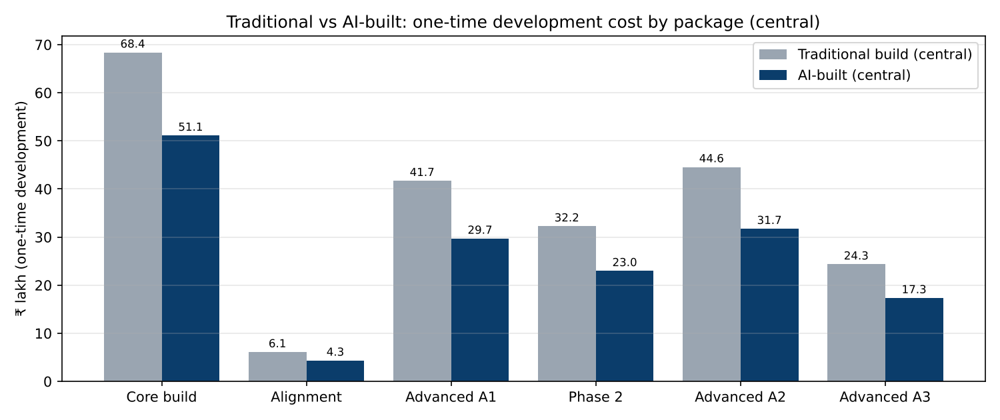
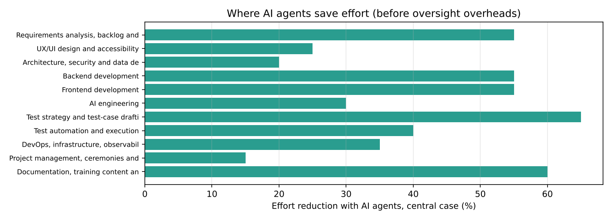

# AI Growth Engine: Cost Estimate v1.1, Building the Application with AI Models and AI Agents
## Traditional build vs AI-built: side-by-side costs in INR and USD

| Field | Value |
|---|---|
| Document | Cost Estimate v1.1 (AI-built variant). Companion to Cost Estimate v1.0 (traditional build) |
| Date | 28 Nov 2026 |
| Basis | Application Blueprint v1.1; approved budgets DEC-230/231; Founder decisions DEC-416…421 (DEC-419 tooling, DEC-420 AI-built delivery, DEC-421 Vercel + Supabase hosting) |
| Revision | Rev. A (28 Nov 2026): running costs re-based for the Vercel + Supabase + AWS Mumbai hosting stack (DEC-421) |
| Currency | INR and USD at ₹90 = $1 (verify). Amounts exclude GST |
| What changes | **Only how the software is built.** AI models and AI agents draft, code, test and document under human supervision. **The application itself, its features, its 80 production AI agents and its running costs do not change** |
| Status | **Approved approach (DEC-420, 28 Nov 2026):** AI-built delivery from Sprint 0, with a **Sprint 2 calibration gate (≈ Day 45)**. Team, dates and Ledger A stay as approved until the gate (§12) |

**Bifurcation used throughout.** Every table separates four things:

- **(1) one-time development** (people and vendors);
- **(2) build-time subscriptions and AI usage** (tools and tokens used to build);
- **(3) recurring running cost of the application** (cloud, AI inference, providers);
- **(4) lifecycle cost** (maintenance and future-proofing).

Each one is shown for the **traditional build** and the **AI-built** approach.

# 1. Executive summary

## 1.1 Side-by-side totals

| (1) One-time development | Status | Traditional range | Traditional central | AI-built range | AI-built central | Saving (central) | Saving % | AI-built central (USD) |
|--------------------------|------------|--------------|---------|--------------|---------|---------|------|---------|
| Core build to the Release 2 gate (Ledger A) | Approved (DEC-230) | ₹52.68 L – ₹84.08 L | ₹68.38 L | ₹31.74 L – ₹79.29 L | ₹51.11 L | ₹17.27 L | 25% | $56,787 |
| Literal alignment to the 38-document pack (CR-ALN-01) | Approved (DEC-416) | ₹2.78 L – ₹11.64 L | ₹6.09 L | ₹1.57 L – ₹10.87 L | ₹4.34 L | ₹1.75 L | 29% | $4,819 |
| Advanced release A1 (AI, revenue, platform) | Approved (DEC-417) | ₹28.00 L – ₹55.40 L | ₹41.70 L | ₹15.78 L – ₹51.72 L | ₹29.69 L | ₹12.01 L | 29% | $32,989 |
| Phase-2 core continuation (W6 Should/Could, hypercare, expansion pilots) | Optional, not yet approved | ₹25.80 L – ₹38.70 L | ₹32.25 L | ₹14.54 L – ₹36.13 L | ₹22.96 L | ₹9.29 L | 29% | $25,513 |
| Advanced release A2 | Proposed; decided at gate G-A1 | ₹32.46 L – ₹56.65 L | ₹44.56 L | ₹18.29 L – ₹52.88 L | ₹31.73 L | ₹12.83 L | 29% | $35,252 |
| Advanced release A3 (after the scale gate) | Proposed; decided at gate G-A2 | ₹17.74 L – ₹30.95 L | ₹24.34 L | ₹10.00 L – ₹28.89 L | ₹17.33 L | ₹7.01 L | 29% | $19,256 |
| **Approved scope (core + alignment + A1)** | Approved | **₹83.46 L – ₹151.12 L** | **₹116.17 L** | **₹49.09 L – ₹141.88 L** | **₹85.14 L** | **₹31.04 L** | **27%** | **$94,595** |
| **Full programme (all options)** | Approved + optional | **₹159.46 L – ₹277.43 L** | **₹217.32 L** | **₹91.91 L – ₹259.78 L** | **₹157.15 L** | **₹60.17 L** | **28%** | **$174,616** |

| (2) Build-time subscriptions and AI usage | Traditional (DEC-419) | AI-built | Difference |
|---|---|---|---|
| Tools and seats per month (all Claude seats + GitHub, Figma, Workspace, Bitwarden, BrowserStack, domains) | $861 – $897 (₹77,490 – ₹80,694) | $1,336 – $1,527 (₹1,20,240 – ₹1,37,394) | + $475 – $630 per month |
| AI-agent token usage (Claude API for headless/parallel coding agents), approved scope | ≈ $0 (interactive seats only) | $1,578 – $18,383 total (central $4,501) ≈ ₹1.42 L – ₹16.54 L | + $1,578 – $18,383 |
| AI-agent token usage, full programme | ≈ $0 | $2,636 – $30,448 total (central $7,435) |  |

| (3) Recurring running cost of the application | Traditional | AI-built |
|---|---|---|
| Pilot running per month after launch (approved Ledger B with contingency and seats) | ₹26,105 – ₹35,362 | Same: **unchanged** |
| All-in after the full advanced roadmap | ₹38,651 – ₹81,580 | Same: **unchanged** |
| Production AI inference by the application's 80 agents (Claude Sonnet primary) | ≈ ₹4,391/month base, capped | Same: **unchanged** |

| (4) Three-year total cost of ownership (build + 3 years) | Traditional | AI-built | Saving |
|---|---|---|---|
| Approved path | ₹194.82 L – ₹358.22 L | ₹153.15 L – ₹368.28 L | ₹41.67 L at the low end; ₹-10.06 L at the high end |
| Full roadmap | ₹298.59 L – ₹548.34 L | ₹210.64 L – ₹549.14 L | ₹87.95 L at the low end; ₹-0.80 L at the high end |
| (USD) Approved path | $216,461 – $398,019 | $170,164 – $409,196 |  |
| (USD) Full roadmap | $331,767 – $609,263 | $234,041 – $610,151 |  |

A negative saving means the AI-built approach costs more. That happens only in the conservative case: the AI tooling continues for three years while the productivity gain stays small. This is why a calibration gate is recommended before the team is changed.

## 1.2 What this means

- **Net effort saving on people:** 29% in the central case. The optimistic case is 44% and the conservative case 7%. The saving is net of the new work that AI-built delivery creates: writing specs for agents, reviewing every AI pull request, security and licence checks, and rework.
- **On the approved scope**, development falls from **₹116.17 L** to **₹85.14 L** central ($129,079 → $94,595). The saving is about **₹31.04 L**.
- **The AI cost of building is small.** Extra seats and tools add $475 – $630 per month. Agent tokens for the approved scope are about $4,501 central (up to $18,383 conservative). Both are a fraction of the people saving.
- **External costs do not shrink.** Penetration tests, training content, legal review, provider onboarding, UAT with real users and the 30-day monitored pilot cost the same, and the calendar cannot compress them.
- **Two ways to take the benefit.**
  - **Option A:** same dates with a smaller team. The team falls from about 8.5 to about 7.0 FTE at peak, and this is the cost view above.
  - **Option B:** same team, earlier delivery. Release 1 go/no-go moves to about **Fri 23 Apr 2027** (Day 138) instead of Fri 04 Jun 2027 (§9).
- **The estimate is less certain than the traditional one.** Productivity gains from AI agents vary widely between teams and codebases. A **Sprint 2 calibration gate** measures the real throughput before the plan is locked (§12).

# 2. How the application would be built with AI models and AI agents

## 2.1 Operating model

| Build agent (AI) | What it does | Model (Claude family) | Human owner |
|---|---|---|---|
| Spec and story agent | Turns blueprint FRs and screen contracts into refined stories, Gherkin AC and task specs | Sonnet-class; Opus-class for complex specs | Product Owner |
| Coding agents (Claude Code, interactive and headless) | Implement APIs, rules, workflows, React screens and migrations against specs and failing tests, in sandboxed branches | Sonnet-class (bulk), Opus-class (hard problems), Haiku-class (simple edits) | Senior engineers |
| Test-generation agent | Writes unit, API and UI tests and test data from AC; maintains traceability | Sonnet-class | QA lead |
| Code-review agent | First-pass review of every pull request: correctness, security, style, test gaps | Sonnet/Opus-class via API in CI | Engineering lead (final approval) |
| Security and licence agent | Runs SAST, dependency, secret and licence scans; explains findings | Haiku/Sonnet-class + open-source scanners | Independent reviewer |
| AI-evaluation agent | Builds and runs the eval sets for the 80 production agents | Sonnet-class (judge) + deterministic checks | AI engineer |
| DevOps agent | Writes IaC, pipelines, dashboards and runbooks | Sonnet-class | DevOps engineer |
| Documentation agent | Drafts runbooks, task cards, release notes, API docs | Haiku/Sonnet-class | Feature owners |

## 2.2 Guardrails for AI-built software

- Every change goes through a pull request reviewed and merged by a named engineer. Agents cannot merge to protected branches or deploy to production.
- Agents work in sandboxed branches and ephemeral environments with synthetic data only. No production data and no personal data reach build agents (DPDP).
- No secrets in prompts or repositories. Agent credentials are least-privilege and short-lived.
- SAST, dependency, secret and licence scans gate every merge. A provenance log records which agent, model and prompt produced each change.
- Test-first: agents implement against acceptance tests written or approved by humans. Coverage and mutation checks are tracked.
- Architecture, security design, PDP rules, money handling and AI guardrails stay human-owned. Agents may draft them, but humans decide.
- Budget caps on the Claude API keys used by build agents, with alerts at 70/90/100%.

# 3. Assumptions: where AI agents save effort and what they add

| Activity | Share of effort | Reduction optimistic | Reduction central | Reduction conservative | Executed by agents | What the AI does | What humans still do |
|--------------------|-----|------|------|------|------|------------------------|------------------------|
| Requirements analysis, backlog and user-story drafting | 7% | 70% | 55% | 40% | 60% | Drafts and refines stories, Gherkin AC and estimates from the blueprint drafts | PO prioritizes and accepts; growth lead checks rules |
| UX/UI design and accessibility | 6% | 35% | 25% | 15% | 20% | Generates screen variants, copy, component code from the design system; accessibility checks | Designer owns IA, flows, usability tests and final design |
| Architecture, security and data design | 6% | 30% | 20% | 10% | 15% | Drafts ADRs, schemas, threat-model checklists, IaC skeletons | Lead architect decides; independent reviewer signs off |
| Backend development (APIs, rules, workflows, data) | 27% | 65% | 55% | 35% | 60% | Coding agents implement APIs, rules, migrations and workflows from specs and tests | Engineers write specs, review every pull request, own design and merges |
| Frontend development (Website and Admin) | 15% | 65% | 55% | 35% | 60% | Agents build React screens from the screen contracts and design system | Engineers review, fix edge cases, verify accessibility |
| AI engineering (agents, gateway, RAG, evaluations) | 10% | 40% | 30% | 20% | 35% | Drafts prompt contracts, eval sets, fixtures; scaffolds agents | AI engineer owns guardrails, routing, evaluation thresholds |
| Test strategy and test-case drafting | 4% | 75% | 65% | 50% | 70% | Generates test cases, data and traceability from stories and FRs | QA lead reviews coverage and risk focus |
| Test automation and execution (unit, SIT, UAT, performance, security) | 11% | 50% | 40% | 30% | 50% | Writes unit/API/UI tests, triages failures, proposes fixes | QA executes UAT with users; performance and pen tests unchanged |
| DevOps, infrastructure, observability and release | 6% | 45% | 35% | 25% | 40% | Writes IaC, pipelines, dashboards and runbooks | DevOps engineer approves changes to production |
| Project management, ceremonies and reporting | 5% | 25% | 15% | 10% | 10% | Status summaries, burn-down analysis, meeting notes | Lead and PO run ceremonies and decisions |
| Documentation, training content and handover | 3% | 70% | 60% | 45% | 60% | Drafts docs, runbooks, task cards and release notes | Owners review for accuracy |
| **Weighted reduction** | 100% | **54.6%** | **44.3%** | **29.6%** | **48%** |  |  |

| New work created by AI-built delivery (% of traditional effort) | Optimistic | Central | Conservative | What it is |
|---|---|---|---|---|
| Agent orchestration, specification and prompt engineering | 3.0% | 4.0% | 6.0% | Writing precise specs, acceptance tests and task prompts for agents; managing agent runs |
| Human review and verification of AI output | 5.0% | 7.0% | 10.0% | Every pull request reviewed by an engineer; spot checks of generated tests and docs |
| Security, licence and provenance review of AI-generated code | 1.0% | 1.5% | 2.0% | SAST, dependency and licence scans, secret checks, provenance log |
| Rework allowance for AI defects | 2.0% | 3.0% | 5.0% | Fixing subtle defects that pass review and surface in SIT/UAT |
| **Total added work** | **11.0%** | **15.5%** | **23.0%** |  |
| **Net saving on people effort** | **43.6%** | **28.8%** | **6.6%** | Reduction minus added work |

**Basis.** These are planning assumptions, not measured results. They reflect three things:

- this blueprint's unusual completeness: stories, AC, test cases, screen contracts and API field contracts already exist as drafts, which favours AI agents;
- a mature, conventional stack: Django/DRF, React, PostgreSQL;
- the parts that stay human by design: architecture, security, the PDP, money handling and AI guardrails.

The low/central/high cost columns pair the traditional low with the optimistic case and the traditional high with the conservative case. The AI-built range is therefore wider than the traditional one.

# 4. One-time development: package by package

| Package | Traditional effort pd (low/central/high) | AI-built effort pd (opt./central/cons.) | People cost (traditional) | Vendor and fixed costs (unchanged) | Traditional cost | AI-built cost | AI-built cost (USD) |
|---|---|---|---|---|---|---|---|
| Core build to the Release 2 gate (Ledger A) | 532 / 722 / 921 | 300 / 514 / 860 | ₹47.97 L – ₹71.95 L | ₹4.71 L – ₹12.12 L | ₹52.68 L – ₹84.08 L | ₹31.74 L – ₹79.29 L | $35,268 – $88,100 |
| Literal alignment to the 38-document pack (CR-ALN-01) | 61 / 107 / 171 | 35 / 76 / 159 | ₹2.78 L – ₹11.64 L | — | ₹2.78 L – ₹11.64 L | ₹1.57 L – ₹10.87 L | $1,743 – $12,078 |
| Advanced release A1 (AI, revenue, platform) | 376 / 553 / 790 | 212 / 394 / 737 | ₹28.00 L – ₹55.40 L | — | ₹28.00 L – ₹55.40 L | ₹15.78 L – ₹51.72 L | $17,531 – $57,462 |
| Phase-2 core continuation (W6 Should/Could, hypercare, expansion pilots) | 100 / 100 / 100 | 56 / 71 / 93 | ₹25.80 L – ₹38.70 L | — | ₹25.80 L – ₹38.70 L | ₹14.54 L – ₹36.13 L | $16,154 – $40,140 |
| Advanced release A2 | 353 / 518 / 733 | 199 / 369 / 684 | ₹32.46 L – ₹56.65 L | — | ₹32.46 L – ₹56.65 L | ₹18.29 L – ₹52.88 L | $20,324 – $58,759 |
| Advanced release A3 (after the scale gate) | 197 / 283 / 402 | 111 / 201 / 375 | ₹17.74 L – ₹30.95 L | — | ₹17.74 L – ₹30.95 L | ₹10.00 L – ₹28.89 L | $11,107 – $32,102 |

## 4.1 Effort by activity: core build (central)

| Activity | Traditional pd | AI-built pd | Of which agent-executed (pd equivalent) | Saved pd |
|---|---|---|---|---|
| Requirements analysis, backlog and user-story drafting | 51 | 23 | 30 | 28 |
| UX/UI design and accessibility | 43 | 32 | 9 | 11 |
| Architecture, security and data design | 43 | 35 | 6 | 9 |
| Backend development (APIs, rules, workflows, data) | 195 | 88 | 117 | 107 |
| Frontend development (Website and Admin) | 108 | 49 | 65 | 60 |
| AI engineering (agents, gateway, RAG, evaluations) | 72 | 51 | 25 | 22 |
| Test strategy and test-case drafting | 29 | 10 | 20 | 19 |
| Test automation and execution (unit, SIT, UAT, performance, security) | 79 | 48 | 40 | 32 |
| DevOps, infrastructure, observability and release | 43 | 28 | 17 | 15 |
| Project management, ceremonies and reporting | 36 | 31 | 4 | 5 |
| Documentation, training content and handover | 22 | 9 | 13 | 13 |
| *Added:* Agent orchestration, specification and prompt engineering | — | 29 | — | −29 |
| *Added:* Human review and verification of AI output | — | 51 | — | −51 |
| *Added:* Security, licence and provenance review of AI-generated code | — | 11 | — | −11 |
| *Added:* Rework allowance for AI defects | — | 22 | — | −22 |
| **Total** | **722** | **514** | **347** | **208** |

# 5. Team, roles and rates

## 5.1 Team for the AI-built option A (same dates)

| Role | FTE at peak | Responsibility in an AI-built team |
|---|---|---|
| Engineering lead / solutions architect | 1.00 | Specs, architecture, final review, merges |
| Senior full-stack engineers supervising coding agents | 3.00 | Write specs and acceptance tests, review agent pull requests |
| Contract engineer (Sprint 3 → Release 2 gate) | 1.00 | Down from 2 in the traditional plan |
| QA lead (AI evaluation and test review) | 1.00 | From Sprint 3, as approved |
| Growth / compliance lead | 0.50 | 0.75 in W4–W5, as approved |
| UX designer (contract) | 0.35 | Reduced: agents generate variants from the design system |
| Independent reviewer (architecture and AI-code security) | 0.10 | Extra focus on AI-generated code |
| **Total** | **6.95** | Traditional peak ≈ 8.5 FTE |

## 5.2 Rate card (unchanged)

Rates are the same as v1.0: loaded ₹568–₹852 per hour ($6.31–$9.47) for India delivery. AI-built teams lean towards senior engineers, because reviewing agent output well needs experience. The rate band already covers senior roles (v1.0 §3).

## 5.3 Skills that matter more in an AI-built team

- Writing precise specifications and acceptance tests that agents can implement
- Reviewing code quickly and critically; spotting plausible-but-wrong logic
- Security review of generated code and dependencies
- Prompt and context engineering for coding agents (CLAUDE.md, skills, repository conventions)
- Test design and evaluation of AI behaviour

# 6. Build-time subscriptions and AI usage

## 6.1 Tools and seats per month

| Item | Purpose | Unit $/month | Seats | Per month (USD) | Per month (INR) | Notes |
|---|---|---|---|---|---|---|
| Claude Max 20x for engineers who supervise coding agents | Higher usage limits for continuous Claude Code sessions | $200 | 5 | $1,000 | ₹90,000 | Replaces Max 5x in DEC-419 for engineers |
| Claude Pro for QA, growth/compliance lead and PO | Drafting, review, test data | $20 | 3 | $60 | ₹5,400 | As DEC-419 |
| CI runners and agent sandboxes | Ephemeral environments where agents build and test branches safely | $50–$200 | 1 | $50–$200 | ₹4,500–₹18,000 | GitHub larger runners or AWS dev sandboxes |
| Agent observability (self-hosted Langfuse, dev instance) | Traces, cost and quality of build agents | $25–$30 | 1 | $25–$30 | ₹2,250–₹2,700 | Hosting only; open source |
| Static analysis and licence scanning | Semgrep/SonarQube Community, Trivy, licence checker | $0 | 1 | $0 | ₹0 | Open source |
| Other DEC-419 tools (GitHub Team, Figma, Workspace, Bitwarden, BrowserStack, domains) | Same as the traditional build | — | — | $201 – $237 | ₹18,090 – ₹21,294 | Approved (DEC-419) |
| **Total AI-built tooling per month** |  |  |  | **$1,336 – $1,527** | **₹1,20,240 – ₹1,37,394** | Traditional (DEC-419): $861 – $897 |

The approved Ledger B line B09 (2 Claude seats, ₹4,140/month) is part of these Claude totals in both approaches. It is not added twice.

## 6.2 AI-agent token usage (Claude API for headless and parallel agents)

Token use is estimated per person-day of work executed by agents. The assumptions are 4.0 M input tokens per agent-executed person-day, 80% of them served from the prompt cache, plus 0.2 M output tokens. The model mix is 20% Opus-class, 70% Sonnet-class, 10% Haiku-class. List prices per million tokens (input / cached input / output) are:

- Opus-class: $5.0 / $0.5 / $25.0
- Sonnet-class: $3.0 / $0.3 / $15.0
- Haiku-class: $1.0 / $0.1 / $5.0

That gives **$6.78 per agent-executed person-day** in the central case; prices to verify. Multipliers for retries, parallel exploration and long contexts: optimistic ×0.5, conservative ×3.

| Package | Agent-executed pd (opt./central/cons.) | Token cost USD (opt./central/cons.) | Token cost INR |
|---|---|---|---|
| Core build to the Release 2 gate (Ledger A) | 255 / 347 / 442 | $866 / $2,351 / $8,997 | ₹77,956 – ₹8,09,749 |
| Literal alignment to the 38-document pack (CR-ALN-01) | 29 / 51 / 82 | $100 / $349 / $1,669 | ₹8,975 – ₹1,50,168 |
| Advanced release A1 (AI, revenue, platform) | 180 / 265 / 379 | $612 / $1,801 / $7,717 | ₹55,097 – ₹6,94,573 |
| Phase-2 core continuation (W6 Should/Could, hypercare, expansion pilots) | 48 / 48 / 48 | $163 / $326 / $977 | ₹14,653 – ₹87,921 |
| Advanced release A2 | 169 / 249 / 352 | $575 / $1,687 / $7,161 | ₹51,727 – ₹6,44,458 |
| Advanced release A3 (after the scale gate) | 95 / 136 / 193 | $321 / $922 / $3,927 | ₹28,867 – ₹3,53,441 |
| **Approved scope** |  | **$1,578 / $4,501 / $18,383** | **₹1,42,028 – ₹16,54,491** |
| **Full programme** |  | **$2,636 / $7,435 / $30,448** | **₹2,37,276 – ₹27,40,311** |

These are **build costs**: the AI used to write the software. They are separate from the application's own production AI inference (Ledger B lines B02, B23, B24), which is unchanged.

# 7. AI agents, automations and workflows: traditional vs AI-built build effort

| Type | Count | Traditional build pd | AI-built pd | Traditional build cost | AI-built build cost | Run cost (unchanged) |
|---|---|---|---|---|---|---|
| AI agents | 80 | 307–452 | 173–422 | ₹13.95 L – ₹30.82 L | ₹7.86 L – ₹28.77 L | ₹4,391/month |
| Automations | 119 | 78–154 | 44–144 | ₹3.52 L – ₹10.50 L | ₹1.99 L – ₹9.80 L | In hosting |
| Workflows | 38 | 176–283 | 99–264 | ₹8.00 L – ₹19.30 L | ₹4.51 L – ₹18.01 L | In hosting |

The full list of all 237 items is in §13 and in the workbook. For each item it gives what it does, its automation level, traditional and AI-built effort and cost, run cost, release and timeline.

# 8. Drafting: user stories, test cases and test strategies

| Artefact | Count | Manual pd | Traditional plan pd (refine drafts) | AI-built pd | How |
|---|---|---|---|---|---|
| User stories with Gherkin acceptance criteria | 461 | 115–202 | 29–52 | 14–36 | Spec agent drafts; humans refine the blueprint drafts and accept |
| Test cases (functional, NFR, AI evaluation, alignment) | 4,156 | 171–260 | 42–78 | 21–55 | Spec agent drafts; humans refine the blueprint drafts and accept |
| Mapping of source-pack tests (unit 75, SIT 422, UAT 302) | 799 | 10–20 | 3–6 | 1–4 | Spec agent drafts; humans refine the blueprint drafts and accept |
| Test strategies and plans | 20 docs | 29–56 | 10–20 | 6–17 | Agent drafts from Part 6.1; QA lead owns |

# 9. Timeline options

**Option A (cost view): same dates, smaller team.** Release 1 go/no-go Fri 04 Jun 2027 (Day 180), Release 2 build Fri 02 Jul 2027 (Day 208), W5 exit Fri 23 Jul 2027 (Day 229). Team ≈ 7.0 FTE at peak.

**Option B (time view): same team, earlier delivery.** Engineering phases shrink by the net saving. Foundation, legal, provider onboarding, penetration tests, UAT with users and the 30-day monitored pilot do not shrink. The cost is about the same as option A, because the same team works fewer months, but revenue starts earlier.

| Milestone | Traditional (approved) | AI-built optimistic | AI-built central | AI-built conservative |
|---|---|---|---|---|
| Release 1 go/no-go | Fri 04 Jun 2027 (Day 180) | Sun 04 Apr 2027 (Day 119) | Fri 23 Apr 2027 (Day 138) | Sat 22 May 2027 (Day 167) |
| Release 2 build gate | Fri 02 Jul 2027 (Day 208) | Tue 20 Apr 2027 (Day 135) | Thu 13 May 2027 (Day 158) | Thu 17 Jun 2027 (Day 193) |
| W5 exit (after monitored pilot) | Fri 23 Jul 2027 (Day 229) | Tue 11 May 2027 (Day 156) | Thu 03 Jun 2027 (Day 179) | Thu 08 Jul 2027 (Day 214) |
| Advanced A1 complete | Dec 2027 (Day ≈ 365) | Sat 31 Jul 2027 | Sat 11 Sep 2027 | Sun 14 Nov 2027 |
| Advanced A2 complete | Mar 2028 (Day ≈ 480) | Mon 04 Oct 2027 | Thu 02 Dec 2027 | Tue 29 Feb 2028 |
| Advanced A3 complete | Jul 2028 (Day ≈ 600) | Sat 11 Dec 2027 | Sat 26 Feb 2028 | Tue 20 Jun 2028 |

# 10. Recurring running cost of the application (unchanged)

Building with AI agents does not change what the application runs on, so the running costs in v1.0 §8 apply unchanged.

| Item | Per month (INR) | Per month (USD) |
|---|---|---|
| Pilot running after launch (Ledger B, contingency, seats) | ₹26,105 – ₹35,362 | $290 – $393 |
| Literal-alignment additions (CR-ALN-02) | ₹1,495 – ₹10,120 | $17 – $112 |
| Advanced capabilities at full rollout | ₹11,051 – ₹36,098 | $123 – $401 |
| Growth gate / scale design points | ₹59,000 – ₹79,000 / ₹1,39,000 – ₹1,79,000 | $656 – $878 / $1,544 – $1,989 |

**After the build**, the AI tooling continues for the maintenance team at about **$636 – $817 per month**. That covers 2 Claude Max 20x seats, 2 Pro seats, CI sandboxes and agent observability, plus the remaining DEC-419 tools.

# 11. Lifecycle: maintenance, future-proofing and three-year TCO

With AI agents, maintenance is assumed at **12–17%** of cumulative development per year, against 15–20% traditionally. Agents handle routine patches, dependency upgrades and test repair. Effort-based future-proofing items (model migration, framework upgrades, DR drills, documentation) shrink by the same net saving. Fixed-price items (penetration test, accessibility audit, DPDP review) do not. Future-proofing per year: **₹5.19 L – ₹15.13 L** (traditional ₹6.47 L – ₹15.29 L).

## Approved path

| Year | Development traditional | Development AI-built | Running (same) | Tooling + tokens (AI-built) | Maintenance (AI-built) | Future-proofing (AI-built) | Total traditional | Total AI-built |
|---|---|---|---|---|---|---|---|---|
| Year 0 (build): Dec 2026 – Jul 2027 | ₹55.46 L – ₹95.72 L | ₹33.31 L – ₹90.16 L | ₹1.94 L – ₹2.69 L | ₹10.49 L – ₹20.59 L | ₹0.00 L – ₹0.00 L | ₹0.00 L – ₹0.00 L | ₹63.32 L – ₹104.58 L | **₹45.74 L – ₹113.44 L** |
| Year 1: Aug 2027 – Jul 2028 | ₹28.00 L – ₹55.40 L | ₹15.78 L – ₹51.72 L | ₹3.78 L – ₹6.97 L | ₹14.98 L – ₹23.43 L | ₹4.00 L – ₹15.33 L | ₹5.19 L – ₹15.13 L | ₹55.43 L – ₹106.06 L | **₹43.72 L – ₹112.58 L** |
| Year 2: Aug 2028 – Jul 2029 (growth gate) | ₹0.00 L – ₹0.00 L | ₹0.00 L – ₹0.00 L | ₹7.72 L – ₹12.21 L | ₹6.87 L – ₹8.82 L | ₹6.36 L – ₹26.05 L | ₹5.61 L – ₹16.35 L | ₹32.41 L – ₹65.82 L | **₹26.56 L – ₹63.43 L** |
| Year 3: Aug 2029 – Jul 2030 (scale design point) | ₹0.00 L – ₹0.00 L | ₹0.00 L – ₹0.00 L | ₹17.32 L – ₹24.21 L | ₹6.87 L – ₹8.82 L | ₹6.87 L – ₹28.13 L | ₹6.06 L – ₹17.65 L | ₹43.65 L – ₹81.75 L | **₹37.12 L – ₹78.82 L** |
| **Total (build + 3 years)** |  |  |  |  |  |  | **₹194.82 L – ₹358.22 L** | **₹153.15 L – ₹368.28 L** |

## Full roadmap

| Year | Development traditional | Development AI-built | Running (same) | Tooling + tokens (AI-built) | Maintenance (AI-built) | Future-proofing (AI-built) | Total traditional | Total AI-built |
|---|---|---|---|---|---|---|---|---|
| Year 0 (build): Dec 2026 – Jul 2027 | ₹55.46 L – ₹95.72 L | ₹33.31 L – ₹90.16 L | ₹1.94 L – ₹2.69 L | ₹10.49 L – ₹20.59 L | ₹0.00 L – ₹0.00 L | ₹0.00 L – ₹0.00 L | ₹63.32 L – ₹104.58 L | **₹45.74 L – ₹113.44 L** |
| Year 1: Aug 2027 – Jul 2028 | ₹104.00 L – ₹181.70 L | ₹58.60 L – ₹169.62 L | ₹4.22 L – ₹8.42 L | ₹15.93 L – ₹34.29 L | ₹4.00 L – ₹15.33 L | ₹5.19 L – ₹15.13 L | ₹131.88 L – ₹233.80 L | **₹87.95 L – ₹242.79 L** |
| Year 2: Aug 2028 – Jul 2029 (growth gate) | ₹0.00 L – ₹0.00 L | ₹0.00 L – ₹0.00 L | ₹8.59 L – ₹15.03 L | ₹6.87 L – ₹8.82 L | ₹11.91 L – ₹47.70 L | ₹5.61 L – ₹16.35 L | ₹45.59 L – ₹95.92 L | **₹32.98 L – ₹87.89 L** |
| Year 3: Aug 2029 – Jul 2030 (scale design point) | ₹0.00 L – ₹0.00 L | ₹0.00 L – ₹0.00 L | ₹18.19 L – ₹27.03 L | ₹6.87 L – ₹8.82 L | ₹12.87 L – ₹51.51 L | ₹6.06 L – ₹17.65 L | ₹57.81 L – ₹114.03 L | **₹43.98 L – ₹105.01 L** |
| **Total (build + 3 years)** |  |  |  |  |  |  | **₹298.59 L – ₹548.34 L** | **₹210.64 L – ₹549.14 L** |

# 12. Risks, calibration gate and recommendation

| Risk specific to AI-built delivery | Effect | Control |
|---|---|---|
| Productivity lower than assumed | Savings shrink towards the conservative case (~7%) | Sprint 2 calibration gate: measure accepted story points per engineer-week against the traditional baseline before reducing the team |
| Subtle defects in generated code | Rework, incidents | Test-first development; mandatory human review; rework allowance; SAST; mutation testing on critical modules |
| Security weaknesses or vulnerable dependencies | Data exposure | Security agent + independent reviewer; dependency pinning; secret scanning; two external pen tests unchanged |
| Licence and IP contamination | Legal exposure | Licence scanning; provenance log; company policy on AI-generated code; contracts assign IP |
| Over-reliance and skills erosion | Team cannot maintain code | Engineers own design and reviews; architecture docs and ADRs kept current; pairing on critical modules |
| Token cost overruns | Higher build AI spend | API budget caps with alerts; prompt caching; model mix tuned (Haiku for simple tasks) |
| Vendor dependency on one model provider | Disruption | Specs and tests are model-agnostic; the codebase is ordinary Django/React; agents can be switched |
| Data protection | Personal data reaching build agents | Synthetic data only in agent sandboxes; no production access for agents |

**Approved approach (DEC-420, Founder, 28 Nov 2026):**

1. Start with the approved traditional team, using the AI tooling and the operating model in §2 from Sprint 0.
2. At the **Sprint 2 calibration gate (about Day 45)**, compare measured throughput with the central assumptions.
3. If the measured net saving is at least 20%, then either:
   - release the second contract engineer and keep the dates (option A); or
   - keep the team and bring Release 1 forward (option B).
4. If the measured net saving is below 20%, keep the approved plan. The extra AI tooling costs about ₹45,000 per month, a small cost against the benefit.

**Gate measurement and thresholds (DEC-420).**

| Item | Definition |
|---|---|
| Net saving | 1 − (actual engineer-days ÷ planned engineer-days for the scope accepted in Sprints 1–2), using the Part 8.1 sprint plan as the baseline |
| Quality guard 1 | Defects escaping to SIT no more than 20% above the plan rate |
| Quality guard 2 | No unresolved critical or high security findings in AI-generated code |
| Quality guard 3 | Pull-request review backlog under 2 working days |
| ≥ 20% and guards hold | Option A by default: keep the dates and release the second contract engineer from Sprint 3 (Ledger A updated by change control). The Founder may choose option B: keep the team and bring Release 1 forward |
| 10–20% | Keep the approved team and dates; keep the AI tooling |
| < 10% | Keep the approved plan; revert to the DEC-419 tooling |
| Build-agent API budget | Hard cap $1,500 per month (₹1.35 L) with alerts at 70/90/100% |
| Record | The gate result and the option chosen are recorded as a new decision |

# 13. Full list: AI agents, automations and workflows, traditional vs AI-built

## 13.1 AI agents (80)

| ID | Name | What it does | Automation | Trad. pd | AI-built pd | Trad. build cost | AI-built build cost | Run/month | Release and timeline |
|-----|-----------|----------------------------------|--------|-----|------|----------|----------|------|----------|
| AG-001 | Knowledge & Claim Ingestion Assistant | Turns approved uploaded decks, brochures and FAQs into chunk summaries and claim candidates with page citations, so R10/R05 approve claims in minutes instead of reading whole documents. | Partially automated | 2–3 | 1.1–2.8 | ₹9,091 – ₹20,455 | ₹5,123 – ₹19,094 | ₹5 | Release 1 (Dec 2026 – 4 Jun 2027) |
| AG-002 | AI Quality Judge & Eval Runner | Scores generative outputs against rubrics (groundedness, claim compliance, tone, refusal correctness) for the CI regression gate and for a 5% sample of production outputs. | Mostly automated | 7–10 | 3.9–9.3 | ₹31,818 – ₹68,182 | ₹17,930 – ₹63,648 | ₹139 | Release 1 (Dec 2026 – 4 Jun 2027) |
| AG-003 | Research Query Planner | Expands approved capability codes, geography and organization types into scoped search queries within the plan's source and cost bounds. | Fully automated within guardrails | 4–6 | 2.3–5.6 | ₹18,182 – ₹40,909 | ₹10,245 – ₹38,189 | ₹1 | Release 1 (Dec 2026 – 4 Jun 2027) |
| AG-004 | Evidence Extractor | Extracts organization-level business facts (projects, tenders, expansions, hiring for relevant functions, budgets, dates) with quotes and provenance from permitted pages and permitted social posts. | Fully automated within guardrails | 2–3 | 1.1–2.8 | ₹9,091 – ₹20,455 | ₹5,123 – ₹19,094 | ₹19 | Release 1 (Dec 2026 – 4 Jun 2027) |
| AG-005 | Buying Signal Classifier | Classifies each evidence item into the approved signal taxonomy with confidence; below-threshold items go to review. | Mostly automated | 2–3 | 1.1–2.8 | ₹9,091 – ₹20,455 | ₹5,123 – ₹19,094 | ₹6 | Release 1 (Dec 2026 – 4 Jun 2027) |
| AG-006 | Need Discovery Agent | Derives business needs from signals and evidence and labels each as explicit (stated in a source) or inferred. | Mostly automated | 2–3 | 1.1–2.8 | ₹9,091 – ₹20,455 | ₹5,123 – ₹19,094 | ₹6 | Release 1 (Dec 2026 – 4 Jun 2027) |
| AG-007 | Solution Match Explainer | Explains why each deterministically ranked offering (AU-016) fits a need and why others were excluded (readiness, geography, capability). | Assistive only | 2–3 | 1.1–2.8 | ₹9,091 – ₹20,455 | ₹5,123 – ₹19,094 | ₹2 | Release 1 (Dec 2026 – 4 Jun 2027) |
| AG-008 | Decision-Maker Role Extractor | Extracts role hypotheses (function, seniority) and published professional channels from official organization pages for qualified accounts. | Partially automated | 2–3 | 1.1–2.8 | ₹9,091 – ₹20,455 | ₹5,123 – ₹19,094 | ₹1 | Release 1 (Dec 2026 – 4 Jun 2027) |
| AG-009 | Qualification Brief Assistant | Prepares a one-screen cited brief per opportunity (need, fit, evidence freshness, score components, open questions) for the reviewer; at L2 (after the 90% gate) proposes accept/reject. | Partially automated | 2–3 | 1.1–2.8 | ₹9,091 – ₹20,455 | ₹5,123 – ₹19,094 | ₹11 | Release 1 (Dec 2026 – 4 Jun 2027) |
| AG-010 | Import Mapping Assistant | Maps unmatched CSV/JSON column headers and value formats to versioned import templates after deterministic header matching. | Partially automated | 2–3 | 1.1–2.8 | ₹9,091 – ₹20,455 | ₹5,123 – ₹19,094 | ₹0 | Release 1 (Dec 2026 – 4 Jun 2027) |
| AG-011 | Outreach & Follow-up Message Drafter | Drafts evidence-cited first-touch emails, WhatsApp template variants, follow-up steps, event invitations and renewal reminders using approved claims only. | Mostly automated | 7–10 | 3.9–9.3 | ₹31,818 – ₹68,182 | ₹17,930 – ₹63,648 | ₹165 | Release 1 (Dec 2026 – 4 Jun 2027) |
| AG-012 | Claims & Policy Guard | Second-line check of every customer-facing draft (messages, content, proposals, chat answers sampled) for unsupported claims, prohibited content, tone and brand. | Fully automated within guardrails | 2–3 | 1.1–2.8 | ₹9,091 – ₹20,455 | ₹5,123 – ₹19,094 | ₹20 | Release 1 (Dec 2026 – 4 Jun 2027) |
| AG-013 | Inbound Intent Classifier & Router | Classifies every inbound email, WhatsApp and web reply (positive, question, objection, out-of-office, complaint, urgent/clinical, wrong person, other), extracts proposed times and a one-line summary, and routes it. | Fully automated within guardrails | 4–6 | 2.3–5.6 | ₹18,182 – ₹40,909 | ₹10,245 – ₹38,189 | ₹9 | Release 1 (Dec 2026 – 4 Jun 2027) |
| AG-014 | Reply Assistant | Drafts answers to inbound questions from approved FAQ and knowledge with citations; at L3, sends only approved FAQ answers verbatim with variables. | Fully automated within guardrails | 2–3 | 1.1–2.8 | ₹9,091 – ₹20,455 | ₹5,123 – ₹19,094 | ₹27 | Release 1 (Dec 2026 – 4 Jun 2027) |
| AG-015 | Admin Copilot | Side-panel assistant that answers staff questions over records the user can already see and approved knowledge, with citations; briefs on accounts and meetings; proposes saved-view filters and drafts (message, task, note). | Assistive only | 2–3 | 1.1–2.8 | ₹9,091 – ₹20,455 | ₹5,123 – ₹19,094 | ₹222 | Release 2 (Jun – 23 Jul 2027) |
| AG-016 | Autonomous Commercial Planner | Proposes commercial plans (objective, eligible segment, channel mix, sequence, budget, schedule) and workflow drafts from approved node types; narrates simulation results. | Partially automated | 7–10 | 3.9–9.3 | ₹31,818 – ₹68,182 | ₹17,930 – ₹63,648 | ₹26 | Release 2 (Jun – 23 Jul 2027) |
| AG-017 | Website Assistant | Public chat on each verified startup site that answers from approved public knowledge with citations, captures a consented lead and hands over clinical, legal, pricing-negotiation and complaint topics. | Fully automated within guardrails | 2–3 | 1.1–2.8 | ₹9,091 – ₹20,455 | ₹5,123 – ₹19,094 | ₹13 | Release 1 (Dec 2026 – 4 Jun 2027) |
| AG-018 | Content & Campaign Studio Drafter | Drafts articles, social variants, landing-page copy, ad copy, SEO titles/meta and translation drafts (hi-IN, ta-IN, or-IN) from a brief using approved claims. | Partially automated | 4–6 | 2.3–5.6 | ₹18,182 – ₹40,909 | ₹10,245 – ₹38,189 | ₹98 | Release 1 (Dec 2026 – 4 Jun 2027) |
| AG-019 | Bid / RFP Analyzer | Parses RFPs, tenders and submitted project requirements into eligibility criteria, deadlines, mandatory documents, evaluation criteria and a compliance matrix, plus an L0 bid/no-bid brief. | Assistive only | 4–6 | 2.3–5.6 | ₹18,182 – ₹40,909 | ₹10,245 – ₹38,189 | ₹141 | Release 2 (Jun – 23 Jul 2027) |
| AG-020 | Proposal & Bid Response Drafter | Drafts proposals and bid response sections from approved templates, meeting notes entered by staff, approved claims and the deterministic price snapshot (prices inserted by AU-035, never by the model). | Partially automated | 4–6 | 2.3–5.6 | ₹18,182 – ₹40,909 | ₹10,245 – ₹38,189 | ₹63 | Release 2 (Jun – 23 Jul 2027) |
| AG-021 | Objection & Negotiation Assistant | Classifies objections into the approved taxonomy, drafts approved responses, and prepares exception summaries for A070 when a request exceeds concession limits. | Partially automated | 4–6 | 2.3–5.6 | ₹18,182 – ₹40,909 | ₹10,245 – ₹38,189 | ₹22 | Release 2 (Jun – 23 Jul 2027) |
| AG-022 | Contract Clause Reviewer | Compares counterparty redlines or third-party paper against the approved template and clause library; flags non-standard, missing or risky clauses for Legal with references. | Assistive only | 4–6 | 2.3–5.6 | ₹18,182 – ₹40,909 | ₹10,245 – ₹38,189 | ₹18 | Release 2 (Jun – 23 Jul 2027) |
| AG-023 | Order Document Extractor | Extracts RFQ/PO lines (SKU, description, unit, quantity, requested price, delivery date/region) from uploaded documents and emails into a draft order or RFQ for OrganicSpec and other order-desk startups. | Partially automated | 2–3 | 1.1–2.8 | ₹9,091 – ₹20,455 | ₹5,123 – ₹19,094 | ₹5 | Release 2 (Jun – 23 Jul 2027) |
| AG-024 | Payment Evidence Extractor | Pre-fills payment verification fields (UTR/reference, amount, currency, date, payer name, bank) from uploaded bank/UPI evidence for the Finance Maker. | Assistive only | 2–3 | 1.1–2.8 | ₹9,091 – ₹20,455 | ₹5,123 – ₹19,094 | ₹1 | Release 2 (Jun – 23 Jul 2027) |
| AG-025 | Onboarding Handoff Summarizer | Produces the commercial-to-delivery handoff summary (scope, commitments, contacts' roles, open risks, approved terms references) when a deal closes. | Partially automated | 2–3 | 1.1–2.8 | ₹9,091 – ₹20,455 | ₹5,123 – ₹19,094 | ₹0 | Release 2 (Jun – 23 Jul 2027) |
| AG-026 | Loss & Feedback Analyzer | Classifies free-text loss reasons and customer feedback into the loss taxonomy and produces a monthly theme report. | Mostly automated | 2–3 | 1.1–2.8 | ₹9,091 – ₹20,455 | ₹5,123 – ₹19,094 | ₹0 | Release 2 (Jun – 23 Jul 2027) |
| AG-027 | Market & Competitor Watch Summarizer | Summarizes permitted public competitor and market events into internal alerts with sources. | Fully automated within guardrails | 2–3 | 1.1–2.8 | ₹9,091 – ₹20,455 | ₹5,123 – ₹19,094 | ₹1 | Release 2 (Jun – 23 Jul 2027) |
| AG-028 | Ops & Incident Triage Agent | Clusters failed runs, DLQ items, provider errors and alerts; summarizes probable cause and links the runbook (RB-) for on-call staff. | Assistive only | 2–3 | 1.1–2.8 | ₹9,091 – ₹20,455 | ₹5,123 – ₹19,094 | ₹7 | Release 2 (Jun – 23 Jul 2027) |
| AG-029 | Insight Narrative Agent | Writes weekly 'what changed and why' narratives on deterministic KPI snapshots for startup heads and a portfolio digest for the founder. | Fully automated within guardrails | 2–3 | 1.1–2.8 | ₹9,091 – ₹20,455 | ₹5,123 – ₹19,094 | ₹1 | Release 2 (Jun – 23 Jul 2027) |
| AG-030 | SaaS Onboarding Configuration Assistant | During W33, proposes business profile, industry taxonomy, offering structure, objective templates and workflow bindings from the applicant's description. | Partially automated | 4–6 | 2.3–5.6 | ₹18,182 – ₹40,909 | ₹10,245 – ₹38,189 | ₹35 | Release 2 (Jun – 23 Jul 2027) |
| AG-031 | Support Desk Assistant | Triages portal support tickets (W28, W34) by category and severity, drafts replies from the help centre, answers authenticated customers' questions about their own records, and drafts KB articles from resolved tickets. | Mostly automated | 4–6 | 2.3–5.6 | ₹18,182 – ₹40,909 | ₹10,245 – ₹38,189 | ₹14 | Release 2 (Jun – 23 Jul 2027) |
| AG-032 | Partner Due-Diligence Brief | Compiles public evidence on prospective partners, insurers and licensees into a due-diligence checklist with sources. | Assistive only | 4–6 | 2.3–5.6 | ₹18,182 – ₹40,909 | ₹10,245 – ₹38,189 | ₹10 | W6 / Phase 2 (Aug – Dec 2027) |
| AG-033 | Requirements & Story Assistant | Drafts user stories, Gherkin AC, ADR and DPIA skeletons from FR/BRL/DEC text, and runs change-impact analysis over the traceability matrix. | Partially automated | 2–3 | 1.1–2.8 | ₹9,091 – ₹20,455 | ₹5,123 – ₹19,094 | ₹505 | Release 1 (Dec 2026 – 4 Jun 2027) |
| AG-034 | Coding Assistant | Claude Code for implementation, refactoring, IaC, UI microcopy and accessibility fixes, with repository rules (RLS scoping, outbox, no secrets). | Partially automated | 2–3 | 1.1–2.8 | ₹9,091 – ₹20,455 | ₹5,123 – ₹19,094 | ₹505 | Release 1 (Dec 2026 – 4 Jun 2027) |
| AG-035 | PR, Security & Release Review Agent | Reviews each pull request for tenancy/RLS scoping, outbox use, secret exposure, OWASP issues, missing tests; triages CI failures and SAST/dependency findings; drafts release notes and go/no-go summaries; drafts threat-model updates. | Assistive only | 4–6 | 2.3–5.6 | ₹18,182 – ₹40,909 | ₹10,245 – ₹38,189 | ₹505 | Release 1 (Dec 2026 – 4 Jun 2027) |
| AG-036 | Test & Synthetic Data Generator | Generates test cases from Gherkin AC (EP/BVA/decision-table techniques), synthetic two-tenant fixtures (RECOMMENDATION-017), injection corpora and eval cases from reviewed feedback. | Partially automated | 2–3 | 1.1–2.8 | ₹9,091 – ₹20,455 | ₹5,123 – ₹19,094 | ₹6 | Release 1 (Dec 2026 – 4 Jun 2027) |
| AG-037 | Meeting Notes & Action Summarizer | Turns staff-written meeting notes (and, only after GAP-143 is resolved with consent, authorized transcripts) into a structured summary, decisions and action items that distinguish confirmed from unconfirmed commitments, so follow-ups start … | Partially automated | 7–10 | 3.9–9.3 | ₹31,818 – ₹68,182 | ₹17,930 – ₹63,648 | ₹7 | Release 2 (Jun – 23 Jul 2027) |
| AG-038 | Retention Next-Best-Action Advisor | For accounts entering the renewal window (AU-039), reads delivery milestones, feedback, support history and contract dates and proposes one next best action (check-in, success review, upsell discussion within approved offerings, risk escala… | Assistive only | 4–6 | 2.3–5.6 | ₹18,182 – ₹40,909 | ₹10,245 – ₹38,189 | ₹5 | Release 2 (Jun – 23 Jul 2027) |
| AG-039 | Agent Supervisor and Planner | Turns a staff objective ("pursue account X for offering Y", "prepare RFP response", "prepare launch brief") into a typed, budgeted, approvable plan over registered agents and automations, so multi-step work starts in minutes with every base… | Partially automated | 7–10 | 3.9–9.3 | ₹31,818 – ₹68,182 | ₹17,930 – ₹63,648 | ₹120 | Advanced A1 (Aug – Dec 2027) |
| AG-040 | Account Research Agent | Builds one cited, versioned account brief per organization from owned records (CRM, evidence, interactions) and permitted public sources only (AU-007), so every account-centric agent and person works from the same facts; no personal profili… | Assistive only | 7–10 | 3.9–9.3 | ₹31,818 – ₹68,182 | ₹17,930 – ₹63,648 | ₹20 | Advanced A1 (Aug – Dec 2027) |
| AG-041 | Signal and Intent Fusion Analyst | Explains the account-level intent band computed by AU-055 from classified signals (AG-005), first-party consented web engagement, inbound intents (AG-013) and event attendance (AU-051) as a dated timeline with reasons, so owners engage when… | Assistive only | 2–3 | 1.1–2.8 | ₹9,091 – ₹20,455 | ₹5,123 – ₹19,094 | ₹8 | Advanced A2 (Dec 2027 – Mar 2028) |
| AG-042 | Predictive Score Explainer | Turns stored SHAP contributions from the advisory propensity model (AU-056) into a short plain-language "why" with caveats, so owners trust and correctly use the estimate alongside, not instead of, the DEC-011 score | Assistive only | 4–6 | 2.3–5.6 | ₹18,182 – ₹40,909 | ₹10,245 – ₹38,189 | ₹7 | Advanced A2 (Dec 2027 – Mar 2028) |
| AG-043 | Next-Best-Action and Offer Advisor | For each open opportunity, proposes one next best action from the registered action catalogue (call, send approved asset, book meeting, multi-thread to another role, involve specialist, pause, close-lost review) and, where eligible, one nex… | Assistive only | 4–6 | 2.3–5.6 | ₹18,182 – ₹40,909 | ₹10,245 – ₹38,189 | ₹30 | Advanced A2 (Dec 2027 – Mar 2028) |
| AG-044 | Deal-Risk Early-Warning Analyst | Explains deal-risk flags raised by AU-058 (stalled beyond stage p75 duration, close date slipped twice, single-threaded, negative intent, competitor mention in notes, unanswered proposal) and drafts one suggested task, so managers intervene… | Assistive only | 2–3 | 1.1–2.8 | ₹9,091 – ₹20,455 | ₹5,123 – ₹19,094 | ₹10 | Advanced A2 (Dec 2027 – Mar 2028) |
| AG-045 | Conversation Intelligence Analyst | Aggregates themes, objections, competitor mentions and commitment patterns across staff-written meeting notes and in-product written threads (email, WhatsApp, portal messages already processed lawfully under BR-M27), producing team-level in… | Assistive only | 4–6 | 2.3–5.6 | ₹18,182 – ₹40,909 | ₹10,245 – ₹38,189 | ₹38 | Advanced A3 (after scale gate) (Apr – Jul 2028) |
| AG-046 | Objection-Handling Coach | Lets staff practise objection handling against synthetic buyer personas built from the approved objection taxonomy (AG-021) and approved responses, and gives private feedback on coverage of approved facts, so new staff ramp faster and live … | Assistive only | 7–10 | 3.9–9.3 | ₹31,818 – ₹68,182 | ₹17,930 – ₹63,648 | ₹151 | Advanced A2 (Dec 2027 – Mar 2028) |
| AG-047 | RFP Response Co-pilot | For each requirement extracted by AG-019, retrieves matching approved, unexpired answers from the answer library (AU-063), drafts the response with per-answer citations and confidence, lists gaps with owners, and fills the compliance-matrix… | Partially automated | 7–10 | 3.9–9.3 | ₹31,818 – ₹68,182 | ₹17,930 – ₹63,648 | ₹401 | Advanced A1 (Aug – Dec 2027) |
| AG-048 | Price-Book Guidance Assistant (merged into AG-066, DEC-410) | Answers staff questions such as "which approved price version, bundle or tier applies to this order, and who must approve a 12% discount request?" by citing approved price-book entries and the DEC-038 approval route, so quotes are built rig… | Assistive only | 2–3 | 1.1–2.8 | ₹9,091 – ₹20,455 | ₹5,123 – ₹19,094 | ₹5 | Advanced A2 (Dec 2027 – Mar 2028) |
| AG-049 | Personalization-at-Scale Variant Generator | For a campaign brief and a set of deterministic segments (M38: sector, organization type, region, role, offering), generates 2–4 message or asset variants per segment from approved claims, so personalization scales without one-off drafts; v… | Partially automated | 4–6 | 2.3–5.6 | ₹18,182 – ₹40,909 | ₹10,245 – ₹38,189 | ₹65 | Advanced A2 (Dec 2027 – Mar 2028) |
| AG-050 | Indic Localization Agent | Localizes approved content and templates into hi-IN, ta-IN, or-IN (DEC-026) and, when enabled per startup, bn-IN, te-IN, mr-IN, kn-IN, ml-IN, gu-IN [ASSUMPTION-603], using translation memory and a glossary, with back-translation and placeho… | Partially automated | 7–10 | 3.9–9.3 | ₹31,818 – ₹68,182 | ₹17,930 – ₹63,648 | ₹111 | Advanced A2 (Dec 2027 – Mar 2028) |
| AG-051 | Campaign Planner and Pacing Advisor | Drafts a campaign plan (channel mix, schedule, budget split within the approved total cap) and weekly pacing proposals from AU-064 pacing indices, so spend tracks plan; it never moves budget (CI-062), never selects audiences (CI-063) | Partially automated | 7–10 | 3.9–9.3 | ₹31,818 – ₹68,182 | ₹17,930 – ₹63,648 | ₹60 | Advanced A2 (Dec 2027 – Mar 2028) |
| AG-052 | Experiment Designer and Analyst | Writes pre-registered experiment designs (hypothesis, primary and guardrail metrics, unit, duration) using sample sizes and MDE computed by AU-065, and writes plain-language readouts from AU-065 results, so every AI or marketing change is j… | Assistive only | 2–3 | 1.1–2.8 | ₹9,091 – ₹20,455 | ₹5,123 – ₹19,094 | ₹7 | Advanced A2 (Dec 2027 – Mar 2028) |
| AG-053 | Attribution and Marketing-Mix Analyst | Explains AU-040 multi-model attribution and AU-066 marketing-mix results with uncertainty, so the founder and marketing lead make channel-budget decisions on evidence, with the BR-M52 caveat that attribution is an estimate | Assistive only | 4–6 | 2.3–5.6 | ₹18,182 – ₹40,909 | ₹10,245 – ₹38,189 | ₹2 | Advanced A3 (after scale gate) (Apr – Jul 2028) |
| AG-054 | Forecast Variance and Pipeline Hygiene Analyst | Decomposes week-over-week changes in the AU-041 forecast into drivers (new, slipped, won, lost, stage moves, probability changes) and lists hygiene findings (close date in the past, no next step, stage age outliers), so forecast reviews tak… | Assistive only | 2–3 | 1.1–2.8 | ₹9,091 – ₹20,455 | ₹5,123 – ₹19,094 | ₹3 | Advanced A2 (Dec 2027 – Mar 2028) |
| AG-055 | Knowledge Curator and RAG Freshness Agent | Reviews AU-069 findings (stale chunks, conflicting facts across documents, near-duplicates, coverage gaps from clustered abstentions and retrieval misses) and drafts concrete edits or new FAQ entries for knowledge owners, so groundedness an… | Partially automated | 4–6 | 2.3–5.6 | ₹18,182 – ₹40,909 | ₹10,245 – ₹38,189 | ₹14 | Advanced A1 (Aug – Dec 2027) |
| AG-056 | Agent Red-Team and Drift Analyst | Generates mutations of the seed injection, jailbreak, cross-audience and data-exfiltration corpora (paraphrase, language switch to hi/ta/or, encoding, indirect via document/email/WhatsApp formats) for scheduled runs (AU-070), and clusters f… | Mostly automated | 7–10 | 3.9–9.3 | ₹31,818 – ₹68,182 | ₹17,930 – ₹63,648 | ₹84 | Advanced A1 (Aug – Dec 2027) |
| AG-057 | Admin Command Bar Interpreter | Lets staff type "show my overdue approvals for MedMaarg", "open the AppNAI tender due Friday", "draft a follow-up task for Acme" in the Admin shell (A003); maps the request to a registered command with parameters, resolved through AU-072 ag… | Assistive only | 4–6 | 2.3–5.6 | ₹18,182 – ₹40,909 | ₹10,245 – ₹38,189 | ₹19 | Advanced A2 (Dec 2027 – Mar 2028) |
| AG-058 | WhatsApp Concierge with Human Handoff | Handles customer-initiated WhatsApp conversations (opted-in, BR-M31) within the service window: answers from approved public or granted portal knowledge with citations, offers meeting slots through AU-023, collects bounded enquiry fields, a… | Fully automated within guardrails | 4–6 | 2.3–5.6 | ₹18,182 – ₹40,909 | ₹10,245 – ₹38,189 | ₹58 | Advanced A2 (Dec 2027 – Mar 2028) |
| AG-059 | Meeting-Prep Brief Agent | Generates a one-page brief T−24 h before a meeting with a qualified account: purpose, attendee roles, AG-040 summary, open opportunities and objections, last commitments (confirmed vs unconfirmed from AG-037), approved assets to share, sugg… | Assistive only | 2–3 | 1.1–2.8 | ₹9,091 – ₹20,455 | ₹5,123 – ₹19,094 | ₹3 | Advanced A2 (Dec 2027 – Mar 2028) |
| AG-060 | Data-Quality and Dedupe Steward | Reviews candidate duplicate pairs from AU-074 blocking (similar names, domains, addresses, aliases) and inconsistent fields, and proposes merge / keep-separate with field-level resolutions and evidence, so duplicates fall and propensity fea… | Partially automated | 2–3 | 1.1–2.8 | ₹9,091 – ₹20,455 | ₹5,123 – ₹19,094 | ₹9 | Advanced A1 (Aug – Dec 2027) |
| AG-061 | Account Plan and Buying-Committee Mapper | For a target account, drafts the account plan (objectives, whitespace among approved offerings, plays, risks) and proposes buying-committee slots and role hypotheses from permitted evidence, so tier-1 accounts get a reviewed plan within one… | Partially automated | 7–10 | 3.9–9.3 | ₹31,818 – ₹68,182 | ₹17,930 – ₹63,648 | ₹41 | Advanced A2 (Dec 2027 – Mar 2028) |
| AG-062 | Signal Fusion "Why-Now" Brief Writer | Writes a three-sentence "why now" brief for each surging account and for each newly routed hot lead, citing the deterministic intent components (AU-084) and evidence, so sellers act on timing within the SLA (KPI-ADV-X2-03) | Assistive only | 4–6 | 2.3–5.6 | ₹18,182 – ₹40,909 | ₹10,245 – ₹38,189 | ₹35 | Advanced A1 (Aug – Dec 2027) |
| AG-063 | Multichannel Cadence Composer | Proposes cadence structures from approved step templates for an objective and segment, and drafts per-recipient variants of approved templates (email, WhatsApp template variables) plus human-task briefs (LinkedIn research note, call opener … | Partially automated | 7–10 | 3.9–9.3 | ₹31,818 – ₹68,182 | ₹17,930 – ₹63,648 | ₹45 | Advanced A3 (after scale gate) (Apr – Jul 2028) |
| AG-064 | Pipeline Inspection and Forecast Risk Analyst | For each open deal, turns deterministic facts and AU-088 flags into a short risk note with cited facts and three inspection questions; for the forecast roll-up, explains week-over-week changes. Managers inspect more deals in less time and c… | Assistive only | 4–6 | 2.3–5.6 | ₹18,182 – ₹40,909 | ₹10,245 – ₹38,189 | ₹48 | Advanced A1 (Aug – Dec 2027) |
| AG-065 | Deal Room and Mutual Action Plan Assistant | Drafts MAP milestones from the proposal scope, RFP checklist (AG-019 output), approved meeting summaries (AG-037) and the vertical MAP template; drafts deal-room welcome text and weekly room updates from approved items, so buyers see one cl… | Partially automated | 7–10 | 3.9–9.3 | ₹31,818 – ₹68,182 | ₹17,930 – ₹63,648 | ₹23 | Advanced A2 (Dec 2027 – Mar 2028) |
| AG-066 | CPQ Bundle Advisor and Guardrail Explainer | Given the stated need and the active price book, suggests up to three approved bundles or line sets with reasons, and explains guardrail results (AU-089) in plain language with the next allowed action, so time-to-quote falls and fewer quote… | Assistive only | 4–6 | 2.3–5.6 | ₹18,182 – ₹40,909 | ₹10,245 – ₹38,189 | ₹15 | Advanced A1 (Aug – Dec 2027) |
| AG-067 | Customer Health and QBR Narrative Analyst | Explains deterministic health-score drivers (AU-093) in plain words, drafts the QBR narrative over the AU-094 metric snapshot, and proposes expansion hypotheses limited to approved offerings, so CSMs prepare reviews in an hour instead of a … | Partially automated | 4–6 | 2.3–5.6 | ₹18,182 – ₹40,909 | ₹10,245 – ₹38,189 | ₹28 | Advanced A2 (Dec 2027 – Mar 2028) |
| AG-068 | Win/Loss and Voice-of-Customer Insight Synthesizer | Classifies redacted survey verbatims and win/loss review notes into the theme taxonomy, extracts competitor mentions present in the text, and produces a monthly theme synthesis with counts and example quotes, so product, marketing and sales… | Assistive only | 4–6 | 2.3–5.6 | ₹18,182 – ₹40,909 | ₹10,245 – ₹38,189 | ₹11 | Advanced A2 (Dec 2027 – Mar 2028) |
| AG-069 | Partner Match and Co-sell Brief Assistant | Explains the deterministic partner-to-opportunity ranking (capability tags, region, tier, past verified outcomes), and drafts the co-sell brief that an owner may share with an approved partner, containing only fields allowed by BRL-ADV-X2-2… | Partially automated | 4–6 | 2.3–5.6 | ₹18,182 – ₹40,909 | ₹10,245 – ₹38,189 | ₹16 | Advanced A2 (Dec 2027 – Mar 2028) |
| AG-070 | Enablement and Playbook Coach | In context (account plan, deal room, task workbench, editorial calendar), recommends approved enablement assets, the next play step from the vertical playbook, and short coaching tips derived from approved talk tracks and won-deal patterns,… | Assistive only | 7–10 | 3.9–9.3 | ₹31,818 – ₹68,182 | ₹17,930 – ₹63,648 | ₹52 | Advanced A2 (Dec 2027 – Mar 2028) |
| AG-071 | Analytics NL Query Agent | Lets startup heads, growth managers and analysts ask questions in English and get governed numbers from the semantic layer without engineering tickets, so ≥ 70% of ad-hoc questions are self-served and no number is invented (every metric com… | Partially automated | 7–10 | 3.9–9.3 | ₹31,818 – ₹68,182 | ₹17,930 – ₹63,648 | ₹66 | Advanced A2 (Dec 2027 – Mar 2028) |
| AG-072 | Workflow Draft Composer | Helps tenant administrators turn a described goal ("when a website form arrives for OrganicSpec, check eligibility, draft a reply and ask the order coordinator to approve") into a draft workflow that passes validation and simulation, so ≥ 5… | Partially automated | 4–6 | 2.3–5.6 | ₹18,182 – ₹40,909 | ₹10,245 – ₹38,189 | ₹61 | Advanced A3 (after scale gate) (Apr – Jul 2028) |
| AG-073 | SRE Remediation Advisor | Cuts time from page to a safe, approved action by explaining the likely cause and ranking catalogued runbooks with evidence, and drafts postmortem timelines; target Sev2 MTTR ↓ ≥ 30% (NFR-ADV-X3-07) | Partially automated | 7–10 | 3.9–9.3 | ₹31,818 – ₹68,182 | ₹17,930 – ₹63,648 | ₹9 | Advanced A2 (Dec 2027 – Mar 2028) |
| AG-074 | AI Observability Drift Analyst | Turns trace aggregates, eval scores and feedback into a weekly per-agent health note with regressions linked to prompt or model revisions, so AI quality regressions are found ≤ 24 h after the alert and fixed before users notice (doc 31 "Qua… | Partially automated | 4–6 | 2.3–5.6 | ₹18,182 – ₹40,909 | ₹10,245 – ₹38,189 | ₹4 | Advanced A1 (Aug – Dec 2027) |
| AG-075 | Compliance Evidence Assessor | Keeps SOC 2-aligned and ISO 27001-mapped control narratives current and lists missing or stale evidence, so an audit-ready pack exists on demand and preparation effort falls by ≥ 50% | Partially automated | 4–6 | 2.3–5.6 | ₹18,182 – ₹40,909 | ₹10,245 – ₹38,189 | ₹33 | Advanced A2 (Dec 2027 – Mar 2028) |
| AG-076 | Accessibility Co-pilot | Helps authors fix accessibility issues before publication and drafts alt text, so pre-publication violations fall ≥ 70% and alt-text coverage reaches 100% on public pages (NFR-088, BRL-PUB-06 unchanged) | Partially automated | 4–6 | 2.3–5.6 | ₹18,182 – ₹40,909 | ₹10,245 – ₹38,189 | ₹19 | Advanced A2 (Dec 2027 – Mar 2028) |
| AG-077 | Supply-Chain Risk Analyst | Shortens triage of new CVEs in deployed components by drafting exploitability notes and VEX candidates with evidence, so Critical findings are triaged ≤ 24 h and remediated within §4.16.3 SLAs | Partially automated | 2–3 | 1.1–2.8 | ₹9,091 – ₹20,455 | ₹5,123 – ₹19,094 | ₹10 | Advanced A1 (Aug – Dec 2027) |
| AG-078 | Secrets Rotation Coordinator | For providers without a rotation API, drafts the exact console steps, overlap window and verification call, so guided rotations finish on time with no downtime (NFR-ADV-X3-14) | Partially automated | 4–6 | 2.3–5.6 | ₹18,182 – ₹40,909 | ₹10,245 – ₹38,189 | ₹1 | Advanced A1 (Aug – Dec 2027) |
| AG-079 | Anomaly & Fraud Triage Agent | Gives reviewers a concise, evidence-linked brief of why a case was raised and what to check, so precision at review reaches ≥ 0.9 and review time per case falls ≥ 40% | Partially automated | 2–3 | 1.1–2.8 | ₹9,091 – ₹20,455 | ₹5,123 – ₹19,094 | ₹19 | Advanced A2 (Dec 2027 – Mar 2028) |
| AG-080 | FinOps Optimization Agent | Turns measured utilization and cost ledgers into a ranked list of savings with formulas and SLO risk, so ≥ 10% of infrastructure spend is identified as addressable per quarter without SLO violation (doc 36 OPT-03-04) and KPI-21/22/23 trends… | Partially automated | 2–3 | 1.1–2.8 | ₹9,091 – ₹20,455 | ₹5,123 – ₹19,094 | ₹9 | Advanced A1 (Aug – Dec 2027) |

## 13.2 Automations (119)

| ID | Name | What it does | Automation | Trad. pd | AI-built pd | Trad. build cost | AI-built build cost | Run/month | Release and timeline |
|-----|-----------|----------------------------------|--------|-----|------|----------|----------|------|----------|
| AU-001 | Model gateway router, Tier 0 cache & template responder | Routing decision table (§7.3.4); exact-match cache key = hash(agent, prompt version, model, normalized input, scope); semantic cache (pgvector cosine ≥ 0.92, same tenant/startup namespace, Public/Internal only); approved template responses | Fully automated | 1–2 | 0.6–1.9 | ₹4,545 – ₹13,636 | ₹2,561 – ₹12,730 | In B01 | Release 1 (Dec 2026 – 4 Jun 2027) |
| AU-002 | Budget reservation, alerts & hard stop | Reserve estimated ₹ (max_tokens × output price + input estimate) against agent, startup, tenant and global budgets; reconcile actual usage; 80% alert, 100% hard stop; founder top-up audited | Fully automated | 1–2 | 0.6–1.9 | ₹4,545 – ₹13,636 | ₹2,561 – ₹12,730 | In B01 | Release 1 (Dec 2026 – 4 Jun 2027) |
| AU-003 | Output schema validation & repair controller | Validate JSON against versioned schema; up to 2 repair retries with the validation error; then route per §7.3.4 (Tier 2 only if data class allows) else Tier 3 | Fully automated | 0.5–1 | 0.3–0.9 | ₹2,273 – ₹6,818 | ₹1,281 – ₹6,365 | In B01 | Release 1 (Dec 2026 – 4 Jun 2027) |
| AU-004 | Data classification & PII redaction | Field-level classification from the data dictionary + Presidio analyzers (email, phone, Aadhaar/PAN patterns, names, health terms) with Indian recognizers; mask/pseudonymize; block Tier 2 if Restricted/Confidential remains | Fully automated | 1–2 | 0.6–1.9 | ₹4,545 – ₹13,636 | ₹2,561 – ₹12,730 | In B01 | Release 1 (Dec 2026 – 4 Jun 2027) |
| AU-005 | Untrusted-content sanitizer & injection pre-filter | HTML-to-text cleaning, hidden-text removal, length caps, delimiter wrapping with provenance, injection heuristics (instruction verbs aimed at the model, tool-call syntax, canary probes) flagging injection_suspected | Fully automated | 1–2 | 0.6–1.9 | ₹4,545 – ₹13,636 | ₹2,561 – ₹12,730 | In B01 | Release 1 (Dec 2026 – 4 Jun 2027) |
| AU-006 | Eval regression CI gate | Run promptfoo/DeepEval suites per agent (deterministic graders + AG-002 judge); compare to thresholds in §7.6.9; block merge on failure | Fully automated | 0.5–1 | 0.3–0.9 | ₹2,273 – ₹6,818 | ₹1,281 – ₹6,365 | In B01 | Release 1 (Dec 2026 – 4 Jun 2027) |
| AU-007 | Source permission & expiry enforcer | Check purpose, licence, robots/terms flag, quotas and expiry per source; stop collection on expiry (M07 trigger) | Fully automated | 0.5–1 | 0.3–0.9 | ₹2,273 – ₹6,818 | ₹1,281 – ₹6,365 | In B01 | Release 1 (Dec 2026 – 4 Jun 2027) |
| AU-008 | STOP / opt-out handler & queued-send cancellation | Multilingual STOP lexicon, List-Unsubscribe, WhatsApp opt-out; suppression write; cancel queued sends in scope atomically | Fully automated | 0.5–1 | 0.3–0.9 | ₹2,273 – ₹6,818 | ₹1,281 – ₹6,365 | In B01 | Release 1 (Dec 2026 – 4 Jun 2027) |
| AU-009 | Policy Decision Point dispatch guard | Recheck scope, role, consent, jurisdiction, quiet hours, caps, entitlement, budget reservation and approved hash at dispatch | Fully automated | 0.5–1 | 0.3–0.9 | ₹2,273 – ₹6,818 | ₹1,281 – ₹6,365 | In B01 | Release 1 (Dec 2026 – 4 Jun 2027) |
| AU-010 | Provider health checks & circuit breakers | Synthetic health probe; error-rate/latency windows; open circuit after 5 consecutive failures or 50% errors in 60 s; half-open probe after 30 s | Fully automated | 0.5–1 | 0.3–0.9 | ₹2,273 – ₹6,818 | ₹1,281 – ₹6,365 | In B01 | Release 1 (Dec 2026 – 4 Jun 2027) |
| AU-011 | Privacy request locator & retention purge | Identifier search across tables incl. AI run logs and caches; purge AI payloads after 90 days; keep digests; legal hold respected | Fully automated | 0.5–1 | 0.3–0.9 | ₹2,273 – ₹6,818 | ₹1,281 – ₹6,365 | In B01 | Release 1 (Dec 2026 – 4 Jun 2027) |
| AU-012 | FinOps cost attribution & anomaly alerts | Cost per task/agent/startup/tenant/provider; z-score and >150% of 7-day baseline alerts; KPI anomaly thresholds | Fully automated | 0.5–1 | 0.3–0.9 | ₹2,273 – ₹6,818 | ₹1,281 – ₹6,365 | In B01 | Release 1 (Dec 2026 – 4 Jun 2027) |
| AU-013 | Release pipeline gates | Secret scan, SAST, dependency update bot (Renovate-style), licence check, ID/trace lint, restore drill schedule, smoke test | Fully automated | 0.5–1 | 0.3–0.9 | ₹2,273 – ₹6,818 | ₹1,281 – ₹6,365 | In B01 | Release 1 (Dec 2026 – 4 Jun 2027) |
| AU-014 | URL normalization, blocked-host & duplicate-content filter | Canonicalize URLs, strip tracking, reject blocked hosts, content-hash dedupe (saves AG-004 calls) | Fully automated | 0.5–1 | 0.3–0.9 | ₹2,273 – ₹6,818 | ₹1,281 – ₹6,365 | In B01 | Release 1 (Dec 2026 – 4 Jun 2027) |
| AU-015 | Organization canonical upsert & safe merge | Match by domain + location + alias; conflicting attributes → merge task | Fully automated | 0.5–1 | 0.3–0.9 | ₹2,273 – ₹6,818 | ₹1,281 – ₹6,365 | In B01 | Release 1 (Dec 2026 – 4 Jun 2027) |
| AU-016 | Readiness-gated solution match ranking | pgvector similarity between need and approved capability chunks + rule filters (readiness Approved and Available, geography, capability profile) | Fully automated | 0.5–1 | 0.3–0.9 | ₹2,273 – ₹6,818 | ₹1,281 – ₹6,365 | In B01 | Release 1 (Dec 2026 – 4 Jun 2027) |
| AU-017 | Opportunity scoring | score = round(100 × Σ wᵢcᵢ / Σ w_known); Unknown if known weight < 0.60; bands | Fully automated | 0.5–1 | 0.3–0.9 | ₹2,273 – ₹6,818 | ₹1,281 – ₹6,365 | In B01 | Release 1 (Dec 2026 – 4 Jun 2027) |
| AU-018 | Contact verification & freshness expiry | Provenance check (published on official page), channel syntax/MX check, freshness expiry and recheck | Fully automated | 0.5–1 | 0.3–0.9 | ₹2,273 – ₹6,818 | ₹1,281 – ₹6,365 | In B01 | Release 1 (Dec 2026 – 4 Jun 2027) |
| AU-019 | Research review assignment & alerts | Round-robin/owner rules; SLA timers | Fully automated | 0.5–1 | 0.3–0.9 | ₹2,273 – ₹6,818 | ₹1,281 – ₹6,365 | In B01 | Release 1 (Dec 2026 – 4 Jun 2027) |
| AU-020 | Lead dedupe, consent capture & form routing | Idempotency key; dedupe; consent with policy revision; route by typed fields; age band < 18 → guardian/institution path with no minor data beyond grade band | Fully automated | 0.5–1 | 0.3–0.9 | ₹2,273 – ₹6,818 | ₹1,281 – ₹6,365 | In B01 | Release 1 (Dec 2026 – 4 Jun 2027) |
| AU-021 | Customer 360 projection | Event-sourced projection | Fully automated | 0.5–1 | 0.3–0.9 | ₹2,273 – ₹6,818 | ₹1,281 – ₹6,365 | In B01 | Release 1 (Dec 2026 – 4 Jun 2027) |
| AU-022 | Sequence scheduler with stop-on-reply | Eligibility recheck, quiet hours, caps; stop on any substantive reply (AG-013) or STOP (AU-008) | Fully automated | 0.5–1 | 0.3–0.9 | ₹2,273 – ₹6,818 | ₹1,281 – ₹6,365 | In B01 | Release 1 (Dec 2026 – 4 Jun 2027) |
| AU-023 | Meeting slot offer & booking conflict check | Free/busy query, buffers, time-zone conversion, hold-and-confirm | Fully automated | 0.5–1 | 0.3–0.9 | ₹2,273 – ₹6,818 | ₹1,281 – ₹6,365 | In B01 | Release 1 (Dec 2026 – 4 Jun 2027) |
| AU-024 | Bounce/complaint suppression | Hard bounce/complaint → suppression; soft bounce counters | Fully automated | 0.5–1 | 0.3–0.9 | ₹2,273 – ₹6,818 | ₹1,281 – ₹6,365 | In B01 | Release 1 (Dec 2026 – 4 Jun 2027) |
| AU-025 | Emergency stop & runaway guard | Kill switch at platform/tenant/startup/workflow/agent/tier/channel scope; caps on steps, retries, concurrency, actions per relationship, LLM calls and tokens per run | Fully automated | 0.5–1 | 0.3–0.9 | ₹2,273 – ₹6,818 | ₹1,281 – ₹6,365 | In B01 | Release 1 (Dec 2026 – 4 Jun 2027) |
| AU-026 | Uncertain-outcome reconciliation | Query provider by reference; mark reconciled_confirmed/failed; block retry until reconciled | Fully automated | 0.5–1 | 0.3–0.9 | ₹2,273 – ₹6,818 | ₹1,281 – ₹6,365 | In B01 | Release 1 (Dec 2026 – 4 Jun 2027) |
| AU-027 | Notification digest & approval SLA escalation | Severity routing, digests, escalation ladders | Fully automated | 0.5–1 | 0.3–0.9 | ₹2,273 – ₹6,818 | ₹1,281 – ₹6,365 | In B01 | Release 1 (Dec 2026 – 4 Jun 2027) |
| AU-028 | Missed-schedule recovery | Recover once; further misses alert | Fully automated | 0.5–1 | 0.3–0.9 | ₹2,273 – ₹6,818 | ₹1,281 – ₹6,365 | In B01 | Release 1 (Dec 2026 – 4 Jun 2027) |
| AU-029 | Publication pipeline & expiry monitor | Approved-hash check, atomic pointer swap, tenant-keyed cache invalidation; claim/knowledge expiry notifications | Fully automated | 0.5–1 | 0.3–0.9 | ₹2,273 – ₹6,818 | ₹1,281 – ₹6,365 | In B01 | Release 1 (Dec 2026 – 4 Jun 2027) |
| AU-030 | Automation conflict resolution by priority rules | Hold both; priority compliance > transactional > sales > marketing; merge or escalate | Fully automated | 0.5–1 | 0.3–0.9 | ₹2,273 – ₹6,818 | ₹1,281 – ₹6,365 | In B01 | Release 1 (Dec 2026 – 4 Jun 2027) |
| AU-031 | Compliance auto-pause on complaint threshold | Threshold per channel/campaign → pause + incident | Fully automated | 0.5–1 | 0.3–0.9 | ₹2,273 – ₹6,818 | ₹1,281 – ₹6,365 | In B01 | Release 1 (Dec 2026 – 4 Jun 2027) |
| AU-032 | Ad spend cap & anomaly pause | Cap check and >150% anomaly → pause via provider API | Fully automated | 0.5–1 | 0.3–0.9 | ₹2,273 – ₹6,818 | ₹1,281 – ₹6,365 | In B01 | Release 1 (Dec 2026 – 4 Jun 2027) |
| AU-033 | SEO technical audit | Crawl checks (status, canonical, sitemap, metadata length), Search Console metrics from authorized source | Fully automated | 0.5–1 | 0.3–0.9 | ₹2,273 – ₹6,818 | ₹1,281 – ₹6,365 | In B01 | Release 1 (Dec 2026 – 4 Jun 2027) |
| AU-034 | Bid deadline & mandatory-checklist tracker | Deadline countdown (UTC, FR-DM-02), checklist completeness gate before human submission | Fully automated | 0.5–1 | 0.3–0.9 | ₹2,273 – ₹6,818 | ₹1,281 – ₹6,365 | In B01 | Release 2 (Jun – 23 Jul 2027) |
| AU-035 | Quote calculator, invoice generation & approval routing | Decimal lines, ROUND_HALF_UP, tax profile; threshold routing to approvers | Fully automated | 0.5–1 | 0.3–0.9 | ₹2,273 – ₹6,818 | ₹1,281 – ₹6,365 | In B01 | Release 2 (Jun – 23 Jul 2027) |
| AU-036 | Document assembly, hashing & diff | Assemble from approved templates and onboarding checklists; SHA-256 hash; deterministic diff between revisions for approvers | Fully automated | 0.5–1 | 0.3–0.9 | ₹2,273 – ₹6,818 | ₹1,281 – ₹6,365 | In B01 | Release 2 (Jun – 23 Jul 2027) |
| AU-037 | Payment matching proposal & maker-checker routing | Match on amount, reference, date window, payer; propose to maker; checker ≠ maker | Fully automated | 0.5–1 | 0.3–0.9 | ₹2,273 – ₹6,818 | ₹1,281 – ₹6,365 | In B01 | Release 2 (Jun – 23 Jul 2027) |
| AU-038 | Fulfilment ledger & over-delivery guard | Idempotent event keys; over-delivery rejection; reservation/release | Fully automated | 0.5–1 | 0.3–0.9 | ₹2,273 – ₹6,818 | ₹1,281 – ₹6,365 | In B01 | Release 2 (Jun – 23 Jul 2027) |
| AU-039 | Renewal calendar & rule-based account health score | Rules on usage, tickets, payments, engagement (no medical data) | Fully automated | 0.5–1 | 0.3–0.9 | ₹2,273 – ₹6,818 | ₹1,281 – ₹6,365 | In B01 | Release 2 (Jun – 23 Jul 2027) |
| AU-040 | Revenue attribution & reconciliation | Last non-direct touch default + alternative models with caveat | Fully automated | 0.5–1 | 0.3–0.9 | ₹2,273 – ₹6,818 | ₹1,281 – ₹6,365 | In B01 | Release 2 (Jun – 23 Jul 2027) |
| AU-041 | Stage-weighted forecast & backtest | Stage probabilities from history; MAPE backtest (KPI-29); labelled estimate | Fully automated | 0.5–1 | 0.3–0.9 | ₹2,273 – ₹6,818 | ₹1,281 – ₹6,365 | In B01 | Release 2 (Jun – 23 Jul 2027) |
| AU-042 | Usage metering & entitlement enforcement | Meter AI tasks per tenant (definition §7.5.4), messages, fetches, storage; 80/100% alerts; deny beyond entitlement | Fully automated | 0.5–1 | 0.3–0.9 | ₹2,273 – ₹6,818 | ₹1,281 – ₹6,365 | In B01 | Release 2 (Jun – 23 Jul 2027) |
| AU-043 | Expansion readiness gates | Checklist completion and approvals before promotion or rollout | Fully automated | 0.5–1 | 0.3–0.9 | ₹2,273 – ₹6,818 | ₹1,281 – ₹6,365 | In B01 | W6 / Phase 2 (Aug – Dec 2027) |
| AU-044 | Integration procurement gate & entitlement expiry monitor | Evaluates PG-01…PG-10 evidence; blocks Active without all; daily expiry scan (30/7/1-day notices); 60-day unused detection; monthly re-evaluation task | Fully automated | 0.5–1 | 0.3–0.9 | ₹2,273 – ₹6,818 | ₹1,281 – ₹6,365 | In B01 | Release 1 (Dec 2026 – 4 Jun 2027) |
| AU-045 | Matched-sample provider benchmark harness | Validates dataset (non-empty, unique opaque sample and expected-result IDs, no negative/nonfinite costs or latencies, same currency); runs baseline and candidate on identical sources; computes micro P/R, nearest-rank p95, failure rate, tota… | Fully automated | 1–2 | 0.6–1.9 | ₹4,545 – ₹13,636 | ₹2,561 – ₹12,730 | In B01 | Release 1 (Dec 2026 – 4 Jun 2027) |
| AU-046 | Knowledge revocation & derivative purge | Sets revoked_at; deletes embeddings; purges exact/semantic caches by knowledge revision; invalidates Copilot summaries; legal hold respected | Fully automated | 0.5–1 | 0.3–0.9 | ₹2,273 – ₹6,818 | ₹1,281 – ₹6,365 | In B01 | Release 1 (Dec 2026 – 4 Jun 2027) |
| AU-047 | Dependency & model-weight licence gate | SBOM → licence register match; fail on unknown, AGPL-linked, weights without commercial use, stale review | Fully automated | 0.5–1 | 0.3–0.9 | ₹2,273 – ₹6,818 | ₹1,281 – ₹6,365 | In B01 | Release 1 (Dec 2026 – 4 Jun 2027) |
| AU-048 | Provider invoice ↔ usage reconciliation | Matches invoice lines to metered usage by provider, account, period, unit; tolerance 2% or ₹100; dedupes usage events by provider event ID | Fully automated | 0.5–1 | 0.3–0.9 | ₹2,273 – ₹6,818 | ₹1,281 – ₹6,365 | In B01 | Release 2 (Jun – 23 Jul 2027) |
| AU-049 | Tenant contribution-margin calculator | Margin = recognized service revenue − (direct provider cost + AI cost + allocated infra + allocated support), per tenant and cohort; allocation basis versioned | Fully automated | 0.5–1 | 0.3–0.9 | ₹2,273 – ₹6,818 | ₹1,281 – ₹6,365 | In B01 | Release 2 (Jun – 23 Jul 2027) |
| AU-050 | Adapter retirement & credential revocation | Disable new calls; drain and reconcile pending events and invoices; export/delete provider-held data per policy; revoke credentials and webhooks; test replacement; mark Retired | Fully automated | 0.5–1 | 0.3–0.9 | ₹2,273 – ₹6,818 | ₹1,281 – ₹6,365 | In B01 | Release 2 (Jun – 23 Jul 2027) |
| AU-051 | Event registration capacity, dedupe & reminders | Capacity check with row lock; dedupe by normalized email + event; waitlist; consented reminders through outbox; attendance import | Fully automated | 0.5–1 | 0.3–0.9 | ₹2,273 – ₹6,818 | ₹1,281 – ₹6,365 | In B01 | Release 1 (Dec 2026 – 4 Jun 2027) |
| AU-052 | Tender amendment detector & evidence refresh | Compares portal document hashes and deadline fields; on change creates amendment record, re-runs AG-019 checklist diff, updates AU-034 deadlines, notifies bid owner | Fully automated | 0.5–1 | 0.3–0.9 | ₹2,273 – ₹6,818 | ₹1,281 – ₹6,365 | In B01 | Release 2 (Jun – 23 Jul 2027) |
| AU-053 | Supervisor plan validator and step guard | Rules PV-01…PV-10 (§9.7.4.2): registry enabled and pinned, DAG acyclic, ≤ 12 agent steps, Σ step cost ≤ reservation and ≤ ₹25 default, monotonic data class, guard + checkpoint after customer-facing drafts, minors/clinical exclusion, no W1 t… | Fully automated | 1–2 | 0.6–1.9 | ₹4,545 – ₹13,636 | ₹2,561 – ₹12,730 | In B01 | Advanced A1 (Aug – Dec 2027) |
| AU-054 | Agent version canary controller and auto-rollback | Hash (tenant_id, object_id) into buckets; route 5% → 25% → 100% with minimum dwell 48 h / 72 h; compare SLOs (AU-071) of canary vs control; rollback if any SLO burn rate > 2× over 1 h, any mandatory check fails once, or cost per task > 1.5×… | Fully automated | 1–2 | 0.6–1.9 | ₹4,545 – ₹13,636 | ₹2,561 – ₹12,730 | In B01 | Advanced A1 (Aug – Dec 2027) |
| AU-055 | Intent fusion score | intent = Σ wₖ × sₖ × e^(−Δt/τₖ) over component types k (signal, inbound, web, event) with versioned weights and half-lives (default τ: signal 30 d, inbound 14 d, web 7 d, event 21 d); band High/Medium/Low/Unknown; Unknown if < 2 component t… | Fully automated | 1–2 | 0.6–1.9 | ₹4,545 – ₹13,636 | ₹2,561 – ₹12,730 | In B01 | Advanced A2 (Dec 2027 – Mar 2028) |
| AU-056 | Propensity model training, scoring and calibration (advisory) | Point-in-time features from ml_feature_snapshot (stage age, activity counts, AU-017 components, intent band, offering, sector, region, source type); LightGBM or regularized logistic regression; isotonic calibration; SHAP contributions store… | Fully automated | 2.5–4 | 1.4–3.7 | ₹11,364 – ₹27,273 | ₹6,403 – ₹25,459 | In B01 | Advanced A2 (Dec 2027 – Mar 2028) |
| AU-057 | Model and agent drift monitor | PSI per ML feature and score distribution (alert > 0.2); KS test on agent confidence distributions; 7-day trends in abstention, schema-repair, escalation share, accept/edit/reject; fairness slices per §7.6.6 | Fully automated | 1–2 | 0.6–1.9 | ₹4,545 – ₹13,636 | ₹2,561 – ₹12,730 | In B01 | Advanced A1 (Aug – Dec 2027) |
| AU-058 | Deal-risk rule pack | Rules DR-01 stage age > p75 of won deals for that stage and startup; DR-02 close date moved ≥ 2 times; DR-03 single contact role engaged for > 30 days in proposal stage; DR-04 negative or objection intent unanswered > 5 days; DR-05 proposal… | Fully automated | 1–2 | 0.6–1.9 | ₹4,545 – ₹13,636 | ₹2,561 – ₹12,730 | In B01 | Advanced A2 (Dec 2027 – Mar 2028) |
| AU-059 | Churn-risk model | Survival or logistic model on usage, ticket categories and severity, payment timeliness, engagement, milestone delays — no medical data (BR-M50), institution-level for EduVerse; calibrated; SHAP stored; feeds AG-038 and AU-039 health band a… | Fully automated | 1–2 | 0.6–1.9 | ₹4,545 – ₹13,636 | ₹2,561 – ₹12,730 | In B01 | Advanced A3 (after scale gate) (Apr – Jul 2028) |
| AU-060 | Action catalogue eligibility filter | Candidate actions from the registered catalogue filtered by stage, open tasks, caps, quiet hours, PDP dry-run eligibility (TL-10), relationship state, loss policy (no auto-recontact, CI-086), offering readiness Approved and Available, start… | Fully automated | 1–2 | 0.6–1.9 | ₹4,545 – ₹13,636 | ₹2,561 – ₹12,730 | In B01 | Advanced A2 (Dec 2027 – Mar 2028) |
| AU-061 | Memory consent, retention and purge controller | Enforce ai_memory_policy (enabled, fact types, TTL); expire items past expires_at; purge on privacy request via AU-011 locator incl. memory_refs[] in envelopes; purge on tenant offboarding (WF-14); write purge certificate | Fully automated | 1–2 | 0.6–1.9 | ₹4,545 – ₹13,636 | ₹2,561 – ₹12,730 | In B01 | Advanced A1 (Aug – Dec 2027) |
| AU-062 | Memory write gate | Rules §9.7.4.4: allowlisted fact types, evidence required, special-category lexicon + Presidio + regex block, ≤ 280 chars, natural persons as contact_id + role only, minors/clinical block, dedupe by value hash, contradiction → review findin… | Fully automated | 1–2 | 0.6–1.9 | ₹4,545 – ₹13,636 | ₹2,561 – ₹12,730 | In B01 | Advanced A1 (Aug – Dec 2027) |
| AU-063 | RFP answer library freshness and expiry | Each answer has owner, evidence, claim IDs, review_by (default 180 days); expire on claim expiry or review_by; notify owner at 30/7/1 days; block retrieval of expired answers; usage counter per bid | Fully automated | 1–2 | 0.6–1.9 | ₹4,545 – ₹13,636 | ₹2,561 – ₹12,730 | In B01 | Advanced A1 (Aug – Dec 2027) |
| AU-064 | Budget pacing calculator | pacing index = actual spend ÷ planned spend to date; projected end-of-flight spend = actual + daily run-rate × days left; alert at index < 0.8 or > 1.2; never changes bids or budgets | Fully automated | 1–2 | 0.6–1.9 | ₹4,545 – ₹13,636 | ₹2,561 – ₹12,730 | In B01 | Advanced A2 (Dec 2027 – Mar 2028) |
| AU-065 | Experiment allocator and statistics engine | Deterministic assignment hash(experiment_id, unit_id); sample size for two-proportion test (α 0.05, power 0.8, MDE set by owner); SRM χ² check (p < 0.001 → invalid); fixed-horizon analysis with 95% CI; optional Thompson sampling over pre-ap… | Fully automated | 1–2 | 0.6–1.9 | ₹4,545 – ₹13,636 | ₹2,561 – ₹12,730 | In B01 | Advanced A2 (Dec 2027 – Mar 2028) |
| AU-066 | Marketing-mix model run | Bayesian regression of weekly outcomes on channel spend with adstock and saturation, seasonality and controls; priors versioned; posterior predictive checks; results as credible intervals | Fully automated | 1–2 | 0.6–1.9 | ₹4,545 – ₹13,636 | ₹2,561 – ₹12,730 | In B01 | Advanced A3 (after scale gate) (Apr – Jul 2028) |
| AU-067 | Compliance pre-check for plans and campaigns | Checks: purpose and privacy-notice revision cover the processing; consent basis per recipient class and channel; jurisdiction rule pack (DEC-029) for target countries; minors and clinical exclusions; claims cited are approved and unexpired;… | Fully automated | 1–2 | 0.6–1.9 | ₹4,545 – ₹13,636 | ₹2,561 – ₹12,730 | In B01 | Advanced A1 (Aug – Dec 2027) |
| AU-068 | Gateway cost optimizer | From the cost ledger and eval results: cache-miss hot spots (same prefix, low hit rate), prompts > p95 size for their agent, sync calls eligible for Batch, Sonnet-routed tasks where the Haiku eval meets thresholds, Tier 0 candidates (repeat… | Fully automated | 1–2 | 0.6–1.9 | ₹4,545 – ₹13,636 | ₹2,561 – ₹12,730 | In B01 | Advanced A1 (Aug – Dec 2027) |
| AU-069 | RAG freshness and coverage monitor | Stale: chunk age > source freshness SLA or referencing superseded price/offering versions; conflict: same entity attribute with different values across approved chunks; duplicate: cosine ≥ 0.97 within namespace; gap: abstention/retrieval-mi… | Fully automated | 1–2 | 0.6–1.9 | ₹4,545 – ₹13,636 | ₹2,561 – ₹12,730 | In B01 | Advanced A1 (Aug – Dec 2027) |
| AU-070 | Golden-set and red-team scheduler | Schedules AU-006 suites, AG-056 mutation runs and Tier 2 model resistance runs in the eval sandbox; compares with baseline (dataset hash pinned) | Fully automated | 0.5–1 | 0.3–0.9 | ₹2,273 – ₹6,818 | ₹1,281 – ₹6,365 | In B01 | Advanced A1 (Aug – Dec 2027) |
| AU-071 | Agent observability and AI SLO tracker | Per agent version SLOs (schema-valid ≥ 99.5%, groundedness ≥ 95% on sample, p95 latency, cost per task); 28-day error budget; multi-window burn-rate alerts (1 h and 6 h) | Fully automated | 0.5–1 | 0.3–0.9 | ₹2,273 – ₹6,818 | ₹1,281 – ₹6,365 | In B01 | Advanced A1 (Aug – Dec 2027) |
| AU-072 | Command registry and RBAC resolver | Command ID → required permission set, scope rule (single startup for mutations), object-level check via existing permission classes; deny returns reason | Fully automated | 0.5–1 | 0.3–0.9 | ₹2,273 – ₹6,818 | ₹1,281 – ₹6,365 | In B01 | Advanced A2 (Dec 2027 – Mar 2028) |
| AU-073 | WhatsApp service-window and handoff router | Service-window timer from last customer message (24 h, verify Meta policy); outside window only approved templates; handoff triggers (keywords, AG-013 labels urgent/clinical/complaint/legal/minor, user request, 2 consecutive low-confidence … | Fully automated | 1–2 | 0.6–1.9 | ₹4,545 – ₹13,636 | ₹2,561 – ₹12,730 | In B01 | Advanced A2 (Dec 2027 – Mar 2028) |
| AU-074 | Data-quality rules and dedupe blocking | Normalize names (legal suffixes, case, punctuation), domains, phone/address formats; blocking keys (domain root, normalized name trigram, city); Jaro-Winkler and token-set similarity; candidate pair if score ≥ 0.85 and same tenant and start… | Fully automated | 1–2 | 0.6–1.9 | ₹4,545 – ₹13,636 | ₹2,561 – ₹12,730 | In B01 | Advanced A1 (Aug – Dec 2027) |
| AU-075 | Meeting-prep scheduler | Select meetings 24–36 h ahead linked to an in-scope account with opportunity band ≥ 50 or an open bid; skip if brief exists and evidence unchanged; respect B24 ladder | Fully automated | 0.5–1 | 0.3–0.9 | ₹2,273 – ₹6,818 | ₹1,281 – ₹6,365 | In B01 | Advanced A2 (Dec 2027 – Mar 2028) |
| AU-076 | Translation memory and glossary enforcer | Exact TM match → Tier 0 reuse; glossary term enforcement (source term → required target term); placeholder count and order equality; length limits per channel; script check (Devanagari, Tamil, Odia, etc.); back-translation similarity thresh… | Fully automated | 1–2 | 0.6–1.9 | ₹4,545 – ₹13,636 | ₹2,561 – ₹12,730 | In B01 | Advanced A2 (Dec 2027 – Mar 2028) |
| AU-077 | Send-time window optimizer (statistical) | Per segment and channel, empirical reply-time histogram with Bayesian smoothing toward the startup mean; choose the best 2-hour window inside quiet-hour policy; validated by AU-065 holdout | Fully automated | 1–2 | 0.6–1.9 | ₹4,545 – ₹13,636 | ₹2,561 – ₹12,730 | In B01 | Advanced A3 (after scale gate) (Apr – Jul 2028) |
| AU-078 | Human feedback capture and label queue | Store diff and reason; sample stratified items into a labelling queue (A128) with redaction; reviewer labels → candidate eval items; promotion to an eval set only with R10 + AI lead approval and new dataset hash | Fully automated | 1–2 | 0.6–1.9 | ₹4,545 – ₹13,636 | ₹2,561 – ₹12,730 | In B01 | Advanced A1 (Aug – Dec 2027) |
| AU-079 | AI system inventory and model-card sync | Maintain one inventory row per agent/automation-with-model and version: intended purpose, risk class (§9.7.12.1), data classes, autonomy cap, model tier, eval run IDs, fairness results, known limitations, oversight design, owner, kill-switc… | Fully automated | 1–2 | 0.6–1.9 | ₹4,545 – ₹13,636 | ₹2,561 – ₹12,730 | In B01 | Advanced A1 (Aug – Dec 2027) |
| AU-080 | Lead-to-account matcher | Normalize email domain (public-suffix list), strip free-mail; organization name similarity (token-set ratio, RapidFuzz-class library), registered ID exact match, address match (libpostal-class normalizer), existing contact link; weighted co… | Fully automated | 1–2 | 0.6–1.9 | ₹4,545 – ₹13,636 | ₹2,561 – ₹12,730 | In B01 | Advanced A1 (Aug – Dec 2027) |
| AU-081 | Owner routing and speed-to-lead SLA clock | Routing order existing owner → account owner → territory → capacity-weighted round robin; skip ineligible; SLA due = start + class SLA on owner's business calendar; 75/100/200% escalation ladder | Fully automated | 1–2 | 0.6–1.9 | ₹4,545 – ₹13,636 | ₹2,561 – ₹12,730 | In B01 | Advanced A1 (Aug – Dec 2027) |
| AU-082 | Territory and capacity simulator | Apply rules to all accounts; compute moved accounts and deals, capacity load per owner, balance index (1 − Gini of potential); compare before/after | Partially automated | 0.5–1 | 0.3–0.9 | ₹2,273 – ₹6,818 | ₹1,281 – ₹6,365 | In B01 | Advanced A2 (Dec 2027 – Mar 2028) |
| AU-083 | Enablement usage and freshness tracker | Count usage per asset × stage × outcome (won/lost via relationship ID); flag assets whose claims expire in ≤ 14 days; unlist expired | Fully automated | 0.5–1 | 0.3–0.9 | ₹2,273 – ₹6,818 | ₹1,281 – ₹6,365 | In B01 | Advanced A2 (Dec 2027 – Mar 2028) |
| AU-084 | Signal fusion and intent decay scorer | Intent = min(100, Σ type_weight × topic_fit × 0.5^(age/half-life)); components stored; expired evidence removed; surge = +15 points in 7 days | Fully automated | 0.5–1 | 0.3–0.9 | ₹2,273 – ₹6,818 | ₹1,281 – ₹6,365 | In B01 | Advanced A1 (Aug – Dec 2027) |
| AU-085 | Buying-committee coverage calculator | Coverage = filled and engaged required slots ÷ required slots; single-threaded = 1 engaged member on a deal above threshold | Fully automated | 0.5–1 | 0.3–0.9 | ₹2,273 – ₹6,818 | ₹1,281 – ₹6,365 | In B01 | Advanced A1 (Aug – Dec 2027) |
| AU-086 | Multichannel cadence orchestrator | For each due step: PDP dry-run; automated channels → outbox with dispatch recheck (AU-009); human steps → task (A137); global stop on any stop event for the person across all cadences; committee pause; cumulative cap across channels | Fully automated | 1–2 | 0.6–1.9 | ₹4,545 – ₹13,636 | ₹2,561 – ₹12,730 | In B01 | Advanced A1 (Aug – Dec 2027) |
| AU-087 | Forecast roll-up and weekly snapshot | Sum by category and owner chain; manager adjustments with reason; immutable snapshot (payload hash); attainment = Closed-Verified ÷ prior Commit; slippage = deals leaving Commit | Fully automated | 0.5–1 | 0.3–0.9 | ₹2,273 – ₹6,818 | ₹1,281 – ₹6,365 | In B01 | Advanced A1 (Aug – Dec 2027) |
| AU-088 | Pipeline hygiene and inspection flags | Rules: no next step; close date past; stage age > p75 of won deals; single-threaded; no MAP above threshold; amount change > 20% in a week; owner lacks grant | Fully automated | 0.5–1 | 0.3–0.9 | ₹2,273 – ₹6,818 | ₹1,281 – ₹6,365 | In B01 | Advanced A1 (Aug – Dec 2027) |
| AU-089 | CPQ guardrail evaluator | Validate lines against active price-book revision; required/excluded options; quantity bounds and breaks; validity ≤ max; margin ≥ floor (Decimal); discount band → approver per DEC-038 | Fully automated | 1–2 | 0.6–1.9 | ₹4,545 – ₹13,636 | ₹2,561 – ₹12,730 | In B01 | Advanced A1 (Aug – Dec 2027) |
| AU-090 | Deal-room access and MAP tracker | Grant scoped object access to verified contact; expiry and revocation; milestone due/overdue states; slipped flag to AU-088 | Fully automated | 0.5–1 | 0.3–0.9 | ₹2,273 – ₹6,818 | ₹1,281 – ₹6,365 | In B01 | Advanced A2 (Dec 2027 – Mar 2028) |
| AU-091 | Partner registration and channel-conflict checker | Duplicate check (AU-080 matcher), internal open opportunity check, existing registration check; first-valid-wins window; conflict case to R02 | Partially automated | 0.5–1 | 0.3–0.9 | ₹2,273 – ₹6,818 | ₹1,281 – ₹6,365 | In B01 | Advanced A2 (Dec 2027 – Mar 2028) |
| AU-092 | Partner tier and commission record calculator | Commission record = verified revenue × approved rate (Decimal, ROUND_HALF_UP); tier = thresholds on trailing 12-month verified partner-sourced revenue and certifications | Fully automated | 0.5–1 | 0.3–0.9 | ₹2,273 – ₹6,818 | ₹1,281 – ₹6,365 | In B01 | Advanced A2 (Dec 2027 – Mar 2028) |
| AU-093 | Customer health score v2 | Score = round(100 × Σ wᵢcᵢ ÷ Σ w_known); Unknown if known weight < 0.60; bands by template; trend over 30/90 days; quarterly back-test vs renewal outcome | Fully automated | 0.5–1 | 0.3–0.9 | ₹2,273 – ₹6,818 | ₹1,281 – ₹6,365 | In B01 | Advanced A1 (Aug – Dec 2027) |
| AU-094 | QBR pack assembler | Snapshot verified metrics for the period (milestones, deliveries, usage, support, invoices and payment status, NPS); freeze snapshot hash | Fully automated | 0.5–1 | 0.3–0.9 | ₹2,273 – ₹6,818 | ₹1,281 – ₹6,365 | In B01 | Advanced A2 (Dec 2027 – Mar 2028) |
| AU-095 | Survey scheduler with fatigue and eligibility rules | Eligibility via PDP (adult business contact, consent basis, jurisdiction); frequency caps 90/30 days; signed single-use token (expiry 14 days); detractor → task | Fully automated | 0.5–1 | 0.3–0.9 | ₹2,273 – ₹6,818 | ₹1,281 – ₹6,365 | In B01 | Advanced A2 (Dec 2027 – Mar 2028) |
| AU-096 | Multi-model attribution calculator | For touches in window: first, last, last non-direct, linear, position-based 40/20/40, time-decay (half-life 30 days); credits sum to verified amount (Decimal ROUND_HALF_UP to 2 places; rounding residual assigned to the latest touch); Unknow… | Fully automated | 1–2 | 0.6–1.9 | ₹4,545 – ₹13,636 | ₹2,561 – ₹12,730 | In B01 | Advanced A2 (Dec 2027 – Mar 2028) |
| AU-097 | Campaign ROI and cost allocation calculator | Join campaign costs (ads actuals, provider, AI from AU-012, manual lines with evidence) to attributed verified gross margin; ROI or "not assessed" | Fully automated | 0.5–1 | 0.3–0.9 | ₹2,273 – ₹6,818 | ₹1,281 – ₹6,365 | In B01 | Advanced A2 (Dec 2027 – Mar 2028) |
| AU-098 | Experiment assignment and stop monitor | Arm = hash(visitor_key, experiment_id) mod 100 vs allocation; holdout respected; stop triggers (complaint/opt-out, bounce, claims, cap) pause arm | Fully automated | 0.5–1 | 0.3–0.9 | ₹2,273 – ₹6,818 | ₹1,281 – ₹6,365 | In B01 | Advanced A3 (after scale gate) (Apr – Jul 2028) |
| AU-099 | Recognition points ledger and team board | Evaluate approved rules on verified outcome snapshots; append award; team aggregates; individual names only if opted in | Fully automated | 0.5–1 | 0.3–0.9 | ₹2,273 – ₹6,818 | ₹1,281 – ₹6,365 | In B01 | Advanced A3 (after scale gate) (Apr – Jul 2028) |
| AU-100 | Identity resolution matcher & merge proposal | Exact blind-index match → link; similarity score (Jaro-Winkler name + org + domain) ≥ 0.8 → proposal; recompute consent/suppression, most restrictive wins | Partially automated | 0.5–1 | 0.3–0.9 | ₹2,273 – ₹6,818 | ₹1,281 – ₹6,365 | In B01 | Advanced A3 (after scale gate) (Apr – Jul 2028) |
| AU-101 | Event log exporter | Read committed events since watermark; project allowlisted fields; drop/tokenize Restricted; write Parquet + manifest; advance watermark atomically | Fully automated | 0.5–1 | 0.3–0.9 | ₹2,273 – ₹6,818 | ₹1,281 – ₹6,365 | In B01 | Advanced A2 (Dec 2027 – Mar 2028) |
| AU-102 | Semantic metric compiler & parity check | Compile YAML → SQL templates; run parity fixture vs legacy RP outputs; mark parity status | Fully automated | 0.5–1 | 0.3–0.9 | ₹2,273 – ₹6,818 | ₹1,281 – ₹6,365 | In B01 | Advanced A1 (Aug – Dec 2027) |
| AU-103 | Feature materialization | Compute registered functions; write offline (lake) and online values with as-of | Fully automated | 0.5–1 | 0.3–0.9 | ₹2,273 – ₹6,818 | ₹1,281 – ₹6,365 | In B01 | Advanced A3 (after scale gate) (Apr – Jul 2028) |
| AU-104 | Tenant export & webhook delivery engine | Permission recheck; dataset build; encrypt; manifest SHA-256; deliver; for webhooks sign HMAC with timestamp, exponential backoff 24 h | Partially automated | 0.5–1 | 0.3–0.9 | ₹2,273 – ₹6,818 | ₹1,281 – ₹6,365 | In B01 | Advanced A3 (after scale gate) (Apr – Jul 2028) |
| AU-105 | AI trace redaction & telemetry shipper | Apply AU-004 DLP; replace Restricted by type tokens; hash Confidential bodies unless sampling allowed; emit OTel GenAI spans; aggregate daily | Fully automated | 0.5–1 | 0.3–0.9 | ₹2,273 – ₹6,818 | ₹1,281 – ₹6,365 | In B01 | Advanced A1 (Aug – Dec 2027) |
| AU-106 | SLO burn → runbook router | Map alert signature → candidate runbooks; execute protective steps of approved runbook classes at L2; open plan for L1 approval otherwise | Partially automated | 0.5–1 | 0.3–0.9 | ₹2,273 – ₹6,818 | ₹1,281 – ₹6,365 | In B01 | Advanced A2 (Dec 2027 – Mar 2028) |
| AU-107 | Chaos scheduler & abort guard | Check environment = staging; start FIS template; watch stop conditions; abort ≤ 60 s; record result | Fully automated | 0.5–1 | 0.3–0.9 | ₹2,273 – ₹6,818 | ₹1,281 – ₹6,365 | In B01 | Advanced A1 (Aug – Dec 2027) |
| AU-108 | DR drill orchestrator | Restore snapshot/PITR in backup sandbox with dispatch off; run integrity suite; time RPO/RTO; file evidence; destroy | Fully automated | 0.5–1 | 0.3–0.9 | ₹2,273 – ₹6,818 | ₹1,281 – ₹6,365 | In B01 | Advanced A1 (Aug – Dec 2027) |
| AU-109 | Status page publisher | Compute component state from external probes; publish approved notices; email subscribers | Partially automated | 0.5–1 | 0.3–0.9 | ₹2,273 – ₹6,818 | ₹1,281 – ₹6,365 | In B01 | Advanced A1 (Aug – Dec 2027) |
| AU-110 | JIT privileged access broker | Grant bundle permissions with TTL; revoke on expiry/withdrawal; propagate session revocation ≤ 60 s | Partially automated | 0.5–1 | 0.3–0.9 | ₹2,273 – ₹6,818 | ₹1,281 – ₹6,365 | In B01 | Advanced A1 (Aug – Dec 2027) |
| AU-111 | Device posture & session risk evaluator | Check device cert validity and binding, browser in matrix, passkey amr; compute posture level | Fully automated | 0.5–1 | 0.3–0.9 | ₹2,273 – ₹6,818 | ₹1,281 – ₹6,365 | In B01 | Advanced A1 (Aug – Dec 2027) |
| AU-112 | Rights request orchestrator | Start clocks; call AU-011 locators per store; build step proposals; apply approved steps; tombstones to lake; generate evidence pack | Partially automated | 0.5–1 | 0.3–0.9 | ₹2,273 – ₹6,818 | ₹1,281 – ₹6,365 | In B01 | Advanced A1 (Aug – Dec 2027) |
| AU-113 | Continuous control test runner | Run Config/Security Hub/Prowler/CI queries; record result; hash and store evidence; open finding on fail | Fully automated | 0.5–1 | 0.3–0.9 | ₹2,273 – ₹6,818 | ₹1,281 – ₹6,365 | In B01 | Advanced A2 (Dec 2027 – Mar 2028) |
| AU-114 | Secrets rotation executor | Managed: create new version, test, promote, revoke old after overlap. Guided: open task with AG-078 steps, one-time value form, verify, revoke | Partially automated | 0.5–1 | 0.3–0.9 | ₹2,273 – ₹6,818 | ₹1,281 – ₹6,365 | In B01 | Advanced A1 (Aug – Dec 2027) |
| AU-115 | Supply-chain verification gate | Generate SBOM + provenance; verify cosign signature and builder identity at deploy; upload SBOM; nightly CVE match on deployed set; scan marketplace partner artefacts | Fully automated | 0.5–1 | 0.3–0.9 | ₹2,273 – ₹6,818 | ₹1,281 – ₹6,365 | In B01 | Advanced A1 (Aug – Dec 2027) |
| AU-116 | Anomaly & fraud rule engine | Velocity, novelty, duplicate-hash and mismatch rules with scores; thresholds per tenant; protective responses | Fully automated | 0.5–1 | 0.3–0.9 | ₹2,273 – ₹6,818 | ₹1,281 – ₹6,365 | In B01 | Advanced A2 (Dec 2027 – Mar 2028) |
| AU-117 | Cost showback calculator | Direct costs from ledger; allocate shared by drivers; reconcile; publish | Fully automated | 0.5–1 | 0.3–0.9 | ₹2,273 – ₹6,818 | ₹1,281 – ₹6,365 | In B01 | Advanced A2 (Dec 2027 – Mar 2028) |
| AU-118 | Rightsizing & idle-resource detector | p95 utilization vs allocation; idle EIPs/volumes; S3 lifecycle gaps; log outliers; AI cache misses | Partially automated | 0.5–1 | 0.3–0.9 | ₹2,273 – ₹6,818 | ₹1,281 – ₹6,365 | In B01 | Advanced A1 (Aug – Dec 2027) |
| AU-119 | PWA offline sync & conflict check | Submit drafts in order with idempotency keys; revision check; conflicts to review list; wipe synced items | Fully automated | 0.5–1 | 0.3–0.9 | ₹2,273 – ₹6,818 | ₹1,281 – ₹6,365 | In B01 | Advanced A3 (after scale gate) (Apr – Jul 2028) |

## 13.3 Workflows (38)

| ID | Name | What it does | Automation | Trad. pd | AI-built pd | Trad. build cost | AI-built build cost | Run/month | Release and timeline |
|-----|-----------|----------------------------------|--------|-----|------|----------|----------|------|----------|
| WF-01 | Startup catalogue (product truth) | approve offering, price, claims, segment, customer roles, pipeline and workflow; no unapproved offerings or unscoped access (BRD §5). | Partially automated | 3–5 | 1.7–4.7 | ₹13,636 – ₹34,091 | ₹7,684 – ₹31,824 | In B01 | Release 1 (Dec 2026 – 4 Jun 2027) |
| WF-02 | Market discovery | plan source query → evidence → signals/need → solution match → qualify, with allowed sources, review, freshness and confidence (BRD §5). | Partially automated | 3–5 | 1.7–4.7 | ₹13,636 – ₹34,091 | ₹7,684 – ₹31,824 | In B01 | Release 1 (Dec 2026 – 4 Jun 2027) |
| WF-03 | Professional contacts | find organization decision-makers, verify channel/source, deduplicate, eligibility; no private scraping; contact score ≠ permission (BRD §5). | Partially automated | 5–8 | 2.8–7.5 | ₹22,727 – ₹54,545 | ₹12,807 – ₹50,918 | In B01 | Release 1 (Dec 2026 – 4 Jun 2027) |
| WF-04 | Inbound acquisition | landing page, chat, email, WhatsApp, social, event or referral → lead and attribution, with scope, consent and dedupe; no medical records or minor targeting (BRD §5). | Partially automated | 5–8 | 2.8–7.5 | ₹22,727 – ₹54,545 | ₹12,807 – ₹50,918 | In B01 | Release 1 (Dec 2026 – 4 Jun 2027) |
| WF-05 | Content and campaign | generate approved content, SEO, social, ad/landing plan, audience and budget, with claim and channel approval, cost caps and actual publication (BRD §5). | Partially automated | 5–8 | 2.8–7.5 | ₹22,727 – ₹54,545 | ₹12,807 – ₹50,918 | In B01 | Release 1 (Dec 2026 – 4 Jun 2027) |
| WF-06 | Outreach and replies | preview eligible contacts → approved messages → callback → classify intent; opt-out/complaint stop; a response halts the generic sequence (BRD §5). | Partially automated | 5–8 | 2.8–7.5 | ₹22,727 – ₹54,545 | ₹12,807 – ₹50,918 | In B01 | Release 1 (Dec 2026 – 4 Jun 2027) |
| WF-07 | Follow-up and meetings | schedule tasks by intent, preference and local time; verify calendar; caps, rejection and suppression stop (BRD §5). | Partially automated | 3–5 | 1.7–4.7 | ₹13,636 – ₹34,091 | ₹7,684 – ₹31,824 | In B01 | Release 1 (Dec 2026 – 4 Jun 2027) |
| WF-08 | Project bid (AppNAI route, BRD §4 and BR-S001) | AppNAI qualify RFP/requirements, eligibility checklist, deadline guard, bid/no-bid, proposal and quote, human submission with recorded evidence, award proof, contract, delivery, verified payment (BRD §4–§5; DEC-053) | Partially automated | 5–8 | 2.8–7.5 | ₹22,727 – ₹54,545 | ₹12,807 – ₹50,918 | In B01 | Release 1 (Dec 2026 – 4 Jun 2027) |
| WF-09 | Proposal, quote and negotiation | Proposal and quote from approved templates and price versions; Decimal totals and tax; discount and legal approval thresholds; recipient review in portal; objections answered from approved facts or escalated (BRD §5; DEC-038) | Partially automated | 5–8 | 2.8–7.5 | ₹22,727 – ₹54,545 | ₹12,807 – ₹50,918 | In B01 | Release 1 (Dec 2026 – 4 Jun 2027) |
| WF-10 | Order and fulfilment (OrganicSpec route, BR-S004) | Buy/sell/service/training orders with SKU, unit and quantity lines; stock reservation; idempotent fulfilment events; over-delivery rejection; acceptance; separate receivable and payable ledgers (BRD §5; FR-DM-03) | Partially automated | 5–8 | 2.8–7.5 | ₹22,727 – ₹54,545 | ₹12,807 – ₹50,918 | In B01 | Release 1 (Dec 2026 – 4 Jun 2027) |
| WF-11 | Commercial closure (all routes) | Close only on route-specific verified evidence (signed contract or verified payment); finance maker-checker; partial payments; no duplicate revenue or false Won state (BRD §5; DEC-054) | Partially automated | 5–8 | 2.8–7.5 | ₹22,727 – ₹54,545 | ₹12,807 – ₹50,918 | In B01 | Release 2 (Jun – 23 Jul 2027) |
| WF-12 | Retention and renewal | Offering-specific onboarding and handoff (no patient data), milestones, feedback, renewal calendar and eligible reminders, lost-deal learning (BRD §5) | Partially automated | 5–8 | 2.8–7.5 | ₹22,727 – ₹54,545 | ₹12,807 – ₹50,918 | In B01 | Release 2 (Jun – 23 Jul 2027) |
| WF-13 | Autonomous plan | Objective-driven plan from approved templates; simulation of recipients, cost, deadlines and conflicts; approval of the exact plan hash; execution with dispatch-time recheck; live monitoring, budget hard stops and emergency stop (BRD §5) | Partially automated | 5–8 | 2.8–7.5 | ₹22,727 – ₹54,545 | ₹12,807 – ₹50,918 | In B01 | Release 2 (Jun – 23 Jul 2027) |
| WF-14 | Suspend and offboard (tenant or startup) | Suspend or offboard a tenant/startup: stop schedules and queued actions, revoke senders and access, reconcile uncertain outcomes, export allowed records, apply retention (BRD §5) | Partially automated | 5–8 | 2.8–7.5 | ₹22,727 – ₹54,545 | ₹12,807 – ₹50,918 | In B01 | Release 2 (Jun – 23 Jul 2027) |
| WF-15 | Supervised multi-agent account pursuit | Pursue a qualified account through research, brief, next action and first-touch draft as one supervised plan, with every approval of the baseline preserved (ADR-110; BR-AUTO; DEC-064). | Partially automated | 5–8 | 2.8–7.5 | ₹22,727 – ₹54,545 | ₹12,807 – ₹50,918 | In B01 | Advanced A1 (Aug – Dec 2027) |
| WF-16 | Predictive model lifecycle | Train, validate, shadow, approve, serve, monitor and retire advisory ML models (AU-056, AU-059, AU-066) without ever changing DEC-011 scoring or any eligibility decision (ADR-113; DEC-383). | Partially automated | 5–8 | 2.8–7.5 | ₹22,727 – ₹54,545 | ₹12,807 – ₹50,918 | In B01 | Advanced A1 (Aug – Dec 2027) |
| WF-17 | Deal-risk and churn early warning | Nightly detect at-risk open deals (AU-058, AG-044) and, from A3, at-risk customers (AU-059 feeding AG-038), and turn each into an owner task with reasons, so intervention happens before the forecast or renewal date (BR-M21, BR-M50, BR-M60). | Partially automated | 5–8 | 2.8–7.5 | ₹22,727 – ₹54,545 | ₹12,807 – ₹50,918 | In B01 | Advanced A1 (Aug – Dec 2027) |
| WF-18 | RFP response co-pilot (AppNAI) | Answer RFP requirements from the approved answer library with citations and gaps, inside WF-08, keeping bid/no-bid, pricing and submission human (BR-S001, DEC-053, DEC-064). | Partially automated | 5–8 | 2.8–7.5 | ₹22,727 – ₹54,545 | ₹12,807 – ₹50,918 | In B01 | Advanced A1 (Aug – Dec 2027) |
| WF-19 | Localized personalization at scale | From a campaign brief and deterministic segments, generate guarded variants, localize them with TM and glossary, approve them as templates and test them, so personalized multilingual outreach scales under DEC-064 (BR-M25, BR-M34, BR-M38; DE… | Partially automated | 5–8 | 2.8–7.5 | ₹22,727 – ₹54,545 | ₹12,807 – ₹50,918 | In B01 | Advanced A1 (Aug – Dec 2027) |
| WF-20 | Experiment lifecycle | Pre-register, approve, run, monitor and read out experiments on messages, sequences, content, agent versions and NBA policies, so lift claims rest on valid statistics (ADR-118; BR-S090). | Partially automated | 5–8 | 2.8–7.5 | ₹22,727 – ₹54,545 | ₹12,807 – ₹50,918 | In B01 | Advanced A1 (Aug – Dec 2027) |
| WF-21 | Agent release, canary and red-team | Release any new agent, prompt, model or ML version through offline evals, red-team, shadow and staged canary with automatic rollback, and keep it under continuous adversarial and drift monitoring (ADR-111, ADR-117; BR-M54; OKPI-16). | Partially automated | 5–8 | 2.8–7.5 | ₹22,727 – ₹54,545 | ₹12,807 – ₹50,918 | In B01 | Advanced A1 (Aug – Dec 2027) |
| WF-22 | Knowledge freshness and memory governance | Keep RAG knowledge current, consistent and complete (AU-069, AG-055) and keep long-term memory lawful (AU-061, AU-062), with all edits through the M03 approval pipeline and all memory under purpose, TTL and erasure (BR-M03, BR-M56; DEC-385)… | Partially automated | 5–8 | 2.8–7.5 | ₹22,727 – ₹54,545 | ₹12,807 – ₹50,918 | In B01 | Advanced A1 (Aug – Dec 2027) |
| WF-23 | WhatsApp concierge with human handoff | Answer customer-initiated WhatsApp conversations within the service window from approved knowledge, offer meeting slots, and hand off to a human for sensitive topics or on request (BR-M31, BR-M41; DEC-030, DEC-064). | Partially automated | 5–8 | 2.8–7.5 | ₹22,727 – ₹54,545 | ₹12,807 – ₹50,918 | In B01 | Advanced A1 (Aug – Dec 2027) |
| WF-25 | Account-based engagement | Select and tier target accounts, map the buying committee, approve an account plan and run coordinated plays across sales, marketing, success and partners, without any automatic outreach beyond approved, eligible steps (F01–F04). | Partially automated | 5–8 | 2.8–7.5 | ₹22,727 – ₹54,545 | ₹12,807 – ₹50,918 | In B01 | Advanced A1 (Aug – Dec 2027) |
| WF-26 | Lead-to-account match, route and speed-to-lead SLA | Attach every inbound lead to the right account, assign the right owner deterministically and measure response against the SLA, with escalation (F05, F06, F07). | Partially automated | 5–8 | 2.8–7.5 | ₹22,727 – ₹54,545 | ₹12,807 – ₹50,918 | In B01 | Advanced A1 (Aug – Dec 2027) |
| WF-27 | Multichannel cadence under consent | Run approved cadences across email, WhatsApp, human LinkedIn tasks, human call tasks and meetings with one consent check, one frequency budget and global stop rules (F09, F26). | Partially automated | 5–8 | 2.8–7.5 | ₹22,727 – ₹54,545 | ₹12,807 – ₹50,918 | In B01 | Advanced A1 (Aug – Dec 2027) |
| WF-28 | Deal room, mutual action plan and guarded quote | Give the buyer committee one portal space with approved materials and a confirmed mutual action plan, and build quotes inside approved price books with live guardrails (F10, F11, F12, F29). | Partially automated | 5–8 | 2.8–7.5 | ₹22,727 – ₹54,545 | ₹12,807 – ₹50,918 | In B01 | Advanced A1 (Aug – Dec 2027) |
| WF-29 | Pipeline inspection and forecast call | Inspect open deals every week with deterministic flags and advisory risk notes, set commit categories with evidence and lock an immutable forecast snapshot labelled as estimate (F20, F21, F08). | Partially automated | 5–8 | 2.8–7.5 | ₹22,727 – ₹54,545 | ₹12,807 – ₹50,918 | In B01 | Advanced A1 (Aug – Dec 2027) |
| WF-30 | Partner referral, deal registration and co-sell | Onboard partners under approved terms, accept registrations and referrals with conflict checks, co-sell with data minimization and record commission only (F13, F14). | Partially automated | 5–8 | 2.8–7.5 | ₹22,727 – ₹54,545 | ₹12,807 – ₹50,918 | In B01 | W6 / Phase 2 (Aug – Dec 2027) |
| WF-31 | Customer health, QBR, renewal and expansion | Score customer health daily, explain drivers, prepare approved QBR packs and run renewal and expansion cases priced only through CPQ (F15, F16, F17, F30–F32). | Partially automated | 5–8 | 2.8–7.5 | ₹22,727 – ₹54,545 | ₹12,807 – ₹50,918 | In B01 | Advanced A1 (Aug – Dec 2027) |
| WF-32 | Voice of customer and win/loss learning loop | Collect NPS/CSAT from eligible adult business contacts, run win/loss reviews with consent, synthesize themes and close the loop with owned actions (F18, F19). | Partially automated | 5–8 | 2.8–7.5 | ₹22,727 – ₹54,545 | ₹12,807 – ₹50,918 | In B01 | Advanced A1 (Aug – Dec 2027) |
| WF-33 | DPDP data-principal-rights request | Handle access, correction, erasure, objection, grievance and nomination requests end to end within statutory and internal deadlines, with evidence (CAP-X3-16; DP-R9; BRL-PRV-01…05). | Partially automated | 5–8 | 2.8–7.5 | ₹22,727 – ₹54,545 | ₹12,807 – ₹50,918 | In B01 | Advanced A1 (Aug – Dec 2027) |
| WF-34 | SLO breach auto-remediation with human approval | Move from a burn-rate page to a verified, approved fix with consistent steps and a postmortem draft (CAP-X3-09, CAP-X3-12; DEC-407). | Partially automated | 3–5 | 1.7–4.7 | ₹13,636 – ₹34,091 | ₹7,684 – ₹31,824 | In B01 | Advanced A1 (Aug – Dec 2027) |
| WF-35 | Automated DR drill and game day | Prove RPO/RTO targets (OKPI-18, 19, 32, 33, 34) and runbook readiness on a schedule without touching production dispatch (CAP-X3-10, CAP-X3-11). | Partially automated | 5–8 | 2.8–7.5 | ₹22,727 – ₹54,545 | ₹12,807 – ₹50,918 | In B01 | Advanced A1 (Aug – Dec 2027) |
| WF-36 | Just-in-time privileged access elevation | Replace standing privileged permissions with time-boxed, approved elevation on a healthy device (CAP-X3-13, CAP-X3-14). | Partially automated | 3–5 | 1.7–4.7 | ₹13,636 – ₹34,091 | ₹7,684 – ₹31,824 | In B01 | Advanced A1 (Aug – Dec 2027) |
| WF-37 | Tenant bring-your-own-warehouse export | Deliver scheduled, verified exports of a tenant's own data to a destination it controls (CAP-X3-07; OPT-20-04; doc 28 §Import and export). | Partially automated | 3–5 | 1.7–4.7 | ₹13,636 – ₹34,091 | ₹7,684 – ₹31,824 | In B01 | Advanced A3 (after scale gate) (Apr – Jul 2028) |
| WF-38 | Tenant no-code workflow authoring to activation | Let tenant administrators author safe automations from templates or a described goal, prove them in simulation and activate them through existing approvals (CAP-X3-25; DEC-051; DEC-064). | Partially automated | 5–8 | 2.8–7.5 | ₹22,727 – ₹54,545 | ₹12,807 – ₹50,918 | In B01 | Advanced A3 (after scale gate) (Apr – Jul 2028) |
| WF-39 | Secrets rotation with overlap | Rotate every secret on time without downtime, including providers without a rotation API (CAP-X3-18; §4.6.2; doc 27 §Secret lifecycle). | Partially automated | 3–5 | 1.7–4.7 | ₹13,636 – ₹34,091 | ₹7,684 – ₹31,824 | In B01 | Advanced A1 (Aug – Dec 2027) |

# 14. Assumptions

1. Everything in Cost Estimate v1.0 §15 applies unless stated here.
2. AI acceleration factors and oversight overheads (§3) are planning assumptions to calibrate at Sprint 2.
3. Only people costs scale with AI productivity; vendor and fixed-price items (pen tests, training content vendor, load-test windows) do not.
4. Token prices are list prices for Claude Opus-, Sonnet- and Haiku-class models as known on the date; verify. Usage per agent-executed person-day: 4.0 M input (80% cached), 0.2 M output.
5. Option A keeps the approved dates; option B keeps the approved team. Both have similar cost; option B starts revenue earlier.
6. Maintenance with AI agents is 12–17% of cumulative development per year (traditional 15–20%).
7. The application's own features, production AI agents and running costs are identical in both approaches.

**End of document.**
